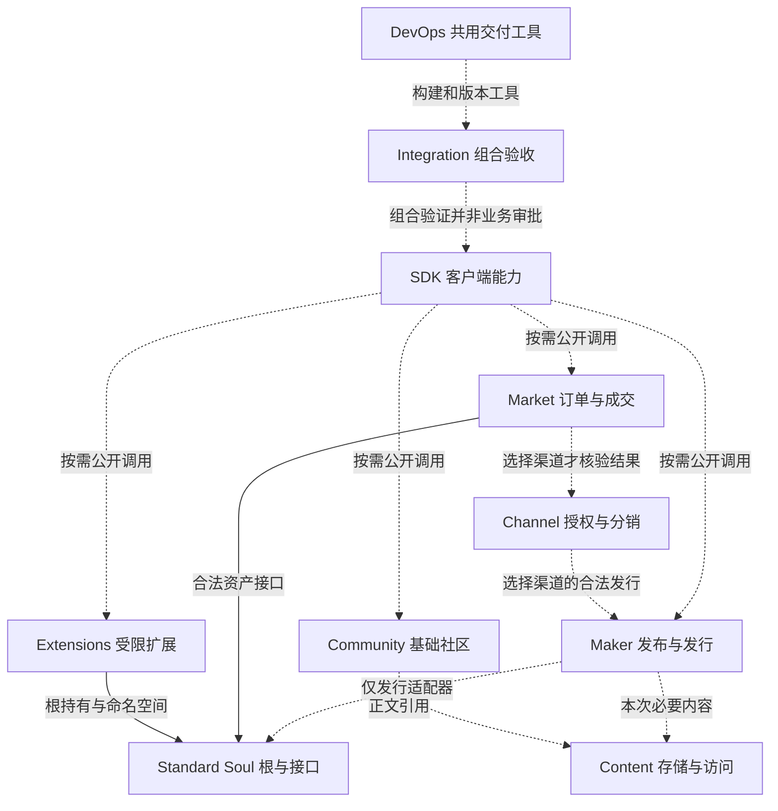

# Soulidity 合约模块与权限边界汇总说明

本轮施工前校准以[边界决策](open-ecosystem/CONSTRUCTION_BOUNDARY_DECISIONS_CN.md)为准：三类基线、B0、owned-only 构造、授权与收入生命周期、跨模块证明、暂停恢复、15 个保留维护单元、视觉及原产品分支已补充。原九表157条逐项见[范围追踪](open-ecosystem/ORIGINAL_SCOPE_TRACE.json)；精确函数／ABI／Cap 与运行验证仍需关口0及后续施工完成。[移交提示与材料](SOULIDITY_CONSTRUCTION_HANDOFF_CN.md)。

日期：2026-10-10。版本：1.2。阶段：Plan，研发及迁移输入。范围：开放资产、独立模块、Maker 中间状态、权限、渠道与市场分离，以及内部生态化的量化行动计划。

Maker 与 Soul 独立开放；Soulidity 和 Animacraft 提供可替换的操作入口。**渠道授权与分销、交易市场分别建立仓库、维护职责和服务权限域**，通过公开接口按需联动。目标新增 10 个仓库，分 3／2／5 三批推进。下文的仓库、频道、视图、合同和流水线数量都是建设目标，尚未创建或启用；仓库名执行时核对可用性。

本说明汇总开放生态文档继续审核记录及之后的组织、模块和量化讨论。用户确认的开放资产、独立接替、渠道与市场分离优先；其他粒度、岗位映射和数量为推荐实施方案。原产品目标、Owner、Delivery／DEV／BUG、M1–M4／S0–S14／G1–G5 和 CURRENT 保留。文档完成不关闭原产品或全合约重构目标。

## 1 阅读入口和依据

| 材料 | 用途 |
| --- | --- |
| [开放资产与独立用户旅程架构说明](SOULIDITY_OPEN_ECOSYSTEM_RD_ADDENDUM_CN.md) | 完整产品方向、费用、基础设施、升级和接替策略 |
| [对象与权利关系](open-ecosystem/OBJECTS_AND_RIGHTS_CN.md) | 工程、快照、资产、版本、资格、协议、控制权和收入 |
| [入口权限与依赖矩阵](open-ecosystem/ENTRY_PERMISSION_DEPENDENCY_MATRIX_CN.md) | 38 类语义动作的主体、证明、状态、依赖与退出 |
| [状态与恢复](open-ecosystem/STATE_TRANSITIONS_AND_RECOVERY_CN.md) | 五个状态域、24 个状态码、38 条转移；已付和未知操作的恢复 |
| [Soul DOF 规范](SOUL_DOF_V1_REBUILD_CN.md) | 原三类组件、组合、整套交易、原生及上游业务范围 |
| [前轮继续审核记录](../output/open-ecosystem-review-2026-10-10/REVIEW_CN.md) | 前轮 9 类发现和当时准确源码及文档证据；保留历史范围 |
| [本轮汇总审核记录](../output/modules-permissions-consolidation-2026-10-10/REVIEW_CN.md) | 本次拆分、数量一致性、历史证据与待实施条件 |
| [生态标准化与并行重构输入](SOULIDITY_ECOSYSTEM_MODULARIZATION_SPEC_CN.md) | 模块性质、30 个语义能力单元、16 接口族、依赖、兼容、发布与并行规则 |
| [细化互操作案例](open-ecosystem/INTEROPERABILITY_CASES_CN.md) | 60 案例、16 不变量，逐项责任与量化条件；均未执行 |
| [机器可读模块清单](open-ecosystem/MODULE_DELIVERY_PLAN.json) | 与本文对应的 10 个模块、频道、批次和数量公式；不是已创建对象注册表 |
| [现行运行规则](../agent-management/OPERATING_MODEL.md) | 唯一八阶段交付流程、原角色和执行边界 |

本文作为总入口，详细对象、38 类动作和完整状态转移继续在三个附件维护。已有审核证据不改写为最新验收，也不重复建立任务板。

## 2 五个产品入口和十个责任单元

五个入口继续是社区与发现、交易市场、创作与发行、Soul 工作台、应用与体验。它们负责用户如何找到和操作能力；仓库负责独立维护与交付；链上包负责真实类型和升级边界。三者无须一一对应。

| 产品入口 | 调用的责任单元 | 边界 |
| --- | --- | --- |
| 社区与发现 | Community、Content、SDK；按需读取 Maker／Soul | 无社区注册也能创建、持有和合法交易资产 |
| 交易市场 | Market；选择渠道时另接 Channel | 订单授权不等于渠道授权；独立成交不强制接渠道 |
| 创作与发行 | Animacraft、Maker、Content、SDK；按需 Channel | 制作、发布、分销和最终发行分别成立 |
| Soul 工作台 | Standard、Extensions、Content、SDK | 每次按实际持有路径和具体权限操作 |
| 应用与体验 | 独立游戏／应用、Standard 和选用扩展 | 不强制共用引擎、市场或平台账号 |

Soulidity 是发现、管理、交易和应用的组合客户端；Animacraft 是制作、发布和可选分销工具。路由与编排帮助用户减少操作，但不能替代链上规则或持有用户总控制权。减少 gas、存储、费用、签名和操作时间分别实测。

## 3 十个新增仓库

| 模块 ID | 建议仓库 | 内部语义模块 | 权威状态与依赖 | 批次 |
| --- | --- | --- | --- | --- |
| SDK | `soul-sdk` | 读取、交易构建、错误、恢复和能力适配 | 不持有业务权威状态或钱包密钥；客户端分包按需引用 | 1 |
| DEVOPS | `ecosystem-devops` | 共用工作流、构建、制品、版本与运行工具 | 固定版本工具；无生产总签名权，不是用户运行依赖 | 1 |
| INTEGRATION | `ecosystem-integration` | 组合清单、接替旅程、外部示例和验收报告 | 记录实际候选与证据，不承载业务合约或审批中心 | 1 |
| STANDARD | `soul-standard` | Soul 身份／来源、类型、扩展命名空间与根操作约束 | 公开最小核心；不反向依赖渠道、市场、社区或平台 Config | 2 |
| CONTENT | `soul-content` | 引用／托管、续期、访问授权、私密恢复 | Sui／Walrus 与实际密钥设施；不取得资产转移或资金支出权 | 2 |
| COMMUNITY | `soul-community` | 资料、帖子、评论、关系和分页 | 社区实例与内容引用；不控制资产创建或发行 | 3 |
| MAKER | `maker-protocol` | 根与控制、版本发布、Pack、许可、资格／供给、发行适配 | 原产品维度唯一计数；Maker 核心不强制依赖 Soul，发行适配器按需依赖两者 | 3 |
| CHANNEL | `soul-channel` | 条款报价、接受／撤销、行为委托、渠道额度、分销费和服务收入 | 自身实例与精确资产版本；不依赖市场才能授权或合法分销 | 3 |
| MARKET | `soul-market` | 订单、托管、报价、成交、取消、结算和服务收入 | 必要资产与转移接口；不依赖渠道才能合法独立成交 | 3 |
| EXTENSIONS | `soul-extensions` | 组件／视觉、形态、经历、嵌套、Vault 及参考工具 | 独立子模块、命名空间和权限；不同扩展不共享万能写权 | 3 |

十个仓库是维护单元，不是十个 Move 包或十种 Cap。一个仓库可有多个独立包和参考实现；SDK、DevOps、Integration 无须产生链上包。扩展和发行适配器不为方便目录结构强制进入标准根包。渠道与市场明确独立仓库，分别规划真正的包与升级边界；合仓方案已被本次用户决定替代。

保留 `animacraft`、`soulidity`、`soulidity-docs` 和现有引擎／游戏仓库，不纳入“新增十个”的数量。Native、Foundation 原政策与历史谱系在现有 Soulidity 保留独立责任；不塞入公共标准或变成生态总 Config。完整去向见[标准化输入](SOULIDITY_ECOSYSTEM_MODULARIZATION_SPEC_CN.md)。SoulDesk 是否独立抽仓另行依据维护与发布需求评审，本轮不增加第十一个仓库。

## 4 渠道和市场的独立契约

| 问题 | Channel | Market |
| --- | --- | --- |
| 主要结果 | 有权主体同意特定渠道执行明确行为和分销条款 | 卖方建立订单，买方按有效报价获得真实资产或权益 |
| 权威状态 | 协议、行为范围、版本、期限、代次、渠道额度及自身收入 | 订单、托管／交付关系、报价、成交状态和自身收入 |
| 控制范围 | 仅已接受的渠道行为；不能修改 Maker 总供给或 Soul 根 | 仅订单与允许托管路径；不能修改渠道条款或取得资产总控制权 |
| 独立使用 | 通过 Maker 合法入口分销，无须进入 Market | 合法卖方直接挂牌／成交，无须选择 Channel |
| 暂停／退出 | 本渠道停止新业务，撤销和已得收入按原规则处理 | 本市场停止新风险交易，合法撤单、交付与领取出口分别验证 |
| 治理 | 本渠道实例配置、资金、必要暂停及实际包升级 | 本市场实例配置、资金、必要暂停及实际包升级 |

选用渠道的发行由 Channel 验证条款、委托与渠道额度，Maker 的实际写入口继续验证资格、资产权利和唯一供给；选用渠道的市场成交再由 Market 验证订单和实际交付。以绑定资产／版本／主体／动作／币种／金额／受益人／时效的不可伪造结果连接，证明／票据机制由实现评审，防跳过、重复使用和跨实例重放。能原子完成的授权消耗、付款、分配与交付在同一 PTB 完成；拆仓不拆散一次成交的不变量。

Channel 的 fee、额度和收入账本不写成 Market 的全局政策；Market 的托管权限不包含渠道代理权。渠道中止不自动取消其他市场，市场停用不自动结束其他渠道。跨模块取消或已付履约须遵守原协议，不能凭一个模块的状态虚构另一个模块的终态。

合法直接路径无需未选渠道的费用，仍执行资产本身许可、供给、资格及原经济条款。网页导流或只读展示不能仅靠链上协议判定用户必须抽成；公开读取不默认创建代理授权。系统也不能让已经接受并实际消耗的受限代理能力借直接入口绕过义务。

## 5 独立与联动的判定

| 必须独立的责任 | 必须联动且保持唯一依据的规则 |
| --- | --- |
| Maker 编辑器、链上发布、分销渠道、交易市场、社区和各应用 | 原资产 ID、真实类型来源、版本和历史权益 |
| 服务实例配置、服务收入、必要暂停、包升级 | 同一维度的供给／用户次数／资格，不能按渠道复制总量 |
| 内容阅读、扩展写入、Vault 支出 | 敏感写入口的实际根持有路径和最小权限证明 |
| 可替换客户端、公开读取节点和发布／读取设施 | 原意图、准确交易字节、真实收据和已付资源 |
| 各模块构建和维护节奏 | 一次发行／成交的付款、分配、计数、权益与交付原子性 |

开放意味着通过最小公开标准接入，不意味着不需要自定义 Move 或所有模块零依赖。必要类型依赖、资产权利和选用服务依赖分别登记；标准不反向依赖服务。发布涉及多个状态和存储系统时保留恢复记录，不承诺整个旅程单一交易。

下图表示目标调用与交付关系，虚线为按需接入或工程支持，不是已经验证的包导入图；实际包级依赖另在迁移清单记录。

## 6 权限清单和组合边界

下表是权限语义，不能按行机械铸造 Cap。已有 Control 的真实行为范围需逐项映射；暂未实现的分权记录目标和迁移条件，不宣称已经隔离。

| 权限 | 合法主体与范围 | 不包含的能力 |
| --- | --- | --- |
| Maker 根控制／发布 | 实际绑定该 Maker 的控制者；可委托时绑定动作与版本 | 他人 Soul、渠道／市场管理、素材版权和任意资金 |
| Maker 发行／资格 | 公开有效条件或明确受限代理；资产权威计数校验 | 复制总额度、无限发行、篡改旧版本权利 |
| Soul 根控制 | 实际持有人或经过验证的容器控制路径 | 平台默认接管，缓存 owner 冒充持有人 |
| 单扩展写入 | 根路径允许且授权到指定命名空间、动作、期限、额度和代次 | 任意可变 UID、整根写权、跨扩展操作 |
| Vault 提款／资产转移 | 原规则认可的完整支出证明；不新增通用支出委托 | 内容读取或使用应用的权限 |
| 内容读取／解密 | 指定主体、内容、版本、政策和实际密钥条件 | 作品控制、提款、退款、收回已保存明文 |
| Blob 托管／续期 | 实际 Blob 权限路径；开放出资按受约束入口 | 改作品、改权益或自动取得解密权 |
| 渠道行为委托 | 已接受协议内指定行为和资产版本 | Maker／Soul 总控制、任意发行、其他市场配置 |
| 订单授权／托管 | 指定订单与资产的有效交付路径 | 渠道授权、独立改作品、无限转移卖方其他资产 |
| 社区维护 | 作者操作自己的内容；管理员只管理具体社区规则 | 资产登记许可、发行、交易和用户余额 |
| 服务配置 | 本渠道／市场／社区实例参数和新条款 | 资金提取、资产根控制、追溯改写成交 |
| 收入提取 | 原账本及条款认可的真实权利人 | 用户／创作者余额、其他服务收入 |
| 应急暂停 | 确有必要的本实例新风险动作 | 全生态暂停、无条件封死合法退出 |
| 包升级 | 实际 UpgradeCap、策略及所有有效控制路径 | 网站发布、用户资产签名或自动取得资产控制 |

可以同一笔交易组合 Maker 规则、所选渠道条件和市场结算；这些义务共同完成不要求合成一个总管理员。可以由同一主体持有几项已披露权限，但配置、资金、暂停和升级应能分别识别，撤销与恢复不混淆。相同 UI、角色名或 Cap 数量不是边界证明。

每个仓库登记源码维护、版本发布、生产部署、链上控制四类边界，共 **40 项适用性记录**。无链上状态的仓库注明链上控制不适用；这不是 40 把钥匙。实际 Cap 数量、治理成员／阈值、延迟、费率和预算依真实实现和原规则确定。

包升级与资产控制分开；多签、时间锁、Compatible／Additive／Dependency-only 和永久不可升级分别验证。一个包内共用升级边界；分仓不自动隔离升级。稳定的小型核心完成兼容、旧入口和接替验证后再评审不可升级。[Sui 升级策略](https://docs.sui.io/develop/publish-upgrade-packages/custom-policies)

## 7 Maker 中间状态和已付旅程

| 步骤 | 权威材料 | 责任归属 | 交接要求 |
| --- | --- | --- | --- |
| 编辑与保存 | 原工程、素材、编辑 revision 和备份 | Animacraft 或第三方制作端 | 工程可重新打开；本地未备份材料不承诺自动恢复 |
| 固定快照 | 确定字节、定义、权利、规则和摘要 | 制作端，发布端重新验证 | 在途快照不改；继续编辑形成下一候选 |
| 存储与认证 | 原随机密文、实际 Blob、收据、期限和托管关系 | Content 接口及实际 Sui／Walrus | 已成功资源复用；私密材料上传前加密 |
| 链上版本构建 | 原 Maker、Draft、检查点和真实交易 | Maker 发布入口 | 不新建根冒充恢复；未完成版本不能发行 |
| 版本可用 | 固定版本及必要内容条件 | Maker，Content 提供必要证明 | READY 不表示所有用户有解密权或资源永不过期 |
| 渠道接入 | 精确协议身份、条款、主体、版本和有效条件 | Channel | 同一协议 ENDED 为终态；再次同意另建协议 |
| 发行／市场成交 | 资格、计数、付款、三权利、交付与收入 | Maker 或 Market；选用渠道才连接 Channel | 能原子完成的义务全部成功或全部回滚 |

制作、内容、发布、渠道和单步交易使用附件的五个状态域。市场另维护订单权威状态；订单成交／取消与渠道协议终态不能混用。本轮不增加或冻结市场 ABI，也不把订单状态计入附件原 24 个状态码。

交易执行成功（EXECUTED_SUCCESS）、业务核对完成（SUCCESS_VERIFIED）和当前对象状态分别判断。原 effects／事件／历史版本证明原交付；后续转移或读回失败不能回到付款重试。未知结果查询原摘要；签名过期、404 或超时不单独证明从未执行。只有证据证明未执行且不可再执行（NOT_EXECUTABLE）才准备新的明确尝试。[Sui 交易生命周期](https://docs.sui.io/develop/transactions/transaction-lifecycle)

迁移包不含钱包私钥；有效签名和私密工程受保护。备份原快照、原密文、签名载荷、网络、摘要、对象、版本、已付步骤和兼容说明；另一客户端验证链上事实、支持能力和用户权限后接续。同步支持的多设备意图还需实际并发／CAS 机制，不能仅靠浏览器 Web Locks 宣称跨设备排他。

## 8 资产权利和原产品行为

保留 Creator → Player → Complete、Pack、Collection、Physical、内容、Vault、形态、经历和嵌套；新原生生产者不伪造 Maker 来源。开放接入不能删掉原收入、已购权益、初始内容或历史供给。

| 组件权利 | 装卸和交接 |
| --- | --- |
| REFERENCE | 准确来源／内容／许可引用，不是独立资产或所有权；卸下不返虚构对象 |
| SOUL_BOUND | 固定 Style 永久属于原 Soul，即使不显示；不能独售、返钱包或跨 Soul |
| TRANSFERABLE | 才产生真实独立 Item；安装原对象，卸下返回原 ID；已安装对象随整套合法交接，未安装钱包对象不随行 |

每 Part 一个固定 Style 单位，没有通用未启用 Free 库存。资格不是可自由转让 Pass；素材版权、Maker 控制、发行许可与服务授权分别认定。AgentPass 后置，不因模块拆分新增通用资产支出委托。

## 9 公共基础设施和平台退出

Sui 保存权威规则、对象和关系，Walrus 保存字节，客户端编辑、渲染和构造交易。无需 Soulidity 自有业务服务器，但实际 Sui 节点、Walrus 发布／读取设施及选用的密钥服务器仍需可用。

Walrus 字节公开可发现，未展示不等于私密；工程、素材和恢复签名包在客户端加密。Blob 有期限，续期需要实际对象和合法控制路径；不可删除不等于永久存储。自动续期需预算和提交者，不能仅靠链上规则自行发起交易。[Walrus Blob 管理](https://docs.wal.app/docs/walrus-client/managing-blobs)

静态客户端可采用 Walrus Sites，保留独立构建和公开网络／包／对象清单，不依赖品牌域名。实际密钥服务更换与权利人恢复路径需单独验证；已解密内容无法撤回。平台退出验收阻断平台专属入口，保留声明的公共基础设施条件，操作原资产与原意图。

## 10 内部生态化数量清单

| 建设项 | 目标数量 | 计算与范围 | 完成条件 |
| --- | --- | --- | --- |
| 新 GitHub 仓库 | 10 | 第一批 3，第二批 2，第三批 5 | 有实际模块制品／消费者／验证，不以空仓计完成 |
| 新模块 Slack 频道 | 10 | 每个责任单元 1；不重复建现有总交付／Bug频道 | 每频道登记仓库、责任人、任务入口、升级处理入口 4 项 |
| 表单入口 | 3 | 需求、Bug、发布；新增 0–3，现有可用入口复用 | 3 次试提交进入正确唯一记录和模块视图 |
| 工作视图 | 11 | 10 个模块视图＋1 个跨模块视图 | 复用原记录；一项任务不重复维护状态 |
| 维护职责合同 | 10 | 模块合同，不是新增十个岗位或常驻进程 | 每合同完成 10 字段并映射现有岗位 |
| 维护／验收责任映射 | 20 | 每模块 1 名维护责任人＋1 名验收责任人 | 原 Owner 保留；高风险实施者不能独自验收 |
| 共用审查职责 | 2 类 | 质量／发布；资金／权限／升级／迁移安全 | 具备资格的实际审查，不等于外部审计 |
| 逻辑流水线 | 20 | 10 CI＋9 版本发布＋1 跨仓集成 | 各真实成功运行 1 次，记录准确候选和结果 |
| 环境类别 | 3 | 本地／CI、集成验证、生产 | 明确实际网络与目标；不是新建三个链网络 |
| 基础交付物 | 60 | 每仓 6 类 | 按 §12 齐全且可运行 |
| 工程权限适用性记录 | 40 | 每仓 4 类 | 适用记录真实控制路径；不适用注明理由 |
| 初始核心验收场景 | 10 | 6 个正常／接替＋4 个权限／失败 | 精确环境和版本通过；不是完整安全审计 |

旧九仓方案被十仓方案替代：频道／合同 9→10，视图 10→11，责任映射 18→20，逻辑流水线 18→20，基础交付物 54→60，工程权限记录 36→40。表单、环境、审查类型和初始验收数量保持。以上数量不含保留的产品仓库，也不衡量链上管理员数量。

## 11 频道表单和 Agent 配置

| 模块 | 计划频道 | 建议维护职责映射 | 初始验收职责 |
| --- | --- | --- | --- |
| SDK | `#mod-soul-sdk` | LUQI，CIPHER 复核协议接口 | SENTINEL／实际独立验收者 |
| DEVOPS | `#mod-devops` | HARBOR | SENTINEL／实际独立验收者 |
| INTEGRATION | `#mod-integration` | FLUX；IRIS 管用户结果 | SENTINEL／IRIS |
| STANDARD | `#mod-soul-standard` | CIPHER 统筹，沿用原实现 Owner | 独立安全与质量验收者 |
| CONTENT | `#mod-soul-content` | LUQI，CIPHER 复核权限 | 独立安全与质量验收者 |
| COMMUNITY | `#mod-community` | 依原任务映射 CIPHER／LUQI；客户端 SABLE | SENTINEL／IRIS |
| MAKER | `#mod-maker` | CIPHER 统筹，沿用原实现 Owner | 独立安全与质量验收者 |
| CHANNEL | `#mod-channel` | CIPHER 统筹，沿用原实现 Owner | 独立安全与质量验收者 |
| MARKET | `#mod-market` | CIPHER 统筹，沿用原实现 Owner | 独立安全与质量验收者 |
| EXTENSIONS | `#mod-extensions` | CIPHER 统筹，沿用原实现 Owner；FLUX 接入 | 独立安全与质量验收者 |

这些是规划的职责映射，不替换活动任务 Owner，不代表新建账户。每份模块合同登记身份、职责、可写范围、输入输出、工具身份、权限、预算、验收者、交接位置、停用方法，共 10 字段。完整旅程设一个已有集成责任人；执行会话按任务分配，写入用隔离工作树。

| 表单 | 必填字段及数量 | 记录目标 |
| --- | --- | --- |
| 需求／改进 | 模块、用户与问题、预期结果、验收条件、相关链接：5 项 | 现有 DEV／Delivery，系统提供唯一 ID |
| Bug | 模块、环境版本、复现步骤、预期、实际、证据、影响：7 项 | 现有 BUG；查重并关联受影响模块 |
| 发布 | 模块、候选、目标环境、兼容组合、证据、恢复、执行责任与授权依据：7 项 | 现有 Delivery；状态与八阶段分开 |

模块采用本表 10 个 ID，允许多选受影响模块但只有一个主任务 Owner。系统追加记录 ID、Owner、状态、阶段、证据链接，不算用户填写字段。全局需求／Bug／发布表单在十个频道提供入口，不建三十张孤立任务表。

推荐运行节奏：每周 1 次跨模块集成评审，每两周 1 次交付演示和 1 次回顾；兼容现有周期后采用。初期每个已开工模块最多 1 个实现任务，同时维持原全局 1 条主要旅程＋1 条基础设施工作流；增加模块不自动增加并发。只有容量及原授权支持时再调整。记录交付周期、跨模块等待、返工、真实旅程成功和接替难度，不用仓库数或 Agent 数判断效果。

## 12 每仓交付和 DevOps

每个新仓库有六类基础交付物：`README.md`（用途与运行）、`MODULE.md`（接口／状态／依赖／权限／不变量）、`AGENTS.md`（执行和写入范围）、`COMPATIBILITY.md`（版本与迁移）、`RUNBOOK.md`（发布和恢复）、CI 配置及可运行验证入口。前五为文档，第六可含多个配置／脚本；60 是六类交付物乘十仓，不是固定六十个文件。共享规则引用唯一源，不复制十遍完整手册。

| 流水线类别 | 数量 | 具体结果 |
| --- | --- | --- |
| 仓库 CI | 10 | 本仓构建、适用检查、准确源码／制品身份 |
| 版本发布 | 9 | 除 Integration 外各仓固定版本制品、依赖与发布证据；非合约仓也可发布 SDK 或工具版本 |
| 跨仓集成 | 1 | 已声明版本组合的业务、权限与接替报告 |

二十条是逻辑能力，YAML 文件可复用或合并触发，不强制二十个配置文件或自动生产部署。Integration 的报告不另建版本发布流水线。现有客户端／游戏部署保留，切换明确公共依赖版本；生产执行、链上签名、资金和升级继续核实实际授权。共用工作流固定版本，不集中收集所有仓库生产密钥。

每份发布清单记录仓库／提交／未提交差异、工具锁、依赖、制品哈希、网络／包／对象、消费者组合、验证与未测项、权限和恢复路径。前端回退不撤销链上状态；跨包 API 的 `public(package)`、witness 私有构造与类型来源必须实际设计，不能把同包函数搬进不同仓库就声称独立编译。

## 13 迁移行动和关口

| 关口 | 本步量化结果 | 累计目标 | 退出条件 |
| --- | --- | --- | --- |
| 0 基线与映射 | 10 份模块迁移清单、10 份模块契约、1 张依赖／权限图 | 尚未新建远端对象 | 每模块准确工作区、提交／差异、包／类型／对象、调用方、Owner、原卡、目标路径和切换条件明确 |
| A 基础试运行 | 新增 SDK／DevOps／Integration 三仓、三频道、三合同、三模块视图；配置三类表单和跨模块视图 | 3 仓／3 频道／4 视图／3 合同／6 责任映射／6 逻辑流水线／18 交付物 | SDK 有真实消费者；共用流程跑通；1 条现有完整旅程通过准确组合验收 |
| B 标准与内容 | 新增 Standard／Content 两仓、两频道、两合同、两视图、四条逻辑流水线 | 5 仓／5 频道／6 视图／5 合同／10 责任映射／10 流水线／30 交付物 | 根持有／类型、内容权限与恢复、真实依赖和外部示例验证；保护绑定的新目标验收资产；历史资产留存不要求旧 ABI 兼容；B0 先准备市场再冻结 |
| C 业务迁移 | 依次 Community、Maker、Channel、Market、Extensions 五仓；各增加频道／合同／视图及两条流水线 | 10 仓／10 频道／11 视图／10 合同／20 责任映射／20 流水线／60 交付物 | 每迁一个就切换实际消费者，完成相关原旅程和独立接入；渠道和市场各自配置、退出和升级边界明确 |
| D 接替验收 | 10 个核心场景及相关模块反例；1 份最终组合与开放条件清单 | 数量不再增加 | 使用原资产／原意图接替；证据和未覆盖项准确；原产品完整验收另行继续 |

每模块迁移清单与契约可合并在同一 `MODULE.md`，关口 0 不另加二十份重复文档。每份合同可以放在既有岗位登记的模块字段，不必另建岗位。建议顺序是依赖与交接顺序，不中断当前原卡或自动重排优先级。

每次源码切换遵循固定六步：保存原差异和基线→在目标维护入口准备准确候选→独立构建及受影响验证→消费者引用固定版本→组合验收和记录→旧源码位置标明新权威来源并停止双边修改。保留必要历史和回退制品，不删用户稿件／已付资源，也不让两套发行器同时冒充目标权威。

移动源码优先保持真实包／模块／类型身份；需要拆开已有同包模块时，不能假定只改文件路径就保留类型。无法兼容的地方先列明确迁移、旧入口保护和用户影响，不能重发原 Soul 或重复付款来凑齐新仓验收。

## 14 十个核心验收场景

| ID | 类型 | 用户结果与证据要求 |
| --- | --- | --- |
| T01 | 正常／接替 | 第三方制作工具形成兼容快照；不取得原 Maker 控制或擅自改变版权 |
| T02 | 正常／接替 | 独立客户端发布 Maker 并按原规则发行；保留原供给、收入和三权利 |
| T03 | 正常／接替 | 非 Maker 生产者创建标准 Soul，真实来源与合法根持有路径验证 |
| T04 | 正常／接替 | 分别完成无渠道独立市场成交、无市场合法渠道分销，再验证可选组合；任一停用不默认封死另一方 |
| T05 | 正常／接替 | 替代客户端读写基础社区并操作选用扩展，保留原对象、形态／历史／嵌套和三权利 |
| T06 | 正常／接替 | 阻断平台专属入口后接续原存储／发布／已签操作；复用实际 paid／success 资源和备份 |
| T07 | 权限／失败 | 错 Cap／实例、错根路径、内容读变提款、局部写变跨扩展写均被拒绝 |
| T08 | 权限／失败 | 所选渠道凭证、条款、费用、额度与受益人不能跳过／伪造／重放；合法未选路径无渠道费 |
| T09 | 权限／失败 | 多渠道与直接入口并发不能超原供给维度；版本／控制切换不重置历史计数 |
| T10 | 权限／失败 | 未知、已执行成功待核对、签名过期和已确定失败分别恢复；不重复付款／发行 |

首要验收是新增独立被动外观／经历扩展后，固定旧市场的源码、依赖锁、配置和部署制品，原 Soul 仍可挂牌、取消、成交，市场被迫发布次数 0；涉及资金、授权或转移义务的能力另行适配／拒绝。完整执行条件及更多情况见 [60 个细化案例](open-ecosystem/INTEROPERABILITY_CASES_CN.md)。

十个是场景组，不是十次交易或十条单元测试。T04 拆分各子路径执行，资金／升级／旧入口、Collection／Physical、Pack、整套交易、密钥设施和完整原职责仍有专项验证。各项填准确候选、环境、结果、证据和剩余检查，未运行不填通过。

## 15 继续审核结论与当前差距

前轮发现九类问题均继续保留实施要求：根构造保证、协议实际执行点、私密存储、成功与读回、未执行证据、协议终态、控制交接、状态粒度、计数维度。前轮代码和验证结果保持当时范围；本轮只重读少量相关接口，具体源码哈希在本轮基线，不能称独立合约审核通过。

2026-10-10 汇总轮（v1.0）读取的 `standard::new` 仍返回有 `key, store` 的 fresh Soul，`runtime::Build`／`issuer::Build` 无存储 abilities，计数仍有 version／definition／wallet 维度。这些静态事实只支持相应边界讨论；合法持有路径、渠道完整隔离和真实接替仍在原重构任务验证。并行任务可能继续改变源码，引用现状时读取其 CURRENT 和唯一交接，不复制完成数。

汇总轮（v1.0）新增审核条件是渠道／市场不互为强制入口、权限和升级分别映射、联动结算不拆原子性、所有数量随九仓改十仓一致、模块职责不覆盖原 Owner、历史审核不冒充最新证据。详细结论见本轮审核记录。

## 16 评审承接和未定参数

本轮复用[产品工程评审模板](../agent-management/templates/product-engineering-review.md)，手册 v1.0，1–4、6、7、8.3–8.4、9、12 节，阶段 Plan 文档汇总。依附原 DEV／BUG／Delivery 和合约职责记录：产品／组织数量一致性与文档结构核对通过；合约分包、资金、升级、密钥、迁移和运行接替待实施验证；EVM／金融收益模型不适用，本轮无此新范围。

模块性质、标准最小核心、Native／Foundation 去向、SDK 按需能力、渠道存量处理、权限分类、选择验证／发布和并行策略已在[标准化输入](SOULIDITY_ECOSYSTEM_MODULARIZATION_SPEC_CN.md)中选定；其中建议不冒充用户确认或部署事实。剩余实施参数：真实包数量与依赖、Cap 清单、治理持有人／多签阈值／延迟、费率、期限、续期预算、密钥恢复、实际审查容量和日历。研发基于原规则和实测填写，不能把本说明中的固定仓库数量推导成固定管理员数量或自动批准收费。新仓名称、已有频道／表单是否可复用在执行前查重；总新增目标如有变化显式更新清单。

本轮交付范围是汇总、标准化契约、细化案例、文档调整和审核证据。有限只读 Agent 复核仅服务当前文档工作；没有创建常驻模块 Agent、GitHub／Slack 对象、变更链上权限或部署。60 个案例均 Not run。后续指令启动实际重构时，在原记录先完成关口 0 的精确映射，再按关口 A 推进真实候选。

## 17 全生态标准化承接

新增[标准化输入](SOULIDITY_ECOSYSTEM_MODULARIZATION_SPEC_CN.md)和[机器接口契约](open-ecosystem/MODULE_INTEROPERABILITY_CONTRACTS.json)确定 10 个新增模块、5 类保留职责、30 个语义能力单元、16 个接口族、32 项决策、16 个不变量及 38 类语义入口的责任和案例。30 是能力划分，不推定包／UpgradeCap 数量；精确 ABI 与所有原生产函数仍需在真实候选逐项映射。

60 个细化案例复用原 T01–T10，其中 57 个必需设计案例、3 个条件案例；条件预留／租赁／抵押不新增产品承诺。新增被动扩展与固定旧市场是首要验收，其他案例涵盖存量权益、存储／私密恢复、组件与容器、渠道／市场、各游戏／社区、旧入口、权限与并行工程。验证传播不等于发布传播，不改变所用契约的消费者强制发布目标为 0。

原组织数量不变：10 仓／10 频道、3 类共用表单、11 视图、10 Agent 合同、20 责任映射、20 逻辑流水线、3 环境、60 类交付物和 40 权限适用性记录。建议先用 2 个隔离实现槽＋1 个只读验证槽＋1 个协调槽，在原全局 WIP 内并行子项。具体实施与运行证据仍在原重构和产品记录维护。
