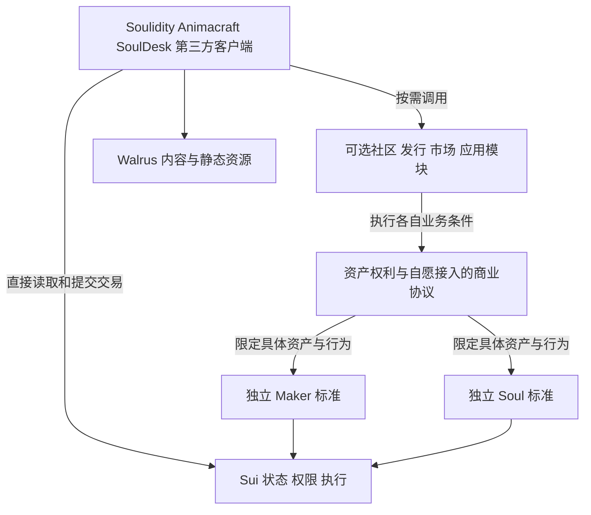

# Soulidity 开放资产与独立用户旅程架构说明

本轮施工前校准以[边界决策](open-ecosystem/CONSTRUCTION_BOUNDARY_DECISIONS_CN.md)为准：三类基线、B0、owned-only 构造、授权与收入生命周期、跨模块证明、暂停恢复、15 个保留维护单元、视觉及原产品分支已补充。原九表157条逐项见[范围追踪](open-ecosystem/ORIGINAL_SCOPE_TRACE.json)；精确函数／ABI／Cap 与运行验证仍需关口0及后续施工完成。[移交提示与材料](SOULIDITY_CONSTRUCTION_HANDOFF_CN.md)。

日期：2026-10-10。版本：2.6，承接全生态标准化与并行重构输入、固定旧市场首要验收和 60 个细化案例；三个实施附件同步至 1.3。面向：产品、Move、前端、SDK、测试与交付研发。

本文给出新的目标架构、尚未确定事项的推荐策略、现状差距和验收要求。用户已确认的方向与本文提出的方案分别标明；方案是研发评审与实施输入，不能据此宣称合约已改造、生产已部署或权限已锁定。v1.1 与 v2.0 分别保留在 `output/open-ecosystem-design-2026-10-10/previous-v1.1.md`、`previous-v2.0.md` 作为历史恢复文件。

研发先读[合约模块与权限边界汇总说明](SOULIDITY_CONTRACT_MODULES_AND_PERMISSION_BOUNDARIES_CN.md)，再按本说明和以下附件落实实际模型。汇总说明收录继续审核结论及后续内部生态化计划：新增 10 个仓库、10 个模块频道、3 个表单入口、11 个视图、10 份模块合同和 20 条逻辑流水线，均是建设目标。附件中的对象、入口和状态名称是语义索引，需映射到真实类型、函数与恢复机制，不是已冻结 ABI，也不要求逐行新增对象或包。

| 实施附件 | 解决的问题 |
| --- | --- |
| [标准化与并行重构输入](SOULIDITY_ECOSYSTEM_MODULARIZATION_SPEC_CN.md) | 十模块与保留职责、接口、变化分类、选择发布和并行策略 |
| [互操作案例](open-ecosystem/INTEROPERABILITY_CASES_CN.md) | 60 细化案例与 16 不变量，承接原场景与责任 |
| [对象与权利关系](open-ecosystem/OBJECTS_AND_RIGHTS_CN.md) | 哪些是资产、工程、版本、资格或协议；谁拥有和控制；哪些一致性必须共同维护 |
| [入口、权限与依赖矩阵](open-ecosystem/ENTRY_PERMISSION_DEPENDENCY_MATRIX_CN.md) | 每个动作由谁执行、需要什么证明、修改哪些状态、有哪些必要依赖及退出路径 |
| [制作、发布、分发状态与恢复](open-ecosystem/STATE_TRANSITIONS_AND_RECOVERY_CN.md) | 中间状态如何组合；签名未知与已付步骤如何接替；什么条件才允许正式发行 |

本轮旧文件备份与文档核对记录保存在 `output/open-ecosystem-implementation-docs-2026-10-10/`。历史部署事实按原日期保留；目标架构与现行交付状态分别维护。

前次继续审核的修改、逐项结论与恢复基线见[历史审核记录](../output/open-ecosystem-review-2026-10-10/REVIEW_CN.md)，范围为主说明 v2.3／附件 v1.1；本次汇总及数量核对见[汇总审核记录](../output/modules-permissions-consolidation-2026-10-10/REVIEW_CN.md)。各轮核对结果保持其准确版本范围，不冒充本次合约验证。最新标准化结构与文档证据见[本轮目录](../output/ecosystem-standardization-2026-10-10/)。

## 1 总体结论与已确认方向

**建议采用“开放资产标准 + 对象范围内的权利与商业协议 + 独立业务模块 + 可替换客户端”的架构。** Maker 和 Soul 独立存在；Soulidity、Animacraft 和第三方产品围绕这些资产提供操作入口。平台退出后，用户可通过其他客户端或直接构造 Sui 交易，继续既有资产旅程。

五个板块继续保留为产品入口：社区与发现、交易市场、创作与发行、Soul 工作台、应用与体验。它们不是五个全局权限域，也不要求部署恰好五个合约包。协议、数据和权限边界按资产与具体行为划分。

用户已确认的方向：

- Maker 与 Soul 都完全开放，第三方可以独立创建、发布、管理、使用和提供工具；平台登记不是标准资产的创建许可。
- 各业务尽量解耦，直接通过钱包与 Sui 交互，不以 Soulidity 业务 API、账户、运营人员或团队签名为必要入口。
- 后续能够分别重构每个小模块，按明确接口、状态与权限边界交付，避免为了修改局部业务而重新改造全部系统。
- 当前 Maker 的制作使用 Animacraft；制作与链上发布、分发已经分为不同阶段。制作结果、内容存储、链上对象、渠道协议和发行之间的中间状态必须完整设计和恢复。
- 核心权威状态和可执行规则放在 Sui；文件、媒体、文档、密文与可发布的静态网站资源使用 Walrus；编辑、渲染和适合本地执行的运行任务由客户端承担。
- Maker 接入 Animacraft 时，另行同意该渠道的授权、分销与抽成；Soul 接入市场或应用时，同样按所需行为授权。
- Soulidity 消失不应使现有资产及原本可独立执行的用户旅程失效。社区先提供基础功能，复杂展示、推荐和运营规则以后细化。

本文推荐的进一步策略：核心不内置强制平台收费和全生态暂停；商业条件放在明确的资产权利与可选服务协议中；管理权按对象和职责分开；共同链上核心在验证完成后趋于稳定或不可升级；首先完成“平台断开后仍能操作原资产”的接替验收。

这一目标允许依赖 Sui、Walrus 及实际选用的密钥基础设施。它要求消除平台专属依赖，并为公共基础设施的访问、存储期限和密钥恢复设计接替路径，不能承诺在链或底层网络不可用时继续执行链上操作。

## 2 品牌定位与架构分工

Soulidity 更适合定位为**开放资产的发现、管理与交易工作台**；Animacraft 更适合定位为**开放资产的创作、发布与分销工具**。两者可以提供路由、交易编排、授权说明、报价、恢复和默认体验，帮助用户减少操作与交易成本。

同一产品可以串联多个步骤，但制作工具、链上发布执行器与渠道分销仍分别实现。用户当前在 Animacraft 制作 Maker，不意味着发布或分发必须始终经过同一个客户端。

“Router”适合描述其中的技术能力，难以完整表达创作、社区和管理职责。降低成本也是待测量的产品目标，需要比较 SUI gas、WAL 存储、服务费用、权利费用、签名次数和操作时间，不能仅凭合约拆分就保证更便宜。

| 架构层 | 负责什么 | 权限与依赖边界 |
| --- | --- | --- |
| 公共基础设施 | Sui 状态与执行；Walrus 内容；按需采用的加密与解密设施 | 使用公开接口及可替换访问提供者；实际存储、网络和密钥条件必须列明 |
| 开放资产标准 | Maker 身份、发布版本与必要发行约束；Soul 身份、来源与受约束扩展接口 | 核心不依赖平台社区、市场、分销渠道或全局业务 Config |
| 权利与商业协议 | 资产许可、组件权利、发行资格、分销授权、已购权益、收益归属 | 绑定实际资产、版本、主体与行为；由各自有效权利人决定 |
| 独立业务模块 | 社区、发行服务、市场、应用以及各实例的规则 | 只依赖自己使用的资产能力和协议；其管理权不外溢为资产总管理权 |
| 客户端与工具 | 编辑、展示、查询、报价、构造 PTB、签名、恢复 | Soulidity、Animacraft、SoulDesk、第三方工具可以替换；不保管默认的用户总控制权 |

图中为目标职责关系，不能据此认定已有包关系全部符合。发行适配器可以同时调用 Maker 和 Soul 标准，但不能因此让所有 Maker 操作都必须依赖 Soul，或让已经发行的 Soul 每次操作都必须输入原 Maker。

## 3 Maker：独立资产、公开版本、独立发行规则

### 3.1 推荐对象与控制模型

推荐 Maker 具有稳定的根标识、受约束的发布版本，以及绑定该 Maker 的控制凭证。为多渠道发行提供并发入口时，可使用共享的 Maker 根对象，由持有人拥有的控制凭证管理发布与配置；共享对象不表示任何人可以修改它。最终布局需结合当前 Product、Control、版权与供给模型评审，不凭本文直接迁移对象。

核心保留能维持资产自身规则的最小数据：身份、版本引用与完整性、合法控制者、来源与权利引用，以及发行确实需要的供给或资格状态。大型定义、素材和编辑工程放在 Walrus。分销渠道的推荐、服务费、账户状态和暂停不进入全体 Maker 的标准核心。

Maker 的“共享”主要表示多人或多个客户端可按许可读取、使用明确版本；控制权、素材版权、发行权、分销权和收入提取权仍分别认定。Maker 控制权转让也不能自动转让原作者版权或组件许可。

可编辑工程、固定发布版本和链上 Maker 控制权是三种不同的东西。导出工程不转让控制权；取得控制权不自动取得全部素材版权；新编辑不覆盖旧成交依据。具体关系见[对象与权利附件](open-ecosystem/OBJECTS_AND_RIGHTS_CN.md)。

### 3.2 发布与供给

建议发布版本固定内容摘要、组件权利、来源、发行约束和必要经济条款；后续修改形成新版本。已支付或已发行的权利绑定成交时的有效条款，不能被修改当前页面或渠道配置追溯改写。需要可变授权时，将可变状态与不可变的成交依据分开。

多个渠道发行同一 Maker 时，共用该资产的权威供给与资格状态，避免每个渠道复制一套额度后超发。渠道可有自己的额度或折扣，但其授权不能超过资产发行规则。未授权渠道无法仅凭 Maker 的公开文件获得发行资格。

供给、用户次数与资格的计数维度按原政策明确记录，例如产品／版本／定义／用户；不能擅自把原版本范围合并成跨版本全局额度，也不能为每个渠道另发一份总额度。版本更新或控制权转让不自动清零已有维度的历史计数；新版本是否有独立额度仍按原政策处理。

Maker 到 Soul 的发行通过最小生产者接口或发行适配器完成。来源、供给、付款和权利检查由真正负责该次发行的入口执行；Soul 保留可验证来源。标准来源说明谁从哪个源对象发行，不自动证明作品原创、版权合法或生产者安全。

Soul 不强制由 Maker 创建，第三方也可以有独立生产者。客户端明确区分原生来源、第三方来源和已验证能力；不将平台认证变成标准创建的门槛。

### 3.3 必须保留的原业务

现有 Creator → Player → Complete、Pack、父 Maker 版本与来源、Part／Item／Style、许可、发行资格和收入关系继续逐项保留。REFERENCE、SOUL_BOUND、TRANSFERABLE 三类组件权利沿用已确认含义；只有对应规则允许时才产生可自由转移的 Item。解耦不能把只读引用改成所有权，也不能让永久绑定组件因更换渠道变为可转让。

Collection 与 Physical 的原有规则、权限和退出同样按原职责保留。开放标准不把它们变成所有资产或所有渠道的必经模块；是否参与具体操作，以该资产和原旅程的有效规则为准。

### 3.4 制作与链上发布和分发之间的交接

当前制作工具是 Animacraft，但制作、发布、分发是不同职责。制作负责编辑工程、素材、组件和规则；链上发布负责把确定的制作版本变为可验证、可按规则使用的 Maker 版本；分发负责让该版本进入选定渠道并执行许可或销售。使用 Maker 发行 Soul 又是后续独立行为。界面可以串联这些步骤，但后台不能共用一个含义模糊的“已发布”状态。

本地 Maker 草稿不是已经可用的链上资产。已经有链上 Maker 根对象，也不代表版本已激活、内容已完整保存或渠道已获授权。以下划分是推荐的交接语义，具体名称映射到现有模型，不强制重排已有交易拓扑。

| 阶段 | 交付结果 | 可以进入下一步的证据 |
| --- | --- | --- |
| 制作与保存 | 可编辑工程、素材、草稿 revision；本地保存与工程导出 | 原工程能重新打开，制作校验通过；“已保存”不宣称已上链 |
| 确定待发布版本 | 固定草稿 revision、定义、素材摘要、权利与发行规则的制作快照 | 后续存储和交易使用同一快照；用户继续编辑会形成下一候选版本 |
| 内容准备与存储 | 必要素材、内容、密文和 manifest 的实际 Walrus 引用及生命周期记录 | 所需存储与认证完成、引用完整且可读取；局部成功不算整版完成 |
| 链上发布构建 | Maker 根、绑定控制权、版本记录及已有多步发布检查点 | 原交易成功证据、对象归属、版本与内容摘要一致；未完成对象不开放正式发行 |
| 版本可用 | 该版本完成必要封存或激活，并满足资产自身规则 | 使用链上状态与必要内容条件共同判定，不能只靠本地完成标记 |
| 渠道接入 | 针对实际 Maker 版本的有效分销或销售协议 | 授权主体、范围、币种、费用、时效和额度有效；未接渠道仍可保留独立版本 |
| 实际分发或 Soul 发行 | 对应许可、订单、权益或发行结果与结算记录 | 遵守 Maker 供给、原组件权利与所选渠道规则；结果与收益可独立读取和恢复 |

制作、存储和上链的具体调用顺序依照当前受验证拓扑：例如某流程需要先有策略对象才能准备密文，应保留实际前置关系。上表表达职责和完成条件，不承诺所有资源只能严格串行生成，也不要求先付全部费用才能保存制作工程。

推荐用公开交接清单连接制作端与发布端，至少记录工程标识与 revision、制作快照和内容摘要、素材引用及权限、发布 schema、目标网络、真实主体、必要费用规则、原发布意图与检查点、实际 Maker ID 和链上版本的映射。文件与工程标识不能冒充链上对象 ID；只有实际完成后才填入真实对象和收据，不把预览占位符当作发布依据。清单不包含私钥，签名材料按原恢复机制保护。

导出的制作工程、待发布清单、发布进度和真实链上结果是不同材料。可编辑工程与版本内容允许第三方制作或发布工具按权限读取；发布执行器仍需重新验证清单、真实链上状态和自身支持的协议版本，不能执行任意导入交易。用户可以在 Animacraft 制作后，换独立工具继续合法发布；已经上链的版本也无需依赖原编辑器继续分发。

本地制作默认不强制把每次编辑上链。为避免草稿只存在一个浏览器内，保留工程导出、素材备份与可迁移的恢复记录；用户可按需把受保护工程保存到 Walrus。没有导出、备份或可读取副本的本地数据，不能承诺平台或设备消失后自动恢复。

### 3.5 中间状态与异常恢复

制作状态、内容存储状态、链上发布状态和每个渠道的协议状态分别记录；已发行数量、订单与收入按各自权威对象计算。例如“制作新草稿已修改、旧版本可用、一个渠道有效、另一个已撤销”是合法组合，不能合并成一项全局发布状态。制作草稿和恢复进度可在客户端持久化；授权、版本有效性、供给与资金状态以链上为准。

| 中间情形 | 推荐处理 |
| --- | --- |
| 制作完成但尚未存储或上链 | 保留工程和待发布版本，可退出后继续；不假定已经分发或发行 |
| 部分素材已存储、已付款，其他步骤未完成 | 按原存储意图和实际收据核对，仅推进未完成部分；原成功资源与期限记录保留 |
| 内容已齐但链上发布未开始 | 发布端独立验证同一快照与实际内容条件；不重新制作或重复上传已可用资源 |
| Maker 根已创建、分块或激活未完成 | 恢复原对象和检查点；正式使用入口拒绝未完成版本；具体可退出范围按原状态机执行 |
| 交易已签名或提交，结果未知 | 查询原摘要和链上状态；不把超时当失败，不重新创建 Maker 或重复扣款 |
| 钱包拒绝、交易确定失败或某步需要重试 | 区分未签名、已签名和实际失败；按原意图及有效规则恢复，新的签名需对应明确的新请求 |
| 原版本发布期间，制作端继续编辑 | 在下一候选快照编辑；当前发布继续使用固定版本，不能静默替换素材或权利 |
| Maker 已可用但渠道未接入、到期或暂停 | 资产和版本仍保留；限制相应渠道新业务；已成交权利、订单与收入按原条款处理 |
| 内容到期、控制者变化、网络或客户端版本变化 | 重新核验实际权限、内容和兼容条件；执行续期、恢复或明确迁移；不能自动重签旧授权或重建原资产 |
| 用户中止或切换客户端 | 保留可导出的原工程、意图和成功证据；在兼容且有权的客户端恢复；已付费用与资产按原规则处理 |

恢复记录应能跨刷新、关闭浏览器和受支持的客户端迁移；并发窗口不能同时推进同一意图。新客户端必须依据真实交易与对象重新校验，不把本地数据库中的 COMPLETE 当链上证明。未知状态保持待核验；取消制作或中止发布不意味着已经支付的存储费用可退，也不自动删除已有内容或链上对象。

原交易成功但业务读回暂不可得时，进入“已执行成功、待核对”，不继续归为执行 UNKNOWN。原 effects、事件与历史版本证明原交付；当前归属或 revision 后来变化只影响下一步。签名过期也不单独证明原交易从未执行；确有未落链且不可再执行的完整证据时，才按恢复附件准备新的明确尝试。

界面沿用原页面呈现这些语义：明确“草稿已保存”“待存储确认”“链上发布未完成”“版本可用”“渠道未授权”等对应结果，并显示当前步骤、已完成部分、有无实际付款和下一项可执行操作。等待用户签名、上传进行中、结果未知和确定失败分别提示；支持继续、查询或合规退出，不以长期转圈代替恢复状态。名称可匹配现有文案，不能用“Maker 完成”同时表示制作完成与正式可分发。

## 4 Soul：稳定身份与可组合扩展

Soul 核心建议保留稳定 ID、schema、revision、实际生产者与来源、扩展描述，以及安装、读取、更新、卸载等受约束接口。资料、外观、内容、资产容器、形态、经历、嵌套和应用状态按已有需求成为独立扩展，使用明确命名空间、类型和版本。

DF／DOF 是组织与组合机制，**不会自动提供某项业务的授权隔离**。尤其是 DOF 子对象的可变访问需要经过父对象接口；将整个 Soul 的可变引用交给某个受委托者，可能同时暴露资产提款或其他扩展修改能力。必须验证实际入口、持有路径和整笔 PTB，而不是仅检查某个扩展内部的权限分支。[Sui 动态字段](https://docs.sui.io/develop/objects/dynamic-fields)

默认建议：持有人控制自己的 Soul；第三方只获得明确的读权限或具体操作权限。组件维护者拥有维护自己组件的能力，不能借此取得 Soul 的全部管理权。Vault 提款、资产转移与读取内容是不同权限，不能由“可使用 Soul”推导出来。

D26 选定 owned-only 创建配置：所有公开 fresh-root 出口以受约束构建／最终交付接口证明不可创建 shared／party Soul 根，完成后 key+store 自由转移成立。历史静态切片的 `new` 返回值不能据原生 finish 推断安全；第三方构造、解包及共享攻击须实际生产编译／字节码／执行证明，敏感资金与私密能力只开放已验证持有路径。[Sui 共享对象接口](https://docs.sui.io/references/framework/sui_sui/transfer#function-public_share_object)

标准扩展描述可用于能力发现，不等于所有客户端必须执行未知代码或展示未支持内容。第三方可以实现兼容扩展；客户端应保持可识别、可拒绝、可迁移的边界。已有组件和容器仍需遵守原权利、所有权与退出规则。

## 5 Animacraft 分销与其他渠道接入

### 5.1 默认推荐策略

Maker 默认独立于 Animacraft；创作者或实际有权授权的主体，自愿选择渠道。分销默认采用**非独家、范围明确、可停止新增业务的协议**，允许同时接入多个渠道。独家或特殊限制只有在有效权利人明确同意时成立。

分销协议建议至少表达以下语义，字段名称与对象布局由研发复用现有模型确定：

| 内容 | 必须明确的条件 |
| --- | --- |
| 双方与资产 | 授权主体、渠道主体、Maker ID、发布版本或明确版本范围 |
| 行为范围 | 展示、导流、代售、发行等具体动作；是否允许转委托 |
| 经济条件 | 收费币种、比例或固定额、计算基数、收款对象、尾差、协议版本 |
| 时效与状态 | 生效、到期、撤销、额度、必要的授权代次与有效性校验 |
| 已有承诺 | 已付订单、已发行资产、买方权益、创作者收入与结算义务如何保留 |
| 退出 | 停止新增业务、取消未成交订单、领取已得收入、解除相关授权的公开入口 |

协议只授予必要分销能力，不交出 Maker 总控制凭证、素材版权或任意提款权。分销不默认包含修改作品、无限发行、升级核心或永久抽成。

### 5.2 接受与执行

开放渠道可先在链上公布有效的协议报价或条款；有权的用户通过钱包交易选择明确版本并接受，后续操作由合约自动校验，无需 Animacraft 团队逐笔签名。若特定渠道确需审批，该审批仅限制自己的服务接入，不能阻止独立资产通过其他方式使用。

签名与入口必须绑定网络、资产、协议版本、受益人、必要的有效期与防重放条件。协议生效、发行、付款与结算中能原子完成的状态变化放在同一 PTB；文件上传等跨系统步骤保持独立的持久化恢复状态。

协议对象只是条款与同意的依据，约束必须接到实际授权消耗、额度计数、供给更新和结算入口。前端插入一条分账命令、或渠道包装函数检查过一次，都不能证明直接调用与组合路径不可绕过；实际写入入口验证所选渠道的有效结果，拒绝伪造、重放和跳过条件。合法直接入口仍执行资产自身规则，不支付未选择渠道的费用；普通网页导流无法仅凭协议记录强制链上识别。

旧协议结束保持终态；重新接入建立新协议／代次与新同意。D27 默认控制交接后新控制者确认新增代理行为，受控路径真实轮换；自由转移路径不使用依赖自动撤销的脱离根可重用权限。既有许可和义务按原条款；产品账本收入以当前真实有效 Control 提取，作者／服务收入按对应条款。A→B→A 不凭旧地址或当前地址相同判授权永久失效。

### 5.3 退出与既有权利

撤销或到期默认停止新的授权行为；已完成购买和发行的合法权利、应付收益以及原作品约束继续按成交条款处理。未完成订单按原状态机恢复或退出，不自动新增退款承诺。

通过未选择该渠道的合法直接路径操作，不应支付该渠道服务费；资产本身已有的有效许可、作者版税、供给和发行费用仍须遵守。渠道费与资产权利费用分别计算，不将 Animacraft 抽成写成所有 Maker 永久必经的全局费用。

同一模型适用于 Soul 接入市场、应用或其他服务，但不能强制所有业务使用一个万能授权对象。各模块表达自己的必要语义，并共用清晰的字段与 SDK 约定。

## 6 五个业务入口如何解耦

| 产品入口 | 负责的业务 | 联动方式与权限边界 |
| --- | --- | --- |
| 社区与发现 | 简介、资产展示、基础帖子和评论；后续可扩展发现能力 | 读取公开资产与内容；用户写自己的资料；社区管理只作用于相应社区规则和展示，不成为资产登记、发行、交易的先决条件 |
| 交易市场 | 挂牌、报价、成交、取消、交付与结算 | 用户选择市场并授予最小必要能力；市场规则只约束该市场；暂停新交易时仍提供合法取消、领取和退出路径 |
| 创作与发行 | Maker 编辑、发布、许可、Pack、Player 与 Complete | 编辑客户端和发行入口分开；第三方可使用原发布版本或自己的生产者；Animacraft 分销按第 5 节另行接入 |
| Soul 工作台 | 持有资产查看、装卸组件、内容、Vault、授权、形态、经历、嵌套等 | 是用户工具；按真实对象归属和有效权限构造交易；替代客户端可以继续执行相同入口 |
| 应用与体验 | 游戏、剧场、SoulDesk、Agent 运行、场景接入 | 每个应用管理自己的规则和状态，用户授予所需权限；平台展示和应用准入分开；各游戏不强制依赖同一引擎 |

社区基础内容对象、父子关系和分页查询路径应直接在 Sui 表达；正文和媒体用 Walrus。最小版本先完成简介、发帖、评论、按确定顺序分页与必要的用户编辑入口。复杂推荐、排序和具体论坛运营策略后续确定，不在本轮扩展为推荐服务建设。

共用查询、组件和 SDK 不意味着共用写权限。资产控制、社区管理、市场配置、应用运行可以被不同主体分别持有。读取别的模块已发布状态属于联动；要求别的模块管理员许可才能执行自己的核心行为属于需要消除或明确解释的依赖。

### 独立模块重构与交付

渠道授权与分销、交易市场按用户本次确认分别设为 `soul-channel` 和 `soul-market` 独立仓库；各自管理条款／协议或订单／托管、收入、配置与必要暂停。合法渠道分销不强制进入市场，合法独立市场成交不强制接受渠道。选用两者时通过最小公开结果接口联动，相关授权、费用、供给和交付保持原子且不可绕过；分别核定真实包和升级边界，不以分仓替代分权证明。

独立重构的单位应进一步小于网站板块，例如 Maker 编辑、内容存储与发布恢复、链上版本发布、渠道分销、市场订单、结算、基础社区和 Soul 扩展。每个单位有明确输入输出、权威状态、权限、公开接口、版本、失败恢复与验收职责，能在共同约定内分别修改、验证和交付。

模块之间通过公开对象与版本化接口连接，避免直接修改对方内部数据或使用跨模块总控制权。接口保持兼容时，重构 Maker 编辑器不应要求更换市场或重发资产；重构社区不应要求重新授权分销；升级某应用不应强制修改 Soul 核心。

需要共同维护的规则不能拆成互相冲突的状态：同一资产身份、来源、版本、总供给、用户次数与三类组件权利保留唯一依据；一次成交的付款与交付保持原子性。独立重构意味着明确接口与责任，不能让渠道各自发放一份“总额度”或让款项先分走再等待资产交付。

代码分目录不等于能够独立发布或拥有独立升级权限。同一包内的模块仍受该包升级边界约束；共享对象布局、共同类型、供给或结算不变量发生变化时，必须做明确的跨模块评审与迁移。真正需要独立发布且依赖可行的职责再拆包，不为形式独立堆叠无关包。

局部变更验证本模块及实际受影响的接口和原旅程；新的失败或共享规则变化再扩大范围。完整发布仍执行原 Release 检查。接口不兼容时，先确定唯一目标版本与显式迁移，不通过偷偷切换旧发行器或备用包来跳过问题。每次重构对应原职责记录，用户操作、资产来源、已购权益、原收入和恢复意图均需保留。

## 7 权限、授权与自动执行

### 7.1 不按“每板块两把总钥匙”设计

没有适用于所有官网或项目的标准权限数量。推荐先列出实际可改变什么、影响哪些对象、能转移多少价值和如何退出，再形成 Capability 清单。Sui 对能力的推荐重点是最小权限、对象绑定、有效持有人校验和撤销边界。[Sui 安全实践](https://docs.sui.io/develop/security/best-practices)

| 权限类别 | 推荐边界 |
| --- | --- |
| Maker 控制 | 单个 Maker 的合法控制者，执行该资产允许的发布与配置；版权和组件权利另列 |
| Soul 控制 | 实际持有人及明确的对象操作规则；不给平台默认总控制权 |
| 使用或分销授权 | 指定资产、版本、受委托主体、动作、期限、额度及是否允许转委托 |
| 服务配置 | 某个市场、社区或渠道实例的条款、准入和服务参数；不能改全体资产规则 |
| 服务资金提取 | 该服务真实收入账本与指定收款范围；不能因可配置服务而提取用户或创作者余额 |
| 应急暂停 | 有需要才设置，限制本实例的新风险操作；退出行为单独评审 |
| 升级权限 | 每个可升级包的真实 UpgradeCap 及其策略；不按网站菜单数发放 |
| 展示与内容维护 | 相应用户资料、社区范围或客户端发布资源；不能借展示权限接管资产 |

对于确实存在的收费服务实例，建议将配置与收入提取作为两项独立职责；确需应急控制时增加受限 Pause 权限；包升级另列。某个实例可能由同一多签持有这些凭证，但权限语义仍分开。纯客户端或无管理入口的核心不为凑数创建管理员。

复用 `permission-register.csv` 登记网络、包、对象或 Cap ID、真实持有人、所有生效入口、范围、多签、延迟、升级策略、暂停、退出与读取证据。检查公开入口、包内入口、旧包、包装对象、恢复路径和共享状态，不能只统计命名带 Admin 的结构。

### 7.2 授权的默认策略

默认授权限定到实际资产和动作；敏感授权显式提示有效期、额度和受益人，不预选永久全权。只读内容权限不包含提款；分销不包含转让资产；修改某扩展不包含修改其他扩展。平台账户和展示中的“已授权”标签不能代替链上有效性检查。

公开读取、按公开规则获取资格或购买，并不默认需要逐个用户取得管理授权。代发行、代管理、私密读取和资产支出分别核验对应规则；具体入口见[权限与依赖矩阵](open-ecosystem/ENTRY_PERMISSION_DEPENDENCY_MATRIX_CN.md)。格式可共享，不能再建立所有业务必经的万能授权中心。

撤销必须能由实际有权主体独立执行，无需受委托者合作或平台在线。可用授权对象、代次或实例内撤销状态实现，但不能把平台全局注册表设为所有第三方授权的必经设施。

资产转移后旧授权的语义必须明确。Sui 自由转移不能笼统假设存在通用转移钩子；只验证当前地址可能在“转出再转回”后使旧授权恢复。对要求转移即失效的授权，需要经验证的代次或受约束转移机制；未知容器与外部路径应拒绝敏感授权或明确其限制，不作普遍失效保证。

### 7.3 自动化的默认策略

授权检查、分账、许可验证等可在交易内自动执行。定时续期、周期任务、外部计算不会由合约自行发起：由用户客户端、用户指定的执行者或符合条件的第三方提交交易，权限与预算仍在链上校验。

自动化需要的权限由用户显式授予，限定对象、动作、预算、收款路径、期限与撤销。任何符合条件的执行者都能提交的维护操作优先设计为开放提交，执行者不能改变受益人或取得资产控制权。

AgentPass 继续后置；本轮不新增通用资产支出委托。现有 Grant 与未来 AgentPass 的接口及迁移按原计划核验，不将“自动搞”解释成默认允许 Agent 取走全部资产。

## 8 交易、费用与结算

推荐将资产自身条款与服务实例条款分开。最终报价明确至少四类成本：链上 gas、Walrus 存储、资产许可或作者权利费用、用户选定渠道或市场的服务费。相同币种可合并展示总额，但必须能追溯各收款对象和依据。

建议成交绑定报价对应的资产版本、服务协议版本、有效期、预期状态与最大支付额。合约按真实对象重新检查供给、资格、付款与分配，拒绝旧报价、错误币种、欠付、重复发行和错误受益人。默认费率、固定额和尾差算法从现有已确认经济规则继承；未定的新服务费留作实例参数，不在本文指定任意百分比。

能原子完成的付款、权利发放和资产交付使用同一 PTB；不允许资金已分走而资产未交付的半成结果。Sui PTB 的原子性只覆盖同一链上交易，不覆盖 Walrus 上传、跨多个交易或外部运行。[Sui PTB](https://docs.sui.io/develop/transactions/ptbs/prog-txn-blocks)

现有最终发行的线性 Build 必须在同一 PTB 内完成，不能像 Maker 多步版本发布一样保存为跨交易半成品。发布检查点、单步交易、内容可用性与渠道有效性分别记录；完整转移表与组合条件见[状态与恢复附件](open-ecosystem/STATE_TRANSITIONS_AND_RECOVERY_CN.md)。

市场可以按实际权利模型复用 Sui 商业设施或适配器，但不能假设所有外部对象都符合相同转移政策。选择市场不会把资产版权变成平台版权，也不能绕过合法作者收益与组件权利。Maker 控制权、Soul 和独立组件的成交分别评审。

版税默认在明确的发行或成交入口执行；通用格式或前端承诺不能让允许自由转移的资产在所有外部交易中自动强制分成。若某类资产确需跨市场的链上强制政策，应明确其转移限制、适配机制和兼容代价，并验证直接调用路径。已有权利与已确认机制先保留，不把“开放”解释为取消原有作者收益，也不新增未经确认的全生态转移税。

失败恢复继续沿用原意图、精确交易字节与实际摘要。未知执行结果先查询原交易，符合条件时仅精确重播同一签名交易；已经成功的交易不通过新意图重复付款、上传或发行。已执行失败与确定未执行且不可再执行分别核验，只有证据充分且原规则允许时才准备新的明确尝试；不能把换客户端、读回故障或签名过期变成自动重新购买。[Sui 交易最终性与幂等](https://docs.sui.io/develop/transactions/transaction-lifecycle)

## 9 不依赖自有业务后台的最小产品

### 9.1 数据和执行位置

| 信息或工作 | 推荐承载位置 |
| --- | --- |
| 所有权、Cap、授权、协议、版本摘要、供给、订单、收入、关系和恢复所需权威状态 | Sui 对象与明确入口 |
| 公开素材、帖子正文、说明、媒体、密文、静态资源；按用户选择备份的工程与恢复包 | Walrus，记录 blob 标识、完整性及生命周期；私密材料在客户端加密后上传 |
| 编辑、合成、渲染、展示、报价预览、交易构造、本地运行 | 客户端；关键规则在链上最终验证 |
| 分页、公开对象发现、状态读取 | 明确链上索引对象及公开查询接口；访问提供者可配置与替换 |
| 搜索、复杂推荐和缓存 | 后续可选能力；不作为核心资产和原旅程的执行门槛 |
| 受保护内容解密 | 客户端解密加实际选择的密钥设施；公开内容无需引入此依赖 |

不自建业务后台是可行目标；客户端仍需访问 Sui 节点、Walrus 发布与读取设施，私密内容可能需要独立密钥服务器。它们不是 Soulidity 的业务审批中心，但具有真实可用性和授权条件。

Walrus 的存储字节公开可发现，未上架或未展示不会形成访问隔离。未公开工程、私密素材和含有效签名的恢复包必须先加密，并设计合法解密与备份路径；公开引用及摘要不等于公开明文。内容是否可取得、用户是否有权解密及客户端是否会渲染分别判定，不能因单个用户无权限就宣布整版内容失效。[Walrus Blob 管理与隐私边界](https://docs.wal.app/docs/walrus-client/managing-blobs)

### 9.2 网站和查询的接替

推荐将静态客户端发布到 Walrus Sites，并同时提供可独立运行的客户端源码、构建说明和公开的网络部署清单。Walrus Sites 的资源存于 Walrus、资源索引位于 Sui，访问可经过门户与聚合器；门户本身也可以由其他人运行。[Walrus Sites 技术说明](https://docs.wal.app/docs/sites/introduction/technical-overview)

原域名和 SuiNS 可以是方便入口，不能是唯一身份。发布清单应包含链、包及类型来源、对象、客户端版本与资源摘要、支持的入口和可配置访问提供者。用户能根据公开标识取得客户端及原资产，而不是必须请求原平台 API 返回唯一操作参数。

链上数据设计需有分页和关系索引，例如社区 → 帖子、帖子 → 评论、Maker → 发布版本、服务 → 协议或订单；默认客户端不能依靠扫描整条链或平台私有数据库完成基础旅程。可选索引器提升性能时，关键授权、余额、结算结果仍以链上读取为准。

现有生产网站仍按当前部署证据管理。本文提出 Walrus Sites 作为目标发布策略，不宣称现有 Vercel 发布已完成替换。

## 10 Walrus 续期与私密内容恢复

### 10.1 存储生命周期

Walrus 存储有期限；不可删除不等于永久保存。延期需在到期前，使用实际 Blob 对象及符合系统要求的权限和费用，不能仅保存 blob 内容标识就保证可续期。[Walrus Blob 管理](https://docs.wal.app/docs/walrus-client/managing-blobs)

推荐发布时记录必要内容引用、实际 Blob 对象或托管位置、期限、完整性与续期路径；用户能够独立查看并续期。资产持有人或其他有权主体持有可操作的生命周期权限，不能只由平台钱包掌握。适合的公共资源可按实际需要采用允许第三方出资续期的共享 Blob 机制，不能强制所有资产改为同一种托管模型。[Walrus Move 生命周期示例](https://docs.wal.app/docs/examples/move)

自动续期默认可选：用户确认预算、期限和资金来源；任意执行者或指定执行者按受约束规则提交续期交易。没有资金或执行者在线时不会自动发生续期。客户端提前提示，并提供用户自行操作与内容备份路径。

若内容已经丢失或过期，不能承诺原网络自动恢复。再上传或换存储引用必须验证原内容摘要和实际有权主体，并保留原资产 ID、来源、已购权益和付款记录；不能借恢复重新发行或强迫重复购买。

### 10.2 受保护内容

Seal 的访问规则可由 Sui 表达，实际密钥服务仍由密钥服务器提供。访问政策在链上不意味着不需要密钥设施；选择的服务器及其公钥也是信任和恢复边界。[Sui Seal](https://docs.sui.io/sui-stack/seal)

推荐：固定目标网络实际支持的 Seal 版本、策略和服务器身份；条件允许时选择多个独立运营主体，并评审阈值和失效条件。不能假设失效服务器换一个 URL 就能恢复相同密钥，也不能将未验证的网络能力视为已部署。

对需要长期可恢复的私密内容，评审由合法权利人控制的加密密钥备份或等效恢复机制，明确哪些内容需要支持、谁可以恢复、如何保护以及如何保持购买和转移后的合法访问边界。默认不将明文或私钥上传链，也不绕过撤销规则自动给旧持有人永久解密权。具体方案需结合已有 Seal／Pack／Composable 内容旅程验证，未通过前不宣称私密内容脱离原设施仍然可恢复。

撤销能够阻止后续受控访问，不能收回用户此前已经解密并保存的明文或密钥。客户端和协议说明应区分未来访问控制与已经交付内容；恢复机制不能承诺二者同时可撤回。

## 11 升级、暂停与不存在的生态总管理员

推荐不存在一个能暂停全体独立 Maker、Soul、第三方市场和应用的 Soulidity 总管理员。资产许可控制、单一服务配置、资金提取、网站发布、密钥策略和包升级分别登记；用户选择某服务只接受其明确范围内的控制。

共同标准升级影响很大，建议分阶段治理：在开发验证期，明确实际 UpgradeCap 持有人与升级策略；发布稳定核心前，完成资产与权利兼容、旧入口、外部集成和退出验证，再评审将足够小且已验证的核心设为不可升级。业务层按需保留升级能力，升级治理与资产根控制分开。

过渡期敏感升级推荐多签与经过验证的延迟机制，具体成员、阈值和延迟由实际责任人及恢复要求确定；本文不冒充已批准配置。时间锁、多签、兼容策略、依赖更新限制与永久不可升级是不同控制。Sui 内置升级策略可以收紧；兼容升级仍能改变函数行为，不能用“compatible”证明资产规则永不改变。[Sui 自定义升级策略](https://docs.sui.io/develop/publish-upgrade-packages/custom-policies)

旧包不会随升级消失，依赖也不会自动跟随更新。对敏感状态必须验证旧入口、版本守卫、迁移及停在中途的恢复。不可升级、迁移、撤销权限等实际动作继续走原评审与授权边界，不由这份文档执行。

应急暂停限于本服务的新风险业务。已拥有的资产读取、合法取消、已得收益领取和退出分别验证；确有某种紧急情形必须限制其中一项时，明确威胁、范围和替代出口，不能笼统暂停全部以取得资产控制权。

## 12 合约依赖与兼容策略

“直接与 Sui 交互”表示客户端直接调用公开合约和系统入口；它不表示没有自定义 Move 包。对象类型、许可、供给、发行和结算需要实际代码承接。优先复用 Sui 原生能力，保留安全与互操作所需的最小必要依赖。

推荐 Maker 核心与 Soul 核心可以独立使用，二者各自只依赖所需的 Sui 底座；发行适配、市场与扩展再按实际能力引用。客户端格式复用不需要强制调用平台；真正共用链上类型或受约束操作时，允许依赖小型公开标准包。具体拆包以真实调用图、迁移可行性、发布限制和旧职责为依据，不以减少包数代替解耦。

同样的字段或复制源码不等于同一个 Sui 链上类型。需区别：公开格式兼容、相同标准类型兼容、具体能力兼容、业务准入和安全审查。类型来源由包及模块等身份决定；通用客户端只能按公开规则识别已支持类型与适配器。[Sui 对象模型](https://docs.sui.io/develop/sui-architecture/object-model)

避免第三方被迫依赖一个可变的全局资产目录、发行门控或平台 Config。标准对象可直接创建并使用；平台可以维护自己的推荐和兼容目录，但该目录关闭不得阻止资产直接操作。某项业务内部应保持唯一权威状态，不通过复制几个收费 Config 来伪造去中心化。

每项必要依赖记录：实际包与类型、对象输入、为何需要、谁能修改、失败影响、可替代路径和旧入口验证。仅获取内容定义的工具不强制依赖交易、私密库或 Vault；公开操作不为方便统一入口强制引入无关模块。

## 13 未定事项的推荐决策

以下是本轮的默认方案，不要求研发先把每项讨论完才开始差距映射。涉及永久权限变化、生产迁移、实际新收费或承诺的动作，仍按原批准流程处理。

| 尚未完全确定的事项 | 推荐策略 | 落地时需验证 |
| --- | --- | --- |
| Maker 与 Soul 的关系 | 两种独立资产；通过可选发行适配器关联；发行后保留可验证来源 | 是否还能完成原 Creator／Player／Complete 和 Pack 旅程 |
| 模块独立重构 | 稳定对象与版本化接口；按具体职责独立交付 | 真实包升级边界、共享类型与受影响原旅程 |
| 制作与链上分发交接 | 制作快照固定；存储、发布、渠道分别记录状态；恢复沿用原意图 | 已付局部成功、多步对象、编辑新版本和换客户端的恢复 |
| 共用标准的方式 | 小型公开链上核心加公开 schema／SDK；格式与真实类型分别识别 | 第三方真实包、标准来源、能力发现和迁移 |
| Maker 发布修改 | 新版本；已有成交依据固定；可变授权状态单独保存 | 旧版本、父来源、素材与供给边界 |
| 分销性质 | 默认非独家、限范围、限版本；撤销停止新增业务 | 渠道资格、并行额度、已购权益与已得收入 |
| 平台收费 | 可选服务协议收费；不设置标准资产必付的全生态服务税 | 原有版税／许可不丢失；报价币种与尾差一致 |
| 管理权限数 | 按对象与职责登记；服务配置、资金、必要暂停分开；升级按实际包 | 所有有效权限路径及多签真实持有人 |
| 核心升级 | 开发期明确控制，稳定后评审小型核心不可升级；业务层独立治理 | 旧入口、迁移、恢复与实际升级策略 |
| 自动授权与维护 | 钱包明确同意后按链上规则执行；续期开放提交或受限执行者 | 防重放、撤销、额度、预算与无执行者时行为 |
| 社区 MVP | 简介、帖子、评论、确定顺序分页；复杂规则后续细化 | 当前社区对象与用户原内容能否直接复用 |
| 前端接替 | Walrus Sites、公开可重建客户端、可配置公共访问提供者 | 无品牌域名、无原 API 时实际启动和完整旅程 |
| Walrus 续期 | 用户可独立续期，预算自动化可选；公共资源可按需接受第三方出资 | Blob 对象权限、到期前窗口与恢复流程 |
| 私密内容 | 实际 Seal 策略加独立运营边界；按权利设计密钥恢复 | 目标网络支持、服务器失效、购买与转移后访问 |

服务费率、升级多签成员及阈值、延迟时长、存储期限、续期预算和密钥恢复参数不能由通用架构推导成统一数字。研发可以参数化并给出实测建议；现有已确认规则先继承，尚未确认的实际值在发布前明确记录。

## 14 当前实现差距与证据边界

本次阅读的合约重构工作树为 `/Users/naoer/.codex/worktrees/soul-dof-v1-rebuild/soulidity`。现状依据为其中 `docs/codex/CURRENT.md`、其唯一指定交接、当前 `docs/CONTRACT_REBUILD_SPEC_CN.md` 与下列源码。该工作树仍在推进，引用时重新读取现行入口；本文不固定其包版本或局部完成数量。本轮没有运行新的合约验证，也未改变工作树的交付状态。

| 当前证据 | 已说明什么 | 与本目标的差距 |
| --- | --- | --- |
| `move/soulidity_standard/sources/soul.move` | 已有开放生产者、来源和扩展命名空间的最小标准接口 | 不等于任意委托者安全取得可变根，也不自动证明第三方发行的供给或版权 |
| `move/standard_examples/maker/` | 独立 Maker 示例通过自己的生产者发行标准 Soul，依赖较小 | 是集成示例，不能替代完整开放 Maker、版本许可、多渠道分销与现有商业旅程 |
| `move/soulidity_v1/sources/catalog.move` | 当前 Maker 创建读取 Config 门控，Product 绑定协议并取得经济策略 | 必须评审资产自身规则与可选服务条件的分离，不能宣称 Maker 已不依赖平台 |
| `move/soulidity_foundation/sources/economics.move` | 当前 Config、角色、报价与结算共同形成原生业务的权威状态 | 独立关闭发行与市场门控，不等于独立资产；同一管理权的配置与资金范围需逐项登记 |
| `move/soulidity_application/sources/vault.move` | 资产容器入口依赖实际 Soul 可变访问 | 扩展授权不能暴露整个根后顺带获得提款；需恶意 PTB 和容器路径验证 |
| `move/soulidity_content/sources/authorization.move` | 已有对象范围、主体、期限与代次等授权校验 | 转出再转回、旧授权、外部容器和恢复语义需完整验证；AgentPass 尚后置 |
| `move/soulidity_community/sources/community_posts.move` | 已有基础帖子、评论、关系与索引职责 | 优先复用；验证客户端直接查询、分页、内容读取和独立写入，不另建重复论坛模型 |

已读记录包括隔离本地网络上的兼容升级、独立市场／发行门控与部分真实交易验证；这些局部证据不表示全合约目标完成或完整 Release 成立，也不能被引用为本说明的开放分销、生产升级、完整私密恢复或平台消失演练已经通过。后续进展和原始收据继续以该工作树记录为准，避免复制成另一个完成口径。

D25 区分基线：完整新目标允许一致新包／类型／对象，不要求历史旧 ABI 兼容；历史资产／已付资源／会话留存，不强制迁移。对冻结新目标内的互操作和恢复保护该组原 ID／权利／来源／余额；真正需要不兼容迁移时另有明确方案与唯一权威／退出证明，不能以重铸原样本或重付原成功业务伪造验收。

Maker 制作与发布的补充依据为当前 Animacraft 候选目录 `tmp/bug005-publication-recovery/` 的 `maker-v8-draft-store.js`、`maker-v8-publication-transport.js`、`maker-v8-publication-store.js`、`maker-v8-publication-controller.js` 和 `maker-v8-publication-adapters.js`。源码分别表达本地草稿与导出、内容及 manifest 准备、持久化意图和检查点，以及 SCAFFOLD → BASE_CHUNK → COMPANION_OBJECTS → ACTIVATION_CHUNK 的发布推进。当前模型已有阶段划分，研发应优先映射和补齐其跨客户端交接与独立边界，不能把本文的概念阶段写成生产已完成的新状态机。

## 15 研发实施顺序与退出条件

使用原 Delivery／DEV／BUG 及合约职责记录。本文各节是需求与验收引用，不是新任务板；既有 Owner、M1–M4／S0–S14、原职责总量、CURRENT 续接指针及当前执行顺序保持。复用手册 v1.0 的 1–4、6、7、8.3–8.4、9、12 节，以及 `OPERATING_MODEL.md` 第 8 节的交付循环。

1. **Plan：依赖和权利差距映射。** 对每条原旅程列出对象、入口、费用、权限、版本、基础设施与退出方式；标出平台必经依赖；为每项现有职责记录保留、适配或迁移方式。先核验 Creator／Player／Complete、组件、Pack、市场、内容、Vault、形态、经历与嵌套全部有去向，同时绘出制作快照、存储、链上发布和各渠道协议的状态与交接关系。
2. **Code：先建立独立资产入口。** 复用现有可用标准与社区模型；建立资产自身规则和可选服务协议之间的接口，再适配原生发行、渠道和市场。敏感功能同时设计新旧入口守卫，不先删除收费或资格检查再补权限。
3. **Build／Test：构建并逐旅程证明。** 固定包、类型来源、对象、依赖、客户端制品和实际网络；运行必要的业务不变量、权限反例、原旅程和恢复验证。SDK 与前端通过同一公开入口实现，不另藏平台特权路径。
4. **Release／Deploy：完成评审后再按授权发布。** 使用原权限台账、迁移和安全评审模板；确认实际 Cap、旧包、收入、买方权益、存储与密钥策略。文档完成、VM 通过或本地升级不等于生产完成。
5. **Operate／Monitor：检验接替与生命周期。** 在真实可复现环境停用平台专属访问，验证替代客户端、独立续期、协议退出、查询和恢复。监控可以替换；到期和异常不能只在平台私有仪表盘里可见。

先将三个附件映射到原职责记录的实际对象、入口与守卫，再完成一条端到端接替旅程：Animacraft 制作固定工程 → 独立客户端继续原存储与发布 → 按有效规则完成一次原子发行 → 退出所选渠道后读取原资产、权益与收益。之后按相同边界补齐其他原旅程，不把第一条通过当作全部职责完成。

原卡或附件注明：手册版本、适用章节、当前 stage、实现状态、证据、剩余检查与退出条件。涉及资金、权限、升级或迁移时复用 `agent-management/templates/product-engineering-review.md`。本轮只形成说明与文档交接，不修改远端任务记录，也不将原产品状态改成完成。

## 16 核心验收：固定旧市场与原用户旅程接替

验收时关闭或阻断 Soulidity／Animacraft 的专属域名、业务 API、平台操作账户与团队签名入口；保留正常的 Sui、Walrus 和实际采用的公共密钥条件，使用独立客户端或可复现交易脚本操作**原资产**。另做公共提供者失效与内容生命周期演练，分别记录限制。

| 用户旅程 | 必须证明的接替结果 |
| --- | --- |
| 独立创建 Maker | 无社区注册、平台 Config 门控或团队签名；发布明确版本；其他工具可按许可读取 |
| 制作到链上分发的交接 | Animacraft 制作结果能按权限导出，在兼容独立工具继续存储、发布和分发；草稿标识、快照、真实 Maker ID 和版本映射一致 |
| 发布中间状态与恢复 | 部分存储付款、认证、分块、激活、签名未知和用户中止分别恢复；不重复创建、付款或发行；继续编辑不替换在途快照 |
| 单个模块重构 | 接口兼容时，仅替换该模块仍能完成受影响原旅程；共同类型或规则改变时使用明确迁移，其他已可用模块与资产权利保持 |
| 独立发行 Soul | 使用有效生产者与资产规则；来源、供给、付款和原组件权利保持；无需平台运行 |
| 原 Player／Complete 与 Pack | 对应源版本、已付资格、组件和原流程保持；不会因换客户端重付或重发 |
| 接入或退出渠道 | 用户独立接受、查看和撤销协议；新增业务停用；已购权益和已得收益正确保留 |
| 市场挂牌与成交 | 按所选市场及实际资产规则完成；服务费与资产权利费用区分；错误报价拒绝 |
| 市场暂停后的退出 | 按有效规则取消未成交挂牌、领取收入和取回可退出资产；无平台管理员逐笔批准 |
| 工作台与组件 | 读取、装卸、更新原对象；三类组件权利、形态、经历与嵌套不改变；不向委托者暴露全部根权限 |
| 授权与撤销 | 对象、主体、动作、时效、代次正确；撤销独立可执行；旧授权与转移限制实际验证 |
| Vault 和资金 | 真实有权主体能够操作；只读、分销、社区和扩展权限不能越权提款 |
| 基础社区 | 在替代客户端取得原简介、帖子、评论及分页；有权用户可以直接写入对应链上状态 |
| 应用与体验 | 已支持的本地或公开可接替运行方式可继续；原应用特有状态和权限公开可读可接入；需特定运行设施的行为列出实际接替条件 |
| 内容与续期 | 根据公开引用读取原内容；实际有权主体在到期前独立续期；预算不足或资源丢失按明确恢复路径处理 |
| 私密内容 | 合法访问与撤销保持；验证所选服务器失效与权利人恢复；不能用公开替换 URL 冒充解密恢复 |
| 未知结果与换客户端 | 查验原摘要、恢复原意图和已有状态；不重复支付、上传、发行或重复计入收入 |
| 成功执行与后续状态变化 | 原执行 effects／事件／历史对象证明原交付；读回故障不降为执行未知；当前归属／revision 的合法变化单独核验 |
| 原交易不可再执行 | 有完整未落链与不可执行证据才准备新尝试；超时、查询无结果或过期都不单独充当证明 |
| 协议执行点与控制交接 | 直接／旧入口、跳过渠道包装和伪造／重放结果不能越权；新旧控制者代理权与已有许可分别验证 |
| 私密交接与资源粒度 | 私密工程和恢复包上传前加密；缺解密权、未知渲染与资源真正失效分别处理；未选资源不阻断无关操作 |
| 旧包与迁移 | 旧入口不能绕过新条件；迁移中断可恢复；原 ID、来源、资产及权利逐项核对 |

每条验收记录具体网络、包与类型来源、对象／Cap、实际主体、权限、交易摘要、checkpoint、币种与金额、前后状态、原证据及恢复结果。复用 `docs/soul-dof-v1-preparation/templates/journey-execution.template.json` 和 `permission-register.csv`；未执行记为 Not run，无法支持明确记录限制，不以总测试数替代原旅程证明。

新增独立被动外观／经历扩展后，原 Soul 的挂牌、取消与成交仍成立；旧市场源码、依赖锁、配置、部署制品保持不变，被迫发布 0。必须用旧市场固定后才发布的独立扩展验证；同包 fixture 不能替代最终证明。带资金、授权、转移等义务的能力按实际契约适配或拒绝。其他变化／恢复／替换见[60 个细化案例](open-ecosystem/INTEROPERABILITY_CASES_CN.md)，均为待执行。

必须包含的权限反例：错误 Cap、错误实例、错版本、已撤销、已到期、转出再转回、旧入口、跨扩展、只读变提款、并发发行超额、重复支付、服务暂停后的退出。每条命题应对应可复现证据，不能用“链上可查”“用了 Walrus”“前端按钮隐藏”替代执行证明。

本目标完成的标准是：原职责映射完整；选定标准和实际治理通过评审；独立创建与协议模型真实实现；替代客户端完成适用的原用户旅程；所有未覆盖的基础设施条件和恢复限制明确记录并处置。当前文档完成只关闭本轮说明工作，原合约重构与产品交付继续按原记录推进。

## 17 研发参考与记录位置

本项目依据：

- [现有产品问题与架构](SOULIDITY_PROBLEM_PRODUCT_ARCHITECTURE_CN.md)、[生态与产品命名](SOULIDITY_ECOSYSTEM_CN.md)、[Soul DOF 重构方向](SOUL_DOF_V1_REBUILD_CN.md)。历史准备材料不替代当前工作树的真实源代码与证据。
- [产品与工程手册 v1.0](../agent-management/PRODUCT_ENGINEERING_HANDBOOK_CN.md)、[交付循环](../agent-management/OPERATING_MODEL.md)、[资金／权限／升级评审模板](../agent-management/templates/product-engineering-review.md)。
- [权限台账模板](soul-dof-v1-preparation/templates/permission-register.csv)、[旅程执行模板](soul-dof-v1-preparation/templates/journey-execution.template.json)。
- 当前合约工作树的 `docs/codex/CURRENT.md` 及其唯一指定交接、`docs/CONTRACT_REBUILD_SPEC_CN.md`、`docs/CONTRACT_REBUILD_COVERAGE.json`；实际实现和未完成职责继续在原位置维护。

外部技术依据已在对应条款引用，核对日期为 2026-10-10。正式实施时重新固定具体版本、实际网络与依赖；官方 latest 文档不能代替当前候选制品验证。

## 18 全生态独立维护与明确默认策略

按[标准化输入](SOULIDITY_ECOSYSTEM_MODULARIZATION_SPEC_CN.md)维护模块性质、权威状态、语义接口和消费者声明。Standard 不包含全部业务应用 schema；Market 分订单内核、资产语义适配和按需组合桥；SDK 按需子包。Native、Foundation 原政策与历史退出保留独立责任，服务配置／收入／暂停不变成生态总 Config。

32 项决策在机器契约分别标记用户确认和本轮选定设计默认。存量报价、真实预留、已履约与未知结果按不同规则处理；换客户端可继续原实例，换实例不隐式继承订单／余额／授权。变化按独立、兼容验证、不兼容适配、状态／类型迁移处理；只有真实消费者契约变化才要求联动，重新验证不等于重新发布。

原产品目标与经济规则不改；租赁／抵押仅作条件兼容案例。真实包／ABI／Cap／policy／密钥／费率／预算和运行证据由原重构任务填写，文档完成不等于部署或验收完成。
