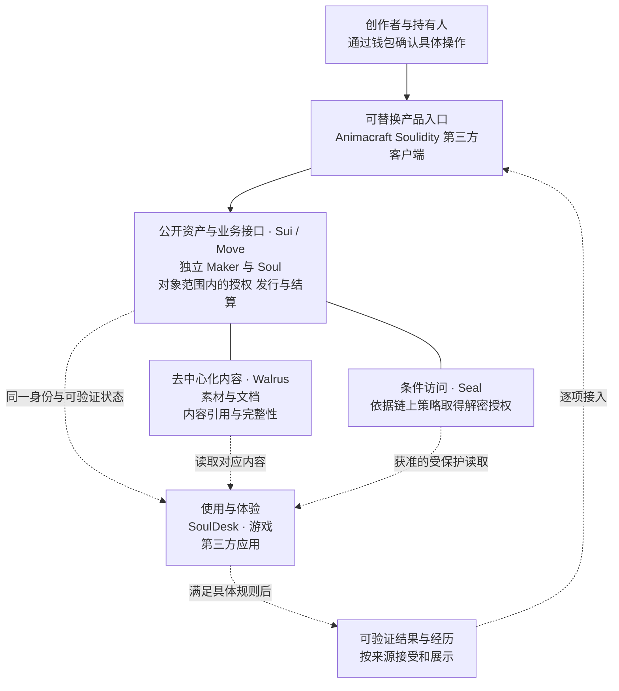
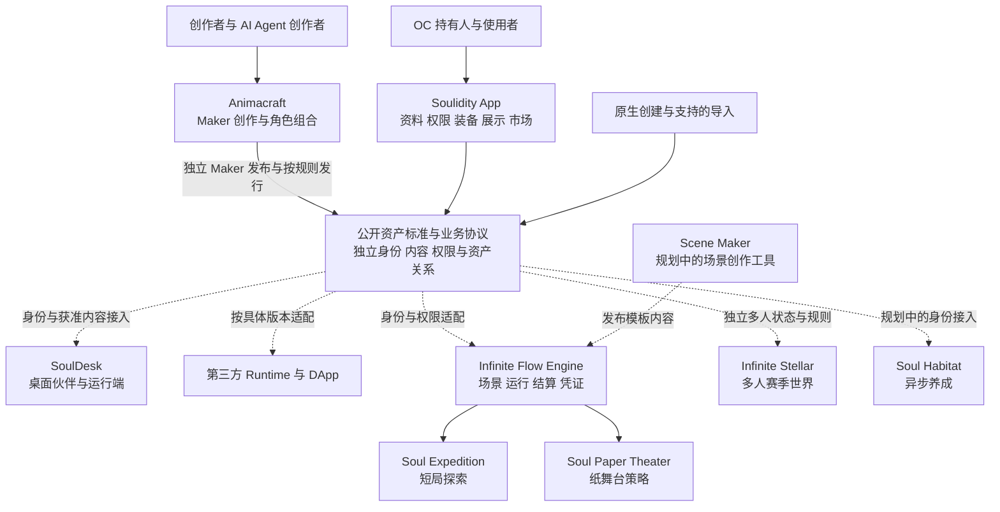
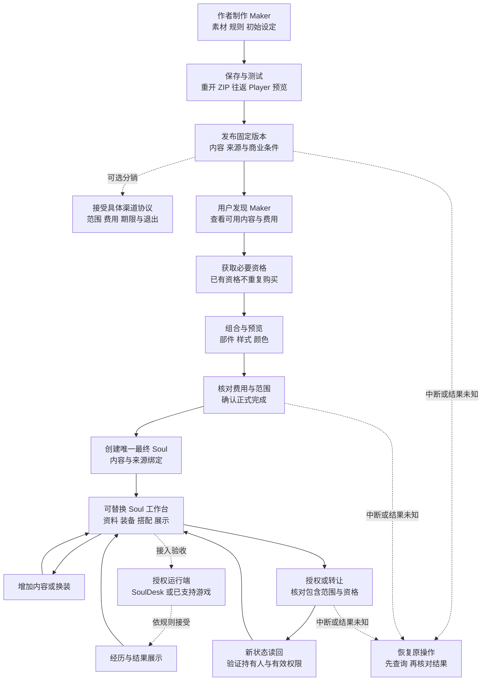
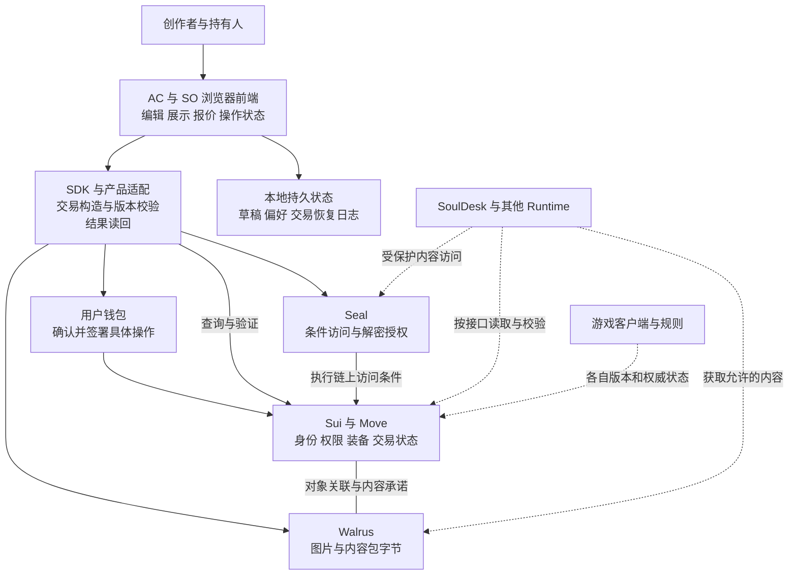

# Soulidity 全链上 OC 生态与产品架构

产品架构更新日期：2026-10-10。交付状态与旧 SVG／PNG 保留 2026-10-04 快照。面向项目成员、创作者与合作方，用于解释 Soulidity 为什么存在、各产品如何协作，以及技术机制如何支持用户结果。

**Soulidity 是面向设圈与原创角色的全链上创作与使用生态，围绕同一个 Soul，连接角色创作、内容管理、授权交易、组件装备与跨应用体验。**

核心业务状态与交易规则由链上协议承接，内容采用去中心化存储，编辑、渲染与 AI 推理由客户端和运行端完成。这样的分工让不同参与者可以核对同一角色的来源、持有关系与有效权限，减少角色跨环节使用时的重复整理和人工交接。完整生态仍在交付中，产品定位与已上线范围分开说明。

本文采用“用户问题 → 操作流程 → 产品职责 → 技术机制 → 验收结果”的顺序。问题来自项目负责人确认的需求方向和现有产品规格；问题发生频率、节省时间和付费意愿尚无本次外部用户研究数据。产品机制与用户价值分别描述，交付状态见文末。图中的关系表达产品职责，不能单独作为已上线证明。

当前目标为开放独立资产：Maker 与 Soul 不以 Soulidity／Animacraft 作为必经管理中心；五个网站板块是可替换业务入口。具体策略见[开放生态主说明](SOULIDITY_OPEN_ECOSYSTEM_RD_ADDENDUM_CN.md)，实施映射见[对象与权利](open-ecosystem/OBJECTS_AND_RIGHTS_CN.md)、[入口权限与依赖](open-ecosystem/ENTRY_PERMISSION_DEPENDENCY_MATRIX_CN.md)、[状态与恢复](open-ecosystem/STATE_TRANSITIONS_AND_RECOVERY_CN.md)。下方 Mermaid 更新产品职责，旧图片保留历史，当前对象关系图以实施附件为准。

合约模块、权限、渠道／市场分离和十仓量化行动统一见[合约模块与权限边界汇总](SOULIDITY_CONTRACT_MODULES_AND_PERMISSION_BOUNDARIES_CN.md)，不改变本文件产品入口分类或原交付状态。

## 产品描述

### 一句话介绍

Soulidity 是面向设圈与原创角色的全链上创作与使用生态，让创作者与持有人围绕同一个 Soul 创作、管理、授权和使用角色。

### 完整介绍

Soulidity 从原创角色的生命周期出发，把创作、整理资料、获取内容、搭配形象、授权、交易和使用连接起来。创作者当前使用 Animacraft 制作可重复使用的 Maker；制作结果、内容存储与链上发布分别交接，分销另行选择渠道。用户可以据此创建角色，也可使用其他有效生产者建立标准 Soul。公开协议承接身份、内容版本、访问授权、装备与交易规则，Soulidity App 及其他客户端提供操作入口。SoulDesk 和游戏提供角色的使用场景，Infinite Flow Engine 为适用的全链游戏提供场景、运行与结果凭证能力。

这套方案综合了角色制作器、版本化资料管理、权限控制、数字资产交易、模块化装扮和角色运行端等机制，并用链上身份与业务规则连接它们。创作者在发布时建立的内容关系、访问条件与适用的结算规则，成为后续应用可以按协议验证的共同依据。具体参考项目及功能差异需要独立的来源对照，本文不推断技术继承、兼容性或功能对等。

长期主张是 **Create Once. Live Across Worlds. — 创造一次，在不同世界中持续生活。** 持续身份与历史需要各产品明确接入；各游戏保留自己的状态、规则和公平性边界。

## 全链上架构改变了什么

项目负责人确认，原方案研究从既有 Web2 设圈与 OC 工具出发。以下左列是“平台账户与后台数据库承接业务”的架构模式示意，不是对每个 Web2 产品的调查结论。右列解释 Soulidity 的设计机制；实际开放情况仍按交付状态核验。

| 业务问题 | 平台账户与数据库模式 | Soulidity 的处理机制 | 用户与开发者获得的改变 |
| --- | --- | --- | --- |
| 谁持有角色 | 由平台账户记录归属，其他应用通过平台接口获取 | Soul 对象、真实原生归属与对应托管证明在链上核对 | 接入方可以验证同一持有状态；不能凭缓存 owner 或假定自动递增的轮次授权 |
| 什么内容与版本属于角色 | 文件及版本关系由平台后台或人工目录维护 | 链上内容关联与承诺，加上 Walrus 内容字节 | 多个客户端可按同一引用校验所用内容 |
| 谁可以读取与使用 | 由各平台登录、后台权限或人工交接控制 | SoulGrant、Paid Access 与 Seal 条件访问 | 获准读取与当前协议权限关联；许可声明仍分别表达 |
| 服装组件如何组合 | 库存和装备状态由各应用分别维护 | 组件身份、资格与持久装备约束在协议中表达 | 接入方能核对组件来源和实际装备状态 |
| 交易如何完成与核对 | 平台订单、支付和内部账本负责协调 | 具体链上交易按合约规则执行并读回验证 | 双方能核对交易结果和适用的结算关系 |
| 角色如何进入另一应用 | 导出资料、重新录入，或依赖特定平台接口 | 应用适配同一 Soul、内容版本与授权接口 | 减少重复建档；互操作仍需要实际接入与验收 |

核心架构收益是**共同可验证的业务状态、明确可执行的规则，以及围绕这些规则的产品组合**。它不自动带来更低费用、更快操作、永久存储或全部应用互通。前端可替换性也依赖公开接口、可获取的内容、可用的网络服务和兼容实现，不能仅凭采用区块链就认定已经完成。

### 全链上方案总图

[查看 SVG](diagrams/soulidity-framework/onchain-model.svg) · [查看 PNG](diagrams/soulidity-framework/onchain-model.png)

这张图先回答“规则与资料由谁承接”；后面的三张图分别回答产品分工、用户操作和技术依赖。箭头表示职责或目标接入关系，不表示全生态已经上线。

### 全链上的具体范围

**链上**承接身份、持有关系、内容关联、协议权限、装备约束与适用交易和结算。**Walrus**承接内容文件，保存期限与续期仍需管理；**Seal**按权限条件控制加密内容访问。**浏览器和 Runtime**承担草稿编辑、图像渲染、对话推理与工具执行。部分游戏的权威规则在链上执行，其他场景需分别说明执行模式。

因此，本文的“全链上 OC 方案”指核心业务协议在链上、内容采用去中心化基础设施的架构；不能解释为所有图片字节、草稿编辑或 AI 推理都在 Sui 上执行。普通 OC 无需先成为自主 Agent，也能使用角色管理与授权能力。

### 首创主张的证据范围

当前对外定位使用“面向设圈与原创角色的全链上创作与使用生态”。“首个覆盖 OC 完整生命周期的全链上方案”保留为待系统核验的主张，不作为已经证明的事实。

2026-10-04 的有限检索确认了相邻领域的先例：RMRK 的 ERC-6220 支持固定部件组合与插槽装备；Story 描述了链上 IP 资产与许可机制。两者说明部分链上能力已有先例，但这些材料不足以判断其是否覆盖 Soulidity 的完整目标流程，也不能证明 Soulidity 全球首创。[RMRK 官方文档](https://evm.rmrk.app/composable-equippable)、[Story 官方文档](https://docs.story.foundation/concepts/programmable-ip-license/how-does-story-protect-ip)

后续核验“首个”需要预先固定比较范围：面向外部 OC 创作者、开放 Maker、持久角色身份、内容与授权、组件装备、交易及跨应用使用；同时明确比较的是公开方案、可用产品还是完成部署的版本，并保留时间与来源证据。当前文档不将相邻项目列为已确认的直接竞品或实际代码来源。

## 用户与需求

| 参与者 | 想完成的事情 | 产品应交付的结果 |
| --- | --- | --- |
| OC 创作者和素材作者 | 制作作品，复用素材，表达使用条件并持续更新 | 可发布、可追溯、可继续维护的作品和内容 |
| OC 持有人与使用者 | 找全角色资料，管理搭配，授权使用或转让 | 角色、内容、资格、装备和操作结果之间关系清楚 |
| AI Agent 创作者及其操作者 | 经授权制作、发布和维护内容 | 可调用或可操作的产品路径、可检查的结果与可恢复的失败 |
| 场景与应用开发者 | 接入角色并提供互动体验 | 明确的身份、内容、授权和结果接口 |

外部 AI Agent 创作者仍是已确认的核心用户群之一；它与设圈及 OC 需求位于同一条创作链路。内部研发 Agent、内部试用实例和外部用户应分别统计。一个普通 OC 不必具备自主执行能力，也不需要先进入游戏才能获得资料管理与授权工具的价值。

## 用户问题与方案对应

下表中的价值是设计目标。最后一列定义如何证明目标得到兑现，并不表示这些验收已经全部通过。

| 用户问题 | 产品操作 | 技术机制 | 预期用户价值 | 可观察的验收结果 |
| --- | --- | --- | --- | --- |
| 图片、设定和补充资料分散，版本难辨认 | 在角色页组织不同类型的内容并查看版本 | Soul 身份关联、SoulContent 类型与版本、存储引用 | 找到同一角色的资料，辨认有效版本 | 关闭后重开仍能找到正确内容；旧版本与当前版本有明确区分 |
| 相似角色重复制作，用户难以参与组合 | 作者制作 Maker，用户在允许规则内选择部件、样式与颜色 | Maker → Part → Item → Style，图层、定位、颜色和组合规则 | 复用创作投入，让用户参与表达 | 保存和 ZIP 往返保留原作品；Player 的渲染与作者规则一致 |
| 新服装、扩展素材和独立组件容易混在一起 | 获取 Pack，选择内容，装备组件，保存搭配 | 进入资格、完成政策、组件实例、Soul 装备绑定分别表达 | 知道自己能用什么，以及实际持有什么 | 不把访问资格显示成资产；换装、卸下和重开后状态一致 |
| 购买和授权的范围难以解释 | 操作前展示对象、价格、范围、期限和适用条件 | Soul 所有权、SoulGrant、Paid Access 与许可声明分开 | 清楚理解本次获得的权利 | 实际读取和交易行为符合披露；撤销或过期后的访问被正确处理 |
| 转让后资料与使用权限需要逐项交接 | 查看转让对象与包含范围，完成转让后核对新状态 | 真实归属、内容关联、授权代次与明确的组件交接规则；要求转移即失效时采用可证明的受约束路径 | 减少遗漏和误交接 | 新持有人可读取允许的内容；三类组件按规则交接；旧授权、转出再转回和外部容器路径分别验证 |
| 角色制作完成后缺少持续用途 | 在桌面呈现、参与互动或进入游戏 | Runtime 读取、身份与版本适配、游戏独立规则 | 同一个角色有继续使用与表达的空间 | 一个已支持的第二运行端能识别角色并使用允许内容 |
| 经历分散，难以延续或判断来源 | 查看活动结果，并在允许范围内展示或接入后续体验 | RunReceipt、AcceptedOutcome、来源和版本校验 | 区分可验证经历与自行填写的叙事 | 结果可追溯且不能重复领取；本地教学不生成真实凭证 |
| 断网或刷新后不知道支付和发布是否完成 | 查看原操作并继续恢复 | 持久交易日志、原交易查询、链上结果验证 | 保住已付成本和编辑成果，避免重复操作 | 未知结果先查询；签名不冒充完成；重开能恢复同一操作 |

协议可以核对声明、记录和权限条件。原创性争议、未经许可的素材使用和圈内约定仍需要相应的内容与争议处理流程；加密访问也不能保证合法读取后的内容永远不会被复制。资料管理、授权和持续使用的收益，需要在真实用户流程中测量。

## 产品关系图

[查看 SVG](diagrams/soulidity-framework/product-map.svg) · [查看 PNG](diagrams/soulidity-framework/product-map.png)

下方 Mermaid 表示 2026-10-10 目标职责；链接的 SVG／PNG 为 2026-10-04 历史图。实线表示职责或已有关系，虚线表示规划、可选关系或待验收接入，均不代表完整生产验收。

| 产品 | 明确承担的职责 | 必须保留的边界 |
| --- | --- | --- |
| Animacraft | Maker 作者工具、发布执行器、Player 与可选分销 | 制作与链上发布分开；分销按明确协议；每次正式完成创建一个新 Soul；原三类组件规则保留 |
| Soulidity Protocol & App | 公开身份与业务接口，以及资料、权限、装备、展示、市场和社区工作台 | 资产独立，客户端可替换；市场、社区、应用只控制各自规则；所有权、访问权与素材许可分开 |
| SoulDesk | 桌面呈现、人格和资源使用、Agent 工作流交互 | 本地运行能力和链上身份分开；Desktop-Claw 上游归属保留 |
| Infinite Flow Engine | 版本化场景、有界单人运行、随机事件、结算和凭证 | 当前 P0 不包含通用多人组队、可变背包与自动多方分账 |
| Soul Expedition | 短局 Roguelike 路线与风险选择 | 教学与链上模式分开；引擎固定版本需核对 |
| Soul Paper Theater | 有限回合的纸舞台策略体验 | 本地教学不能生成真实 Soul 历史；链上部署配置需核对 |
| Infinite Stellar | 独立的多人赛季探索与竞争 | 不以引擎作为多人权威；身份延续不带来永久战力；转让 Soul 不转让赛季席位和文明 |
| Soul Habitat | 异步养成、资源约束与有限自主行为 | 规划态；首阶段拟使用不可提现 Life Credits，化身终止不销毁源 Soul |

Scene Maker 是规划中的工具方向。Soulidity Games 是四款游戏的介绍分组，不是统一运行架构。OCL 能力分级属于研究方向，不作为当前用户必须经过的入口。

## OC 用户流程图

[查看 SVG](diagrams/soulidity-framework/oc-journey.svg) · [查看 PNG](diagrams/soulidity-framework/oc-journey.png)

以下以 Maker 路径为例；Mermaid 表达新目标，SVG／PNG 保留旧快照。用户可以只管理角色资料或授权内容，不必走完所有分支。渠道分销为可选路径，发布版本与渠道状态分别读取；详细中间状态见恢复附件。当前验收见后文历史状态表与权威工作区记录。

可以用一个角色说明流程：创作者发布“月兔”Maker，用户选择外观并完成 Soul 创建，再获取允许使用的服装，在 Soulidity 装备并保存搭配。接入完成后，SoulDesk 读取获准的形象与内容；游戏按照自己的规则使用角色身份。故事描述可以编辑，可验证游戏结果则需要来自对应规则与凭证。这是流程示例，不是已经发生的外部用户案例。

验收时分别核对三个结果：作者作品没有在保存、发布和使用端丢失语义；持有人获得的资格、内容与资产符合披露；第二运行端正确使用同一身份并遵守权限。外部用户回来继续创作或使用，才构成持续采用的证据。

## 技术架构图

[查看 SVG](diagrams/soulidity-framework/technical-architecture.svg) · [查看 PNG](diagrams/soulidity-framework/technical-architecture.png)

Animacraft 与 Soulidity 当前确认采用“链 + 前端”架构。浏览器直接接入 Sui、Walrus、Seal 和钱包，不依赖自有业务后端、业务数据库或 SSR 服务。该约束不替其他独立游戏或桌面运行端决定全部内部架构。

连线表示逻辑依赖，Walrus 内容与链上对象的关联需由客户端和协议按各自职责验证；图不表示任意两层会自动同步。Runtime 和游戏接入需固定具体协议版本。

| 层 | 保存或决定什么 | 为什么放在这里 |
| --- | --- | --- |
| Sui / Move | 持有关系、授权、内容关联、装备约束与适用交易结算 | 多方可以围绕同一权威状态核对操作结果 |
| Walrus | 图片、文档、素材和内容包 | 大文件与业务对象分开，结合版本与内容承诺读取；期限和续期仍需管理 |
| Seal | 满足条件的加密内容访问 | 让读取与当前权限关联；不替代版权许可或内容争议处理 |
| 浏览器与 SDK | 编辑、渲染、发现、报价、交易构造与验证 | 用户通过产品直接操作，关键动作前重新核对实时状态 |
| 本地持久存储 | 未发布草稿、偏好及操作恢复材料 | 重开能够继续工作；本地缓存不冒充资产所有权 |
| Runtime | 动画、对话、推理、工具执行及本地交互 | 行动能力由具体运行环境提供，权限和预算按操作约束 |
| 游戏规则 | 场景状态、胜负、奖励和赛季进度 | 各游戏维护明确的规则与公平性边界 |

2026-10-04 基线中的 Animacraft v8 有 Core、Seal、Runtime、Output、Physical、Market、Release 七个包职责，与 Soulidity 组成八包联动发布；这是该版本的工程分工，不是新标准必须维持的平台绑定。新目标按实际类型、接口与升级边界重构。现有源码中的基础身份、内容、来源、装备、搭配和社区职责仍需逐项保留；源码存在不直接证明完整生产旅程可用。

## 保持一致的核心规则

1. **一个角色结果使用唯一最终 Soul 身份。** Maker、组件实例、Player 配方与 Soul 分别承担不同职责。
2. **角色身份与内容分开。** 内容按类型和版本关联；访问资格与实际可用的存储内容都要核对。
3. **权限按操作表达。** Soul 所有权、内容访问、素材许可、管理权和收益关系分别说明；转让不自动赋予全部著作权。
4. **三类组件权利保持。** 每个 Soul Part 至多一件固定 Style 内容；REFERENCE 是准确引用，SOUL_BOUND 永久留在同一 Soul，TRANSFERABLE 才发行真实独立 Item。当前目标整套交易交接当时已装的真实组件与永久绑定记录，不交接源 Maker／Pack 或卖方个人资格；未装 Free 不随该 Soul 成交，卸下不自动恢复旧选择。
5. **所有权与授权分别核验。** 要求转移即失效的授权使用可验证的代次或受约束转移机制；自由转移没有通用自动钩子。转出再转回、外部容器、旧入口与内容访问策略必须实际验证，不能承诺所有旧授权普遍自动失效。
6. **游戏历史按来源接受。** 角色记忆不自动成为游戏战力；模拟、教学和真实链上凭证分别表达。
7. **未知操作先恢复。** 签名、广播、链上成功和业务读回完成分别显示；查询同一交易，避免替换签名和重复支付。

## 交付状态与证据

以下为 2026-10-04 读取本地源码与执行记录形成的快照。本次没有重新签名、发送链上交易、运行完整产品验收或核验全部线上部署。已实现、已验收、已发布和已采用是不同维度。

| 产品或能力 | 已有证据 | 尚待完成或核对 |
| --- | --- | --- |
| Animacraft 与 Soulidity | 现行 v8 联动发布记录，Creator、Player、装备与市场相关实现，部分实站验收 | 原 M1–M4 未整体验收；真实发布、钱包、受保护解密、桌面与移动端及恢复矩阵仍需收口 |
| 当前 Maker 发布流程 | 最新 F02-L 记录 FINALIZE 主网成功、原浏览器显示完成，Root 已 ACTIVE | 公开 Plaza / Player 仍有内容承诺校验错误，发现、打开、渲染与重开仍未完整验收；链上成功不能替代可用产品交付 |
| SoulDesk | 桌面基础和部分身份、内容读取能力 | 最新协议兼容、品牌及安装包、实际发行与跨产品读取验收 |
| Infinite Flow Engine | 实验性 P0 合约和源码分发 SDK | 生产发布门禁仍阻塞，未独立审计；真实部署与模板集成需验收 |
| Expedition 与 Paper Theater | 客户端、Move 规则、本地 Rehearsal | 当前链上部署和固定引擎版本需核对；教学不能当作生产凭证 |
| Infinite Stellar | 测试网 canary 与可玩本地沙盒 | 未主网部署；生产证明、服务及发布门槛仍待完成 |
| Soul Habitat | 产品与协议规划 | 首个可回放模拟尚未作为已交付能力确认 |
| Scene Maker | 受限模板创作方向 | 创作者可使用的发布工具仍待建设 |
| 外部持续采用 | 已有内部岗位与试用准备记录 | 尚无本次可据以宣称完整外部创作循环或留存的证据 |

近期验收继续沿原 AC/SO M1–M4 与 S0–S14 执行；生态层 ECO 里程碑承接它们。本文不新增产品承诺、时间表或替代执行路线。

## 如何使用这份说明

面向创作者，使用产品描述、问题对应表和 OC 流程图，优先解释一次操作的结果。面向合作方，使用产品关系图解释接入位置及责任边界。面向工程团队，使用技术架构图、核心规则及现行版本证据定位实现。具体借鉴对象如需对外展开，应单独补充一手资料与逐项比较，区分参考机制、实际使用的技术和上游代码归属。

每当更新一项能力，同时回答：对应哪个用户问题、用户如何操作、哪个产品负责、哪个机制保证、什么证据说明成功。保持稳定产品逻辑与动态交付状态分开维护。

## 依据与维护入口

- [生态与产品总览](SOULIDITY_ECOSYSTEM_CN.md)：产品分类、品牌和网络方向；历史状态表不覆盖当前执行。
- [现行产品与交付事实](../agent-management/LIVE_PRODUCT_STATE.md)：权威工作树、架构约束与管理快照。
- [组织与运行规则](../agent-management/OPERATING_MODEL.md)：外部 Agent 创作者定位、内部与外部采用的区分。
- [AC 当前执行入口](../tmp/animacraft-v8-mainnet-release/docs/codex/CURRENT.md)：读取顶部现行状态，历史段不作为下一步指令。
- [原产品路线图](../tmp/animacraft-v8-mainnet-release/docs/codex/PRODUCT_DELIVERY_MILESTONES.md)：完整范围及用户行为约束。
- [Fresh Maker v8](../tmp/animacraft-v8-mainnet-release/README.md)：包职责、静态客户端与交易恢复。
- [Soul 当前源码](/Users/naoer/.codex/worktrees/f722/soulidity/move/soulidity/sources/soul.move)、[装备适配](/Users/naoer/.codex/worktrees/f722/soulidity/move/soulidity/sources/animacraft_equipment_adapter_v8.move)、[SPA 配置](/Users/naoer/.codex/worktrees/f722/soulidity/web/vite.config.ts)：本机权威工作树证据，非可移植公开链接。
- [Infinite Flow Engine](../../infinite-flow-engine/README.md)、[Soul Expedition](../../soul-expedition/README.md)、[Soul Paper Theater](../../soul-paper-theater/README.md)、[Infinite Stellar](../../infinite-stellar/README.md)、[Soul Habitat](../../soul-habitat/README.md)：各独立产品的实现范围和发布边界。

源头需求补充：2026-10-04 项目负责人在本任务中确认，方案从设圈与 OC 问题出发，结合已有 Web2 解决方案形成全链上产品。本文以问题与全链上业务机制共同组织介绍，保留已确认的外部 AI Agent 创作者定位；首创性作为待核验主张单独管理。
