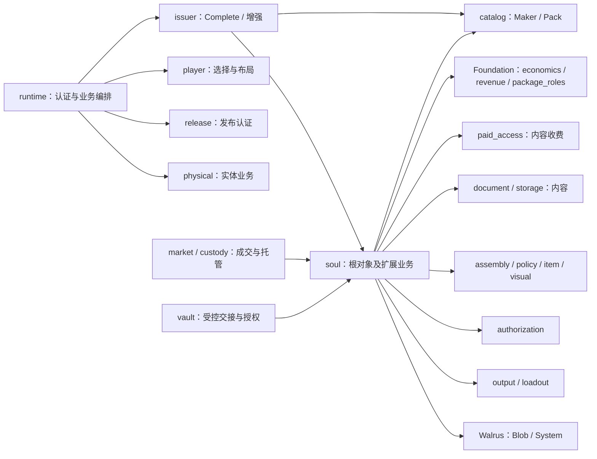
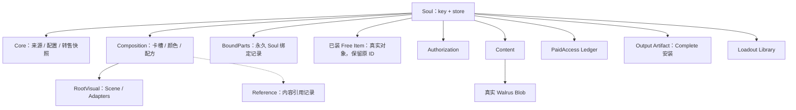
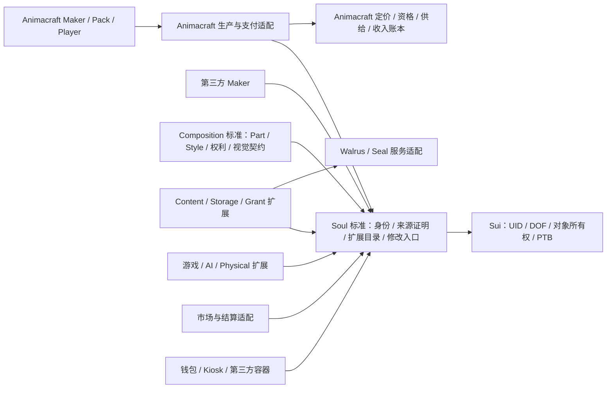

# Soul 中心架构评审与工程图

## 2026-10-09 最新：嵌套工具交接与真实默认发布通过

Vault现位于已有Application扩展层，仍为Soul下DOF资金/资产与私密工具；Core移除原vault模块，无兼容wrapper/新业务包。标准核心保持独立。prepare_handover轮换整个原生嵌套树中的每个已安装工具，即使中间Soul没有本应用；深度16/总节点256，过界原子拒绝，已接受原生容器组合仍可关闭/暂停退出。AgentPass后置。

真实无签名模拟复现原Core105302>102400，随后实际本地Appv6=99030、freshCore=97937发布通过；双构建、bytes/ABI/typeorigins/linkage/Cap与交易BCS读回一致。当前913VM保留原908并新增5嵌套测试、独立Vault17、全部321外包81合法240预期拒绝逐源/主诊断通过；11项探针仅将Vault目标改为Application namespace。第三方producer只依赖标准，实际两个Root/工具及77/73余额和9MIST原资产组合、CAS/永久request拒绝、转买家与unnest/退出3成功2拒绝，原ID保留、两钱包+gas守恒0。

**全goalACTIVE/30partial/Releasefalse。** 独立工具PTB不代替新Core真实Config→Maker/Pack→Player→Complete→native服务→市场；这些当前新候选实链门禁仍须执行，Seal KMS未通过。保留链Genesis/config/keys哈希不变，node已SIGINT0/19089无监听/DB保留。证据：`output/contract-rebuild/nested-vault-handover-2026-10-09/{verification-evidence.json,IMPLEMENTATION_CN.md,REVIEW_CN.md}`。现网站UI结构/路径保持，无生产/SDK前端/37实站/Git/代理/外审；以下按历史版本阅读。

## 2026-10-09 最新：Soul 下工具与可选原生访问扩展

Vault 仍为 `Soul → 标准 DOF → Vault`，资金资产和私密内容都保留，读权不授权支出。独立付费／委托入口已通过现有 Sui Kiosk 的可选 access extension 恢复：真实 native cap 封存在既有 Account；扩展内部真实 ObjectBag DOF 存 Soul，不发行新OwnerCap、不建立反向共享Vault，也不要求普通Soul经过该容器。关闭／协议暂停仍允许实际owner取回原Soul，工具／内部资产ID和余额保持；非空不能卸载。普通Kiosk进出同步轮换根Soul可选工具的私密域；AgentPass后置。

原paid21／delegate9职责全部保留，新增11安全测试；当前全默认908VM、独立Vault17VM、完整321外包81合法240预期拒绝按各自主诊断／SHA通过，原307正文不变。59生产文件／副本一致，两次生产bytecode一致；Core14下限96467B，不包含type origins/linkage，尚不证明exact发布。17项Vault独立测试manifest已修正为当前源码依赖，不再指向历史副本。

**全30仍partial、goalACTIVE、Release=false。** 新候选尚未链上发布／真实native PTB／KMS；普通自由转移无通用撤销hook，嵌套子Soul工具的严格私密交接仍须验收。现网站结构与操作路径保持，无SDK前端／37实站／生产／Git／agents／外审。原Slack9记录15格读回，其他567业务单元、30记录ID及Owner／状态／阶段保持。证据：`output/contract-rebuild/kiosk-access-extension-2026-10-09/{verification-evidence.json,IMPLEMENTATION_CN.md,REVIEW_CN.md,slack-sync-proof.json}`。以下为各自历史候选时点，不以旧“当前”段落覆盖本段。

## 2026-10-09 当前：Soul 下 Vault 工具已实现，完整验收未通过

当前后续迁移增量：生产58输入不变，authorization/loadout/output/vault_edit四文件原116项保留，116VM通过，逐项映射与原始源保留；完整307外包76合法231预期拒绝按正文/SHA/各自主诊断通过。默认完整VM仍FAIL：paid_access/vault两旧接口文件106诊断。supplied-root授权政策单元不证明独立代理输入或SealKMS权限；原独立paid/delegate产品入口仍须接回，AgentPass后置，不能用test-only托管或权限mock使门禁假绿。全30partial/goalACTIVE/Releasefalse，仍无正确工具新链上发布。证据：`output/contract-rebuild/vault-test-migration-2026-10-09/{IMPLEMENTATION_CN.md,REVIEW_CN.md,verification-evidence.json,test-duty-map.json}`。下面234诊断及11外包是上一增量时点记录。

用户确认资金／资产和私密文件／记忆两类都需要，AgentPass 后置。当前源码已替换为 `Soul → 标准 DOF → Vault 工具`，非泛型 Vault 持有真实 Balance 动态字段、原 ID 资产 DOF 和 certified 加密 Library DOF；旧 sharedVault→Soul、独立 OwnerCap、Soul 编辑借还及 runtime 反向入口已移除。Physical 直接使用实际 Soul；两条市场成交路径轮换可选工具私密域，完整清单公共可读，取消保持；读取授权不成为支出权。Native目录 schema2 创建／校验一致，修复扩大回归发现的 schema1 初始化错误。

当前限定验收：独立17 VM＋选取原业务206 VM全通过；11外包2合法9预期拒绝按主诊断通过。固定 Sui／Walrus 依赖，两次生产构建、108冻结输入和58生产文件＋7显式选取原测试／夹具副本逐字节校验。**默认完整VM仍编译失败（六旧接口测试文件234诊断），当前完整307外包尚未跑；全30仍partial／goal ACTIVE／Release=false。** Core13模块包下限90898B，仅下限，正确工具未新链上发布／真实PTB。布局/API不兼容旧Corev4，应新部署。旧895VM／304等和20反向托管交易仅各历史版本证据，不能当本候选验收。

私密库沿用 owner＋generation：自由转移没有通用hook，未显式轮换而转回可能恢复旧域；新持有人的私密head可为空，密文／收据仍随Soul。不能承诺自动跨人明文继承、AgentPass独立委托或复制Grant提款。公开借出 mutable Soul 的第三方容器仍需自行守权限。原本地链／Root／Free／Artifact保留，故障节点未重启，未签新交易。无SDK前端/37实站/生产/外审/Git/agents。

源码、决策、验证和剩余门禁：`output/contract-rebuild/soul-vault-tool-2026-10-09/{IMPLEMENTATION_CN.md,REVIEW_CN.md,verification-evidence.json,default-vm-failures.json}`。下面关于反向Vault和认证Vault包装的条目按原历史时点阅读，不构成当前产品或权限方案；其原授权／付费职责须逐项迁移而不能丢失。

## 2026-10-09 当前：跨场景整套交易与当前外包全量通过

103冻结输入未变；886默认VM保持，当前297外包74合法/223预期拒绝逐文件主诊断与hash全通过。本轮当前Appv5/Corev3、ae60751d/default137新增18真实原交易13成功5业务拒绝/41Public；现形态512×768及卸装Bound/Reference真实清单承诺解码核验，原Soul/Free/Artifact/Forms/Growth交接、买家恢复/取出/再装、取消和失败回滚通过。少付款拒绝不改变授权版本，成功出售清generation后转回不复活。实际1000=875seller+50OC+50Maker+25平台保留，角色重合归并后钱包扣Gas−25与Config+25守恒0。与scene/schema合71个原digest52成功19失败（17业务2历史夹具）/177Public。源码与包未改变，Core101188余1212；节点已SIGINT0，DB/keys保留。完整目标ACTIVE/all30partial/Physical34pending3partial/Releasefalse；独立scopedPack跨Scene、严格Vault形态、嵌套/全职责/升级旧入口/恢复争用安全仍必须。

证据：`output/contract-rebuild/cross-scene-market-2026-10-09/IMPLEMENTATION_CN.md`、`verification-evidence.json`、`REVIEW_CN.md`、`exact-settlement-proof.json`、`underpayment-authorization-rollback-proof.json`。无SDK前端/37实站/生产/Git/agents/外审，AgentPass后置。下方旧增量按各自历史时点阅读。

## 2026-10-09 当前：跨场景真实旅程及旧写入口schema防护

当前103输入／886默认PASS，297外包仅前一源码历史证据、当前重跑待。跨场景四包实际升级和21主旅程后，复现旧App v3写入丢失新映射recipe承诺；Character/Forms改用标准已有单调module schema2。App实际Compatible v5/91700B、Corev3/101188B余1212，15原交易10成功5旧入口拒绝／48Public，独立Standard-only容器恢复/退出通过。两段合计53原交易39成功14失败（12业务2夹具）／136Public，钱包变化加gas逐笔0；原Soul/Free/Artifact/Forms/Growth保持。只有本地ae60751d/protocol137；节点已停。schema1已有对象需要显式当前操作推进，不因发布自动迁移。完整目标ACTIVE／所有30partial／Physical34pending3partial／Releasefalse；当前全297、scoped跨场景Pack/整套市场/严格Vault/嵌套/全职责/恢复争用安全仍必须。无SDK前端/37实站/生产/Git/agents/外审；AgentPass后置。

证据：[IMPLEMENTATION_CN.md](../output/contract-rebuild/module-schema-guard-2026-10-09/IMPLEMENTATION_CN.md)、verification-evidence.json、REVIEW_CN.md。以下旧增量按各自历史时点阅读。

2026-10-09 当前经历反馈增量（以下旧数字按历史时点阅读）：可选永久 growth DOF Journal 已实现实际私有来源出具、当前持有人逐条接收、精确 Source/规则集/版本/schema、Clock期限、撤销与 O(1) generation失效、永久事件防重放、严格运行序列及不可覆盖历史。Receipt是来源证明值，不自动产生XP/代币/组件，不是内容解密授权；来源声明真实性与升级权仍属于应用信任边界。普通自由转移保留设置，但没有委托自动写入，接收仍须实际可变Soul；新持有人可主动接受待处理证明或撤销来源。Standard/Core源码未改、无新增包层。

当前101顶层源码输入；默认854PASS保留原832，外包283PASS（71合法/212拒绝，失败批次与更正证据保留）。App实际Compatible v3/88393B、原类型来源/9模块字节/ABI/linkage/Cap读回与双构建通过。41唯一原交易29成功/11业务拒绝/1混用旧新App入口InvalidLinkage夹具失败（更正单版本调用后旧形态入口通过）；90Public命令、钱包扣gas−25/平台保留25/守恒0。实际独立应用Outbox、同Soul5条经历、整套出售和Standard-only容器接收/退出通过，原Free/Artifact/不可变Form快照保持。当前Root48bc…/growth revision10/gen1、form revision8、app14、grantgen2；Config资金108。完整所有合约目标仍ACTIVE/30职责partial/Physical34pending3partial/Releasefalse；跨Scene/嵌套应用/严格Vault接口/全职责/升级恢复争用安全仍需完成。证据：`output/contract-rebuild/oc-growth-2026-10-09/IMPLEMENTATION_CN.md`、`verification-evidence.json`、`REVIEW_CN.md`。

## 2026-10-09 当前同一OC形态与历史增量

当前标准核心不变；新增Application::forms永久DOF Journal/版本Snapshot及分页选择/来源，形态恢复原子核验实际资产/固定Style/颜色/布局/规则，不发行新根或第二份库存。原Native Soul及Standard-only容器、新holder分支、原ID退出和含历史整套出售已实际本地验证。App Compatible v2原类型保留/新forms origins、双编译/实际字节ABIlinkageCap82,231通过；832默认VM（保留819＋13）、272外包68正204负、26原PTB20success6业务拒绝/62Public、25保留资金差0。99真实顶层输入冻结，纠正旧217中120生成副本混入计数；旧证据不删除。

准确证据：[oc-forms/IMPLEMENTATION_CN.md](../output/contract-rebuild/oc-forms-2026-10-09/IMPLEMENTATION_CN.md)与verification-evidence.json/source-freeze.json。全目标ACTIVE/all30partial/Physical34pending3partial/Release=false。仅同Scene原生形态保存和恢复；跨Scene、真实成长回写、完整嵌套应用/升级旧入口/恢复争用/安全仍待。没有SDK前端/37实站/生产/外审，AgentPass后置。以下较早增量按历史候选阅读，不把旧App v1 Cap或旧819当当前全套状态。

## 2026-10-09 当前：原生托管与发行目录已验收增量

此段与 `docs/codex/CURRENT.md` 的 native-publication-index handoff 是当前候选入口；下方较早增量证据保留为历史，不代表最新源码。

默认819/819 PASS，原500函数/规模/预算不变；266外包全量66合法200预期拒绝。复用已排序Expected＋私有行号，取消逐素材Table索引；实际Blob托管在既有Content包内，原生Release仍保留权限/真实System/私有UID/CAS/认证/租期，标准Soul不变，无新增包层或反向依赖。

当前Visual/Model/Content/App/Core五包实际隔离发布，五个未变包复用；两次字节码/依赖及部署ABI/linkage/Cap核验通过。Core实际101061/102400余1339。当前60唯一交易46成功14预期业务拒绝、293 Public调用、74MIST保留/资金差额0；真实Creator/付费Player/Complete及Physical来源/成交/原ID返回已读回。6Blob为本地测试委员会认证，不证明生产存储/SealKMS/像素或外部审计。

证据：[`native-publication-index/IMPLEMENTATION_CN.md`](../output/contract-rebuild/native-publication-index-2026-10-09/IMPLEMENTATION_CN.md)，对应verify_increment.py/source-freeze.json/verification-evidence.json。源码217输入冻结。BlobPage类型来源和Draft/Certificate存储布局变更采用新部署，不声称旧对象升级兼容。全目标ACTIVE/all30partial/Physical34pending3partial/Release=false，剩余完整职责、私密委托、OC形态成长历史嵌套、恢复争用和升级旧入口仍需完成；当前新包500真实网络及所有Pack政策旅程尚未全量执行。AgentPass/SDK前端/37实站/生产后置。

2026-10-09 当前出生来源证明增量：实际原Artifact完整承诺＋绑定标准Soul ID/Origin的出生承诺，Proof schema2/Asset provenance v3；Controller保持store-only，仅哈希进入复制格式。129输入/10包实际字节ABIlinkageCap和App/Core双编译通过，Core102285/102400余115。默认791/790PASS/原500TIMEOUT仍FAIL；Physical74PASS；9外包4正5负PASS（实际工具可用252项，未全跑；原正例漏限定类型名失败保留后修复）。57唯一原PTB43成功14业务拒绝/293Public/6认证Blob，5实际Birth观察换装、实体化预留、转移和generation清理后出生不变而live manifest变化；伪出生/重放/旧CAS/旧配方拒绝。真实101 Receiving出售、原ID/证明保留；17+57保留74，wallet exgas−74守恒0。Physical171仅再承接2项→43implemented91restructured3partial34pending；全部30仍partial，full goal ACTIVE/Code/Releasefalse。证据 output/contract-rebuild/physical-genesis-proof-2026-10-09/{IMPLEMENTATION_CN.md,REVIEW_CN.md,verification-evidence.json}；以下旧增量均按历史时点阅读。

2026-10-09当前Physical交接格式增量：四种复制格式归入已有Application metadata，真实Key资产/Registry/Listing与私有Receiving/发行/结算仍Core；第三方逐字段可检查，类型定义地址变动需新候选。129当前输入、10包实际字节ABIlinkageCap及App/Core双编译通过，Core102230/102400余170。52唯一原PTB38成功14业务拒绝/292Public/6认证Blob，原BCS/effects/失败历史读回；假快照持有人/假净额/欠款/重购拒绝，原ID/注册事实不变、归档转回；17+57保留74、钱包扣gas−74守恒0。8外包3正5负PASS；当前默认789/788PASS/原500TIMEOUT仍FAIL；非全254/原180回归。完整goalACTIVE/30partial/Releasefalse，Physical36+3/全职责/升级旧入口/恢复争用/严格私密/OC形态养成嵌套仍待。证据与手册评审 output/contract-rebuild/physical-metadata-interface-2026-10-09/{IMPLEMENTATION_CN.md,REVIEW_CN.md,verification-evidence.json}；以下按历史时点阅读。

2026-10-09当前PackPhysical增量：75真实PTB58success17businessAbort；旧410保留合485/402success83failure/7228Public。当前10包bytes/ABI与128source一致，生产源码未变。实际两Control注册、重复/过期CAS、三同名Part独立scope、PaidPack访问19与Physical37独立结算、actualSoul/Artifact proof、Receiving原ID二售101、归档取消/转让/消费通过；Player/Soul render BCS一致（非pixels）。钱包扣gas+income333守恒，Config10/funds99，新Pack57。Physical171新增50映射→43implemented80restructured3partial45pending；保护素材/注册controllerEpochCap/完整provenance/旧market角色仍缺口，all_functions_mapped/fullacceptance=false。完整goalACTIVE/Code/30partial/Releasefalse，Core122/原VM500TIMEOUT/current242/500Complete/养成嵌套及全职责待；无production/SDKfrontend/37live/KMSstoragepixels/agents/Git/外审。证据 output/contract-rebuild/paged-pack-physical-ptb-2026-10-09/{combined-evidence.json,physical-function-map.json,IMPLEMENTATION_CN.md}。下方按各阶段历史时点阅读。

2026-10-09增量：当前分页候选公开／Included scoped与Physical105真实PTB（83success／21business abort／1真实非公开调用夹具failure）完成适用验收；原305保留合计410（344success／66failure）、6242合法Public调用。actual10包bytes／ABI及128source一致。两个同名Pack Part scope隔离、独立颜色、Player/Soul render BCS一致；原ItemID装卸／微调与限制负例通过。Physical actual Registry／免费／付费／canonical proof／Receiving原ID出售／归档退出通过。完整钱包扣gas与income260守恒；当前Config10/funds83。夹具ObjectOwner误判与非公开归档原始失败均保留，未改生产源或重放旧mutation。30全部partial／完整goalACTIVE／Code／Releasefalse；Core余122、原累计500VM TIMEOUT、当前242全跑、500Complete／PackPhysical全职责／养成嵌套等待。无pixels／KMS／storage／SDKfrontend／production／37live／agents／Git／外审。证据 `output/contract-rebuild/paged-scoped-ptb-2026-10-09/{combined-evidence.json,IMPLEMENTATION_CN.md}`。以下阶段数字按历史时点阅读。

## 2026-10-09 当前分页候选付费与整套市场增量

生产源未改，128冻结输入及真实包字节/部署ABI一致。当前paged Core真实Maker→paidPlayer→Complete→Pack增强/初始Complete、三权利/原ID装卸/微调和整套市场通过83笔新本地PTB（62成功21业务拒绝）。累计305笔（261成功44失败，旧容量与夹具错误仍保留）、5078Public调用、原BCS/effects/失败历史回滚核验。初售171账本Maker86/Pack52/平台33；正常Admin将local native secondary500→250，Config9→10；gross1000=25+50+50+875，当前平台58/保留总收入196，钱包扣gas后-196相抵。

普通转移issuer委托inactive、转回可live；明确sale清理generation后转回不复活。卸装Bound/Reference、原Free/Artifact/内容随整套交接。Paid66边界Config9/funds33是历史；当前Config10/funds58/Soul app12/gen1。源码128未变、原777/776+1TIMEOUT及242全跑待状态保持；Core122余量。完整目标ACTIVE/Code/30partial/Releasefalse，后续全30/升级安全/500Complete/养成/第三方与scoped回归待；无生产/SDK前端/37实站/KMS像素/agents/Git/外审。证据 `output/contract-rebuild/paged-paid-ptb-2026-10-09/{combined-evidence.json,IMPLEMENTATION_CN.md}`。以下按历史时点阅读。

## 当前增量：真实500素材容量与发布页（2026-10-09）

原真实500扁平DOF发行在finish复现dynamic_field子对象运行时错误，完整托管回滚并取回原502个Blob。Release改用每页32个真实Blob的DOF BlobPage，保持原UID，finish／available／renew仍读取真实对象值，分页取消可完整返回。分页候选在隔离ae60751d/default137正式500素材发布、Player单一Style250片段选择、35Blob中途取消通过；并非500件Item或该Maker的Complete已通过。Standard Soul／组件权利／视觉核心不变。最新Core102278／102400余122；append／append_batch使用mutable TxContext，新对象布局不加旧fallback。原旧候选证据按历史阅读。

当前全默认VM777／776PASS／原累计500TIMEOUT1；776旧命名结果保持。新5外包2合法3拒绝；旧237不冒充更新后242全跑。当前222Ledger199成功23失败（含1生产容量复现和1测试引用返回错误），4679Public ABI，BCS／effects／钱包扣gas守恒；128当前输入冻结、Core13模块两次字节一致。真实500通过不抹去累计VM超时，也不代表全部30职责完成。完整目标ACTIVE／Code／Release=false。证据与工程评审：`output/contract-rebuild/certified-capacity-ptb-2026-10-09/{evidence.json,IMPLEMENTATION_CN.md}`；准确包／Config／Maker在该目录paged/evidence.json。下一步全30及更新后paid／Physical／社区／集合／Loadout与升级恢复、OC形态养成嵌套验收；AgentPass后置。

## 当前增量：视觉实例边界与真实默认发布容量（2026-10-08）

完整目标仍ACTIVE／Code／Release=false。Standard仍独立Sui-only；Application7无Core导入，Model4、Core13。VisualCapture schema2绑定专用私有CaptureProducer＋实际Registry实例，Native issue仍私有；独立捕获与复制画面没有原生发行权。MaterialPolicy在Model；复制型PublicationRules／PhysicalMetadata在Application，实际Control、来源、付款、供给、重放、资产与交接守卫继续由原生应用执行，无旧模块别名。

当前八包已在隔离本地链1544de63／协议137的默认预算真实发布并读回ABI，Core101765／102400字节（余635）。先前103447／102669的真实失败保留。旧Application候选为历史，新当前发行不能当作升级验收。最终776／775通过，原500累计VM超时保留；新增8权限例、独立3VM。外包与重复构建以最终evidence.json为准，不以数量代替旅程／安全证明。

当前证据：`output/contract-rebuild/visual-capture-boundary-2026-10-08/evidence.json`；决策／适用手册／审查：同目录`IMPLEMENTATION_CN.md`；当前源码图：`dependencies/source-dependencies.json`（文本引用，非运行调用图）；实际部署ABI：同目录`*-deployed-abi.json`。源声明清单含test-only，与真实ABI分开。

剩余：当前真实角色／Config／目录初始化、原生及第三方业务PTB、默认500分块预算、完整30职责／资金／私密／重放／争用／旧入口／升级／恢复／安全、同一OC形态／历史／养成与嵌套应用验收。无生产部署、SDK／前端实施、实站37步、外部审计、代理或Git提交；AgentPass后置。以下早期章节按其时点阅读，不能推翻当前源码与证据。

## 当前 Character 应用与发行边界（2026-10-08）

Character 已完整迁入 SoulidityApplication，Core旧模块删除、无alias；Application4模块仅向下依赖，无Core/Catalog/Player反向导入。Standard/Model/Content生产源码不变。原生发行由实际Creator角色、真实Product/root和完整出版元数据承诺生成无abilities Genesis；实际quota/attempt和Coin结算后才返回。Character消耗Genesis安装永久应用，返回绑定root/carrier/actor的无abilities Draft，原生Build私有保存并最终消耗。初始选择/颜色/内容/输出构造需该准确票据。

Pack与后续增强通过实际结算后的无abilities Contribution接入；Enhancement绑定根、具体产品/版本/actor及此前状态，替换另核对真实Component Permit的product/version，完成消耗。复制PrimaryReceipt只是数据。NativeBinding本来依赖Issuer/Product类型，第一轮编译发现反向获取凭证形成环；改由已核验入口传入Binding，并将私有ApplicationOperator放在Core叶模块，不新增全局角色。永久应用保存准确原始操作类型；容器仍需实际托管/OwnerCap/owner/ctx/generation/Seal范围，集合/Physical/市场原角色/许可/CAS/支付保持。**该操作类型证明lineage，不是最新版本、持有权、付款或通用转移hook。** 对实际可变根的显式清授权是持有人操作。

最终默认VM768/767PASS/原500素材累计TIMEOUT，原758场景名字与结果保持，新增10项实际边界通过；独立Output原型3/3VM且无Core依赖。最终全部231外包编译（53合法/178拒绝）逐文件当前正文/hash/主诊断通过，不是231独立部署包。首先五包两次构建，恢复Issuer欠款原code3后Core另构建两次；四个独立包生产输入不变，最终627模块文件副本含重复依赖、5实际解析锁一致。Core15大小下限104695>102400仍不可发布；Application4下限51926等仅是下限，不是发布验收。

保留真实失败日志：初始依赖环、测试夹具同事务重复取共享对象、raw Complete探针漏Binding变量、欠款错误位置回归；均修复并复验，没有降低旧测试期望或用结构错误代替权限证据。完整目标ACTIVE/Code、Release false，全部30旧职责仍partial；当前发布/真实PTB/部署ABI/500单PTB容量/全权限与资金/旧入口升级恢复/独立审查/完整形态历史与养成均待。证据与取舍：`output/contract-rebuild/character-boundary-2026-10-08/evidence.json`、同目录`IMPLEMENTATION_CN.md`。下方为各自阶段历史记录，不能当作当前全目标完成。

2026-10-08 当前内容边界：SoulidityContent 独立于 Core/Model/视觉，实际 Soul/carrier + 专用私有 ContentOperator 绑定实例，元数据不授权；原生实际 custody/Seal/支付入口保留。Release 逐项读取实际托管 Blob，删除 claimed-end 与冗余 renewals。原生745/744PASS/1原500素材TIMEOUT，734原结果保留；独立扩展3VM通过。Core17下限149067>102400仍不可发布，完整目标ACTIVE/Release false。取舍、测试夹具与生产角色区别见 SOUL_STANDARD_KERNEL_CN.md 当前内容段；最终证据 content-boundary-2026-10-08/evidence.json。下方均为各自阶段的历史快照。

2026-10-08最新组件发行增量：真实Item移入独立Model.components；复制Source不能发行，专用ComponentProducer/实际P与Source ID/type/实际目标Soul生成无abilities Permit，一次物化Free，Ref/Bound继续原永久记录。Native Catalog和安装/付款入口仍私有。默认734/733PASS/1原500素材累计TIMEOUT、726原结果保留、8新用例PASS；12外包2合法/10拒绝PASS。106输入，三包重复构建一致；Core25下限170558>102400仍不可发布。完整目标ACTIVE/Release false，实际业务PTB/部署ABI/全职责验收待。详见 SOUL_STANDARD_KERNEL_CN.md 当前组件段及 component-issuance-2026-10-08/evidence.json。

2026-10-08最新来源/Model增量：公开Version冒充发行Witness的裸Soul缺口已隔离复现并按SoulProducer修复；Source/Scope/Profile使用实际源对象与PolicyProducer。policy/assembly移到Model，Character去除Catalog/Product反向依赖，Pack传入认证元数据快照。默认726/725PASS/1原500素材累计TIMEOUT、712原结果保留；14新场景PASS。三包重复构建一致，Core26模块下限170734>102400仍不可发布。当前证据/取舍见 docs/SOUL_STANDARD_KERNEL_CN.md 当前来源段及 model-source-2026-10-08/evidence.json。下方数值为历史快照；全部合约目标ACTIVE、Release false。

2026-10-08最新容量增量：唯一 Standard Soul 与 Character 业务接回保持；视觉键查重/发布目录排序优化，7新边界测试通过，705原场景身份/结果保留。当前默认 VM712/711通过、500素材累计预算1失败；本轮10外包案例3合法7拒绝。相同500素材预检内部VM计量下降46.36%，并非真实网络gas验收。两次生产构建159模块文件（含依赖）一致、89输入冻结；Core下限182,746>102,400仍不可发布。当前差异/取舍见 docs/SOUL_STANDARD_KERNEL_CN.md 当前容量段及 heap-evidence.json。下方原架构/数字为历史快照，全部合约目标active、Release false。

2026-10-08当前增量：独立 Soul 核心与真实第三方生产者/扩展/容器已形成源码及局部验收；原生嵌套和同 OC 持续身份基础已实现/验证。当前接口、OC 养成/多形态与完整业务剩余项见 `docs/SOUL_STANDARD_KERNEL_CN.md`。以下架构图/历史全量数字是评审或旧候选快照，不能当作全部职责已完成或当前 Release 通过。完整目标仍 active，原业务未全部接回。

2026-10-08。依据当前重构工作树生产源码；建议结构尚未实现，全文不是上线或安全审计证明。用户基于本评审明确要求设立新目标，已创建“以标准 Soul 为核心的全部合约重构”active目标；方向进入施工目标，具体接口与包边界仍须原型验证。当前全合约重构仍未完成。现网站页面、操作路径和已确认的商业规则保持为需求依据。

## 1. 结论与问题定位

应当先交付可独立使用的 Soul 标准，再使 Animacraft Maker 成为它的生产者，使市场、容器和应用成为它的使用者。Soul 的类型不随 Maker、Pack 或已安装能力改变。DOF 承载实际对象关系；标准接口承载发现、权利、修改和交接规则。

当前并不是没有使用 Sui 原语：Soul 已是 key + store，Free Item 是真实 DOF 子对象，取出返回原对象；很多状态也已分到 DOF。但 Soul 模块仍直接引用 catalog::Product、economics::Config/PrimaryReceipt、Walrus System/Blob、paid_access 等业务类型，创建时固定装入内容、授权、付费和 Loadout。原语使用正确不等于依赖方向正确。

源引用快照：36 个生产模块，Core 28、Foundation 3、Visual 1、Community 4；149 条本地模块引用。Soul 直接引用 15 个本地模块，另有 Walrus 依赖。引用不等于运行时调用；模块数量不是复杂度或质量分数。完整图和逐边源码行号在 `output/contract-rebuild/soul-architecture-review-2026-10-08/`，可用 `python3 scripts/inspect_contract_dependencies.py --output output/contract-rebuild/soul-architecture-review-2026-10-08` 重建。

## 2. 当前工程图

下图为关键源码依赖的摘要，箭头表示使用者依赖被使用者；全部 36 模块与 149 条引用另见快照及交互图。图内 Foundation 已反映正在进行、未完成全量回归的 economics/revenue 移动。

特别需要处理的是 `Soul → Maker` 和 `Soul → 收费/存储产品`：为了安装 Pack 或追加内容，核心资产认识了上游产品和具体服务。把这些类型移到另一个包后继续从 Soul 引用，仍是同一耦合。runtime 的认证职责应保留在 Animacraft 产品边界，不应成为任何第三方 Soul 修改的统一入口。

当前对象持有图（箭头表示 DOF 持有，虚线表示记录而非独立资产）：

Bound 当前保存 Source 记录，不是独立可交易 Item。卸下是取消该 Part 的装备关系，永久记录仍在该 Soul 中。Reference/Bound 与 Free 不应为了“统一都是对象”被重新包装成具有自由转让权的组件。

## 3. 建议工程结构

下图是职责与依赖方向，不是已决定的包名或拆包数量。实包划分依据 ABI、升级边界、依赖 DAG 与默认网络发布预算确定。

这里的依赖箭头与数据流不同：应用依赖 Soul 标准，运行时可经持有人批准给 Soul 安装能力或写入反馈。标准包不反向导入应用。Composition 也依赖小核心，因此没有视觉需求的第三方不必携带整套 Maker/渲染/收费代码。

### 必需的小核心

- 一个稳定、非泛型的 `Soul has key, store`，避免每个生产者都制造另一种 Soul 类型。根只保留 UID、格式版本、修订号和必要的目录/承诺；展示、来源和能力的具体布局由标准接口定义。此处是候选字段边界，不能当已冻结 ABI。
- 可核验的生产者身份与发行来源：不得用客户端自行填入的 Maker ID 冒充认证来源。生产者类型/发布来源与其签发的真实证明相绑定；Maker 资格、价格、限量、支付和版权供给由生产者合约负责。开放接入不等于接受伪造来源。
- 统一扩展目录：命名空间、实际对象 ID、实际类型、schema/version、功能标识、状态承诺、装卸/交接属性。目录不是外部索引器猜出来的清单；提供分页与完整性验证，避免无界全量遍历。
- 安全的安装、读取、更新与卸下入口；系统键与第三方命名空间隔离；不公开根的 `&mut UID`。资产不能因删除带子对象的根而被遗留，核心须限制销毁/清理路径。
- 市场可核对的组合快照：根修订号、目录及权益承诺、实际包含对象；未知扩展可展示为未知能力，不推断价值或读权。

DOF 子对象随父级控制关系交接，适合这些真实资产或模块；小标记、引用和不需要独立对象身份的值用普通字段/DF/Table 即可。不要把每个布尔值或 Style 的渲染片都铸成资产。

### 标准扩展与应用扩展

| 边界 | 职责 | 从小核心移出的业务依赖 |
|---|---|---|
| Composition 标准 | 每 Part 一个固定 Style 单位；Ref/Bound/Free；装备关系、Scene、布局、颜色、兼容与微调约束 | 不读取 Product、价格、Walrus System 或平台 Config |
| Animacraft Maker/Pack | 可交易产品控制权、不可变定义版本、使用资格、供给、发行、收入权与提现 | 通过标准发行/组件证明生产 Soul；Pack 是上游扩展产品，不改变 Soul 类型 |
| Animacraft 编排 | 现有 Complete、实际 Pack 贡献、一次原子支付与发行、输出与内容认证 | 使用 PTB 组合生产、支付、存储验证和标准安装；保留失败原子性与恢复要求 |
| Content/Storage | 内容版本、真实 Blob 生命周期、存储证明、加密内容引用 | Walrus/Seal 的具体逻辑留在适配与扩展中，不等于取消认证 |
| Grant/付费访问 | 范围、到期、撤销、当前持有权与受控容器；价格与分账 | 不成为任何 Soul 都必须依赖的收费配置；AgentPass 继续后置 |
| 市场/容器 | 展示发现、准确清单、持有控制、报价/取消/成交、所适用费用和退出 | 资产标准与结算政策分离；普遍转让能力不等于能在所有外部市场强制平台费或版税 |
| 下游应用 | 游戏进度、技能、AI 记忆、Physical 回执等 | 每个应用验证自己的语义、供给和规则；不得取得其他命名空间或私密数据的默认权限 |

### 扩展的安全边界

推荐先验证“持有人参与的一次交易”：生产者或应用给出真实模块/组件对象，标准通过明确的类型和命名空间安装到 DOF，目录同步更新。应用更新仅得到对应模块的受限访问，不得到根 UID；根修订号及市场承诺必须同步更新。跨调用确实需要临时凭证时，使用绑定 Soul、模块类型/ID、动作和版本、不可复制/丢弃/保存的交易内凭证；不为每个简单动作再增加一套工厂和注册中心。

Move 没有可直接套用的通用插件虚函数接口。泛型 custody 可以统一，任意插件的业务验证、schema 解释和不同类型的动态调度不能自动统一。最小接口需通过第三方包原型实测，再冻结；本评审不把接口名称当作已证明可编译的实现。

下游“反馈给 Soul”有两种明确操作：持有人提交交易，将结果写入指定扩展；或应用先发行绑定 Soul ID/应用/版本的真实回执，持有人之后导入。无需用户参与的后台持续修改会改变权限和所有权模型，不能悄悄作为原生 DOF 的默认效果。可持久委托的写入需单独证明范围和转移失效机制。

## 4. DOF 与接收资产怎么选

正式安装/装备：持有人参与，将实际对象通过标准入口 `dof::add` 放到 Soul 或其 Composition 下；卸下用 `dof::remove` 返回原对象。安装入口同时检查权利、目标 Part、兼容性、版本与目录。移除 Free 不能因视觉组合失效被困住。

`transfer_to_object` 是发送方把对象转给对象地址，父对象之后凭 UID 和 Receiving 接收。可用于礼物或反馈的待领取队列，但“别人发到了 Soul 地址”不等于已安装、不等于有使用许可、不等于出售清单认可。若采用收件能力，需显式接收/拒绝与垃圾对象边界；不作为正式卡槽的默认路径。

依据：[Sui Dynamic Fields](https://docs.sui.io/develop/objects/dynamic-fields)、[DOF 原生函数签名](https://docs.sui.io/references/framework/sui_sui/dynamic_object_field)、[Transfer to Object](https://docs.sui.io/develop/objects/transfers/transfer-to-object)。实际实现仍应核对本仓库锁定版本，在线最新文档不代替当前依赖测试。

## 5. 资产与视觉保持清楚

| 名称 | 资产/状态的定位 |
|---|---|
| Maker | 可交易的生产产品/控制权；创作者权利、使用资格和玩家生成的 Soul 分开 |
| Expansion Pack | 可独立管理/交易其控制权的扩展产品；买使用权不自动买断控制权或全部组件版权 |
| Soul | 一种标准资产；有无 Pack、视觉或技能扩展是组合状态 |
| Free Item | 一个固定 Style 的独立自由资产；装上 DOF，卸下保留原 ID，再独售或装入其他兼容 Soul |
| Bound | 一个固定 Style 的永久 Soul 绑定单位；可卸装、重新装备，不可转移给另一颗 Soul |
| Reference | 许可内容引用；不把引用、图片 URL 或卖家 Maker Pass 当出售资产 |
| Soul Configuration / 卡槽 / Layer Tracks | 配置、位置和渲染规则；是否形成独立交易资产取决于具体权利，默认不是新资产类别 |

整套 Soul 成交包括其实际持有的已装 Free、永久 Bound（包括已卸装记录）、随 Soul 的合法引用及交接模块；卖家钱包内已取出的 Free 不在其中。不能把售前卸装或伪造目录藏在摘要里。原市场“单售/整套售”的既定行为逐条映射，不能用本方案覆盖既有验收。

视觉作为独立但标准化的 Composition 扩展：冻结画布坐标、renderer/schema、Part 命名空间、源表示、轨道和锚点；保留实际选色/布局与创作者允许的微调范围。一个单位的前后渲染片不是多个 Item。未证明兼容的组件不能靠 UI 拖拽变成兼容；允许微调不意味着任意更改创作者约束。链上结构校验与实际像素一致性是两项验收。

严格转移撤销委托仍需受控交接或另行核验的授权机制：`key + store` 允许外部自由转移，小核心不能假设自己有每次转移的 hook。DOF 不自动解决这个问题，也不能追回已读取的明文。

## 6. 工具和决策链

保留既有 Delivery/DEV/BUG、DOF-001/008/011、Owner、里程碑和用户旅程。不新增竞争任务板。每条工程决策记录需求、2–3 个方案、取舍、验证、残余问题与可回退边界。

| 顺序 | 应交付的证据 | 工具与退出条件 |
|---|---|---|
| 需求 → 不变量 | 现站 Creator/Player/Complete/Wardrobe/Market 操作与真实对象/权利映射 | 既有规格与 37 步旅程；不另造交互 |
| 不变量 → 架构决定 | 小核心边界、依赖方向、类型与命名空间、来源证明、装卸/交接规则 | 本次源码图、ADR；有反例与独立验收条件，而非仅模块列表 |
| 决定 → 最小可执行原型 | 无 Animacraft Config/Product/Walrus 的第三方 Maker 创建 Soul；第三方扩展安装/更新/取出；第三方容器交接 | Move 编译/VM + 独立外包编译 + 隔离默认参数链 PTB；这些是下一步待做，不是已通过 |
| 原型 → 完整接回 | Animacraft Maker/Pack/收费/内容/Physical/市场等所有职责接入 | 原 coverage 和 ABI 映射；每条用户行为不丢失，不扩大入口为无保护 public |
| 候选 → 安全与交付 | 权限、资金守恒、重放、恶意 PTB、升级/旧入口、取消和恢复、视觉像素 | 原编译探针、发布预算、实际节点回执、对账和第三方测试；适用的独立评审/外审另记 |
| 发布 → 运行 | 确切包/对象/配置、发布清单、读回、告警、恢复和权限持有人 | 原 DevOps 八阶段；生产部署授权仍独立，文档不算部署自动化 |

立即适用的自动门禁：标准包禁止导入 Maker/Product、平台 economics、Walrus System 与市场模块；新增扩展不修改 Soul 标准源码；第三方包只依赖标准的正/反例编译；每包及完整交易实测默认发布预算；对收费写路径进行越权与资产守恒核验。门禁需实际实现和运行，当前只完成源码快照，不宣称这些门禁已部署。

重点比较两个候选：A 为目前的产品集中编排加拆包，优点是业务校验集中、缺点是核心反向耦合；B 为小核心＋Composition 标准＋应用适配，优点是第三方独立集成，代价是要设计清楚跨包来源证明和受限修改接口。推荐 B，先用最小原型证明其安全和可行性，再把完整职责接回。全量目标不是取消，施工顺序由“持续搬模块”调整为“先验证标准边界”。

## 7. 当前验证与施工状态

本次只做源码核对、图和架构评审，没有修改生产合约，没有开始实现建议结构。

此前 foundation-economics 增量已移动 economics/revenue、加入父 UID 账本守卫、修改业务角色接口和测试初始化：Foundation 生产构建通过；9 个新 Foundation 用例通过；全 Core 回归、全编译探针、真实完整发布/升级及市场/资金验收未执行。此前 package-roles 的 688 语义用例和 23 笔局部节点交易是旧候选证据，不能继承为当前源代码或建议架构通过。原失败日志、原源码快照和交易回执保留。

下一步先冻结小核心的职责和最小接口，再做独立第三方生产者/扩展/容器原型。不要自动继续旧手册指针中的 Creator/Asset/Runtime/Market 批量分包计划。新架构不能通过减少测试、放宽许可、去除收费认证或丢掉既有职责来显得简单。

手册 v1.0 §§1–4/6/7/8.3–8.4/9/12；Operating Model §8；原 product-engineering-review 模板适用。当前是执行者架构评审；独立核验和外部安全审计未执行。市场价格/投资/借贷模型与 EVM 部署本轮不适用。

## 2026-10-09 发行复制／分页成本增量（当前源码，未实际发布）

当前完整目标 ACTIVE，Code/Release=false；[增量证据](../output/contract-rebuild/publication-copy-cost-2026-10-09/IMPLEMENTATION_CN.md)。默认810/809PASS/原500仍TIMEOUT；8外包正反例通过，258未全量。Catalog一次BCS＋移交Version、App私有字段Expected元数据目录、实际Blob按页/同步epoch校验、视觉借用与精确key分桶；保原500函数体、认证/权利/Control/CAS/资金与原ID。两次离线13模块输出完全一致，Core保守未裁剪体积预检101824余576，尚无新实际包或PTB。新Visual牵引Model来源类型，后续须精确发布Visual/Model/Content/App/Core五包；旧genesis10包/57交易是历史证据。完整500最新已过catalog::publish、仍超时于完整证书SHA；不将诊断当发布成功。全30partial与Physical34pending3partial/升级旧入口/恢复争用/严格私密/OC养成形态嵌套仍必需。详见verification-evidence.json；手册v1.0 §§1–4/7/8.3–8.4/9/12。
