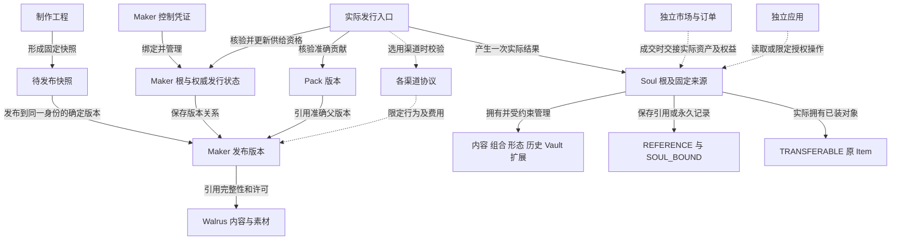

# 开放生态对象与权利关系

本轮施工前校准以[边界决策](CONSTRUCTION_BOUNDARY_DECISIONS_CN.md)为准：三类基线、B0、owned-only 构造、授权与收入生命周期、跨模块证明、暂停恢复、15 个保留维护单元、视觉及原产品分支已补充。原九表157条逐项见[范围追踪](ORIGINAL_SCOPE_TRACE.json)；精确函数／ABI／Cap 与运行验证仍需关口0及后续施工完成。[移交提示与材料](../SOULIDITY_CONSTRUCTION_HANDOFF_CN.md)。

日期：2026-10-10。版本：1.4，承接全生态权威状态、保留职责与扩展性质。阶段：Plan／研发实施输入。总入口：[合约模块与权限边界汇总](../SOULIDITY_CONTRACT_MODULES_AND_PERMISSION_BOUNDARIES_CN.md)。依据：[开放资产主说明](../SOULIDITY_OPEN_ECOSYSTEM_RD_ADDENDUM_CN.md)。配套：[入口矩阵](ENTRY_PERMISSION_DEPENDENCY_MATRIX_CN.md)、[状态与恢复](STATE_TRANSITIONS_AND_RECOVERY_CN.md)。

目标是让 Maker、Soul 和既有组件独立存在，制作、发布、渠道、市场与应用围绕同一资产协作。对象名称表达语义，不预先冻结 Move struct、abilities 或 ABI；优先映射现有对象和值，不能按表逐行新增 NFT、管理员或合约包。

## 1 对象边界

### Maker 制作与发布

| 语义实体 | 最小信息与唯一依据 | 持有或存储方式 | 与其他实体的关系 |
| --- | --- | --- | --- |
| 制作工程 | 工程标识、编辑 revision、Part／Item／Style、素材、规则、必要内容 | Animacraft 当前本地工程及可导出备份；Walrus 保存可选且按内容权限处理 | 一份工程可形成多个候选快照；工程标识不等于 Maker ID |
| 待发布快照 | 确定的工程 revision、schema、定义及素材摘要、组件权利、发行规则 | 客户端确定性制品及可迁移交接清单 | 一次发布意图只绑定一个快照；继续编辑不改变在途快照 |
| 内容引用 | blob 标识、真实 Blob 对象或托管位置、明文／传输摘要、认证与期限 | 内容字节在 Walrus；权威引用与必要存储证明按链上模型保存 | 每个版本引用多个必要资源；同一资源可以复用，仍核期限及许可 |
| Maker 根 | 稳定 ID、版本集合、实际控制关系和必要资产状态 | 推荐可独立调用的链上对象；现有 Product 为映射起点 | 一个 Maker 有多个发布版本；多渠道引用同一资产，不复制总供给 |
| Maker 控制权 | 精确绑定 Maker ID 的有效控制资格 | 复用现有 Control 或经评审的等效证明；真实持有人才有权操作 | 不等于素材版权、渠道授权或别人 Soul 的控制权 |
| 发布版本 | Maker ID、版本、定义和内容承诺、来源、组件权利、供给及有效经济条款 | 可为根内固定值与认证子对象，不要求每个版本独立 key | 成交与发行引用准确版本；后续新版本不追溯改写原权利 |
| 发行规则与计数 | 版本、定义／Style、总上限、用户资格／次数、已发行量及原意图结果 | 每个计数维度只有一份资产范围内的权威状态 | 不同渠道共同受其约束；渠道额度不能变成额外的总发行量 |
| Pack 与贡献来源 | 实际 Pack ID／版本、父 Maker 的准确版本和来源摘要、许可及组件定义 | 复用现有 Pack／Product 模型 | Complete 核验实际贡献源；发布新父版本不静默改变旧 Pack |

Maker 独立使用不要求安装 Soul 模块。Maker 到 Soul 的生产者或发行适配器按需依赖两者；发行后的 Soul 保留来源，不把原 Maker 作为所有后续操作的强制可变输入。特定许可操作确需核对源规则时，仍读取准确来源。

制作工具可以不同，但不得把复制工程描述成接管原 Maker。需要复刻成新资产时，产生新的 Maker 身份与实际来源，并遵守素材许可；共享格式不自动转让作品权利。

### Soul 与组件

| 语义实体 | 权威关系 | 必须保留的交接规则 |
| --- | --- | --- |
| Soul 根 | 唯一 ID、真实原生归属、核心 schema／revision、生产者与来源 | 读取结果中的 owner 缓存不能授予写权；未知容器不凭地址猜控制者 |
| 内容与组合扩展 | 由 Soul 持有的受约束 DOF 模块，内部可用 DF／Table | 维护自己范围；必要来源和组合模块不通过通用卸载任意删除 |
| REFERENCE | 准确内容／Style／来源及许可引用，不是源资产所有权 | 卸下清除选择；不向钱包返回虚构资产，不把卖方个人资格自动交给买方 |
| SOUL_BOUND | 永久属于该 Soul 的固定 Style 记录 | 可以不显示；记录仍留在同一 Soul；不独售、不返钱包、不跨 Soul |
| TRANSFERABLE | 实际唯一 Item 对象及准确来源／权利版本 | 装入的是原对象；取下返回原 ID；只有当时已装对象随整套交接 |
| 形态、搭配、经历、嵌套 | 各自范围内的配置、快照或可验证记录 | 配方不自动产生第二份组件；历史不自动授予收益或解密权；嵌套保持原归属与退出约束 |
| Vault 资金与资产 | Soul 下的真实余额、真实子资产与对应受约束入口 | 读取内容、分销和某扩展权限均不等于提款或转移资产 |
| 私密内容 | 正确策略、内容版本、访问范围及实际密钥设施 | 与资金权限分开；合法访问、撤销、续期和恢复分别验证 |

DOF 负责组织真实持有关系，权限仍由实际入口保证。第三方不得因拥有某扩展权限取得任意 `&mut Soul` 或可变 UID；根被容器持有时，所有写操作均需该路径的有效证明。[Sui 动态字段](https://docs.sui.io/develop/objects/dynamic-fields)

历史静态切片的开放构造返回 fresh Soul，不能据生产者最终 transfer 推定所有路径非共享。现选定 D26 owned-only 创建配置，推荐封装根的线性构建与最终交付接口；所有公开构造出口、第三方生产者和 share/public_share 攻击须以实际 ABI／生产字节码证明，完成后 key+store 自由转移继续成立。

## 2 权利与商业对象

| 权利或业务实体 | 主体和范围 | 与资产的边界 |
| --- | --- | --- |
| 作者／素材许可 | 实际权利人、准确作品和许可版本 | Maker 控制权转移不能默认转让全部版权；来源证明不能充当版权证明 |
| 使用资格 | 实际用户、源产品与版本、适用规则 | 复用现有 Access 或等效记录；不强制把每项资格铸成可转让 Pass |
| 渠道协议 | 有权授权主体、渠道实例、资产版本、行为、时效、额度、费用 | 默认非独家；只授予选择的行为；不持有资产总控制权 |
| 特定操作委托 | 资产、受委托者、动作、期限、额度、代次与撤销状态 | 读、写某扩展、分销、提款分别认定；不使用平台全局授权中心 |
| 市场订单与托管 | 实际卖方、资产或有效交付关系、价格、有效期、权利快照 | 仅在该订单范围内执行；服务暂停不自动锁死原合法退出 |
| 收据与已得收益 | 原意图、真实交易、权益结果、币种与收款依据 | 渠道终止不销毁已完成购买或已得收入；未来费用变更不追溯修改原成交 |
| 服务配置／收入／暂停权限 | 对应服务实例与实际账本 | 不管理全体资产；配置不隐含提款；没有该职责时不创建 Cap |
| 包升级控制 | 真实包的 UpgradeCap 及生效策略 | 与资产控制、网站发布和渠道管理分开；多签与不可升级分别记录 |

默认公开阅读或按公开条款购买，不要求逐个用户取得人工批准。代发行、代管理或非公开内容访问按有效规则授权；渠道接入是否需要双方确认由公开报价和实际协议定义。自动校验不会代替有效权利人的同意。

协议对象和接受记录本身不会限制其他入口。所选渠道的代理权限、额度、费用与受益人，必须在实际消耗授权、写入供给、发放权益或结算的路径上执行；通过可验证凭证或原子票据等方式连接时，还需防止跳过校验、伪造结果和重复使用。合法独立路径继续执行资产自身规则，不承担未选择渠道的费用；仅阅读或导流是否使用过某网站，不能单靠链上协议强制识别。

Maker Control、渠道代理、内容许可和收入按 D27 分域生命周期执行：默认新控制者重新确认新代理行为；受控路径实际轮换，自由转移不发依赖自动撤销的脱离根可重用权限。既有许可、订单与收入按原条款，产品账本领取核真实当前 Control。A→B→A 不能仅看当前地址判失效。

Walrus 上的字节公开可发现。未公开工程、私密素材和包含有效签名的恢复包在客户端加密后再上传，读取、解密与备份密钥按实际权利处理；不能把内容不出现在网站上当作存储隐私。公开清单保留必要引用与完整性依据，钱包私钥不进入任何交接包。[Walrus Blob 隐私边界](https://docs.wal.app/docs/walrus-client/managing-blobs)

## 3 关系图

图中的“保存／拥有”与“引用／约束”分别标注；箭头不是统一的合约依赖。虚线表示可选联动。

Maker 控制、渠道协议、买方资格、Soul 所有权以及作者收益具有不同的主体和生命周期。工程迁移不改变它们，平台账户也不充当它们的权威来源。

## 4 必须一起维护的一致性

- 同一资产的 ID、真实类型来源、发布版本及来源承诺保持唯一解释；复制源码或相同 JSON 不自动具有相同链上类型。
- 同一 Maker 的供给、用户次数、组件权利与发行结果形成一致的约束；按原政策固定产品／版本／定义／用户等维度，选择不同渠道不能绕过上限、产生第二套计数或随版本／控制权变更清零已有维度的历史计数。新版本是否有独立额度沿用原政策。
- 原子成交内，付款、分配、资格／资产交付及原意图记账全部成功或全部回滚。跨 Walrus 与多个交易的发布过程按持久检查点恢复。
- 原收入按其已确认权利持有人提取。现有 Maker 收入路径使用绑定产品的实际 Control，不能用创建时缓存地址冒充当前控制者；作者受益人则按原条款判定。
- 来源与初始角色内容不能因换装、应用接入、渠道退出或升级被重写；三类组件权利不能因客户端改变而升降级。
- 撤销未来委托不追溯销毁已成交资格；资格自身有期限或撤销条件时按原规则执行，不额外承诺永久访问。
- 公开读取不证明当前授权；授权需实际网络、对象、主体、动作、期限、代次、预期状态及防重放检查。

## 5 能够分别重构的职责

| 职责 | 稳定交接点 | 局部重构验收 |
| --- | --- | --- |
| 编辑器 | 工程格式、素材与制作快照 | 原工程往返、新快照正确；旧在途快照保持 |
| 存储与内容准备 | 确定字节、真实内容引用、认证及期限 | 原资源复用；原付费意图和随机密文保持；续期入口可独立执行 |
| 链上发布执行器 | 制作快照、实际发布检查点与资产规则 | 继续原对象；不把半完成对象作为可发行版本 |
| 渠道授权与分销 | 资产版本、行为授权、协议、渠道额度与费用结果 | 独立 `soul-channel`；不取得市场托管或资产总控制；原权利／供给保持 |
| 交易市场 | 原订单、资产托管、报价、结算与可选渠道结果接口 | 独立 `soul-market`；无渠道可合法成交；不管理渠道条款；成交原子且无未选服务费 |
| 社区与发现 | 公开读取、帖子评论对象与分页关系 | 不作为资产创建许可；原内容和作者关系保持 |
| Soul 工具与应用 | 根接口、扩展能力和最小授权 | 不获得整根控制；原资产、形态、经历、嵌套和退出保持 |

共同格式、读取 SDK 和类型识别可以复用；需要相同链上类型或受约束操作时依赖最小公开核心。一个包内仍共用升级边界。先按实际调用图选择拆包，不能用新增包数量衡量解耦成功。

## 6 当前源码映射与研发退出条件

合约参考根：`/Users/naoer/.codex/worktrees/soul-dof-v1-rebuild/soulidity`；制作／发布客户端参考根：主仓 `tmp/bug005-publication-recovery/`。现有实现与候选证据以各工作区 CURRENT、当前源码和原职责记录为准。

| 源码 | 已有语义 | 本目标需要核验或补齐 |
| --- | --- | --- |
| `move/soulidity_v1/sources/catalog.move` | Product、Control、Version、Access、供给、收入及原意图记录 | 资产自身规则与平台 Config／经济策略分离；同一资产只保留一套权威计数 |
| `move/soulidity_v1/sources/release.move` | 发布 Draft、实际 Blob 托管、Certificate、续期与生命周期 | 独立发布和恢复；资产控制／内容生命周期权限不依赖团队在线 |
| `move/soulidity_v1/sources/runtime.move`、`issuer.move` | 真实 Player、访问、贡献、三权利与最终发行 | 保留当前原子发行边界；可选渠道不能绕过原发行规则 |
| `move/soulidity_standard/sources/soul.move` | 开放生产者、来源、扩展命名空间与更新接口 | 根权限不外溢；第三方真正按接口与真实类型接入 |
| `move/soulidity_application/sources/vault.move`、`move/soulidity_content/sources/authorization.move` | 实际资产工具和内容授权 | 读不变支出；实际委托／容器／转移回返边界需验证 |
| `maker-v8-draft-store.js`、`maker-v8-publication-store.js` | 工程、导出、发布意图与检查点持久化 | 三种交接材料分别导出与校验；兼容客户端恢复不能仅信本地状态 |

研发在原职责记录上为每个对象确定实际类型／值、拥有者、权利人、唯一状态位置、公开入口与包依赖；明确同一 Control 的现有权限是否需拆分及迁移，不能仅改文档名称。正式 Release 前对三类组件、Pack、Collection、Physical、市场、内容、Vault、形态、经历与嵌套逐项映射，完整职责不能由这张简表代替。

## 7 标准化后的权威与能力性质

[标准化输入](../SOULIDITY_ECOSYSTEM_MODULARIZATION_SPEC_CN.md)及[机器契约](MODULE_INTEROPERABILITY_CONTRACTS.json)为每项职责确定唯一权威。Native 是独立非 Maker 生产者，继续维护原出生／初始内容／policy／容器；Foundation 原政策保留原权益与账本，不变成生态总 Config。Collection／Physical 关系不以元数据替代原权利或外部履约事实。源包中混有多种职责时按实际入口拆分，不直接以包名认定目标仓。

每扩展分别声明 read／write／carry／handover 与资金、授权、供给、转移／托管、内容、退出／历史六类效果。被动外观／经历没有新增交接义务，目标是原 Soul 在固定旧市场挂牌、取消、成交，市场四类基线不变且强制发布 0。主动或带义务能力由实际消费者适配／拒绝；目录、自报字段与同名 namespace 不能自证权限或强制转移规则。

服务客户端替换不改变原实例权威；新市场／渠道实例不隐式继承原订单、grant、quota、余额或 Cap。原控制交接、已得收入和已购资格按真实原规则分别核验，不因为换客户端／渠道而重置。对应量化案例见[CASE-01–60](INTEROPERABILITY_CASES_CN.md)，原 ID／三权利／历史／余额保护继续有效。
