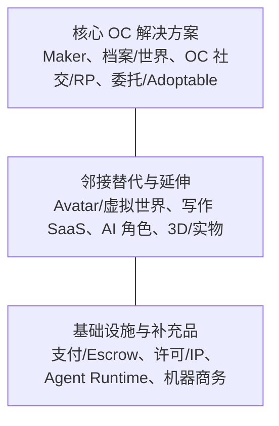
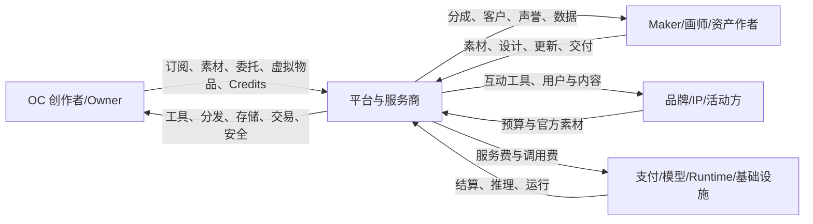

# OC / Character Maker 行业与解决方案研究

**副标题：基于中国、日本、韩国、英语互联网与全球性产品公开样本的用户需求、解决方案、区域生态和商业模式研究**  
**研究截点：** 2026-08-12  
**版本：** 2.0  
**研究性质：** 公开资料桌面研究，不构成投资、法律或财务意见

---

## 目录

- [执行摘要](#执行摘要)
- [第一编　市场边界与统一分析框架](#第一编市场边界与统一分析框架)
- [第二编　用户问题与当前解决方案](#第二编用户问题与当前解决方案)
- [第三编　区域生态](#第三编区域生态同一角色对象的不同产业组织方式)
- [第四编　重点产品案例](#第四编重点产品案例供给留存与价值捕获)
- [第五编　商业模式、竞争机制与行业判断](#第五编商业模式竞争机制与行业判断)
- [附录 A　检索方法与全量边界](#附录-a检索方法收录规则与全量边界)
- [附录 B　分类产品与解决方案名录](#附录-b分类产品与解决方案名录)
- [附录 C　事实口径与复核清单](#附录-c事实口径与复核清单)
- [附录 D　术语速查](#附录-d术语速查)

---

## 执行摘要

### 底线判断

OC（Original Character，原创角色）/ Character Maker 不是一个可以用单一 TAM、单一用户或单一产品形态描述的市场，而是一组围绕“创造、保存、表达、交易和运行原创角色”形成的相邻子市场。它至少包含开放式 Maker、固定素材换装、角色档案与世界观、OC 社区与角色扮演、委托与 adoptable、Avatar 资产经济、AI 角色，以及支撑上述活动的支付、许可和技术基础设施。

这些子市场的用户部分重叠，但付费对象、供给方式、网络效应和成本结构差异很大。Picrew 与 NEKA 解决视觉创建和 Maker 供给；特盐、Toyhouse、CharacterHub、UnVale 解决角色档案、世界和社区；VGen、YCH、米画师等处理委托和交易；ZEPETO、VRoid、VRChat 将角色延伸为可运行 Avatar；Holoworld、MyShell 等把角色转化为可交互 AI。Daydreams、Virtuals 等只在角色已经成为可执行 Agent 后提供更外围的商务基础设施，不是直接 OC 产品。

公开资料足以确认行业存在多种付费与收入机制——广告、订阅、数字部件、虚拟币、委托、adoptable、Avatar 资产和 AI Credits——但不足以证明每一类都已形成稳定支出池，也不足以形成可信的全球统一市场规模。各平台公开的安装量、评分数、注册数、年度参与人数、在线人数和交易声明不可直接相加，也不能等同于 MAU、GMV 或收入。

### 一页式行业判断

| 决策问题 | 当前答案 | 证据强度 |
|---|---|---|
| 这是一个市场吗？ | 更准确地说，是共享用户和角色对象的一组相邻市场，而非单一品类 | 高 |
| 用户最常解决什么？ | 视觉化、整理发展、展示互动、委托交易、进入 Avatar/AI Runtime | 高 |
| 当前方案成熟吗？ | 固定素材生成、通用社交和部分平台内消费成熟；开放供给、档案和交易成熟度不一，跨方案身份/许可/迁移仍碎片化 | 高 |
| 谁在付钱？ | 玩家/角色创作者、Maker 用户、委托买家、Avatar 消费者、AI 用户、品牌/IP 方 | 高 |
| 谁提供供给？ | Maker 画师、角色创作者、委托画师、资产作者、社区运营者、模型/Runtime 开发者 | 高 |
| 价值在哪里被捕获？ | 广告与订阅、DLC/素材、委托服务费、虚拟物品、AI Credits、企业定制 | 高 |
| 哪些平台最具代表性？ | Picrew、NEKA、特盐、Toyhouse、CharacterHub/UnVale、VGen/YCH、ZEPETO/VRoid、Holoworld/MyShell | 中高 |
| 区域是否相同？ | 否：中国偏移动“养 OC”与功能汇流；日本偏开放 Maker 与 Avatar；韩国偏规模化固定素材换装；英语互联网偏档案、adoptable、委托和反 AI 社群规范 | 中高 |
| Web3 是当前主流吗？ | 不是；Daydreams、Virtuals 等属于可执行 Agent 的远邻接基础设施 | 中高 |
| 最大未知是什么？ | 统一 TAM、真实 MAU/留存、跨工具迁移意愿、许可功能的付费意愿和 AI 的真实采用率 | 高 |

### 当前解决方案已经解决什么

- **固定素材视觉创建高度成熟，开放供给的质量与作者经济仍不均衡。** 用户可以在开放 Maker、固定素材 App、AI 生成和 3D 编辑器之间选择；商店中通用头像生成器供给充足，但高质量作者生态并非处处成熟。
- **角色档案与世界观已有大量可用方案。** 从 Toyhouse、特盐到 World Anvil、Ocie，不同产品覆盖公开主页、世界、关系、时间线、本地隐私和协作。
- **展示、RP 和事件各有成熟形态。** Feed、以 OC 身份发言、语C、World/Forum 和 Art Fight 式活动满足不同社交强度。
- **委托和角色交易已有实际市场基础设施。** VGen、YCH、米画师、画加、Toyhouse 等分别处理发现、报价、托管、交付、拍卖、声誉或权属转移。
- **Avatar 和 AI 扩大了角色的使用场景。** ZEPETO、VRoid、VRChat、REALITY、Holoworld、MyShell 等让角色进入直播、虚拟世界、视频和对话。

### 尚未被一致解决的问题

以下首先是“跨平台能力缺口”，并不自动等同于已经验证的商业机会：

- Creator、Designer、Owner、Copyright Owner 和 Licensee 的语义不统一；
- 使用、修改、商业、周边、转售和 AI 权限大量停留在自然语言说明；
- Maker 输出、角色档案、委托交付和 Runtime 身份通常没有共同 ID；
- 数据导出、备份和平台停服恢复能力不一致；
- 未成年人、角色身份、私聊、虚拟币与情感型 AI 叠加后，治理成本显著增加；
- 全生命周期整合是否优于模块化工具组合，尚缺用户迁移行为和付费数据证明。

### 区域格局

| 区域 | 本轮可见产品形态 | 代表产品 | 主要商业模式 | 关键文化/治理特征 |
|---|---|---|---|---|
| 中国大陆 | 移动 OC 档案、世界观、语C、AI 互动、约稿；功能快速汇流 | NEKA、特盐、米球岛、万叙集、临界、随变、米画师 | 订阅、虚拟币、广告、委托、DLC/许可 | “养 OC”语境强；未成年人、生成内容标识和拟人化互动监管重要 |
| 日本 | 开放 2D Maker、固定素材换装、Avatar/直播与 IP 联动 | Picrew、CHARAT、VRoid、Custom Cast、REALITY、Purenista | 广告、订阅、gacha、企业定制、资产销售 | “うちの子”文化、作者逐作品许可、Avatar 消费成熟 |
| 韩国 | 工业化固定素材换装、多角色场景、Avatar 社交 | PitzMaker、SeyeonSoft 系列、ZEPETO | 广告、IAP、虚拟物品、创作者资产 | 移动优先、素材运营和全球化分发强 |
| 英语互联网/北美 | 长期档案、adoptable/closed species、委托、RP 与活动 | Toyhouse、CharacterHub、UnVale、Art Fight、VGen、YCH | 订阅、交易费、众筹、委托服务 | 创作者自定义条款强；AI-free/NFT 反感在部分核心社群中明显 |
| 欧洲及其他区域 | 本轮缺乏足够独立证据 | 多使用全球英语平台或本地私域 | 不宜推断 | 需要补充欧洲、东南亚、拉美和成人/私域生态研究 |

### 阅读边界

本报告的重点是回答“行业由哪些问题和解决方案组成、不同地区和产品如何实现它们”。它不把功能缺口直接表述为市场机会，也不推算缺乏底层数据的 TAM。

---

## 第一编　市场边界与统一分析框架

### 1. 研究问题、范围与证据

#### 1.1 本报告回答的问题

1. OC / Character Maker 行业的核心边界是什么？
2. 用户、创作者、平台和其他参与者分别在完成什么任务？
3. 当前有哪些解决方案范式，它们解决到什么程度？
4. 中国、日本、韩国和英语互联网为何形成不同的产品结构？
5. 哪些平台代表了不同的供给、留存和商业模式？
6. 行业价值由谁创造、由谁支付、由谁捕获？
7. AI、Avatar、Web3 和 Agent 与传统 OC 市场的真实关系是什么？
8. 哪些结论已有充分证据，哪些仍只是供给缺口或研究假设？

#### 1.2 关键术语

| 术语 | 本报告定义 | 不自动意味着什么 |
|---|---|---|
| OC | 由创作者有意设定、具有可辨识身份的原创角色 | 不要求已画成完整立绘，也不要求上链 |
| Character Maker | 通过部件、参数或结构化生成创建角色外观/配置的工具 | 不一定开放第三方作者上传素材 |
| UGC Maker Platform | 独立作者能够发布一套供他人组合的 Maker | 不等同于用户只上传生成后的图片 |
| Character Archive | 保存角色设定、图片、关系、世界或历史的产品 | 不等同于版权登记或交易市场 |
| Adoptable | 可以被领取、购买或转移的角色设计/角色对象 | “Owner”不自动取得全部著作权 |
| Avatar | 用户在直播、社交或虚拟世界中的可运行形象 | 不一定是独立 OC，也不一定支持多个角色 |
| AI Character | 通过模型生成内容或进行角色化互动的系统 | 不一定具备行动能力或可验证身份 |
| Agent | 能调用工具、执行任务或改变外部状态的软件实体 | 不一定是一个完整角色，也不一定具有创作者权利模型 |

#### 1.3 三圈市场边界

##### 核心市场

- 视觉 Maker 与独立作者供给；
- OC 档案、关系、世界和长期管理；
- OC 展示、社区、语C、RP 和事件；
- 委托、YCH、adoptable、权属转移和许可。

##### 邻接市场

- Avatar 创建、直播、虚拟世界和虚拟物品；
- 写作、世界观和 Campaign SaaS；
- AI 图像、角色聊天、陪伴和视频；
- 3D 模型、桌游微缩人偶和实体周边。

##### 基础设施与远邻接补充品

- 支付、托管、退款和争议处理；
- IP、许可、来源和衍生关系；
- 作为远邻接的 Agent Runtime、工具调用和任务市场；
- 作为历史/候选设计的链上凭证与结算。

这种分层允许比较相关产品，同时避免把 Picrew、World Anvil、Character.AI 和 Daydreams 误认为同一竞争集合。

#### 1.4 检索与证据口径

本轮使用 Apple iTunes Search API 对中国、美国、日本和韩国区进行多语言关键词检索，并通过 Google Play 官方详情页、产品官网、帮助中心、服务协议、定价页、公司公告和一手访谈交叉核验。完整检索词、收录排除规则和漏项边界见附录 A。

证据采用三级标记：

| 等级 | 定义 | 典型来源 |
|---|---|---|
| A | 可直接核验的产品事实 | 官网、官方帮助/条款、官方商店、公司公告 |
| B | 平台自报但未经独立审计 | 注册数、创作者数、内容量、交易量声明 |
| C | 用户证言、站内讨论或二手资料 | Reddit、论坛、Wiki、媒体转述 |

本报告的“置信度”针对结论，不等同于单条来源等级。多个 A 级产品事实可以支持高置信行业模式；单个平台功能更新通常只能支持低至中置信趋势假设。

#### 1.5 数据限制

- App Store 评分数不是安装量或 MAU；
- Google Play 安装档位是累计范围，不是精确下载或活跃；
- 注册用户、创作者账户、角色数、Maker 数和 PV 不能相加；
- 活动参与者只代表特定活动；
- `Users Online` 是抓取时点并发，不是日活；
- 免费下载不代表没有广告、订阅或 IAP；
- 没有公开费率不等于平台不收费；
- 本轮缺乏足够的收入、GMV、留存、CAC、LTV、毛利和 cohort 数据，因此不提供统一 TAM 或“单位经济”结论。

---

### 2. 参与者、用户任务与价值流

#### 2.1 参与者不是同一类“创作者”

| 参与者 | 提供什么 | 主要需求 | 常见收入/支出 |
|---|---|---|---|
| OC 原始创作者 | 角色概念、身份、人格和世界 | 保存、表达、发展、控制使用范围 | 为 Maker、委托、订阅和资产付费；也可能出售许可 |
| Maker 作者 | 分层素材、组合规则、更新和 QA | 发行工具、获得使用反馈与收入 | 广告分成、DLC、许可、B2B 定制 |
| 视觉 Designer / 委托画师 | 角色设计、立绘、服装、场景 | 找客户、收款、交付、保护作品 | 委托费、授权费、周边收入 |
| 角色 Owner / Collector | 持有、管理或转移角色对象 | 来源证明、展示、交易、二次创作 | 为 adoptable、委托、订阅和交易服务付费；也可能出售/转移角色 |
| 世界观作者 / RP 玩家 | Lore、关系、剧情和活动 | 协作、规则、发现同好 | SaaS、会员、虚拟币、活动支持 |
| Avatar / 资产作者 | 3D 模型、服装、道具、世界 | 资产制作、审核、销售和跨应用使用 | 虚拟物品和资产销售 |
| AI Character 作者 | Persona、Knowledge、Workflow、模型配置 | 一致性、成本、部署、变现 | Credits、订阅、使用收入、Patron |
| 平台运营方 | 工具、分发、社区、交易和治理 | 供给、留存、收入、安全与合规 | 广告、订阅、抽成、企业服务 |
| 品牌/IP 方 | 官方角色、素材和活动预算 | 低成本互动、获客、内容营销 | B2B Maker、联名、虚拟物品和活动 |

Creator、Designer、Owner、Copyright Owner 和 Licensee 可能是同一人，也可能完全不同。把他们合并为一个“作者”字段，会直接导致交易和许可误解。

#### 2.2 五类核心用户任务

行业不宜被描述成一条人人都会走完的线性生命周期。更准确的模型是五类可以独立发生、也可以组合的任务：

| 用户任务 | 用户真正想完成的事 | 当前主要方案 | 整体成熟度 |
|---|---|---|---|
| 视觉创建 | 快速形成可识别外观，或为作品生产视觉资产 | UGC Maker、固定素材 App、AI 生成、3D 编辑 | 高 |
| 整理与发展 | 保存设定、形态、关系、世界、历史和创作资产 | OC 档案、世界观 SaaS、本地管理工具 | 中高 |
| 展示与互动 | 让角色被看见、获得反馈、以角色身份互动或共同创作 | Feed、World/Forum、语C、RP、事件 | 中高，但高度分化 |
| 委托与交易 | 找画师、购买设计、交付资产、转移角色和取得许可 | Commission、YCH、adoptable、Marketplace、Masterlist | 中 |
| 进入 Runtime | 将角色用于直播、游戏、虚拟世界、对话、视频或任务 | Avatar、虚拟物品、AI Character、Agent | 从成熟到早期不等 |

#### 2.3 六类横向基础能力

以下能力不是“最后一个环节”，而是横跨五类任务：

1. **身份与来源：** 角色、Maker、素材和贡献者如何被识别；
2. **权利与许可：** 谁能使用、修改、商用、转售、训练或运行；
3. **版本与可携带性：** 数据能否导出、迁移、恢复和跨产品解析；
4. **支付与争议：** 报价、托管、退款、chargeback 和交付证据；
5. **隐私与安全：** 未成年人、NSFW、角色冒充、私聊和情感依赖；
6. **内容来源与 AI 治理：** 人类创作、授权 AI、训练来源和生成标识。

#### 2.4 问题—解决方案覆盖矩阵

符号：`●` 为核心能力，`○` 为辅助能力，`—` 为通常不提供。

| 方案范式 | 视觉创建 | 整理发展 | 展示互动 | 委托交易 | Runtime | 来源/许可 | 可携带性 |
|---|:---:|:---:|:---:|:---:|:---:|:---:|:---:|
| 开放 UGC Maker | ● | ○ | ○ | ○ | — | ○ | 低至中 |
| 固定素材 Maker | ● | ○ | ○ | — | ○ | 低 | 低 |
| OC 档案社区 | — | ● | ● | ○ | — | ○ | 低至中 |
| 世界观 SaaS/本地工具 | — | ● | ○ | — | — | 低 | 中至高 |
| OC 身份社交/RP | ○ | ○ | ● | — | ○ | 低 | 低 |
| 委托/Adoptable 平台 | ○ | ○ | ○ | ● | — | 中至高 | 低至中 |
| Avatar/虚拟世界 | ● | ○ | ● | ● | ● | 中 | 低至中 |
| AI Character 平台 | ● | ○ | ● | ○ | ● | 低至中 | 低 |
| 权利/支付基础设施 | — | — | — | ○ | — | ● | 取决于标准 |

矩阵显示的是供给覆盖，不代表用户一定需要一个产品同时覆盖全部能力。模块化工具组合可以保留专业深度和社区边界；一体化产品则可能减少切换，但会增加审核、隐私、支付和信息架构负担。

#### 2.5 价值流

行业没有单一价值捕获中心。视觉 Maker 可能主要由广告和订阅变现；委托平台按交易服务获利；Avatar 平台依赖虚拟物品；AI 平台按算力和功能收费；档案社区则依靠高级展示、容量和会员。

---

## 第二编　用户问题与当前解决方案

### 3. 视觉创建与 Maker 供给

#### 3.1 用户和供给侧的问题

OC 创作者需要在没有完整绘画能力或预算时快速获得可识别外观；专业作者则需要高效生产大量 NPC、设卡、直播形象或参考图。Maker 作者的问题不同：他们需要拆分素材、定义组合规则、处理配色、测试兼容、更新内容、说明许可并获得传播或收入。

#### 3.2 四种主要解决方案

| 方案 | 核心机制 | 代表产品 | 优势 | 主要限制 |
|---|---|---|---|---|
| 开放 UGC Maker | 作者发布完整分层 Maker，玩家组合 | Picrew、NEKA、Meiker.io | 风格多样、作者供给可扩张 | 生产劳动大，许可逐 Maker，输出连续性弱 |
| 固定素材 Maker | 运营方生产全部部件和更新 | CHARAT、PitzMaker、Pastel Girl、Gacha、ChibiStudio | 品质和体验统一、移动端成熟 | 普通作者不能供给素材，内容依赖运营方 |
| 可售资产市场 | 作者销售头发、服装、身体、道具或完整 Avatar | VRoid/BOOTH、ZEPETO、Roblox、VRChat | 收入闭环和持续身份更强 | Maya/Blender/Unity 等门槛高，审核复杂 |
| AI-native 创建 | 文本/参考图生成外观、一致图、动画或可 remix Maker | OCMaker.net、Days AI、OC Idol | 产能高、个性化快 | 训练来源、风格一致性、权利和社区接受度分化 |

在本轮公开样本中，真正允许独立作者发布“供别人继续组合的完整 Maker”的主流产品并不多。可由官方资料核验的核心样本是 [Picrew](https://picrew.me/)、[NEKA](https://www.neka.cc/) 和 [Meiker.io](https://meiker.io/)；VRoid、ZEPETO、Roblox 属于资产供给，VRChat 更偏完整成品 Avatar。

#### 3.3 作者生产工作流影响供给上限

Picrew 使用 Part、Layer、Color、Item 模型，作者往往需要为“图层 × 颜色 × 选项”上传透明 PNG。[Picrew 创作说明](https://support.picrew.me/en/create_imagemaker/create_first) NEKA 采用相似的分层结构，但增加智能上色、实时调试和 iOS 创作。[NEKA 创作工具](https://docs.neka.cc/tutorial/app-maker) Meiker 允许用带标签 PSD 批量导入，降低手工配置成本。[Meiker 制作说明](https://meiker.io/instructions)

因此，开放 Maker 的供给壁垒不仅是画风，还包括：

- 拆层与命名规范；
- 配色和联动规则；
- 部件遮挡、顺序和组合 QA；
- 更新兼容和旧配置处理；
- 作者审核、侵权识别和许可说明；
- 玩家作品对作者的反馈和归因。

#### 3.4 保存单位与用户结果

| 产品形态 | 常见保存单位 | 能否持续编辑 | 主要风险 |
|---|---|---|---|
| Web Maker | PNG，有时保存选项配置 | 取决于 Maker 是否仍存在 | 作者删除/改版后配置失效 |
| 固定素材 App | 本地角色槽、代码或账户状态 | 通常可以 | 换设备、卸载或停更导致丢失 |
| 3D 编辑器 | `.vroid`、VRM、工程文件 | 格式依产品而定 | 导出格式与可编辑工程不等价 |
| Avatar 世界 | 账户库存和在线身份 | 平台内可持续 | 平台锁定和停服 |
| AI 生成 | 图片、角色 Profile、模型配置 | 平台内可迭代 | 模型变化、成本和来源不透明 |

Picrew Premium 能保存组合状态，但保存依赖原 Maker 结构；Gacha 以角色槽或代码保存；VRoid 能保存可编辑 `.vroid` 并导出 VRM；ZEPETO/VRChat 则将 Avatar 与账户和库存绑定。这些不同保存单位显著影响角色后续能否升级和迁移。

#### 3.5 商业模式和成熟度

- Picrew：广告、App 订阅和企业定制；未见面向普通 Maker 作者的普遍平台分成机制；
- NEKA：广告、DLC、付费二改授权和作者提现；二改授权不含商用，商用需另行取得作者许可；
- Meiker：广告及面向作者的可下载版本服务；
- 固定素材 App：广告、奖励广告、素材包、订阅或 gacha；
- VRoid/BOOTH、ZEPETO、VRChat、Roblox：资产销售和创作者分成；
- AI Maker：Credits、Premium 和商业使用升级。

视觉创建是行业最成熟的任务，但“开放作者供给 + 低生产门槛 + 清晰许可 + 作者收入 + 持久角色数据”仍很少由同一方案同时实现。这里能确认的是功能组合稀缺，不能仅凭这一点推断用户愿意为完整组合迁移或付费。

---

### 4. 角色档案、世界观与长期连续性

#### 4.1 用户问题

当角色不再只是一张头像，用户需要保存：名字、背景、性格、多个形态、服装、参考图、色板、关系、世界、时间线、委托历史、创作者信息和公开范围。文字型 OC 甚至可能在获得第一张图之前就已经存在。

#### 4.2 三种当前方案

| 方案 | 代表产品 | 核心对象 | 优势 | 局限 |
|---|---|---|---|---|
| 公开 OC 档案社区 | Toyhouse、CharacterHub、UnVale、特盐 | 角色页、图库、World、关系、动态 | 展示与社区反馈强 | 数据模型平台化、导出不一致 |
| 世界观/写作 SaaS | World Anvil、Campfire、Notebook.ai、Kanka | 世界、文章、地图、时间线、手稿 | Lore 深度、协作和模板强 | 视觉 OC 社交和权属弱 |
| 私密/本地管理工具 | Ocie、轻创集、Fantasia Archive、Obsidian | 私有角色、关系、世界和文件 | 隐私、离线和导出较好 | 发现、社区和交易弱 |

[CharacterHub](https://characterhub.com/blog/character-resources/character-organizer) 以模块化 Profile、World 和 Collection 组织角色；[UnVale](https://help.unvale.io/en/articles/12785689-character-pages) 提供角色页、Traits、图库、水印和隐私；特盐、米球岛、轻创集等中国移动产品强化关系网、多个形态、时间线和世界；[World Anvil](https://www.worldanvil.com/) 和 [Campfire](https://www.campfirewriting.com/) 则从写作与世界构建出发。

#### 4.3 数据模型差异

角色档案至少涉及五类对象：

1. **身份字段：** 名称、标签、简介、种族、属性；
2. **视觉资产：** 参考图、色板、服装、不同年龄/形态；
3. **叙事对象：** 世界、地点、组织、事件、时间线；
4. **关系对象：** 亲属、伙伴、敌对、共同经历；
5. **来源与管理：** Creator、Designer、Owner、上传者、隐私和授权。

不同产品对这些对象的优先级不同。Toyhouse 擅长图片、角色 Tabs、World 和圈内 Credit；特盐和米球岛强化移动“养成”、关系和轨迹；World Anvil/Campfire 强调文章、地图和写作；Ocie 强调本地/iCloud、搜索、备份和私密数据。

#### 4.4 留存机制

档案产品的留存主要不是“每天发帖”，而是累计数据和引用关系形成的迁移成本：

- 角色图片和历史版本增加；
- 关系、世界和时间线变复杂；
- 外部委托和社交页面引用同一档案链接；
- 其他用户的角色与自己的角色建立关系；
- 平台模板、HTML/CSS 或展示风格成为身份表达的一部分。

这些机制可能形成用户切换成本，但公开资料缺少留存率、迁移率和多平台使用比例，不能据此判断某个平台的真实网络效应强度。

#### 4.5 导出、备份与停服

半次元、V-Katsu、Rinmaru 独立站、Ready Player Me 等退出样本使“数据能否带走”成为现实问题。不同用户对一体化迁移的需求强度仍需访谈验证，但至少可以确认：只保存网页链接或最终 PNG，无法保留结构化关系、Creator/Designer 信息、许可版本和委托历史。

一个完整备份可能需要包括 JSON、原图、缩略图、文档、关系、世界、时间线、来源和许可收据。当前不同产品的导出能力差异较大，尚无跨平台通用标准。

---

### 5. 展示、社区、角色扮演与事件

#### 5.1 社交需求并不相同

OC 社交至少包含四种需求：

- 展示作品和角色设定，获得收藏与评论；
- 关注创作者、角色或世界的持续更新；
- 以 OC 身份发言、建立角色关系或进行语C/RP；
- 参加 Prompt、企划、closed-species ARPG、Art Fight 等共同创作活动。

#### 5.2 四种解决方案

| 方案 | 代表产品 | 核心循环 | 主要治理压力 |
|---|---|---|---|
| 低压力发现与外部分发 | Picrew | 发现 Maker→生成→外部分享 | 许可误用、来源和外链传播 |
| 档案社区 | Toyhouse、CharacterHub、UnVale、特盐 | 发布角色/作品→关系/评论→持续完善 | 盗图、内容分级、交易纠纷 |
| OC 身份社交/RP | OCSN、PPL、小C界、语C产品 | 以角色发言→互动→关系/剧情 | 冒充、骚扰、现实身份边界 |
| 事件型共同创作 | Art Fight、企划/ARPG | 活动规则→为他人创作→反馈/积分 | 原创性、AI、评分和公平性 |

Picrew 一手访谈强调减少点赞和评论压力，说明“弱站内社交”可能是有意设计，而不是简单功能缺失。相反，CharacterHub 通过 Quest、Rolechat 和活动推动角色完善；特盐增加 OC 身份群聊；[Art Fight](https://artfight.net/info/about)每年 7 月集中激活创作者，其 2025 年平台统计约 607,932 名参与者和 2,753,001 次 attacks，但这不能视为全年 MAU。

#### 5.3 网络效应与迁移成本

不同社交产品依赖不同网络：

- Picrew 的网络来自 Maker 作者和外部分享；
- Toyhouse 来自角色档案、关系、World、模板和交易历史；
- OCSN/PPL 来自活跃 OC 身份和互动密度；
- Art Fight 来自年度活动规模和互惠创作规范；
- closed species 来自规则、Masterlist、稀有 Trait 和社群声誉。

“用户多”不足以解释产品切换成本。更关键的问题是：供给是否独特、关系是否不可轻易迁移、历史是否被外部引用、社群规则是否获得认可，以及退出是否意味着失去声誉或权属证明。

#### 5.4 AI 与社区信任分化

[UnVale](https://help.unvale.io/en/articles/8927131-what-is-unvale)将自身定位为 Never-NFT / Anti-AI 社区；[Art Fight Rules](https://artfight.net/info/rules)全面禁止生成式 AI；CharacterHub Marketplace 和 [YCH](https://ych.commishes.com/)也限制 AI 作品。另一方面，Days AI、OCMaker、随变、Holoworld 等以 AI 生成和互动为核心。

这不是简单的“先进/保守”差异，而是两套不同的信任机制：

- 人类创作社区依赖作者劳动、风格、署名和同意；
- AI-native 社区依赖生成效率、角色一致性、互动量和模型能力。

未来两类产品可能通过清晰标识和选择性互操作共存，但当前没有证据表明核心 anti-AI 社群会整体转向 AI-native 平台。

#### 5.5 未成年人和角色身份

OC、换装和语C产品中存在大量青少年用户。角色身份、匿名性、私聊/群聊、虚拟币和成人内容叠加后，需要：年龄和 NSFW 分层、陌生人限制、举报/申诉、角色与真人身份标识、充值控制、聊天审核和数据删除。若再引入情感型 AI，还会增加依赖、操纵和危机干预问题。

---

### 6. 委托、Adoptable 与角色交易

#### 6.1 三种不同交易

| 交易类型 | 用户购买的核心对象 | 代表方案 | 常见误解 |
|---|---|---|---|
| Commission | 画师按约定制作的新作品或设计服务 | VGen、米画师、画加、Artistree | 付款不一定包含商业权或源文件 |
| YCH / Adoptable | 预设姿势作品、角色设计或可转移角色对象 | YCH.Commishes、Toyhouse、CharacterHub | 买到 Owner 身份不等于取得完整著作权 |
| License / Asset | 使用某个 Maker、部件、Avatar 或内容的许可 | NEKA、BOOTH、ZEPETO、VRChat | 获得使用权不一定获得转售或修改权 |

#### 6.2 当前工作流

典型委托流程包括：发现画师→确认范围与许可→报价/排队→支付→草图和修改→交付→评价/争议。VGen 将 Proposal、Instant Order、里程碑、队列和评价放入平台，并在 2026 年提供 Personal、Commercial Content、Commercial Merchandising 标准许可。[VGen 委托流程](https://help.vgen.co/hc/en-us/articles/12820045188119-How-does-the-VGen-commission-system-work)、[标准许可](https://help.vgen.co/hc/en-us/articles/29122353993495-Standard-Usage-Licenses)

Toyhouse 的 adoptable 流程则通常是站内发现、评论或私信谈价、PayPal/Ko-fi 等站外付款，再回到 Toyhouse 发起 Ownership Transfer。[Toyhouse 交易讨论](https://toyhou.se/~forums/14421.help-questions/620260.genuine-question-how-to-start-selling-adopts) 它提供圈内档案和转移日志，但不负责托管和退款。

#### 6.3 权利角色必须分开

| 角色/权利 | 回答的问题 |
|---|---|
| Creator | 谁最初创造角色身份或概念？ |
| Designer | 谁完成视觉设计或某次 redesign？ |
| Current Owner | 谁当前持有圈内角色对象或平台记录？ |
| Copyright Owner | 谁依法持有相关作品的著作权？ |
| Licensee | 谁在什么范围内获得使用许可？ |
| Custodian | 谁代为保存、运营或展示？ |
| Revenue Beneficiary | 谁对某种收入事件享有分成？ |

Toyhouse 已原生区分 Current Owner、Creator、Designer、Ownership Log 和能否 regift/retrade/resell。[Ownership 示例](https://toyhou.se/21691224.pinacolada/ownership) 但这些社会语义仍不足以表达地域、期限、媒体、商业内容、周边、AI 训练和转授权。

#### 6.4 Escrow、退款和争议

不同支付方式的风险显著不同：

- 平台托管能在交付或里程碑前保留资金，但增加客服、合规和欺诈成本；
- PayPal 直接付款对画师到账快，但可能面临退款和 chargeback；
- 站外现金工具与站内 Ownership Log 分离，难以自动证明付款和许可；
- 未成年人、跨境支付、汇率、税务和身份验证进一步增加复杂度。

VGen 的买家保障区分 VGen Payments/Stripe 与 PayPal 的资金处理方式；Toyhouse Service Reviews 更像声誉和举证空间，不是仲裁机构。closed species 还常需在 Toyhouse、Discord 和 Lorekeeper/Masterlist 三处同步状态。

#### 6.5 价值捕获

交易产品可以向买方、卖方或双方收费，也可以通过订阅、曝光、支付服务和增值工具获利。CharacterHub 2026 Marketplace [官方说明](https://characterhub.com/blog/oc-ideas/closed-species)显示卖家无上架/平台费、买家约承担 10%；NEKA 银行通道文档显示产品侧约 15%；UnVale 和 Toyhouse 主要挂牌和转移，付款站外；VGen、米画师等则把交付或担保作为核心价值。

公开资料不足以比较这些模式的真实 GMV、退款率、客服成本和用户终身价值，因此不能仅凭名义抽成判断哪种模式经济性最好。

---

### 7. Avatar、虚拟世界与 AI 角色运行

#### 7.1 从 OC 到 Runtime 不是必然升级

有些用户只需要静态角色卡，有些需要直播 Avatar、游戏模型、AI 对话或能执行任务的 Agent。把所有 OC 描述为必然走向 Agent，会忽略创作、收藏和叙事本身的价值。Runtime 应被视为一类独立使用任务，而不是角色成熟度的唯一方向。

#### 7.2 Avatar 解决方案

| 形态 | 代表产品 | 角色如何保存 | 经济对象 |
|---|---|---|---|
| 3D 编辑与开放格式 | VRoid Studio | `.vroid` 工程、VRM 导出 | BOOTH 服装/头发/模型资产 |
| 平台 Avatar 与世界 | ZEPETO、Roblox、IMVU | 账户身份与库存 | 虚拟物品、UGC 资产、世界 |
| 直播 Avatar | Custom Cast、REALITY | 账户配置、平台道具 | gacha、礼物、订阅、联动 |
| 成品 Avatar 市场 | VRChat | 账户购买和 SDK 上传 | 完整 Avatar、Credits |
| 实物/桌游角色 | Hero Forge、Eldritch Foundry | 在线设计、STL或订单 | 数字文件、订阅、实体模型 |

[VRoid Studio](https://vroid.com/en/studio) 对动漫 OC 和 VTuber 创作者较友好，并通过 BOOTH 形成资产交易；[ZEPETO Studio](https://studio.zepeto.me/) 允许作者制作纹理、3D 道具和世界；VRChat Avatar Marketplace 则出售可在平台内持续使用的完整 Avatar。

Avatar 经济的优势是角色具有持续使用场景和重复消费，限制是身份、资产和社交图往往被锁在平台账户中。即使支持 VRM 等格式，可编辑工程、导出模型和平台库存也不是同一类权利。

#### 7.3 AI Character 的三种形态

| 形态 | 主要能力 | 代表产品 | 关键问题 |
|---|---|---|---|
| AI 视觉生成 | 一致图、风格、换装、动画 | Days AI、OC Idol、OCMaker、随变 | 训练来源、角色一致性、权利 |
| AI 聊天/陪伴 | Persona、长期对话、故事和记忆 | Character.AI、PolyBuzz、筑梦岛、Redbean | 隐私、依赖、内容安全、模型变化 |
| 可部署角色 Agent | Knowledge、Voice、Avatar、Tool/API | Holoworld、MyShell、elizaOS | 能力边界、成本、来源、部署和变现 |

[Holoworld](https://docs.holoworld.com/holoworld/agent-market/create-agent)允许定义名称、Persona、Greeting、Scenario、Example Dialogue、Knowledge、Lorebook、语音和 Avatar；MyShell 提供模型/API 工作流、Agent 创建、分享和使用收入。[MyShell 定义](https://docs.myshell.ai/about/what-is-myshell)

这些产品使角色“会回应”或“能行动”，但尚未自动继承传统 OC 平台中的 Creator、Designer、委托许可和世界观来源。AI Character 作者也不必然拥有训练数据或生成视觉的完整权利。

#### 7.4 远邻接边界：Agent 商务与 Web3

[Daydreams](https://www.daydreams.systems/) 的 Task Market、Lucid Agents 和机器支付，以及 [Virtuals ACP](https://whitepaper.virtuals.io/acp-product-resources/acp-changelogs) 的 Agent 工作、escrow、结算和评价，都服务于已经能够执行任务的 Agent，而不是 OC 创建、档案或社区。原 Story Protocol 的 IP/衍生关系方案也已在 2026 年 6 月随项目转向 [DATA Network](https://www.datafdn.org/blog/were-becoming-the-data-foundation) 而不再是当前核心定位。

因此本报告只把这些产品作为远邻接边界，完整名录见 B.9。当前没有传统 OC 用户大规模采用它们的公开证据；链上记录也不能自动判断现实版权，不能替代退款、未成年人保护、平台申诉和司法救济。OC → AI Character → Agent 不是必然路径，强制钱包或 Token 还可能与部分创作者社群的 anti-NFT 规范冲突。

---

### 8. 横向基础能力与治理

#### 8.1 身份、来源与版本

一个角色可能包含原始概念、多个视觉 Designer、Maker 输出、委托作品、服装、3D 模型和 AI Persona。当前平台通常只记录其中一部分。来源系统至少需要区分角色身份、资产、版本、贡献者和上传者，否则同一“Owner”字段无法解释谁创造了什么。

#### 8.2 许可与 AI 权限

Picrew 允许作者分别设置 Personal、Non-Commercial、Commercial 和 Processing；NEKA 以默认非商业和付费二改授权为主，二改不包含商用；VGen 提供个人、商业内容和商业周边标准许可；VRoid、ZEPETO、VRChat 又有各自资产规则。

跨平台仍缺乏统一语义，特别是：

- 是否可用于盈利直播和广告内容；
- 是否可制作实体或数字周边；
- 是否可修改、合成或拆分素材；
- 是否可转售或转授权；
- 是否可用于 AI 训练、Embedding、风格适配或推理输入；
- 许可是否受地域、期限、数量和署名约束。

作者条款的自然语言灵活，但难以自动执行；结构化许可便于理解，却可能无法覆盖复杂法律语境。两者通常需要并存。

#### 8.3 可携带性与停服恢复

可携带性至少有四层：

1. 能导出最终图片；
2. 能导出结构化角色和关系；
3. 能导出可编辑 Recipe、工程或模型；
4. 能带走来源、许可、交易和版本历史。

大多数产品只覆盖第一或第二层。开放格式也不必然解决服务依赖：VRM 能承载模型，不会自动带走 ZEPETO/VRChat 的库存、社交图或商业条款。

#### 8.4 支付、分账与争议

支付能力不仅是“是否能收钱”，还包括报价锁定、里程碑、资金托管、税费、退款、chargeback、交付证明、多人分账和跨境合规。Maker、委托、adoptable 和 Agent 任务需要的合同与争议机制并不相同。

#### 8.5 隐私、内容和未成年人安全

角色公开身份、真实用户身份、私密草稿、群聊和 AI 记忆必须分层。青少年用户和成人内容共存的产品尤其需要：年龄验证或分级、默认隐私、陌生人限制、举报申诉、删除和导出、充值控制、危机提示以及透明审核。

#### 8.6 横向能力成熟度

| 能力 | 当前行业状态 | 代表性成熟方案 | 主要缺口 |
|---|---|---|---|
| 角色 Profile | 成熟 | Toyhouse、特盐、CharacterHub、UnVale | 数据模型和导出不统一 |
| Maker 许可 | 中等 | Picrew、NEKA | 逐 Maker 自然语言、跨平台不可继承 |
| 委托许可/托管 | 中等至成熟 | VGen、米画师 | 跨境、站外支付和复杂权利仍难 |
| Ownership Log | 圈内成熟、法律语义有限 | Toyhouse、CharacterHub、Lorekeeper | Owner 与版权/许可混淆 |
| Avatar 资产交易 | 成熟 | ZEPETO、Roblox、VRChat、BOOTH | 平台锁定、格式与权利差异 |
| AI 来源和训练许可 | 早期且分裂 | AI 标识、社群禁令、逐作者 opt-out | 缺机器可执行同意和统一来源标准 |
| 跨平台角色迁移 | 早期 | JSON/ZIP 导出、VRM、局部 API | 缺共同身份、关系、许可和交易历史 |

---

## 第三编　区域生态：同一角色对象的不同产业组织方式

### 9. 区域比较方法

区域差异不只是“哪些产品更流行”，还体现在用户把什么视为角色核心、创作者如何进入供给、作品在哪里传播，以及平台从何处获利。本编用同一组维度比较中国大陆、日本、韩国、英语互联网/北美和欧洲可见样本：

1. 用户文化与长期保存对象；
2. 可见品类与代表产品；
3. 分发渠道与社交外溢；
4. 创作者供给机制；
5. 商业模式与价值捕获；
6. 权利、AI 与社区治理；
7. 区域独特信号与数据盲区。

平台的注册地、运营公司所在地、主要语言、App 上架地区和实际用户市场并不是同一件事。Picrew、ZEPETO、Toyhouse 等都被跨区域使用，因此本编解释的是“生态重心”，不是把全球平台机械归入单一国别。

### 10. 中国大陆：从“设卡”工具快速汇流为移动养 OC 系统

#### 10.1 用户文化与品类结构

中国用户常用“养 OC”描述长期投入：角色先有外貌、人设和设卡，随后增加多个形态、关系、世界、时间线、委托稿和语C经历。移动端是主要操作场景，角色资料在专门 App 中维护，传播和交易又大量外溢到微博、B站、QQ群和画师平台。角色因此更像持续更新的个人创作对象，而不是一次性头像。

公开样本呈现三类主干，并正相互进入：

| 主干 | 代表平台 | 主要解决问题 | 当前演化 |
|---|---|---|---|
| 开放 Maker | [NEKA](https://www.neka.cc/) | 低门槛捏人、作者发布分层 Maker | 已有 DLC 与二改授权；平台化商用商品仍属后续方向 |
| 档案/世界/社区 | [特盐](https://apps.apple.com/cn/app/id1568689293)、米球岛、万叙集、轻创集、临界、幻书 | 设卡、形态、关系、世界、时间线、作品和企划 | 向 Maker、语C、AI 和虚拟商品汇流 |
| 委托基础设施 | [米画师](https://apps.apple.com/cn/app/id1146790989)、画加 | 画师发现、报价、担保、交付和评价 | 向更结构化的服务与许可流程发展 |

捣谷、萌屿、次元箱、次遇和随变等又把 Maker、商城、AI 对话、故事生成或实体周边接入角色流程。这个现象能证明产品供给正在汇流，但还不能证明用户更愿意使用全栈产品，也不能证明全栈模式拥有更好的留存或利润。

#### 10.2 分发、供给与商业化

iOS、国内 Android 商店、Web 和私域共同承担分发。App Store 版本历史可以验证维护状态，却无法覆盖小程序、QQ群、不同 Android 渠道和私密企划；评分量也不能换算为下载或 MAU。

NEKA 采用作者申请、原创样本审核和 Workshop 分层上传；档案社区主要依赖用户自建角色、世界和内容；约稿平台则通过画师认证、作品集、报价和担保交付组织专业供给。由此形成三种不同的供给成本：素材生产与审核、UGC 社区治理、非标准服务履约。

会员、虚拟币、广告、装扮、存储扩容和卡片是常见收入。NEKA 已把 DLC 和二改授权商品化；官方文档明确二改授权不含商用，商用需另行取得作者许可，平台化商用商品仍属后续方向。其公开银行通道结算口径为作者 84.65%、平台 15%、支付服务商 0.35%，提现另收费。[NEKA 结算说明](https://docs.neka.cc/pricing/notice) 约稿平台则从交易服务和担保中捕获价值。

#### 10.3 权利、AI 与独特约束

水印、下载权限、作者声明和禁止去水印仍是主要保护手段；Creator、Owner、商用权和 AI 权限很少被结构化分开。NEKA 的二改与默认非商用边界相对具体，但也没有形成跨平台可继承的统一许可。

生成和陪伴功能扩张后，未成年人、群聊、情感依赖、隐私删除和生成内容标识会与传统 UGC 审核叠加。本报告只把这些列为产品治理问题，不据此推断单个平台已经违法或合规。

中国样本最显著的信号是“档案 + 世界观 + Maker + 社交 + 交易 + AI”快速汇流；最大的证据缺口则是可比 MAU、GMV、付费率、创作者收入分布和私域活动规模。

### 11. 日本：轻量 Maker 与可携带 Avatar 两条生态并行

#### 11.1 用户文化与品类结构

“うちの子”文化强调对自有角色的持续喜爱，但视觉入口往往很轻：用户在 Maker 中完成组合，下载图片，再到外部社交媒体展示。另一批用户把角色制成 VRM 或直播 Avatar，在视频、虚拟空间和创作者商店持续使用。

| 形态 | 代表平台 | 供给单位 | 主要价值 |
|---|---|---|---|
| 开放 2D Maker | [Picrew](https://picrew.me/) | 独立作者发布的一整套 Maker | 画风多样、低门槛生成、外部传播 |
| 固定素材 Maker | CHARAT 等 | 运营方素材库 | 统一品质、稳定更新、移动体验 |
| 3D Avatar 工具/资产 | [VRoid Studio](https://vroid.com/en/studio)、BOOTH | 模型、服装、发型和可导入资产 | VRM 导出、跨 Runtime 使用 |
| Avatar 社交/直播 | Custom Cast、REALITY | 账户 Avatar、装扮、直播内容 | 高频身份使用、礼物和虚拟消费 |
| 长期换装社区 | Pokecolo、Purenista、Pigg Party | 账户库存、房间和社交内容 | gacha、装扮、收藏和社交留存 |

#### 11.2 分发、供给与商业化

Picrew 依赖 Web 搜索、站外社交分享和移动 App 收藏，形成“发现 Maker—生成—分享—回流”的轻量循环；VRoid 依靠创作软件、BOOTH 和兼容 VRM 的外部应用；直播和换装社区则尽量在 App 内完成身份、内容和消费闭环。

三类供给不能用同一种“创作者数”比较：Picrew 作者生产完整 Maker，VRoid/BOOTH 作者生产可混搭资产，固定素材和直播平台则更多依赖内部美术与运营。Picrew 主要从广告、订阅和 Piclab 企业定制获利，普通 Maker 作者缺少普遍分成；BOOTH 承接资产销售；Avatar 社交产品依赖服装、道具、抽取、会员和直播礼物。

#### 11.3 权利、AI 与独特约束

Picrew 允许作者分别设置 Personal、Non-Commercial、Commercial 和 Processing 权限，并要求 AI Maker 披露；平台还禁止用户未经作者同意把输出输入生成式 AI。[Picrew 使用范围](https://support.picrew.me/en/create_imagemaker/scope_of_use) 这是样本中相对成熟的 Maker 级许可，但 PNG 出站后仍缺少可验证凭证。VRM 可导出也不意味着服装、纹理和衍生素材自动共享同一许可。

日本可见样本的一个显著特征，是轻量 2D Maker 与可携带 3D Avatar 同时存在，中间由 BOOTH 式资产市场连接创作和消费。其公开安装量、评分和产品自报多为全球口径，不能推算日本用户份额。

### 12. 韩国：固定素材规模化与 Avatar 平台经济

#### 12.1 用户文化与品类结构

韩国样本中的“자캐”创作常与 Webtoon 式场景表达结合：用户不只生成单人头像，还会放置多个角色、对白、背景和故事。另一条路径是把 Avatar 作为社交账户身份，通过穿搭、拍摄、世界和 Feed 持续经营。

PitzMaker、Character Maker、Pastel Girl、Lily Diary、Lily Story、Pastel Friends 等构成成熟的固定素材 2D 产品群；[ZEPETO Studio](https://studio.zepeto.me/) 则代表开放资产供给、账户 Avatar、社交世界和虚拟物品交易的一体化平台。

#### 12.2 分发、供给与商业化

固定素材 App 借 Google Play 全球化、本地化和图片导出获得长尾流量，多款公开显示千万级累计安装；这只是全球累计档位，不是韩国活跃用户。ZEPETO 的分发更多发生在平台内部：用户购买物品、拍摄内容、进入世界，再通过外部短视频和社交网络扩大影响。

固定素材 App 的部件通常由运营方生产，普通用户只能组合；ZEPETO 开放的是服装、配件和世界等可混搭资产，而不是 Picrew 式独立 Maker。前者主要从广告、奖励广告和 IAP 获利；后者通过 ZEM 虚拟物品和创作者提现形成更完整的市场。

#### 12.3 权利、AI 与独特约束

公开资料更多展示平台级协议和资产审核，较少出现针对每次角色输出的结构化许可。固定素材导出的图片能否商用、修改或用于 AI，需要逐 App 查阅条款；ZEPETO 创作者资产也受账户与平台规则约束。

韩国可见样本呈现一条从“换装”到“多角色场景”、再到 ZEPETO 式 Avatar 经济的产品路径。最大的研究限制是全球安装量无法拆出韩国活跃，本地社区和 Naver Cafe 等半封闭渠道也未被系统覆盖。

### 13. 英语互联网与北美：档案、来源和圈层规范形成制度壁垒

#### 13.1 用户文化与品类结构

该生态更重视长期档案、adoptable、closed species、委托来源和角色转移。用户会区分 Creator、Designer 和 Current Owner，以 HTML/CSS、标签、图库、World 和关系页经营身份；交易、角色扮演和活动则跨 Toyhouse、Discord、Tumblr、DeviantArt、Bluesky 等多站完成。对重度用户而言，转移日志和圈内声誉常比编辑器本身更重要。

| 环节 | 代表平台 | 生态作用 |
|---|---|---|
| 档案和事实来源 | [Toyhouse](https://toyhou.se/)、Refsheet | 角色主页、图库、来源、转移和圈层外链 |
| 现代档案社区 | [CharacterHub](https://characterhub.com/blog/about-characterhub)、[UnVale](https://help.unvale.io/en/articles/8927131-what-is-unvale)、Ocie | 移动体验、活动、社区、隐私和 Market |
| OC 身份社交/RP | OCSN、PPL、RP Repository | 以角色身份发言、互动和共同创作 |
| 世界观工具 | World Anvil、Campfire、Notebook.ai | Lore、地图、时间线、写作和协作 |
| 委托和交易 | VGen、YCH.Commishes、Toyhouse/UnVale listing | 订单、拍卖、声誉、付款和转移 |
| 周期性激活 | [Art Fight](https://artfight.net/info/about) | 年度互绘事件，把档案转为创作交换 |

#### 13.2 分发、供给与商业化

Web、邀请制、外链和 Discord 是关键基础设施，移动 App 是较新的补充。角色展示、报价、支付、交付、转移和 species masterlist 经常分散在不同站点；开放拼接支持细分圈层，也让用户承担备份、诈骗和争议举证成本。

供给主要来自用户上传的角色、插画、代码模板和委托服务，而不是平台素材库。closed-species 社群通过 Toyhouse、Discord、外部 masterlist 或 [Lorekeeper](https://lk-arpg.github.io/lk-docs/v2.1.0/)自行管理 Trait、MYO、Owner 和转售价值。

订阅、档案扩容、委托服务费、拍卖和站外赞助并存。CharacterHub Marketplace 的[公开规则](https://characterhub.com/blog/oc-ideas/closed-species)称卖家不承担平台费、买家承担约 10%；UnVale 原生 Shops 已于 2024 年关闭，当前 Market 的付款仍在站外完成。[UnVale Shops 关闭说明](https://help.unvale.io/en/articles/10087688-sunsetting-of-shops-on-unvale) Toyhouse Premium 与大量 PayPal/Ko-fi 交易说明产品可以捕获档案价值，却未必捕获交易 GMV。

#### 13.3 权利、AI 与独特约束

Creator、Designer、Owner 已是成熟的社会语义，但 Owner 不自动等于版权或商用许可。VGen 提供 Personal、Commercial Content 和 Commercial Merchandising 标准许可；UnVale、Art Fight、CharacterHub Marketplace 和 YCH 以 AI-free 或 creator-first 保护供给侧信任。

由此出现明显的“双轨市场”：AI 角色产品以速度和互动能力增长，人类创作社区则把禁 AI、来源和同意作为差异化。Toyhouse 没有可靠公开 MAU，页面在线人数不能外推；Art Fight 2025 年的 607,932 名参与者和 2,753,001 次 attacks 只代表一届活动。英语互联网也远大于北美，两者无法由现有数据拆分。

### 14. 欧洲、其他区域与跨区域比较

#### 14.1 欧洲可见样本与覆盖盲区

现有样本更容易看到浏览器优先的世界观写作、桌游角色、独立 Maker 和 3D 制作需求，却难以观察法语、德语、西班牙语、意大利语和东欧本地社区。欧洲不是缺少 OC 创作，而是经常被统计进英语互联网或通用工具，失去了独立区域轮廓。

[Meiker.io](https://meiker.io/)允许作者从 PSD 导入完整 Maker；World Anvil、Campfire、Kanka 和 LegendKeeper 代表结构化 Lore、地图和协作；Eldritch Foundry 代表从数字角色走向桌游模型。这些只是欧洲用户可达的产品形态，不足以证明其用户主体或收入主要来自欧洲。

Web SaaS、Discord、Patreon、Ko-fi、Gumroad 和 itch.io 比区域 App 商店更容易被观察。可见商业模式包括广告、SaaS、赞助、数字资产、STL 和实物制造；现有资料不足以比较各国付费意愿、创作者收入或区域渗透率。

拉丁美洲、东南亚、印度、中东和非洲同样是明确盲区。本地语言商店、成人/closed-species 社群、Discord 私服、微信/QQ群、已下架应用和个人部署站都可能漏入。没有本地语言检索与用户访谈，不宜排列这些区域的规模。

#### 14.2 跨区域比较

| 维度 | 中国大陆 | 日本 | 韩国 | 英语互联网 / 北美 | 欧洲可见样本 |
|---|---|---|---|---|---|
| 用户长期保存的核心 | 人设、关系、世界与养成记录 | Maker 输出或可携带 Avatar | 场景作品与账户 Avatar | 档案、来源、转移和圈层声誉 | Lore、Campaign 与工具项目 |
| 可见供给结构 | 审核 Maker、UGC 社区、认证画师 | 独立 Maker 与 3D 资产并存 | 固定素材库与平台化资产市场 | 用户档案、委托、adoptable、species 自治 | 独立工具作者、模板与 3D 制作者 |
| 主要分发中心 | 移动 App 加站外社交/私域 | Web 分享、BOOTH、直播与 App | Google Play 全球化、平台内 Feed/World | Web、Discord、邀请与外链网络 | 浏览器 SaaS、独立商店和社区 |
| 主要收入中心 | 会员、虚拟币、DLC、约稿 | 广告订阅、资产、gacha、礼物 | 广告/IAP、ZEM 虚拟物品 | 订阅、委托、拍卖、站外支付 | SaaS、赞助、数字资产、STL/实物 |
| 权利表达 | 水印与自然语言为主，商品许可开始成形 | Maker 级许可相对结构化 | 多为平台或 App 级规则 | 社会语义成熟，法律许可仍碎片化 | 逐工具、逐作者处理，区域证据不足 |
| AI 关系 | 生成和陪伴快速进入，画师侧反弹增强 | Maker 披露和作者同意较明确 | 公开证据不足 | AI-native 与 AI-free 社区分叉 | 不能由跨区域平台外推整体态度 |
| 最大数据缺口 | 私域、Android 分发、MAU/GMV | 全球口径无法拆出日本份额 | 全球安装量无法拆出韩国活跃 | 英语互联网无法等同北美 | 本地语言、国别平台和收入数据缺失 |

本轮跨区域样本的明显差异不是功能数量，而是可见产品强调的价值：中国样本多强调持续养成，日本样本多覆盖创作入口与 Avatar 可用性，韩国样本多体现规模化组合和封闭虚拟经济，英语互联网样本多强调档案来源与圈层规则，欧洲可见样本则偏工具和世界观生产。

没有一种区域模式已经同时解决开放创作者供给、长期角色连续性、清晰许可、跨平台分发和稳定创作者收入。这是对供给结构的描述，不足以单独证明用户需要、愿意支付或愿意迁移到一个全栈平台。

---

## 第四编　重点产品案例：供给、留存与价值捕获

### 15. 案例选择与统一评分卡

本编选择的不是“排名前十”，而是能代表不同解决方案范式、区域路径和商业模式的产品样本。比较对象是产品如何解决问题，不延伸到运营主体、融资、团队或公司经营史；公开资料不足时，也不从功能反推经营实力。

| 案例 | 核心范式 | 代表区域/生态 | 选择原因 |
|---|---|---|---|
| Picrew | 开放 UGC Maker | 日本/全球 | 完整 Maker 是供给单位，外部分发强 |
| NEKA | Maker 商品与许可 | 中国 | Maker 作者收入闭环较完整 |
| 特盐 | 长期档案与综合社区 | 中国 | 代表移动“养 OC”与功能汇流 |
| Toyhouse | 档案与事实权属 | 英语互联网 | 长期沉淀、adoptable 和圈层规则 |
| CharacterHub / UnVale | 现代档案社区 | 英语互联网 | 移动化、社区活动、AI-free 信任 |
| VGen / YCH.Commishes | 委托与拍卖 | 全球英语创作市场 | 履约、声誉和标准许可前置 |
| ZEPETO / VRoid | Avatar 资产经济 | 韩国、日本/全球 | 封闭账户经济与开放文件生态的对照 |
| Holoworld / MyShell | AI 原生角色 | 全球 | Persona、模型、工作流和创作者收入 |

每个案例使用相同字段：核心用户任务、核心对象、供给、留存循环、商业模式、日期化规模信号、产品差异化/切换成本、局限与置信度。差异化是产品机制观察，不代表已有留存、利润或网络效应数据证明。

### 15.1 Picrew：以完整 Maker 为供给单位

| 字段 | 观察 |
|---|---|
| 核心用户任务 | 玩家无需绘画即可快速获得头像或外观；插画作者把一套分层素材发布成可反复游玩的 Maker |
| 核心对象 | 由 Part、Layer、Color、Item 组成的独立 Image Maker；用户主要获得渲染 PNG，而非长期角色档案 |
| 供给 | 作者用 Web 工具上传透明分层素材并配置组合规则；每位作者独立决定画风、部件和使用范围。[功能说明](https://support.picrew.me/en/functions_top) |
| 留存循环 | 发现 Maker → 组合 → 下载和站外分享 → 新用户回流 → 收藏或继续尝试；站内社交刻意较轻 |
| 商业模式 | 广告、移动 App 订阅、面向企业/IP 的 Piclab 定制；未见普通 Maker 作者普遍分成 |
| 规模信号 | 截至研究截点，[Google Play](https://play.google.com/store/apps/details?id=com.tc.picrew.me)显示 100 万+累计安装，商店文案称 10,000+ Image Makers；这些不是 MAU 或收入 |
| 产品差异化/切换成本 | 作者供给密度、画风长尾、外链搜索和“用 Picrew 做头像”的用户心智，以及 Maker 级许可惯例 |
| 局限 | 角色连续性弱；作者与平台收入闭环弱；作者删改部件后旧配置可能不可复现；四类许可仍不足以细分周边、直播、AI、地域和期限 |
| 置信度 | 功能、许可和商业化：高；规模与供给分布：中；留存、收入和成本结构：低 |

Picrew 的重要性不在于拥有一套最完整素材，而在于把“完整 Maker”变成第三方作者可发布的内容单元。其网络效应首先发生在作者和外部分发之间，而不是角色档案或交易层。

### 15.2 NEKA：把 Maker 变成可售数字商品和许可

| 字段 | 观察 |
|---|---|
| 核心用户任务 | 用户用中文界面捏人、购买扩展或二改许可；画师发布 Maker 并从 DLC、改造或特定使用许可收入 |
| 核心对象 | Maker、分层部件、DLC、许可和用户输出；比单纯 PNG 更接近商品，但不是完整角色关系/世界图谱 |
| 供给 | 作者申请并提交原创样本，通过后在 Workshop 配置图层、部件、颜色和样式，再提交审核。[官方文档](https://docs.neka.cc/) |
| 留存循环 | 浏览 Maker → 组合和发布 → 关注作者 → 购买 DLC/许可 → 作者更新和复购 |
| 商业模式 | 广告、DLC、付费二改授权和作者提现；二改不含商用，商用需另行取得作者许可。公开银行通道结算为作者 84.65%、平台 15%、支付服务商 0.35%。[结算说明](https://docs.neka.cc/pricing/notice) |
| 规模信号 | 中国 App Store 截至研究截点约 1,855 条评分、4.0 分，2026 年仍更新；未见可复核 MAU、成交额或付费作者数。[App Store](https://apps.apple.com/cn/app/id1620528890) |
| 产品差异化/切换成本 | 本地化作者工具、审核供给、中文授权与支付，以及制作到收入的短闭环 |
| 局限 | 档案、世界和关系较弱；新旧商品规则可能并存；未见完整、机器可读的 AI 权限字段 |
| 置信度 | 产品流程和已公开费率：高；许可品类一致性：中；规模和作者收入质量：低 |

NEKA 与 Picrew 最关键的结构差异，是普通 Maker 作者是否能直接参与价值捕获。前者让平台承担更多审核、退款、侵权和结算成本，也让优质供给拥有更明确的经济反馈。

### 15.3 特盐：以长期“养 OC”为留存中心

| 字段 | 观察 |
|---|---|
| 核心用户任务 | 设定型创作者、收藏者、世界共创者和语C用户，把外观、设定、关系、故事与互动长期放在一处 |
| 核心对象 | 持续演化的 OC 档案：多个形态、图片、卡片、自定义模块、关系、轨迹、时间线、世界和作品 |
| 供给 | 用户创建角色、世界、企划、小说、漫画和动态；平台近年加入设定卡 Maker、头像和装扮商品 |
| 留存循环 | 建档 → 补形态和关系 → 加入世界/企划 → 发布作品 → OC 身份互动 → 新互动反向产生设定和稿件 |
| 商业模式 | 会员、虚拟币、广告和装扮/卡片等数字商品；创作者分成、提现和转售规则公开度较低 |
| 规模信号 | [iOS 商店页](https://apps.apple.com/cn/app/id1568689293)在 2026-08-12 快照约 490 条评分、3.9 分，并持续更新；不能据此估计跨端规模 |
| 产品差异化/切换成本 | 多年角色历史、关系和世界数据；不同 OC 身份形成的社交图；持续“养成”习惯 |
| 局限 | 功能横跨档案、Maker、内容、群聊和消费，信息架构与审核成本同步增加；未成年人、冒充、充值和 UGC 权利治理较重 |
| 置信度 | 功能与更新：高；留存机制：中；规模、分成与经济质量：低 |

特盐证明移动端可以把角色从静态设卡扩展为关系、内容和互动对象；它尚不能单独证明 Maker、档案、社区和交易越集中越好。综合产品的关键约束不是继续加功能，而是每增加一层都会增加治理和认知成本。

### 15.4 Toyhouse：档案、圈层身份与事实来源记录

| 字段 | 观察 |
|---|---|
| 核心用户任务 | 重度 OC 创作者、adoptable 买卖双方和 closed-species 社群长期展示角色、保存资产、记录来源与转移 |
| 核心对象 | Character Page、图库、文学、Tabs、关系、World，以及 Creator、Designer、Current Owner 和 Ownership Log |
| 供给 | 用户上传角色和作品；HTML/CSS 模板作者提供个性化页面；species 与 adoptable 社群持续输入规则、活动和交易记录 |
| 留存循环 | 建角色页 → 持续加稿和设定 → 建立角色/World/外链 → 参加 species 或交易 → 更新 Ownership Log |
| 商业模式 | Premium 与邀请码生态；角色可标 sale/trade/gift，但报价、付款、退款和 chargeback 多在站外完成 |
| 规模信号 | 没有可核验 MAU、收入或 GMV；页面 `Users Online` 只代表抓取时点并发，不能外推活跃 |
| 产品差异化/切换成本 | 长期档案与外链沉淀、圈层权属语义、species 规范、社交关系和转移历史；制度习惯比编辑器更难复制 |
| 局限 | 邀请制和老式 UI 提高进入与移动使用成本；支付和争议站外化；共同所有、批量管理、导出和法律许可有限 |
| 置信度 | 核心对象、流程和圈层用途：高；价格与规模：低至中 |

[Toyhouse Ownership 示例](https://toyhou.se/21691224.pinacolada/ownership)显示 Creator、Designer、Current Owner 和转移权限可以分开记录，但这种圈内事实来源不等同于法定版权登记，也不保证付款和许可的有效性。

### 15.5 CharacterHub 与 UnVale：现代化、创作者优先的档案社区

| 字段 | CharacterHub | UnVale |
|---|---|---|
| 核心对象 | 角色、World、Collection、关系、图库、Rolechat | 角色页、Traits、图库、写作、Posts、Communities、ownership transfer |
| 供给/留存 | 建档后通过 Quest、活动、Rolechat 和 Marketplace 持续参与 | 建档后通过挑战、帖子、Community、Market listing 和转移持续参与 |
| 商业模式 | 免费 + Plus；Marketplace 公开称卖家平台费为 0、买家约 10% | Ultra 订阅；当前 Market 挂牌与转移，付款站外；原 Shops 于 2024 年关闭 |
| 规模信号 | 官方有“500K+ artists”等自报口径，未审计且不等于 MAU；商店信号显示仍在更新 | 官方曾披露不同累计口径；定义、日期不一致，不能形成增长序列 |
| 信任定位 | Marketplace 禁售 AI 作品 | AI-free、Never-NFT |
| 产品差异化/切换成本 | 现代跨端体验、任务活动、市场与角色关系 | 移动社区、价值观品牌、社区活动和角色转移 |
| 主要局限 | 历史沉淀和圈层规范仍需时间；Marketplace 经营数据缺失 | 站外付款使托管和争议不完整；Shops 退出说明全栈交易的运营成本 |
| 证据 | [About](https://characterhub.com/blog/about-characterhub)、[Organizer](https://characterhub.com/blog/character-resources/character-organizer) | [平台说明](https://help.unvale.io/en/articles/8927131-what-is-unvale)、[Market](https://help.unvale.io/en/articles/8927117-unvale-market) |
| 置信度 | 功能与规则：高；规模、留存和 GMV：低 | 功能与规则：高；规模、留存和 GMV：低 |

这两项样本说明移动体验、活动机制、反 AI 信任和原生市场是传统档案产品之外的不同解决方式。它们是否能跨越历史数据和圈层规范造成的迁移壁垒，仍缺可比的用户留存与迁移证据。

### 15.6 VGen 与 YCH.Commishes：把创作需求转化为可履约交易

| 字段 | VGen | YCH.Commishes |
|---|---|---|
| 核心用户任务 | 委托人找适配画师、明确需求和许可；画师管理报价、队列、里程碑、交付和评价 | 委托/YCH/adoptable 卖家发布拍卖或一口价，买家竞价并核验卖家声誉 |
| 核心对象 | Proposal、订单、里程碑、交付物、评价和使用许可 | Listing、出价、成交、作品证明和卖家声誉 |
| 留存循环 | 作品集吸引需求 → 下单 → 交付评价 → 声誉提高 → 复购 | Listing 获得竞价 → 成交与交付 → 声誉累积 → 后续拍卖 |
| 权利/履约 | 2026 年推出 Personal、Commercial Content、Commercial Merchandising [标准许可](https://help.vgen.co/hc/en-us/articles/29122353993495-Standard-Usage-Licenses)；部分支付可在里程碑前扣留 | 支持拍卖、防截拍和 ownership proof 规则；具体许可与付款仍较依赖卖家和第三方 |
| 商业模式 | 交易与支付服务、订单工具 | 拍卖和创作交易服务 |
| 产品差异化/切换成本 | 垂直画风/预算的供需密度、履约流程和评价 | adoptable/YCH 圈层流动性、拍卖工具和声誉 |
| 主要局限 | 交易记录通常不自动回写角色档案；跨境、退款、chargeback 和非标准争议仍重 | 许可非标准化，支付/纠纷证据可能分散，角色长期档案较弱 |
| 规模置信度 | 缺活跃买卖方、GMV、客单和复购的可比公开数据 | 同左 |

这组案例说明委托市场与档案社区的主要对象不同：前者管理订单和履约，后者管理角色历史。把两者接在一起需要同步交付文件、贡献者、许可版本、支付收据和角色关系，而不仅是增加一个“Commission”按钮。

### 15.7 ZEPETO 与 VRoid：封闭账户经济与开放文件生态

| 字段 | ZEPETO | VRoid |
|---|---|---|
| 核心用户任务 | 装扮账户 Avatar、社交、创作内容；作者出售服装、配件和世界 | 低门槛制作 anime 3D 模型并用于直播、游戏和其他应用 |
| 核心对象 | 账户 Avatar、库存、ZEM 商品、World 和社交图 | 可编辑 `.vroid` 工程、可导出的 VRM、服装与发型资产 |
| 供给 | [ZEPETO Studio](https://studio.zepeto.me/)接受纹理、3D 道具和世界 | 免费制作工具；第三方资产主要通过 BOOTH 等市场分发 |
| 留存循环 | 装扮 → 内容/社交 → 新道具消费 → 创作者继续供给 | 建模 → 导出到 Runtime → 购买/制作资产 → 迭代模型 |
| 商业模式 | ZEM 虚拟商品和创作者提现 | Studio 免费，价值由 BOOTH 资产和外部使用场景承接 |
| 产品差异化/切换成本 | Avatar 社交图、内容分发和封闭虚拟物品经济 | anime 3D 工具、VRM 工作流、文件可携带性和外部资产生态 |
| 主要局限 | 身份和库存受账户及平台规则约束 | 档案、关系、来源和许可分散在文件、市场描述和外部应用 |
| 置信度 | 产品与供给：高；可比活跃、作者净收入：低 | 同左 |

两种路径呈现持续存在的开放性权衡：封闭经济便于统一分发、消费和治理，也提高平台锁定；开放文件更便于跨 Runtime 使用，却把许可、更新、身份和收益分散到多个系统。

### 15.8 Holoworld 与 MyShell：AI 角色同时是内容和运行能力

| 字段 | 观察 |
|---|---|
| 核心用户任务 | 消费者与可回应角色互动；创作者把人格、知识、语音、Avatar、模型或工作流组合成 Agent，并尝试变现 |
| 核心对象 | Holoworld 的 Agent 可包含 Persona、Greeting、Scenario、Example Dialogue、Knowledge、Lorebook、Voice 和 Avatar；MyShell 更强调模型、API 与 Workflow 组合 |
| 供给 | 角色创作者、模型开发者和开源研究者共同提供人格、知识、模型、工具和界面 |
| 留存循环 | 发现角色 → 对话/生成内容 → 关注或支持 → 创作者根据互动扩充 → 新能力带来更多使用 |
| 商业模式 | Credits、订阅、按使用、创作者收入和 Patron；部分机制叠加链上身份或代币 |
| 产品差异化/切换成本 | 创建工具、模型/工作流组合、角色分发、互动数据和创作者变现的多边网络 |
| 主要局限 | 训练来源、人格授权、真人模仿、共同创作者同意和衍生权不清晰；模型成本与内容安全直接影响毛利和运营 |
| 规模信号 | 官方资料足以核验方向和功能，不足以得到统一的活跃 Agent、付费用户、创作者净收入或推理毛利 |
| 证据 | [Holoworld 创建 Agent](https://docs.holoworld.com/holoworld/agent-market/create-agent)、[MyShell 说明](https://docs.myshell.ai/about/what-is-myshell) |
| 置信度 | 功能和定位：高；留存机制：中；规模、收入和权利可执行性：低 |

AI 原生平台把传统角色“设定”变成可执行 Prompt、知识库、模型和工具权限。它们扩大了角色的使用频率，却也引入传统档案平台很少处理的推理成本、私密记忆、模型替换、行为责任和训练来源问题。

### 15.9 跨案例比较

| 产品类型 | 供给循环 | 主要留存对象 | 主要付费对象 | 最强结构性约束 |
|---|---|---|---|---|
| 开放 Maker | 作者发布 → 用户生成/传播 → 流量回流 | Maker 目录、作者关系、收藏 | 广告、订阅、DLC/许可 | 作者工具、许可、收入和素材维护 |
| 档案社区 | 用户建档 → 关系/内容/活动 → 档案增厚 | 历史、社交图、外链、权属记录 | 会员、容量、装扮 | 迁移、隐私、治理和新用户学习成本 |
| 委托/拍卖 | 供需匹配 → 履约评价 → 声誉复购 | 信誉、订单历史、流动性 | 服务费、交易费 | 非标准交付、争议和跨境支付 |
| Avatar 经济 | 资产供给 → 身份使用/内容 → 消费 | 库存、Avatar、社交图或文件生态 | 虚拟商品、资产销售 | 封闭锁定与开放碎片化的权衡 |
| AI 角色 | 人格/模型供给 → 互动 → 数据/收入 → 更新 | 对话历史、人格、知识、工作流 | Credits、订阅、使用 | 模型成本、来源、隐私和行为责任 |

产品之间并非一条全栈排行榜。Picrew 的供给优势不能直接转换为 Toyhouse 的档案切换成本，Toyhouse 的权属惯例不能自动处理 VGen 的退款，ZEPETO 的虚拟经济也不能证明用户愿意金融化独立 OC。比较时必须先对齐核心对象和主要留存循环。

---

## 第五编　商业模式、竞争机制与行业判断

### 16. 商业模式与价值捕获

#### 16.1 价值在不同层级被捕获

| 模式 | 代表产品 | 主要付费方与计费对象 | 产品必须做好的事 | 主要压力 |
|---|---|---|---|---|
| 广告 | Picrew、固定素材 Maker | 广告主为用户注意力付费 | 低摩擦使用、分享和流量规模 | 广告体验、品牌安全、作者收益弱 |
| 消费订阅 | Picrew App、特盐、UnVale | 用户为去广告、保存、容量、外观或高级组织付费 | 持续提供可感知价值 | 免费替代多、隐私/导出不宜过度付费化 |
| Maker DLC 与二改授权 | NEKA | 用户购买部件或特定二次修改授权 | 作者工具、审核、支付、授权说明和侵权处理 | 供给集中、退款、规则复杂 |
| 虚拟物品/资产 | ZEPETO、Avatar 社交 | 用户买服装、道具、房间或身份资产 | 资产供给、稀缺设计、社交使用场景 | 账户锁定、未成年人充值、封闭库存 |
| 档案会员 | Toyhouse、CharacterHub | 用户为容量、CSS、隐私或高级组织付费 | 可靠存储、长期访问、搜索和备份 | 基础档案免费预期、停服信任 |
| 委托与拍卖 | VGen、YCH、米画师 | 买家为定制服务/设计付费，产品收服务费 | 有效匹配、履约、托管、声誉和争议 | 非标准交付、欺诈、chargeback、人工成本 |
| 世界观 SaaS | World Anvil、Campfire | 作者/协作者为结构化写作与协作订阅 | 高效数据模型、编辑器、权限、导出 | 通用笔记工具替代、学习成本 |
| AI Credits/使用费 | Holoworld、MyShell | 用户为推理、生成和 Agent 使用付费 | 人格质量、模型路由、成本和安全 | 推理成本、内容安全、模型依赖 |

这些收入不能被简单相加为一个“OC 市场规模”。广告按注意力计价，档案订阅按长期保存计价，委托按非标准服务计价，虚拟物品按身份消费计价，AI 按推理使用计价；它们面对的是完全不同的成本结构和使用意图。

#### 16.2 创作者供给的四种经济关系

| 供给关系 | 例子 | 创作者获得什么 | 平台承担什么 | 结构性风险 |
|---|---|---|---|---|
| 无直接分成的分发 | Picrew 普通 Maker | 曝光、分享和个人品牌 | 工具、托管、流量、审核 | 供给者与平台收入错位 |
| 数字商品/授权分成 | NEKA、ZEPETO | DLC、二改授权或资产销售收入 | 交易、结算、审核、侵权和退款 | 头部集中、规则与税费复杂 |
| 定制服务收入 | VGen、米画师 | 委托费和重复客户 | 匹配、排期、托管、评价和争议 | 服务不可标准化、人工运营重 |
| 订阅/使用收入 | AI 角色产品 | 使用或 Patron 收入 | 推理、分发、安全和模型基础设施 | 成本波动、来源与人格权利不清 |

对开放供给产品而言，重要差异不是“是否有 Creator 页面”，而是作者完成一次生产、审核、更新、授权、获客、结算和处理争议的总成本，以及收入是否足以覆盖这组成本。

### 17. 竞争机制：行业不是单一全栈排名

1. **供给工具可能显著影响 Maker 与资产平台的供给上限。** 拆层、批量配色、预览、移动上传、审核、兼容更新和收入看板，都会影响作者生产和维护成本；成品数量只是结果之一。

2. **历史数据可能抬高档案平台的切换成本。** 图片、关系、World、外链、评论和转移日志积累越久，完整迁移越困难。Toyhouse 的制度惯例因此可能比新平台的单项功能更难复制。

3. **信任规则本身是产品。** 许可是否前置、是否要求披露 AI、能否区分 Creator / Designer / Owner、付款是否托管、如何保护未成年人和处理申诉，都会影响优质供给选择。

4. **交易产品竞争有效流动性，不是总注册量。** 买家能否在特定画风、预算和档期找到服务，卖家能否稳定成交，比账号总数更重要。评价、排期、里程碑和标准许可提高转化，却无法消除非标准服务风险。

5. **开放与闭环长期权衡。** ZEPETO 式账户经济便于统一分发、消费和治理，却提高平台锁定；VRoid/VRM 式文件生态便于跨 Runtime 使用，却把许可、更新和身份关系分散到外部市场和应用。

6. **区域公开样本呈现不同价值锚点。** 中国样本较多强调持续养成，日本样本同时强调开放 Maker 与 Avatar，韩国样本较多体现固定素材和账户 Avatar 经济，英语互联网档案平台强调来源与圈层信任。这是产品发源与公开可见供给的比较，不等同于当地全部用户偏好。

7. **功能汇流不必然赢家通吃。** Maker、档案、社区、交易和 AI 正相互进入；每增加一层也增加审核、版权、支付、信息架构与安全成本。模块化组合可能继续优于全栈，这取决于用户跨工具摩擦和整合意愿，而不是功能表长度。

### 18. 趋势、反趋势与未知数

#### 18.1 高置信跨样本信号

| 信号 | 支持样本 | 反例/边界 | 结论强度 |
|---|---|---|---|
| 多个产品把单张图片扩展为形态、关系、世界、来源或版本 | 特盐、Toyhouse、CharacterHub、UnVale、Ocie 等跨区域样本 | Picrew、固定素材 Maker 仍以图片为成功结果 | 高：长期角色对象已是明确产品范式；不能说所有用户都需要 |
| 创作者工具与收入机制影响供给竞争 | Picrew 作者规模、NEKA 商品许可、ZEPETO 资产、VGen 服务 | 大量固定素材 App 仍靠内部美术成功 | 高：开放供给平台必须解决作者生产与回报 |
| 许可和 AI 来源正在前台化 | Picrew 许可/AI 规则、NEKA 二改、VGen 标准许可、UnVale/Art Fight/YCH AI-free | 许多产品仍只有通用条款 | 高：规则已成为创作者选择和产品定位的一部分 |
| 档案、支付、许可与 Runtime 仍碎片化 | Maker→Toyhouse/特盐→VGen/PayPal→VRM/AI 的常见跨工具流程 | 单个平台可覆盖局部闭环 | 高：系统之间缺共同数据与证据链 |

#### 18.2 中置信趋势假设

- **Maker、档案、社区与交易可能继续局部汇流。** 多地已有产品向相邻功能扩张；尚无公开数据证明全栈产品留存或利润更好。
- **移动端可能继续成为新增用户和轻量创作的重要入口。** 中国 OC App 及 CharacterHub、UnVale、OCSN、PPL 等持续强化移动；复杂 Maker 制作、批量资产和深度世界观仍可能留在 Web/桌面。
- **人类创作社区与 AI-native 产品可能形成更清晰的双轨市场。** 多个创作者社区主动采用 AI-free 立场，AI 角色又快速增加互动能力；用户交叉度、收入规模和长期边界仍未知。
- **可携带 Avatar 与平台内经济可能长期并存。** VRM 等格式证明文件可以跨场景，ZEPETO、Roblox、VRChat 等又显示库存、社交和分发对账户平台的重要性。
- **来源、许可和同意存在逐步结构化的产品信号。** Maker 和委托已出现标准字段，但复杂版权、共同创作和跨法域执行仍需要自然语言合同与人工治理。

#### 18.3 低置信或尚未验证的判断

- 全生命周期一体化一定优于专用工具组合；
- 用户会为跨平台 Character Passport、许可层或链上来源单独付费；
- 传统 OC 用户会普遍把角色转化为 AI Agent；
- 链上凭证会被创作者社区广泛接受；
- 代币市值能预测 Agent 任务需求或协议收入；
- 任一地区公开商店信号足以代表当地完整市场规模。

#### 18.4 “缺口”需要分四种

| 缺口类型 | 含义 | 本行业例子 | 能否称市场机会 |
|---|---|---|---|
| 主流样本未发现成熟方案 | 本轮样本未见广泛采用的完整实现 | 完整跨站角色/许可/交易历史迁移 | 只能称本轮观察到的供给缺口 |
| 功能存在但碎片化 | 多个平台局部提供，标准不兼容 | Creator/Owner、导出、AI 权限 | 需验证整合价值和迁移意愿 |
| 功能可用但体验差 | 用户能完成，成本或风险高 | 站外付款后手工 transfer、移动 HTML 编辑 | 需测量频率、损失和付费意愿 |
| 功能存在但采用不足 | 技术或产品已有，用户未广泛使用 | 链上许可、Agent 任务市场（远邻接） | 不能因供给存在推断需求 |

#### 18.5 最重要的未知数

1. 各子市场的真实 MAU、留存、GMV、收入和付费转化；
2. Maker 作者、委托画师和资产作者收入的中位数与集中度；
3. 用户实际跨越多少工具、在哪一步最常流失，以及迁移数据的真实需求；
4. 用户是否理解 Creator、Owner、Copyright 和 License 的差别；
5. 未成年人在虚拟币、委托、群聊和 AI 陪伴中的实际风险分布；
6. AI-free 与 AI-native 用户是否真的形成两套市场，还是只在部分核心社群分裂；
7. 欧洲、东南亚、拉美和本地语言私域生态的玩家、规模和支付方式；

### 19. 结论

OC / Character Maker 行业的共同对象是“由用户持续定义、维护和使用的独立角色”，但围绕该对象已经形成多个不同市场：视觉 Maker 经营可复用素材，档案社区经营长期数据和关系，委托产品经营非标准服务履约，Avatar 产品经营账户身份与虚拟库存，AI 角色产品经营持续互动。

当前行业并不缺创建角色的办法，也不缺档案、社区、委托、Avatar 或 AI 单点产品。已经成熟的能力包括固定素材生成、PNG 导出、通用 Feed、平台内 Avatar 消费和基础委托流程；中等成熟的能力包括开放 Maker、长期 OC 档案、世界观、圈内 Ownership Log 和结构化许可；仍较早期的是跨平台稳定身份、完整导出、机器可读且法律可理解的许可，以及跨 Runtime 记忆。

本轮区域公开样本呈现的差异来自价值锚点而不只是功能：中国大陆样本偏持续养成和移动汇流，日本样本同时覆盖轻量 Maker 与可携带 Avatar，韩国样本较多体现规模化固定素材和封闭 Avatar 经济，英语互联网样本依赖档案来源、adoptable 与社区规范。欧洲及其他区域的公开证据仍不足，不应被全球平台的英语口径掩盖。

因此，对本轮样本最准确的总结不是“缺少一个把所有环节做齐的平台”，而是：已有方案分别解决了不同任务，但角色跨任务移动时，身份、数据、权利、支付凭证和运行状态很少同步移动。这个结构性断点可从多个产品流程中观察到；它出现的频率与损失、是否对应足够强的独立需求、由谁付费、应该由平台整合还是由标准连接，仍需要用户行为和经营数据验证。

---

## 附录 A　检索方法、收录规则与“全量”边界

### A.1 检索日期与渠道

- **检索截点：** 2026-08-12；动态商店数字均应连同日期阅读。
- **Apple App Store：** 使用 Apple iTunes Search API，分别以 `country=cn/us/jp/kr`、`entity=software`、`limit=200` 运行多语言关键词，按 `trackId` 去重，并回看官方商店页。
- **Google Play：** Google 没有等价、稳定的公开全库 Search API；使用搜索引擎 `site:play.google.com/store/apps/details`、产品名与关键词组合，并回看官方详情页。
- **Web：** 以产品官网、帮助中心、条款、定价、开发文档和官方公告为主；官方资料不可访问时，才降级到站内用户页、论坛、Wiki 或媒体。
- **监管与协议：** 只在与解决方案边界直接相关时收录，不进行完整法律意见或逐国合规审计。

### A.2 关键词组

| 语言/市场 | 核心关键词示例 |
|---|---|
| 中文 | OC、原创角色、设卡、养 OC、捏人、捏脸、角色创建、角色设定、世界观、关系网、约稿、语C |
| 英文 | original character、OC maker、character creator、character profile、worldbuilding、adoptable、avatar maker、doll maker、roleplay character |
| 日文 | オリキャラ、キャラメーカー、アバター作成、着せ替え、うちの子、キャラクター設定、創作キャラ |
| 韩文 | 자캐、캐릭터 만들기、아바타 만들기、옷입히기、캐릭터 메이커、프로필 |
| 技术/邻接 | AI character、character agent、VRM、avatar marketplace、agent commerce、machine payment、IP license |

### A.3 收录、去重和排除

**收录条件：** 产品必须直接解决五类用户任务之一，或提供横向基础能力；历史上重要但已退出的产品单独标记。只因标题包含 “OC” 或 “Avatar” 不足以收录，必须回看实际功能。

**去重规则：** 同一产品的 Web、iOS、Android 合并为一条；同一开发商不同素材包保留为不同产品系列或合并成系列；同名产品以官网、开发者和包名区分；旧 CharaHub 与现役 CharacterHub 不混用。

**排除项：** 通用绘画/DCC、只有附属捏脸的游戏、自拍滤镜、纯随机姓名/文案生成器、无持续角色对象的通用 AI 图片工具、仅售通用素材且没有角色场景的市场。

### A.4 漏项边界

附录 B 是“截至截点、公开可索引渠道中的尽可能全量候选名录”，不是 App Store、Google Play 或私域的数据库全量导出。可能漏掉：

- 下架、地区限定、年龄门槛或未被搜索索引的 App；
- 中国 Android 分散商店、小程序和私域群；
- Discord、QQ群、Naver Cafe、closed-species 或成人社群；
- 同名克隆、动态 JS 深层页和个人部署站；
- 欧洲、拉美、东南亚、印度、中东、非洲的本地语言长尾；
- 抓取后改名、停服或改变商业模式的产品。

因此，本报告使用“发现样本”“公开可见名录”和“覆盖边界”，不声称统计学穷尽。

---

## 附录 B　分类产品与解决方案名录

### B.1 开放 UGC Maker 与 Maker 发行平台

| 产品 | 主要生态/平台 | 核心供给单位 | 角色长期档案 | 主要商业模式 | 状态/证据 |
|---|---|---|---|---|---|
| [Picrew](https://picrew.me/) | 日本发源；全球 Web/iOS/Android | 独立作者的完整 2D Maker | 弱，输出/收藏为主 | 广告、订阅、企业定制 | 现役；官方 |
| [NEKA / 捏咔](https://www.neka.cc/) | 中国；Web/iOS | 完整 Maker、DLC、二改授权 | 弱至中 | 广告、DLC、二改授权分成 | 现役；[文档](https://docs.neka.cc/) |
| [Meiker.io](https://meiker.io/) | 全球 Web | PSD 导入的完整 Maker | 弱 | 广告、作者下载版/支持 | 现役；官方 |

VRoid、ZEPETO、VRChat 和 Roblox 开放的是可混搭资产而不是完整 Maker，统一归入 B.7；AI 型 OCMaker 归入 B.8。

### B.2 中国大陆 OC 档案、世界、社区与创作产品

| 产品 | 主要解决方案 | 平台 | 商业化线索 | 状态/官方证据 |
|---|---|---|---|---|
| [特盐](https://apps.apple.com/cn/app/id1568689293) | 档案、关系、世界、内容、语C、Maker | iOS/Android | 会员、虚拟币、广告、数字商品 | 现役；商店 |
| [米球岛](https://apps.apple.com/cn/app/id6749928694) | OC 档案、世界观、关系与互动 | iOS | IAP/会员待逐项核验 | 现役；商店 |
| [万叙集](https://apps.apple.com/cn/app/id6756862051) | OC 与世界观管理/表达 | iOS | 待核 | 现役；商店 |
| [轻创集](https://apps.apple.com/cn/app/id6741865023) | 极简 OC 管理、关系网、设定、时间线 | iOS | 待核 | 现役；商店 |
| [临界](https://apps.apple.com/cn/app/id1628533855) | OC/二次元画师社区 | iOS/Android | 会员/社区消费待核 | 现役；商店 |
| 幻书 | OC 设定、档案/世界观 | 移动 | 待核 | 商店检索样本，当前细节待核 |
| OC世界观设定集 | 设定与世界管理 | 移动 | 待核 | 商店检索样本 |
| 妖异界 | OC/世界/社区 | 移动 | 待核 | 商店检索样本 |
| 小C界 | OC 档案/社区 | 移动 | 待核 | 商店检索样本 |
| 次元星、次元箱、次遇 | OC/二次元创作与社区 | 移动 | 会员、虚拟消费待核 | 商店检索样本 |
| [随变](https://apps.apple.com/cn/app/id6755762883) | 原创角色互动社区、AI/内容 | iOS | 虚拟消费/订阅待核 | 现役；商店 |
| [捣谷](https://apps.apple.com/cn/app/id6502819518) | 同人谷/追星/OC 物料创作 | iOS | 商品与实体履约 | 现役；商店 |
| [萌屿](https://apps.apple.com/cn/app/id6740026345) | 二次元换装社区 | iOS | IAP/虚拟物品待核 | 现役；商店 |
| 漫想世界 | OC/漫画/世界创作 | 移动 | 待核 | 商店检索样本 |
| 捏脸颜究所、次元头像制作 | 固定素材头像/Maker | 移动 | 广告、IAP | 商店检索样本 |
| 栗子漫画、创世工坊、OC幻境 | 漫画、设定或 OC 创作工具 | 移动 | 待核 | 商店检索样本 |
| 寻岛、OC Hub、OC物语、OCFun | OC 社区/档案候选 | 移动/Web | 待核 | 名称已发现，活跃和同名关系待核 |

“商店检索样本”表示已在本轮关键词结果中出现，但未取得足够官方文档完成深拆；不应据此推断规模、质量或活跃。

### B.3 英语互联网的档案、社区、RP 与事件

| 产品 | 核心对象/方案 | 平台 | 商业模式 | 状态/证据 |
|---|---|---|---|---|
| [Toyhouse](https://toyhou.se/) | 角色页、World、图库、来源、Ownership Log | Web | Premium | 现役、邀请制 beta；部分官方页难抓取 |
| [CharacterHub](https://characterhub.com/blog/about-characterhub) | 角色/世界/关系、Rolechat、Quest、Marketplace | Web/iOS/Android | Plus、买家市场费 | 现役；官方 |
| [UnVale](https://help.unvale.io/en/articles/8927131-what-is-unvale) | 角色、世界、社区、Market/transfer | Web/iOS/Android | Ultra 订阅 | 现役；官方帮助 |
| [Refsheet.net](https://refsheet.net/) | 轻量角色 Reference、色板、Gallery | Web | Patreon/Ko-fi 支持 | 在线；公开版本标识偏旧 |
| Ocie | 私密/本地优先 OC 档案、导出 | Apple 生态 | 订阅/IAP 待核 | 商店可见；具体口径待核 |
| [OCSN](https://play.google.com/store/apps/details?id=com.socialoc.app) | 多 OC 身份 Feed、关系和 RP | Web/iOS/Android | 未见明确 IAP/广告，不等于无收入 | 现役；商店 |
| [PPL](https://apps.apple.com/us/app/ppl-where-ocs-chat-meet-ocs/id6752318403) | 真人操控 OC 的社交/RP | iOS | 待核 | 现役；商店 |
| 语C扩列、语擦、名人朋友圈、四喵 | 中国移动端的真人语C/角色互动 | 移动 | IAP/会员待核 | 功能与状态逐项核验 |
| [RP Repository](https://www.rprepository.com/) | RP 角色页、社区和关系 | Web | Epic/容量商品 | 现役；官方 |
| [RP Library](https://rplibrary.com/) | 角色、World、Timeline、匹配/聊天 | Web | 待核 | Open beta；官网 |
| [Art Fight](https://artfight.net/info/about) | 年度互绘活动和全年角色档案 | Web | 众筹、Merch | 现役；官方 |
| Rate My OC | OC 上传、资料、评分/榜单 | Android | 广告 | 现役；[Google Play](https://play.google.com/store/apps/details?id=com.lunimeratemyoc) |
| Lorepository、Novae、joycache | 新兴档案/来源候选 | Web | 待核 | 预发布、资料不足或状态待核 |
| CharaHub（无 `cter`） | 历史角色档案站 | Web | — | 已关闭；勿与 CharacterHub 混淆 |

### B.4 世界观、写作与社区管理工具

| 产品 | 主要能力 | 平台 | 商业模式 | 与 OC 核心市场关系 |
|---|---|---|---|---|
| [World Anvil](https://www.worldanvil.com/) | 文章模板、角色、地图、时间线、Campaign | Web | SaaS 订阅 | 世界/Lore 邻接替代 |
| [Campfire](https://www.campfirewriting.com/) | 写作、角色关系、地图、时间线、协作 | Web/桌面/移动 | 模块/全套订阅 | 世界与写作邻接替代 |
| [Notebook.ai](https://new.notebook.ai/) | Universe、Character、Location、Document | Web | Premium | 私密世界管理 |
| Kanka | Campaign、角色、地点、关系、Timeline | Web | SaaS/社区支持 | TTRPG/世界管理邻接 |
| LegendKeeper | Wiki、地图、协作 | Web | SaaS | 世界知识库邻接 |
| Lorebase、Lore Forge | Lore/知识图谱 | Web/本地 | SaaS/待核 | 新兴世界工具 |
| Fantasia Archive | 本地世界观管理 | 桌面 | 免费/开源线索 | 本地替代 |
| [Lorekeeper](https://lk-arpg.github.io/lk-docs/v2.1.0/) | closed-species masterlist、MYO、Trait、转移、货币 | 自托管 Web | 开源/自运营 | 社群基础设施而非单一平台 |
| Obsidian、Notion、Airtable、Google Drive | 通用笔记、数据库和协作 | 多端 | SaaS | 通用替代，不按 OC 优化 |

### B.5 固定素材 2D Maker、娃娃与场景应用

| 产品/系列 | 主要来源生态 | 典型输出 | 第三方发布完整 Maker | 常见商业模式 | 状态 |
|---|---|---|---|---|---|
| CHARAT 系列 | 日本 | 2D 人物/头像 | 否 | 广告/企业定制 | 现役 |
| PitzMaker | 韩国 | 多角色、对白、Webtoon 场景 | 否 | 广告/IAP | 现役 |
| Character Maker / OOZOOGORAE | 韩国 | 多角色、背景、故事 | 否 | 广告/IAP | 现役 |
| Pastel Girl、Lily Diary、Lily Story、Pastel Friends、Lily Style、Pastel Party | 韩国/SeyeonSoft 系列 | 纸娃娃人物/场景 | 否 | 广告/IAP | 多数现役 |
| Gacha Life、Gacha Club、Gacha Life 2 | 全球移动 | 角色、Studio/场景 | 否 | 广告/IAP 或免费 | 现役；更新活跃度依产品 |
| Purenista M、Pokecolo、Pokecolo Twin、Pigg Party、CocoPPa Play | 日本/全球移动 | Avatar、房间、社交内容 | 否，部分开放投稿/资产机制 | IAP、gacha、会员 | 现役，逐产品核验 |
| Dollify、ChibiStudio、Chibi Doll、Avatar World | 全球移动 | 2D Avatar/PFP | 否 | 广告/IAP | 现役 |
| Monster Girl Maker 1/2、Black Lollipop/Boys、Live Portrait Maker/Guys、MyLittleStar、Moon's Closet | 全球移动 | 风格化 2D 角色 | 否 | 广告/IAP/付费 | 逐产品核验 |
| YOYO Doll、Vlinder、Neku、SuperMe | 亚洲/全球移动 | Avatar、场景、换装 | 否 | 广告/IAP | 现役或待逐项核验 |
| [Doll Divine](https://www.dolldivine.com/) | 英语 Web/移动 | 大量独立固定素材游戏 | 平台自身不开放通用作者发布流程 | 广告 | 现役；部分 Flash 由 Ruffle 运行 |
| Azalea's Dolls、Moeru Avatar 等 | Web 长尾 | 风格化娃娃/头像 | 通常否 | 广告 | 在线状态逐站核验 |
| OC Maker: Avatar Maker 等关键词长尾 | Google Play/iOS | layers + PNG | 通常否 | 广告/IAP | 大量现役克隆；见 B.10 抽样 |

### B.6 委托、Adoptable、交易与补充渠道

| 产品 | 核心方案 | 支付/履约 | 角色长期档案 | 状态/证据 |
|---|---|---|---|---|
| [VGen](https://help.vgen.co/hc/en-us/articles/12820045188119-How-does-the-VGen-commission-system-work) | 服务菜单、提案、订单、里程碑、标准许可 | 平台/支付渠道，保护因渠道而异 | 弱 | 现役；官方帮助 |
| [YCH.Commishes](https://ych.commishes.com/) | Commission、YCH、adoptable 拍卖 | 常由卖家使用第三方支付 | 弱 | 现役；官方 |
| 米画师 | 画师认证、企划/约稿、担保与交付 | 平台流程 | 弱 | 现役；[App Store](https://apps.apple.com/cn/app/id1146790989) |
| 画加 | 画师与委托撮合 | 平台流程/待核 | 弱 | 现役；[App Store](https://apps.apple.com/cn/app/id1473408794) |
| 快约画、触圈、扩喵、画栈、涂鸦王国、ILLU | 中国画师社区/约稿长尾 | 各产品不同 | 通常弱 | 商店/Web 样本；逐项核验 |
| Artistree、Artconomy、Artists&Clients | 全球委托平台 | 平台或第三方支付 | 弱 | 现役/逐项核验 |
| Ko-fi Commissions、Patreon | 创作者支持/委托 | 平台支付 | 非 OC 专用 | 现役补充渠道 |
| Etsy、Gumroad、itch.io、Fiverr | 商品、资产或服务市场 | 平台支付 | 非 OC 专用 | 现役补充渠道 |
| DeviantArt、Fur Affinity、Tumblr、Instagram、Bluesky、Reddit、Discord | 发现、社群、报价和沟通 | 多站外 | 分散 | 现役分发层，非统一交易系统 |

### B.7 Avatar、虚拟世界与宠物经济

| 产品 | 核心对象 | UGC/资产供给 | 商业模式 | 与 OC 市场关系 |
|---|---|---|---|---|
| ZEPETO | 账户 Avatar、库存、World、Feed | 开放物品/World | 虚拟物品、创作者分成 | 强邻接替代/延伸 |
| VRoid / BOOTH | 可导出模型和资产 | 开放文件/资产 | 资产销售 | 可携带 3D 延伸 |
| VRChat、Roblox | Avatar、World、社交/游戏 | 开放资产和体验 | 虚拟物品/平台经济 | Runtime/市场延伸 |
| Custom Cast、REALITY、MakeAvatar | 账户/可运行 3D Avatar、直播与面捕 | 平台素材或有限资产开放 | IAP、礼物、资产 | Avatar/直播延伸 |
| IMVU、Highrise、Everskies、Gaia Online、Second Life | 账户 Avatar、服装、社交 | 不同程度 UGC | 虚拟物品、订阅、广告 | Avatar 经济替代 |
| Pony Town | Pony Avatar 和社交世界 | 组合/社群 | 支持/订阅线索 | 角色社交邻接 |
| Pixel Petz、Flight Rising、Chicken Smoothie | 可创建/收集/交易宠物 | 用户组合或繁育 | IAP、订阅、虚拟物品 | “创作对象+收藏交易”机制邻接 |
| Recolor.me | Avatar 与小游戏社区 | 平台物品/社区 | 当前口径待核 | 在线，活跃与经济待核 |
| Hero Forge、Eldritch Foundry | 3D 桌游角色、STL 与实体模型 | 平台素材组合 | 数字/实物销售、订阅 | 3D/实体制造延伸 |

### B.8 AI 角色、生成与运行平台

| 产品 | 主要输出 | 是否持续角色 | 商业模式 | 分类/状态 |
|---|---|---|---|---|
| [Holoworld](https://docs.holoworld.com/) | Persona、Knowledge、Voice、Avatar、互动 Agent | 是 | Credits/创作者收入/链上机制 | AI 角色邻接；现役 |
| [MyShell](https://docs.myshell.ai/about/what-is-myshell) | 模型/API/Workflow 组成的 Agent | 是 | Credits、订阅、创作者收入 | AI 角色/平台；现役 |
| Character.AI | Persona 对话角色 | 是，平台内 | 订阅 | 通用 AI 角色邻接 |
| PolyBuzz、Chub.ai、Emochi、Komiko、RolePlai | AI 角色聊天、故事或生成 | 不同程度 | 订阅、Credits、广告/IAP | 长尾邻接；逐产品核验 |
| OC Idol | 结构化 OC + 一致图生成 | 是，偏 AI OC | Credits/订阅 | 现役线索；规模待核 |
| Days AI | AI OC 图像/视频/角色 | 不同程度 | Credits/订阅 | AI 视觉邻接 |
| [OCMaker / AI OC Gallery](https://ocmaker.net/) | AI 生成和角色 Gallery | 不同程度 | 待核 | 在线；逐站核验 |
| 随变、筑梦岛、造梦次元、Lovin、叨叨、条语、幽光、Redbean | 中国 AI/角色互动或陪伴 | 不同程度 | 订阅、虚拟币、IAP | 移动长尾；功能与状态逐项核验 |

AI 图片生成器只有在保存可识别角色、人格、设定或持续关系时才进入上述名录；通用图片工具不因能画人物自动成为 OC 产品。

### B.9 远邻接：Agent、机器商务与权利基础设施

| 产品/协议 | 直接解决什么 | 与 OC 的距离 | 状态/证据 |
|---|---|---|---|
| [Daydreams](https://www.daydreams.systems/) | Task Market、Lucid Agents、Router、机器支付 | 外围 Agent 商务基础设施 | 现役；官方 |
| [Virtuals ACP](https://whitepaper.virtuals.io/acp-product-resources/acp-changelogs) | Agent 工作、escrow、结算、评价和注册 | 外围 Agent 商务/资产基础设施 | 现役；官方 |
| [原 Story / 现 DATA Network](https://www.datafdn.org/blog/were-becoming-the-data-foundation) | 旧 PoC/IP 方案曾处理 IP Asset 与衍生关系；现转向可验证 AI 数据 | 历史权利设计样本，不是当前 OC 产品 | 2026-06 已转向；旧文档 URL 当前不可达 |
| [Olas](https://stack.olas.network/) | Agent 技术栈、服务与经济 | Agent Runtime/协调 | 现役；官方文档 |
| [elizaOS](https://docs.elizaos.ai/) | 开源 Agent Runtime、插件和角色配置 | Runtime 基础设施 | 现役；官方文档 |
| Alethea AI、Delysium | AI Agent/数字身份网络 | AI/Web3 邻接 | 现役状态逐项核验 |
| Phala/Spore、Bittensor | Agent/模型执行与网络 | 更底层基础设施 | 现役；非 OC 直接产品 |

这组产品不应和 Picrew、特盐或 Toyhouse 放在同一活跃用户/收入表中。它们的相关性取决于角色已经具备可部署能力、可验证任务和支付需求。

### B.10 美国 App Store / Google Play 的 OC Maker 关键词长尾抽样

| 产品 | 平台/规模信号（截点时） | 核心形态 | 商业化/状态 |
|---|---|---|---|
| [OC Maker: Avatar Maker（DigiRush Tech；`com.oc.maker.create.avatar`）](https://play.google.com/store/apps/details?id=com.oc.maker.create.avatar) | Android，100 万+累计安装 | layers + Avatar/PNG | 广告；2026 年仍更新 |
| [OC Maker: Avatar Maker V2（DigiRush Tech；`com.oc.maker.create.avatar2`）](https://play.google.com/store/apps/details?id=com.oc.maker.create.avatar2) | Android，10 万+ | layers + Avatar/PNG | 广告；2026 年仍更新 |
| OC Maker: PFP & Avatar | Android；同名产品较多，安装档位待核 | PFP/Avatar | 广告；状态待逐项核验 |
| OC Maker: PFP Maker | Android；同名产品较多，安装档位待核 | PFP/Avatar | 广告；状态待逐项核验 |
| Character Creator: OC Maker | Android | assets、history、gallery、PNG | IAP；现役 |
| Yaelokre OC Maker、FPE OC Maker | Android | fandom 特化编辑器 + Feed/商店 | 广告/IAP；现役 |
| OC Maker & Creator–PFP Avatar | iOS | PFP/Avatar | 免费/IAP 待核；现役 |
| Avatar Maker: OC Creator | iOS | PFP/Avatar | 免费/IAP 待核；现役 |
| Therian OC Maker、Anime OC: Avatar Maker | iOS | 细分主题 Maker | 新长尾；现役 |

本轮检索在 2025—2026 年上架/更新样本中观察到较多关键词堆砌和模板化供给。它们说明产品可以用低成本素材组合覆盖商店关键词，却不能单凭上架或安装档位证明用户需求强度；其长期身份、来源、许可、备份和治理通常很浅。安装档位是全球累计信号，不代表有效 OC 创作者或区域活跃。

### B.11 历史退出与低维护样本

| 产品 | 历史作用 | 状态 | 说明 |
|---|---|---|---|
| Rinmaru Games（独立站） | Flash 时代大量 dress-up/Maker | 原独立站关闭；部分作品由 Doll Divine 保存 | 证明授权保存优于未经许可克隆 |
| V-Katsu | 3D Avatar 创作 | 已停服 | 账户/服务依赖的退出风险样本 |
| Ready Player Me Avatar Creator | 跨应用 Avatar 创建/SDK | 官方服务于 2026-01-31 结束 | 开放口号也不等于永久可用；具体迁移按官方通知核验 |
| 半次元 | 中国 ACG/OC/同人社区 | 已停服 | 社区和作品迁移风险样本 |
| CharaHub | 早期角色档案 | 已关闭 | 与现役 CharacterHub 是不同产品 |

---

## 附录 C　事实口径与复核清单

| 公开信号 | 可以说明什么 | 不能说明什么 |
|---|---|---|
| App 最近更新时间 | 产品在某时点仍维护 | 活跃用户、增长、收入或质量 |
| App Store 评分数 | 有一定安装/反馈发生 | 下载量、MAU、留存；不同国家不可直接合并 |
| Google Play 安装档位 | 全球累计安装范围 | 当前安装、地区活跃或收入 |
| 平台自报用户/创作者数 | 官方采用的累计口径 | 审计账号、MAU、真实人头或付费用户 |
| 年度活动参与者 | 某届活动规模 | 全年 DAU/MAU 或平台总账号 |
| 页面 Users Online | 某抓取时点并发信号 | 日活/月活；不同页面快照不可相加 |
| Listing 数 | 当时特定筛选下的供给 | GMV、成交率、流动性或全站库存 |
| 代币价格/市值 | 资产市场状态 | 产品使用、任务 GMV、协议收入或 Agent 质量 |
| 平台 Ownership Log | 圈内来源和转移记录 | 法定著作权登记、付款保障或完整许可 |
| 下载 PNG/导出 VRM | 可携带一个结果或模型 | 社交图、库存、关系、历史和所有依赖许可 |

后续复核任何规模主张时，应至少同时记录：指标定义、地域、日期、累计/当期、官方/第三方、是否审计。缺少这些字段的数字只作方向信号。

## 附录 D　术语速查

| 术语 | 含义 |
|---|---|
| Maker | 通过部件/参数组合生成角色外观的产品或具体作品 |
| Part / Layer / Item | Maker 中的可选类别、绘制图层和具体部件 |
| Recipe | 可复现某次角色组合的部件选择、颜色、顺序和版本信息 |
| OC / Original Character | 用户有意设定、具有独立身份的原创角色 |
| Adoptable | 可被领取、购买或转移的角色设计/角色对象 |
| YCH / Your Character Here | 预设姿势或场景，由买家角色替换进入的委托形式 |
| Closed Species | 由创作者或社群定义规则、Trait 和创建资格的封闭物种体系 |
| MYO / Make Your Own | 在 species 规则中自行创建角色的资格或名额 |
| Creator | 原始角色概念的发起者；平台定义可能不同 |
| Designer | 具体视觉设计或重设计的贡献者 |
| Current Owner | 当前圈内持有人；不自动等于版权人 |
| Copyright Owner | 法律上的著作权人，不能由一个平台字段自动确定 |
| Licensee | 获得特定使用权的人或主体 |
| Ownership Log | 平台/社群记录的转移和持有历史 |
| Escrow | 在约定完成前由中间方暂时控制资金的安排 |
| Avatar Runtime | 让角色模型进入直播、游戏、虚拟世界或互动环境的系统 |
| VRM | 面向 humanoid 3D Avatar 的文件格式/规范生态 |
| Persona / Lorebook | AI 角色的人格指令与结构化设定/知识 |
| Agent | 能调用工具、执行任务或改变外部状态的软件实体 |
| ACP | Virtuals 的 Agent Commerce Protocol，用于 Agent 工作与结算 |
| x402 | 基于 HTTP 402 语义的机器支付/付费访问模式之一 |
