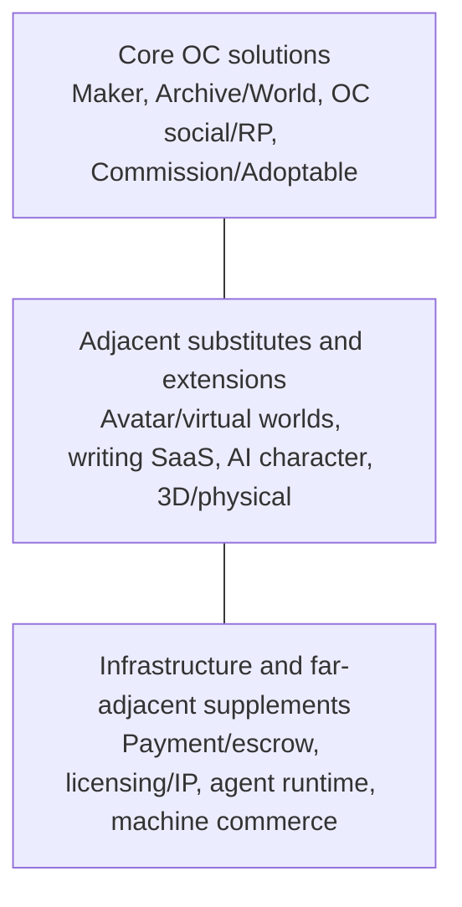
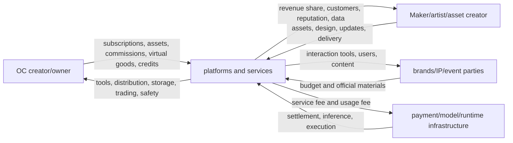

# OC / Character Maker Industry and Solution Landscape

**Subtitle:** Industry research based on publicly available samples from mainland China, Japan, Korea, the English internet, and global products: user needs, solutions, regional ecosystems, and commercial models  
**Research cutoff date:** 2026-08-12  
**Version:** 2.0  
**Nature:** Desktop desk-research based on public sources; not investment, legal, or financial advice  

---

## Table of Contents

- [Executive Summary](#executive-summary)
- [Part I: Market Boundaries and Unified Framework](#part-i-market-boundaries-and-unified-framework)
- [Part II: User Problems and Current Solutions](#part-ii-user-problems-and-current-solutions)
- [Part III: Regional Ecosystem](#part-iii-regional-ecosystem-how-the-same-character-object-organizes-industry-differently-by-region)
- [Part IV: Core Product Cases](#part-iv-core-product-cases-supply-retention-and-value-capture)
- [Part V: Business Models, Competition Mechanics, and Industry Judgement](#part-v-business-models-competition-mechanics-and-industry-judgement)
- [Appendix A: Search Method and Coverage Boundaries](#appendix-a-search-method-retrieval-rules-and-coverage-boundaries)
- [Appendix B: Product and Solution Catalog](#appendix-b-categorized-product-solution-catalog)
- [Appendix C: Fact Standards and Recheck Checklist](#appendix-c-fact-standards-and-recheck-checklist)
- [Appendix D: Terminology Quick Reference](#appendix-d-terminology-quick-reference)

---

## Executive Summary

### Bottom-line judgment

OC (Original Character) / Character Maker is not a market that can be described by a single TAM, single user type, or single product form. It is a set of adjacent sub-markets around “creating, saving, expressing, transacting, and running” original characters. At minimum it includes open Maker, fixed-assets dress-up, character archives and worldbuilding, OC communities and roleplay, commissions and adoptable, avatar asset economics, AI characters, and supporting infrastructure for payments, licensing, and technology.

These sub-markets overlap in users, but differ significantly in payers, supply mechanisms, network effects, and cost structures. Picrew and NEKA address visual creation and Maker supply; Tesan, Toyhouse, CharacterHub, and UnVale solve character archives, world systems, and communities; VGen, YCH, and Mihua Shi (米画师) cover commissions and trading; ZEPETO, VRoid, and VRChat extend characters into runnable avatars; Holoworld and MyShell turn characters into interactive AI. Daydreams, Virtuals, etc. are only outer-layer commercial infrastructure for roles that are already executable agents, not direct OC products.

Public sources are sufficient to confirm multiple monetization mechanisms in the industry—advertising, subscriptions, digital parts, virtual currency, commissions, adoptable, avatar assets, and AI credits—yet insufficient to prove that each category has a stable spend base or reliable global unified market size. Publicly available installs, star ratings, registered users, yearly event participants, concurrent users online, and transaction claims cannot be directly summed and cannot be treated as MAU, GMV, or revenue.

### One-page industry judgment

| Decision question | Current answer | Evidence strength |
|---|---|---|
| Is this one market? | More accurately, it is a set of adjacent markets sharing users and character objects, not a single category | High |
| What do users solve most often? | Visual creation, organization and growth, social display/interactions, commission trading, entry into avatar/AI runtime | High |
| Are current solutions mature? | Fixed-asset generation, generic social, and some in-platform consumption are mature; open supply, archiving, and transaction-related identity/licensing/portability are uneven and still fragmented | High |
| Who pays? | Players/character creators, Maker users, commission buyers, avatar consumers, AI users, brands/IP owners | High |
| Who supplies? | Maker artists, character creators, commission illustrators, asset creators, community operators, model/runtime developers | High |
| Where is value captured? | Ads and subscriptions, DLC/assets, commission fees, virtual goods, AI credits, enterprise customization | High |
| Most representative products | Picrew, NEKA, Tesan, Toyhouse, CharacterHub/UnVale, VGen/YCH, ZEPETO/VRoid, Holoworld/MyShell | Medium-high |
| Are regions the same? | No. Mainland China leans toward mobile “OC nurturing” + feature convergence; Japan towards open Makers and avatars; Korea towards industrialized fixed-asset dressing; English internet towards archives/adoptables/commissions and explicit AI-free community norms | Medium-high |
| Is Web3 core right now? | No. Daydreams and Virtuals are far-neighbor business infrastructure, useful after a character becomes an executable agent | Medium-high |
| Largest unknowns | Unified TAM, true MAU/retention, cross-tool migration intent, willingness to pay for licensing functions, real AI adoption rate | High |

### What current solutions already solve

- **Fixed-asset visual creation is highly mature; open supply quality and creator economics remain uneven.** Users can choose among open makers, fixed-asset apps, AI generation, and 3D editors. Generic avatar generators are plentiful in stores, but high-quality creator ecosystems are not equally mature across all segments.
- **Character archives and worldbuilding have broad usable options.** From Toyhouse and Tesan to World Anvil and Ocie, products cover public profiles, worlds, relationships, timelines, local privacy, and collaboration.
- **Display, roleplay, and event formats each have mature forms.** Feed, speaking under OC identity, social/coupling chats (“语C”), worlds/forums, and Art Fight-style events satisfy different social intensities.
- **Commissions and character trading already have practical market infrastructure.** VGen, YCH, Mihua Shi, Huajia, and Toyhouse handle discovery, quoting, escrow/fulfillment, auctioning, reputation, or ownership transfer differently.
- **Avatar and AI expand role usage scenarios.** ZEPETO, VRoid, VRChat, REALITY, Holoworld, and MyShell allow characters to enter livestreaming, virtual worlds, video, and conversation.

### Problems not yet consistently solved

The following are primarily “cross-platform capability gaps,” not automatically proven market opportunities:

- Semantics of Creator, Designer, Owner, Copyright Owner, and Licensee are not unified.
- Use, modification, commercial use, merchandise, resale, and AI permissions often remain in natural-language explanations.
- Maker output, character archives, commission delivery, and runtime identity usually lack a shared ID.
- Data export, backup, and service exit-recovery capability are inconsistent.
- Governance cost rises significantly when combining minors, character identity, private messaging, virtual currency, and emotionally interactive AI.
- Whether lifecycle integration is better than modular tool combinations is still not proven by migration behavior and payment data.

### Regional structure

| Region | Visible product shape in this round | Representative products | Main monetization | Key cultural/governance traits |
|---|---|---|---|---|
| Mainland China | Mobile OC archives, worldbuilding, chat/social, AI interaction, commission; fast functional convergence | NEKA, Tesan, Miqiudao, Wanzhuji, Linjie, SuiBian, Mihua Shi | Subscriptions, virtual currency, ads, commission, DLC/licensing | “Nurturing OC” framing is strong; child-safety, generation-marking, and anthropomorphic interaction governance are important |
| Japan | Open 2D makers, fixed-asset dressing, avatar/live-stream and IP linkage | Picrew, CHARAT, VRoid, Custom Cast, REALITY, Purenista | Ads, subscriptions, gacha, enterprise customization, asset sales | “Uchi no ko” culture, per-piece author permission, mature avatar consumption |
| Korea | Industrial fixed-asset dressing, multi-character scenes, avatar social | PitzMaker, SeyeonSoft series, ZEPETO | Ads, IAP, virtual goods, creator assets | Mobile-first, large-scale content operations, global distribution strength |
| English internet / North America | Long-term archives, adoptable/closed species, commissions, RP and events | Toyhouse, CharacterHub, UnVale, Art Fight, VGen, YCH | Subscriptions, trade fees, crowdfunding, commissions | Strong creator-custom terms; AI-free/NFT sensitivity is clear in key communities |
| Europe and others | Not enough independent evidence in this sample | Mostly global English platforms or local closed spaces | Not suitable for inference | Need additional research on Europe, Southeast Asia, Latin America, adult/private ecosystems |

### Reading boundary

This report focuses on answering “what problems and solutions make up this industry, and how each region/product implements them.” It does not directly treat capability gaps as commercial opportunities, nor infer market-size assumptions from incomplete data.

---

## Part I: Market Boundaries and Unified Analytical Framework

### 1. Research questions, scope, and evidence

#### 1.1 Questions this report answers

1. What are the core boundaries of the OC / Character Maker industry?
2. What tasks do users, creators, platforms, and other participants complete?
3. What solution paradigms exist now, and to what extent do they solve problems?
4. Why do different regional ecosystems in China, Japan, Korea, and English internet show different structures?
5. Which products represent different supply, retention, and monetization paths?
6. Who creates value, who pays, and who captures value?
7. What is the real relationship between AI, avatar, Web3, and agents with traditional OC markets?
8. Which findings are sufficiently evidenced, and which remain gaps or hypotheses?

#### 1.2 Key terminology

| Term | Definition in this report | What it does not automatically mean |
|---|---|---|
| OC | A character intentionally defined by a creator with an identifiable identity | Does not require a complete illustration or on-chain registration |
| Character Maker | A tool for creating character appearance/configuration through parts, parameters, or structured generation | Does not necessarily allow third-party author uploads |
| UGC Maker Platform | Independent creators can publish a full Maker set for others to combine | Not the same as users uploading only final renders |
| Character Archive | A product that stores character definitions, images, relations, worlds, and history | Not equal to copyright registration or trade market |
| Adoptable | A character design/object that can be claimed, purchased, or transferred | “Owner” does not automatically hold all copyrights |
| Avatar | A runnable representation in livestream/social/virtual worlds | Not always an independent OC, nor always multi-character capable |
| AI Character | A system that generates content or role-interactive conversation via models | Not always executable, and not always identity-verifiable |
| Agent | A software entity that can call tools, execute tasks, or change external state | Not necessarily a full character; not necessarily creator-rights modeled |

#### 1.3 Three-layer market boundary

##### Core markets

- Visual Maker and independent creator supply.
- Character archive, relationships, world, and long-term management.
- OC presentation, community, roleplay, and events.
- Commission, YCH, adoptable, ownership transfer, and licensing.

##### Adjacent markets

- Avatar creation, livestreaming, virtual worlds, and virtual goods.
- Writing, worldbuilding, and campaign/creative SaaS.
- AI image, role conversation, companions, and video.
- 3D models, miniature tabletop, and physical peripherals.

##### Infrastructure and far-neighbor supplements

- Payments, escrow, refund and dispute handling.
- IP, licensing, provenance, and derivative relationships.
- Agent runtime, tool-calling and task markets as far-neighbor infrastructure.
- Historical/candidate design credentialing and settlement in on-chain contexts.

This layering lets us compare relevant products while avoiding treating Picrew, World Anvil, Character.AI, and Daydreams as the same competitive set.

#### 1.4 Search and evidence methodology

This round used Apple iTunes Search API for China, US, Japan, and Korea with multilingual keywords, then cross-verified through Google Play official pages, product websites, help centers, terms, pricing pages, company announcements, and first-hand interviews. Full keyword lists, inclusion/exclusion rules, and blind spots are in Appendix A.

Evidence uses a three-level label:

| Level | Definition | Typical sources |
|---|---|---|
| A | Directly verifiable product facts | Official site, official help/terms, official store pages, company announcements |
| B | Self-reported by platform, not independently audited | Registered users, creators, object counts, transaction claims |
| C | User testimony, platform discussions, or second-hand sources | Reddit, forums, Wiki, media paraphrase |

“Confidence” in this report refers to conclusions and is not equivalent to one-source quality. Multiple A-level product facts can support high-confidence industry pattern; individual product updates generally support low-to-medium confidence trend hypotheses.

#### 1.5 Data limits

- App Store stars are not installation counts or MAU.
- Google Play install bands are cumulative ranges, not exact installs or active users.
- Registered accounts, creator counts, character counts, Maker counts, and PVs cannot be aggregated.
- Event participants represent event-specific cohorts.
- `Users Online` is snapshot-level concurrency, not daily activity.
- Free download does not imply no ads, subscriptions, or IAP.
- Missing public fee schedules do not mean no charge.
- This round does not include enough public data on revenue, GMV, retention, CAC, LTV, margin, or cohorts; therefore no unified TAM or “unit economics” conclusion is provided.

---

### 2. Participants, user tasks, and value flows

#### 2.1 Participants are not one single “creator type”

| Participant | What they provide | Main need | Typical income/expense |
|---|---|---|---|
| OC originator | Character concept, identity, personality, world | Save, express, evolve, control use scope | Pays for Maker, commissions, subscriptions/assets; may sell licenses |
| Maker author | Layer assets, rule design, updates, QA | Publish tools, get feedback and income | Ad sharing, DLC, licensing, B2B customization |
| Visual Designer / commission illustrator | Character design, art, outfits, scenes | Find clients, get paid, deliver, protect works | Commission fees, licensing, merchandising |
| Character Owner / collector | Holds/manages/transfers character objects | Source proof, display, trading, derivative creation | Pays for adoptables, commissions, subscriptions, trade services; may sell/transfer characters |
| World-builder / RP player | Lore, relationships, plot, events | Collaborate, set rules, discover peers | SaaS, memberships, virtual currency, event support |
| Avatar / asset creator | 3D models, outfits, props, worlds | Make assets, pass moderation, sell, cross-app usage | Virtual goods and asset sales |
| AI Character creator | Persona, knowledge, workflow, model configuration | Consistency, cost, deployment, monetization | Credits, subscriptions, usage revenue, patron |
| Platform operator | Tools, distribution, community, trading, governance | Supply, retention, revenue, safety/compliance | Ads, subscriptions, take rate, enterprise services |
| Brand/IP owner | Official characters, assets, activity budget | Low-cost engagement, acquisition, campaign marketing | B2B Maker, collaborations, virtual goods, events |

Creator, Designer, Owner, Copyright Owner, and Licensee may overlap or be fully separate. Collapsing these into one “author” field directly causes licensing and trading misunderstanding.

#### 2.2 Five core user tasks

The industry should not be described as one linear lifecycle every user must complete. A better model is five tasks that can occur independently or together:

| User task | What the user aims to complete | Main current solutions | Maturity |
|---|---|---|---|
| Visual creation | Quickly produce a recognizable look, or generate visual assets for other works | UGC makers, fixed-asset apps, AI generation, 3D editing | High |
| Organization and growth | Keep definitions, forms, relations, worlds, history, and assets | OC archives, worldbuilding SaaS, local management tools | Medium-high |
| Display and interaction | Make characters visible, get feedback, roleplay/speak as characters, co-create | Feed, World/Forum, “Yuchang,” RP, events | Medium-high, but highly diversified |
| Commission and trade | Find artists, buy designs, deliver assets, transfer, get licenses | Commission systems, YCH, adoptable, marketplaces, masterlists | Medium |
| Enter runtime | Use characters in livestreams, games, virtual worlds, dialogue, video, tasks | Avatar, virtual goods, AI characters, agents | Varies from mature to early |

#### 2.3 Six cross-cutting foundational capabilities

These capabilities are not “last-mile” only; they span all five tasks:

1. **Identity and provenance:** how characters, Makers, assets, and contributors are recognized.
2. **Rights and licensing:** who may use, modify, commercialize, resell, train, or run.
3. **Versioning and portability:** whether data can be exported, migrated, restored, and parsed across products.
4. **Payment and disputes:** quoting, escrow, refunds, chargebacks, and delivery evidence.
5. **Privacy and safety:** minors, NSFW, impersonation, private chat, emotional dependency.
6. **Source and AI governance:** human creation, approved AI, training sources, generation labeling.

#### 2.4 Problem-solution coverage matrix

Legend: `●` = core capability, `○` = supporting capability, `—` = usually not provided.

| Solution pattern | Visual creation | Organization-growth | Display-interaction | Commission-trade | Runtime | Source/licensing | Portability |
|---|:---:|:---:|:---:|:---:|:---:|:---:|:---:|
| Open UGC Maker | ● | ○ | ○ | ○ | — | ○ | Low–medium |
| Fixed-asset maker | ● | ○ | ○ | — | ○ | Low | Low |
| OC archive community | — | ● | ● | ○ | — | ○ | Low–medium |
| Worldbuilding SaaS/local tools | — | ● | ○ | — | — | Low | Medium–high |
| OC identity social / RP | ○ | ○ | ● | — | ○ | Low | Low |
| Commission/adoptable platform | ○ | ○ | ○ | ● | — | Medium–high | Low–medium |
| Avatar / virtual world | ● | ○ | ● | ● | ● | Medium | Low–medium |
| AI Character platform | ● | ○ | ● | ○ | ● | Low–medium | Low |
| Rights/payment infrastructure | — | — | — | ○ | — | ● | Depends on standards |

The matrix describes supply coverage, not that users must need one product covering all capabilities at once. Modular tool combinations can retain depth and community boundaries; integrated products can reduce switching but increase compliance, privacy, payment, and information-architecture burden.

#### 2.5 Value flow

There is no single value capture center. Visual creators may monetize mostly via ads/subscriptions; commission platforms by transaction services; avatar platforms by virtual goods; AI platforms by compute and features; archive communities by premium display, capacity, and memberships.

---

## Part II: User Problems and Current Solutions

### 3. Visual creation and Maker supply

#### 3.1 User and supply-side problems

OC creators with no full drawing skill or budget need quick recognizable appearances; professional creators need efficient production of many NPCs, deck cards, livestream appearances, or references. Maker authors have distinct needs: split assets, define composition rules, tune colors, test compatibility, update content, provide licensing, and secure distribution or income.

#### 3.2 Four main solution modes

| Mode | Core mechanism | Representative products | Strength | Main limitation |
|---|---|---|---|---|
| Open UGC Maker | Independent authors publish complete layered Makers for users to combine | Picrew, NEKA, Meiker.io | Diverse styles; expandable creator supply | High production cost, per-Maker licensing, weak continuity of outputs |
| Fixed-asset maker | Operator provides all parts and updates | CHARAT, PitzMaker, Pastel Girl, Gacha, ChibiStudio | Consistent quality and mobile UX maturity | Non-creator users cannot supply assets; user dependency on operator |
| Sellable asset market | Authors sell hair, outfits, bodies, props, or full avatars | VRoid/BOOTH, ZEPETO, Roblox, VRChat | Strong income loop and sustained identity | Higher barriers for Maya/Blender/Unity; stricter review |
| AI-native creation | Prompt/reference-based appearance generation, consistency images, animation, or remixable makers | OCMaker.net, Days AI, OC Idol | High throughput and personalization | Training source, style consistency, rights and acceptance differ |

In this round’s visible sample, products verifiably allowing independent authors to publish full reusable Makers are still limited. Officially verifiable core samples are [Picrew](https://picrew.me/), [NEKA](https://www.neka.cc/), and [Meiker.io](https://meiker.io/). VRoid, ZEPETO, and Roblox are asset-supply ecosystems; VRChat is more oriented to finished avatars.

#### 3.3 Producer workflow and supply ceilings

Picrew uses Part/Layer/Color/Item models, and authors often upload transparent PNGs across “layers × colors × options.” [Picrew creation guide](https://support.picrew.me/en/create_imagemaker/create_first)  
NEKA uses a similar layered structure while adding smart coloring, live debug, and iOS creation tools. [NEKA maker documentation](https://docs.neka.cc/tutorial/app-maker)  
Meiker.io supports tagged PSD batch import, lowering manual config cost. [Meiker making guide](https://meiker.io/instructions)

Therefore, barriers in open Maker supply include more than style:

- Layering and naming standards
- Color logic and interlocking rules
- Asset occlusion order and compatibility QA
- Version compatibility and legacy updates
- Author review, infringement detection, and licensing statements
- Feedback attribution and attribution tracking

#### 3.4 Storage units and user outputs

| Product type | Common storage unit | Supports continuous edit | Primary risk |
|---|---|---|---|
| Web maker | PNG, sometimes partial configuration storage | Depends whether the Maker remains available | Config invalidation when author updates/deletes |
| Fixed-asset app | Local character slot, save code, account status | Usually editable | Device migration, uninstall, and sunsetting loss risk |
| 3D editor | `.vroid`, VRM, project files | Format dependent | Export format != editable project equivalence |
| Avatar worlds | Account inventory and online identity | Persist inside platform | Account lock-in and lifecycle risk |
| AI-generated | Images, character profile, model configuration | Evolves inside each platform | Model drift, cost, source opacity |

Picrew Premium can save combinations but storage still depends on the original Maker structure; Gacha uses slot/code saving; VRoid supports `.vroid` and VRM export; ZEPETO/VRChat bind avatars to accounts/inventory. These differences strongly affect how a character can later evolve and migrate.

#### 3.5 Business model and maturity

- Picrew: ads, app subscriptions, enterprise/brand Piclab customization; no common creator revenue share for standard creators was found.
- NEKA: ads, DLC, paid remix authorization, and creator payouts; remix authorization is non-commercial and commercial use needs separate author permission.
- Meiker: ads and paid download-version support for creators.
- Fixed-asset apps: ads, rewarded ads, asset packs, subscriptions, or gacha.
- VRoid/BOOTH, ZEPETO, VRChat, Roblox: asset sales and creator revenue share.
- AI makers: credits, premium tiers, and commercial upgrade options.

Visual creation is the most mature task in the industry, but “open creator supply + low production barriers + clear licensing + creator income + durable character data” is still rarely all achieved by one solution.

---

### 4. Character Archive, Worldbuilding, and Long-term Continuity

#### 4.1 User problems

When a character is more than a single avatar, users need to preserve name, background, personality, multiple forms, outfits, references, palettes, relations, world context, timelines, commission history, creator metadata, and visibility settings. Text-first OCs may even exist before the first image is produced.

#### 4.2 Three current solution types

| Type | Representative products | Core objects | Strength | Limitation |
|---|---|---|---|---|
| Public OC archive community | Toyhouse, CharacterHub, UnVale, Tesan | Character pages, galleries, worlds, relations, feed | Strong display and community feedback | Platform-native data models, inconsistent export |
| Worldbuilding/writing SaaS | World Anvil, Campfire, Notebook.ai, Kanka | World, articles, maps, timelines, manuscripts | Strong lore depth, collaboration, templates | Weak visual OC social and rights recording |
| Private/local management tools | Ocie, Qingchuangji, Fantasia Archive, Obsidian | Private characters, relationships, worlds, files | Privacy, offline, and better export in many cases | Weak discovery, social, and trading |

Public sample points note:
[CharacterHub](https://characterhub.com/blog/character-resources/character-organizer), [UnVale](https://help.unvale.io/en/articles/12785689-character-pages), Tesan, and similar Chinese apps reinforce relation networks, multiple forms, timelines, and worlds on mobile; [World Anvil](https://www.worldanvil.com/) and [Campfire](https://www.campfirewriting.com/) emphasize writing and worldbuilding.

#### 4.3 Data model differences

Character archiving includes at least five object types:

1. Identity fields: name, tags, bio, traits, race.
2. Visual assets: references, palettes, outfits, form/age variants.
3. Narrative objects: worlds, locations, organizations, events, timeline.
4. Relation objects: family, allies, rivals, shared history.
5. Source and management: Creator, Designer, Owner, uploader, privacy, licensing.

Emphasis differs by product. Toyhouse emphasizes image tabs, world pages, and social credit; Tesan and Miqiu Island emphasize mobile growth loops, relations, and trajectory records; World Anvil/Campfire emphasize article, map, and writing systems; Ocie emphasizes local/iCloud-first workflows, search, backup, and private data.

#### 4.4 Retention mechanism

For archive products, retention is not only posting frequency but accumulated data and network effects:

- More images and history versions
- More complex relations/worlds/timelines
- External commission and social pages linking to the same archive URL
- Inter-character links between users’ characters
- Platform templates/HTML/CSS or presentation style as identity expression

These mechanisms may create switching cost, but public materials do not include retention rates, migration rates, or cross-platform use share; thus network strength cannot be directly claimed.

#### 4.5 Export, backup, and service exit

Exit examples like Banjiyuan, V-Katsu, the former Rinmaru site, and Ready Player Me show “data portability” is not hypothetical. Publicly measurable demand for one-stack migration still needs user interviews, but it is already clear: saving only links or final PNG does not preserve structured relations, Creator/Designer provenance, licensing versions, and commission history.

A complete backup should include JSON/metadata, originals, thumbnails, docs, relations, worlds, timelines, source proof, and licensing records. Portable standards across platforms remain limited.

---

### 5. Display, Community, Roleplay, and Events

#### 5.1 Social needs are not identical

OC social needs include at least four layers:

- Display role and setting and gain feedback via like/comments.
- Follow creators, characters, or worlds for sustained updates.
- Interact as character identities and build relationships or RP.
- Participate in prompt campaigns, mini-RP, closed-species ARPG, or Art Fight-style collaborative events.

#### 5.2 Four solution modes

| Mode | Representative products | Core loop | Main governance pressure |
|---|---|---|---|
| Low-friction discovery and external distribution | Picrew | discover maker → generate → external share | Licensing misuse, source tracking, link leakage |
| Archive communities | Toyhouse, CharacterHub, UnVale, Tesan | publish character/work → relations/comments → continuous enrichment | Piracy, age and content controls, trade disputes |
| OC identity social / RP | OCSN, PPL, Xiaocjie, “Yu Cha” products | speak with character identities → interaction → relationship/story | Impersonation, harassment, real-person boundary control |
| Event-based collaborative creation | Art Fight, campaign/ARPG events | event rule → create for others → feedback/credits | Originality disputes, AI, fairness and scoring |

Picrew interviews indicate reduced comment/like pressure on purpose, meaning “low in-platform social” can be a deliberate design choice. By contrast, CharacterHub adds Quest/Rolechat/events, and Tesan adds OC identity group chat. [Art Fight](https://artfight.net/info/about) recorded about 607,932 participants and 2,753,001 attacks in 2025; this is event-specific, not MAU.

#### 5.3 Network effects and switching cost

Social products rely on different network structures:

- Picrew relies on Maker creators and external share.
- Toyhouse relies on archives, relations, world pages, templates, and transfer history.
- OCSN/PPL rely on active OC identities and interaction density.
- Art Fight relies on campaign scale and reciprocal creation norms.
- Closed species rely on rules, traits, and community governance.

“Large user counts” alone are not enough. More important are unique supply, non-portable relationships, citation density outside one platform, and trust in social rules.

#### 5.4 AI and trust divergence

[UnVale](https://help.unvale.io/en/articles/8927131-what-is-unvale) positions itself as Never-NFT / anti-AI; [Art Fight rules](https://artfight.net/info/rules) forbid generative AI broadly; CharacterHub Marketplace and [YCH](https://ych.commishes.com/) also restrict AI works. In parallel, Days AI, OCMaker, SuiBian, and Holoworld are AI-first products.

This is not a simple “innovative vs conservative” split but two trust systems:

- Human-creation communities prioritize creator labor, style, attribution, and consent.
- AI-native communities prioritize throughput, consistency, and engagement output.

These two can coexist with clear labeling and opt-in interoperability, but there is no clear evidence yet of a complete shift of core anti-AI communities.

#### 5.5 Minors and character identity

OC/dress-up/identity-social products include many minor users. With character identity, anonymity, private messaging, virtual currency, and adult content stacked together, required controls include age and NSFW layering, stranger limits, reporting/appeals, identity separation, spending controls, chat moderation, and deletion controls.

---

### 6. Commissions, Adoptable, and Character Trade

#### 6.1 Three trade modes

| Trade type | Core object purchased | Representative solutions | Common misunderstanding |
|---|---|---|---|
| Commission | New work or design service commissioned from an artist | VGen, Mihua Shi, Huajia, Artistree | Payment does not automatically include commercial rights/source files |
| YCH / adoptable | Pre-built pose templates, character design, or transferable character objects | YCH.Commishes, Toyhouse, CharacterHub | Ownership claim is not equivalent to full copyright ownership |
| License / asset | Permissions to use a Maker, asset, avatar, or content | NEKA, BOOTH, ZEPETO, VRChat | Permission does not automatically include resale or remodeling rights |

#### 6.2 Current workflow

A typical commission flow: discover artist → confirm scope and license → quote/queue → payment → draft/revision → delivery → review/dispute.

VGen integrates Proposal, Instant Order, milestones, queueing, and review into the flow. Since 2026 it supports Personal, Commercial Content, and Commercial Merchandising standard licenses. [VGen commission workflow](https://help.vgen.co/hc/en-us/articles/12820045188119-How-does-the-VGen-commission-system-work), [Standard licenses](https://help.vgen.co/hc/en-us/articles/29122353993495-Standard-Usage-Licenses)

Toyhouse adoptable flow is usually in-platform discovery and negotiation, comments/DM, off-platform payment (PayPal/Ko-fi), then Toyhouse ownership transfer. [Toyhouse trade discussion](https://toyhou.se/~forums/14421.help-questions/620260.genuine-question-how-to-start-selling-adopts) provides social ownership logs but not escrow/refund governance.

#### 6.3 Rights roles must be separated

| Right role | Question it answers |
|---|---|
| Creator | Who initially defined the character identity or concept? |
| Designer | Who completed visual design or redesign? |
| Current Owner | Who currently holds the character object in community records? |
| Copyright Owner | Who legally owns relevant copyright? |
| Licensee | Who holds specified usage rights? |
| Custodian | Who preserves/operates/displays the object? |
| Revenue Beneficiary | Who gets revenue from which event? |

Toyhouse explicitly separates Current Owner, Creator, Designer, and transfer permissions, but this social-layer distinction is still not equivalent to legal copyright, jurisdiction, media scope, merchandising rights, or cross-tool training rights.

#### 6.4 Escrow, refunds, and disputes

Platform-escrow and off-platform workflows produce materially different risks:

- Platform escrow can retain funds pre-delivery/milestone but adds customer support and compliance.
- PayPal direct payments speed to artists but may involve refund/chargeback conflict.
- External payment plus internal ownership logs create evidence split for transfer and payment.
- Chargebacks, cross-border tax/exchange issues, and identity verification add cost in minors-heavy markets.

VGen differentiates safeguards by channel (VGen Payments/Stripe vs PayPal), while Toyhouse Service Reviews function more as community evidence and reputation than formal arbitration.

#### 6.5 Value capture

Trade products can charge buyers, sellers, or both; they also monetize via subscriptions, exposure, payment tooling, and value-added utilities. CharacterHub’s 2026 marketplace statement says no listing fee for sellers and about a 10% buyer side fee. NEKA pricing documents show platform-side 15% plus payment processor share. UnVale and Toyhouse currently rely on off-platform payment and transfer. VGen and domestic commissioning apps include fulfillment and escrow-like support in their value proposition.

Public data are insufficient to compare GMV, refund rates, support cost, or user lifetime value directly.

---

### 7. Avatar, Virtual Worlds, and AI Character Runtime

#### 7.1 Moving to runtime is not required for every OC

Some users need only static profiles; others need livestream avatars, game models, dialogue AI, or task-executable agents. Treating all OCs as needing agentization would understate the value of static archive and narrative workflows. Runtime is one usage task, not the only maturity endpoint.

#### 7.2 Avatar solutions

| Shape | Representative products | How characters are saved | Economic object |
|---|---|---|---|
| 3D editing and open format | VRoid Studio | `.vroid` project and VRM export | BOOTH clothing/hair/model assets |
| Platform avatar and worlds | ZEPETO, Roblox, IMVU | Account identity and inventory | Virtual goods, UGC, worlds |
| Livestream avatar | Custom Cast, REALITY | Account config and platform props | IAP, gifts, subscriptions, co-marketing |
| Finished avatar marketplace | VRChat | Purchase + SDK upload paths | Full avatar assets |
| Physical/board game character | Hero Forge, Eldritch Foundry | Online design, STL or order artifact | Digital files, subscriptions, physical models |

[VRoid Studio](https://vroid.com/en/studio) is creator-friendly for anime OCs and VTuber workflows, while BOOTH supports asset sales. [ZEPETO Studio](https://studio.zepeto.me/) supports textures, props, and worlds. VRChat sells long-tail complete avatars with account-level visibility.

Avatar economics provides repeated usage, but identity, inventory, and social graphs are often tightly account-bound.

#### 7.3 AI character forms

| Form | Main capability | Representative products | Core issue |
|---|---|---|---|
| AI visual generation | Consistent image, style, dressing, animation | Days AI, OC Idol, OCMaker, SuiBian | Source, consistency, rights |
| AI chat/companion | Persona, continuous dialogue, story and memory | Character.AI, PolyBuzz, Zhaomeng Island, Redbean | Privacy, dependency, safety, model drift |
| Deployable agent character | Knowledge, voice, avatar, model/workflow/tool chain | Holoworld, MyShell, elizaOS | Responsibility boundaries, cost, deployment and rights |

[Holoworld Agent creation](https://docs.holoworld.com/holoworld/agent-market/create-agent) supports persona, greetings, scenario, dialogue samples, knowledge, lorebook, voice, and avatar; [MyShell](https://docs.myshell.ai/about/what-is-myshell) defines model/API-centric workflow composition.

These products increase output frequency and interactivity, but do not automatically integrate with existing OC platforms’ ownership, licensing, and world provenance models.

#### 7.4 Far-neighbor boundary: agent business and Web3

[Daydreams](https://www.daydreams.systems/) task market and router concepts, and [Virtuals ACP](https://whitepaper.virtuals.io/acp-product-resources/acp-changelogs) agent workflow, escrow, settlement, and reviews serve an already executable agent context, not OC profile/community creation. Story Protocol’s original PoC around IP and derivatives transitioned in 2026-06 toward [DATA Network](https://www.datafdn.org/blog/were-becoming-the-data-foundation), so it is no longer positioned as a direct OC-market foundation.

This report treats these as far-neighbor infra. Their full listing appears in B.9. There is no public evidence of widespread OC-level adoption yet; chain records also do not automatically replace practical copyright, refunds, child safety, complaint handling, or legal remedies. OC → AI Character → Agent is not a universal path; mandatory wallet/token adoption may conflict with anti-NFT norms in some human-creation communities.

---

### 8. Cross-cutting Foundation Capabilities and Governance

#### 8.1 Identity, source, version

A character can include original concept, multiple visual Designers, commission outputs, assets, and AI persona. Most platforms record only part of this graph. A robust source system needs to distinguish identity, assets, version, contributor, and uploader, otherwise “Owner” alone cannot describe provenance.

#### 8.2 Licensing and AI permissions

Picrew allows Personal/Non-Commercial/Commercial/Processing options per creator setting. NEKA uses default non-commercial defaults with paid remix authorization and separate commercial agreements; VGen provides personal, commercial content, and merchandising licenses. VRoid/ZEPETO/VRChat have differing asset and avatar rules.

Cross-platform standards are still weak, especially on:

- Use in monetized livestreams or ads
- Physical or digital merchandise creation
- Modification, composition, disassembly
- Resale/secondary transfer
- AI training/embedding/usage input
- Geographic, duration, quantity, and attribution scopes

Natural language terms improve flexibility; structured licenses improve clarity, yet both still require manual/legal interpretation.

#### 8.3 Portability and recovery

Portability has four layers:

1. Export final image
2. Export structured character/relations
3. Export editable recipes/project/model
4. Export provenance, licensing, version and transfer history

Most products cover only layer 1 or 2. Open formats do not automatically solve service lock-in: VRM does not carry account social graph, purchase evidence, licensing history.

#### 8.4 Payment, split, and disputes

Payment capability is more than “can collect money.” It includes quote locking, milestone billing, escrow, taxes, refunds, chargebacks, delivery proof, split settlement, and cross-border compliance. Maker, commission, adoptable, and agent tasks need distinct contract and dispute regimes.

#### 8.5 Privacy, content, and child safety

Character identity, real-user identity, private drafts, group chat, and AI memory must be segmented. Products with children and adult content overlap need age checks, default privacy, stranger limits, appeal pathways, deletion/export, spending controls, risk warnings, and transparent moderation.

#### 8.6 Horizontal capability maturity

| Capability | Current industry state | Representative mature solutions | Primary gap |
|---|---|---|---|
| Character profile | Mature | Toyhouse, Tesan, CharacterHub, UnVale | Non-unified data and export |
| Maker licensing | Medium | Picrew, NEKA | Creator-level natural language, non-portable across platforms |
| Commission licensing/escrow | Medium to mature | VGen, Mihua Shi | Cross-border, off-platform payment, complex rights |
| Ownership Log | Mature in community context, limited legal semantics | Toyhouse, CharacterHub, Lorekeeper | Overlap of Owner and copyright/licensing |
| Avatar asset trading | Mature | ZEPETO, Roblox, VRChat, BOOTH | Account lock-in, format and rights gaps |
| AI source and training permissions | Early and fragmented | AI labels, anti-AI rules, per-author opt-out | Lack machine-readable consent/standards |
| Cross-platform migration | Early | JSON/ZIP export, VRM, partial APIs | Missing shared identity, relations, licensing, transaction history |

---

## Part III: Regional Ecosystem — How the Same Character Object Organizes Industries Differently

### 9. Regional comparison method

Regional differences are not just “what products are popular,” but also what users treat as the core character object, who produces supply, where it propagates, and where platforms monetize. This part compares Mainland China, Japan, Korea, English internet/North America, and visible Europe using shared dimensions:

1. Cultural object and preservation intent
2. Visible categories and representative products
3. Distribution and social spillover
4. Creator supply mechanisms
5. Monetization model
6. Rights, AI, and community governance
7. Regional signals and evidence blind spots

Origin, operator location, primary interface language, storefront region, and actual active market can differ. Picrew, ZEPETO, Toyhouse appear global; this section describes ecosystem emphasis, not single-country assignment.

### 10. Mainland China: mobile OC nurturing systems converge fast

#### 10.1 User culture and category structure

Users commonly describe their activity as “养 OC” (“nurturing” an OC): identity and look first, then multiple forms, relations, world, timeline, commissions, and role interaction. Mobile remains primary; archive and sharing occur inside dedicated apps and spill into Weibo, Bilibili, QQ groups, and artist platforms. So the character is often a sustained creative object, not a one-off avatar.

Visible samples indicate three intersecting substreams:

| Stream | Representative platforms | Core solved problem | Evolution |
|---|---|---|---|
| Open maker | [NEKA](https://www.neka.cc/) | low-barrier creation; author-published layered Makers | DLC and remix authorization live, while full standardized product commercialization is still evolving |
| Archive/world/community | [Tesan](https://apps.apple.com/cn/app/id1568689293), Miqiudao, Wanzhuj i, Qingchuangji, Linjie, Huanoshu, SuiBian | character records, forms, relations, worlds, timelines, works, campaigns | convergence toward makers, social, AI, and in-app virtual products |
| Commission infrastructure | [Mihua Shi](https://apps.apple.com/cn/app/id1146790989), Huajia | artist discovery, quoting, escrow, delivery, reviews | moving toward standardized service/licensing workflows |

Dougu, Mengyu, Ciyuan, and SuiBian and similar services connect making, shop, AI conversation, story generation, and physical fulfillment into one lifecycle. This shows increasing feature convergence but does not prove users prefer one-stack products.

#### 10.2 Distribution, supply, and monetization

iOS, Android stores, web, and private channels co-distribute. App Store updates show maintenance state but not the full picture for private groups and mini-channels.

NEKA combines author application, originality audit, and layered Workshop publishing. Archive communities depend on user-created character/world/content systems. Commission platforms depend on artist certification, portfolio, and delivery flows. This yields three cost modes: asset production and audit, UGC governance, and service fulfillment.

Common revenue traces include members, virtual currency, ads, outfit items, and storage expansion. NEKA’s split rates are public: author 84.65%, platform 15%, payment processor 0.35%, plus withdrawal fees. [NEKA payout doc](https://docs.neka.cc/pricing/notice)

#### 10.3 Rights, AI, and constraints

Watermarks, download permissions, author declarations, and anti-unauthorized-remix rules remain primary safeguards. Creator, Owner, commercial rights, and AI permissions are still not consistently structured. NEKA has relatively explicit defaults for remix/commercial separation but not a portable cross-platform rights standard.

AI and companion expansion introduces child safety, privacy deletion, and generation marking as compounding governance challenges.

### 11. Japan: parallel lightweight maker and wearable avatar ecosystems

#### 11.1 Culture and category structure

“Uchi no ko” (my own child/character) emphasizes long-term attachment. Entry often stays lightweight: Maker creation and profile image output, then off-platform display. Another stream turns characters into VRM or live avatars for persistent use in VTuber/space/shops.

| Track | Representative platforms | Supply unit | Main value |
|---|---|---|---|
| Open 2D maker | [Picrew](https://picrew.me/) | Full Maker sets by independent authors | low barrier, style variety, external viral share |
| Fixed-asset maker | CHARAT, related ecosystems | Operator-led asset sets | stable UX, update consistency |
| 3D avatar tools/assets | [VRoid Studio](https://vroid.com/en/studio), BOOTH | 3D model, hair/clothes, importable assets | cross-runtime usage via VRM |
| Avatar social/live | Custom Cast, REALITY | account avatars, outfits, livestream content | frequent identity expression and engagement |
| Long-form dressing communities | Purenista, Pokecolo, etc. | account inventories and social rooms | gacha, dressing, social retention |

#### 11.2 Distribution, supply, and monetization

Picrew primarily combines web discovery, social sharing, and mobile app retention. VRoid relies on creation tools, BOOTH, and external VRM-consuming apps. Livestream and dressing apps keep identity, social, and monetization in-platform.

Supply cannot be compared with one “creator count” metric:

- Picrew authors produce full makers.
- VRoid/BOOTH authors produce composable assets.
- Fixed-asset and stream platforms rely more on internal design and operations.

Monetization spans ads, subscriptions, brand customization, BOOTH assets, and stream micro-payments. Creator-level sharing remains limited compared to product-level revenue.

#### 11.3 Rights, AI, and constraints

Picrew supports per-type scope settings and AI-creator disclosure; users are prohibited from re-entering outputs into generative AI without permission. [Picrew scope of use](https://support.picrew.me/en/create_imagemaker/scope_of_use)

VRM export increases format portability but does not automatically unify licensing for clothing, textures, and derivative usage.

### 12. Korea: scale-oriented dressing and avatar platform economy

#### 12.1 User culture and category structure

Korean samples frequently tie “자캐” creation with webtoon-style scene expression: multiple characters, dialog, backdrops, and story framing—not only single portrait output. Another path emphasizes avatar as account identity via dressing, filming, and world-building.

PitzMaker, Character Maker, Pastel Girl, Lily Diary/Story/Friends, and others represent mature fixed-asset 2D systems. [ZEPETO Studio](https://studio.zepeto.me/) represents open asset supply with account avatar/world ecosystems.

#### 12.2 Distribution, supply, and monetization

Large install signals often come from Google Play globalization and image export, but these are not Korean active user metrics. ZEPETO relies more on in-platform activity and external short video dissemination.

Fixed-asset apps are usually operator-supplied; users combine rather than publish full maker frameworks. ZEPETO opens clothing/prop/world asset creation and social runtime economics.

#### 12.3 Rights, AI, and constraints

Most public evidence is platform-level protocol and asset moderation rather than per-output licensing. Whether generated images can be sold, modified, or used in AI remains App-specific.

### 13. English internet and North America: archive, provenance, and community governance as institutional layers

#### 13.1 User culture and category structure

This ecosystem emphasizes long-lived archives, adoptables, closed species rules, licensing provenance, and transfer records. Mature users treat Creator/Designer/Current Owner as core social semantics. Discovery and transfer cross multiple ecosystems (Toyhouse, Discord, Tumblr, DeviantArt, Bluesky, etc.).

| Segment | Representative products | Ecosystem role |
|---|---|---|
| Archive and provenance | [Toyhouse](https://toyhou.se/), Refsheet | role pages, galleries, source logs, transfer records |
| Modern archive community | [CharacterHub](https://characterhub.com/blog/about-characterhub), [UnVale](https://help.unvale.io/en/articles/8927131-what-is-unvale), Ocie | mobile UX, events, social, marketplace |
| OC identity social / RP | OCSN, PPL, RP Repository | identity play and community collaboration |
| Worldbuilding | World Anvil, Campfire, Notebook.ai | lore, maps, timeline, writing collaboration |
| Commissions and trade | VGen, YCH.Commishes, Toyhouse/UnVale listing | order/trade/reputation/payment flow split |
| Periodic activation | [Art Fight](https://artfight.net/info/about) | annual events converting static archives into co-creation |

#### 13.2 Distribution, supply, and monetization

Web, invite codes, external links, and Discord are key infrastructure; mobile apps are a newer layer. Display, pricing, payment, transfer, and species tracking are often spread across sites, adding fragmentation but enabling niche depth.

Supply mainly comes from user uploads and community services rather than single platform libraries.

Monetization includes subscriptions, archive capacity, commission fee, auction/follower support, and sponsorship. CharacterHub market rules mention seller 0% listing and buyer-side ~10% in official text. UnVale shops closed in 2024; current transfers can still rely on external payment. [UnVale shops sunset](https://help.unvale.io/en/articles/10087688-sunsetting-of-shops-on-unvale)

#### 13.3 Rights, AI, and unique constraints

Creator/Designer/Owner distinctions are mature socially, yet legal semantics remain mixed.

Unification into one economic system is limited: AI-native and anti-AI human-creation communities co-exist with clear norms.

### 14. Europe, other regions, and cross-region comparison

#### 14.1 Visible Europe and blind spots

Visible samples often capture browser-first worldbuilding, tabletop role tools, and independent maker/3D workflows rather than fully local-language community evidence. Europe is not absent but under-segmented in English-only sampling and local closed communities.

Visible European-style demand includes [Meiker.io](https://meiker.io/), World Anvil, Campfire, Kanka, LegendKeeper, and Eldritch Foundry. These indicate product forms, not full regional size.

LatAm, Southeast Asia, India, Middle East, and Africa remain explicit blind spots.

#### 14.2 Cross-regional comparison

| Dimension | Mainland China | Japan | Korea | English internet / North America | Visible Europe |
|---|---|---|---|---|---|
| Core long-term object | personality, relations, world, nurturing logs | maker output or portable avatar | scene + account avatar | archive provenance, transfer and norms | lore, campaign, tool projects |
| Supply structure | reviewed makers + UGC communities + certified artists | independent makers and 3D assets coexist | fixed-asset sets + platformized asset economy | community archives, commissions, adoptables, species governance | independent tool makers and worldbuilders |
| Main distribution channel | mobile app + social/private channels | web share, BOOTH, livestream + app | Google Play plus platform feed/world | web, Discord, invite codes, external networks | browser SaaS, stores, niche communities |
| Main income center | memberships, currency, DLC, commissions | ads, subscriptions, assets, gacha, gifts | ads, IAP, ZEPETO virtual items | subscriptions, commission, auctions, off-platform pay | SaaS, sponsorship, digital assets, STL/physical |
| Rights expression | watermarks and natural language dominate; early product-level licensing | maker-level license relatively structured | mostly platform/app-level rules | social semantics mature; legal/licensing still fragmented | mostly per-tool, per-author processing |
| AI relation | AI/companion enters quickly; creator-side pushback is rising | maker disclosure and consent is relatively explicit | limited public evidence | AI-native and anti-AI communities are separated | cross-region platform signal is weak |
| Main blind spot | private channels, Android fragmentation, MAU/GMV | cannot isolate Korea/Japan/local share from global installs | local communities and closed channels are incomplete | English internet ≠ pure North America | local-language and revenue data |

The major cross-regional signal is not simply feature count, but what each ecosystem optimizes: Mainland China converges social+archive+commission+AI; Japan balances maker entry and avatar portability; Korea aligns dressing scale with platform avatar economy; English internet emphasizes provenance and community rules; Europe visible samples remain tooling/worldbuilding heavy.

---

## Part IV: Core Product Cases — Supply, Retention, and Value Capture

### 15. Case selection and unified evaluation card

This section intentionally does not rank products by size. It selects representative solution paradigms, regional patterns, and monetization styles. Comparison focuses on how each product solves user tasks, not company structure, financing, teams, or ownership.

| Case | Core paradigm | Region/ecosystem | Why selected |
|---|---|---|---|
| Picrew | Open UGC Maker | Japan/Global | full reusable Maker as supply unit, strong external distribution |
| NEKA | Maker marketplace with license/product loop | China | clearer maker economics than many peers |
| Tesan | mobile long-life archive + hybrid community | China | key example of mobile “OC nurturing” convergence |
| Toyhouse | archive with provenance and social facting | English internet | long history, closed-species, provenance workflows |
| CharacterHub / UnVale | modern archive community | English internet | mobile experience, events, anti-AI trust |
| VGen / YCH.Commishes | commission and auction | Global creative market | workflow and standardized licensing entry points |
| ZEPETO / VRoid | avatar asset economy | Korea/Japan/Global | platform-bound economy vs open-format 3D flow |
| Holoworld / MyShell | AI-native character | Global | persona/knowledge/model/workflow and creator income stack |

Each case uses the same fields: core user tasks, core objects, supply, retention loop, monetization, dated scale signals, differentiation/cost to switch, constraints and confidence.

#### 15.1 Picrew: full Maker as the unit of supply

| Field | Observation |
|---|---|
| Core task | Users need quick avatar/appearance creation without drawing; artists publish fully layered Maker systems for repeated use |
| Core object | Part/Layer/Color/Item-based Image Maker units; users get rendered PNGs rather than full archive objects |
| Supply | Artists upload transparent assets and configure combinational rules; license scope is per-Maker and platform-dependent |
| Retention loop | discover Maker → combine → download/share externally → invite and reuse |
| Monetization | ads, app subscriptions, enterprise/IP customization; no common creator revenue system observed for standard authors |
| Scale signal | As of cutoff: Google Play shows 1M+ installs and 10,000+ makers; these are not MAU/income |
| Differentiation/cost to switch | author depth + external discoverability + “make avatar with Picrew” habit, and Maker-level licensing norms |
| Limitations | weak continuity semantics; author-platform income loop remains light; output compatibility can break after author updates; licenses still coarse across merchandise/live/AI/privacy/territory/timeframe |
| Confidence | high for function/terms; medium for scale/distribution; low for retention/revenue/network effects |

#### 15.2 NEKA: turning Maker into saleable digital assets and licensing

| Field | Observation |
|---|---|
| Core task | Chinese users create looks quickly and buy extensions/remix licenses; creators publish Makers and receive income via DLC/remix/licensing |
| Core object | Maker units, layered assets, DLC, licensing metadata, user outputs |
| Supply | creator submission, originality checks, workshop upload/config, moderation, and review |
| Retention loop | browse Makers → combine/share → follow creators → purchase DLC/licensing → creator updates and repeat purchase |
| Monetization | ads, DLC, paid remix authorization, creator payouts; remix is non-commercial and commercial use requires explicit creator permission |
| Scale signal | Chinese App Store shows ~1,855 ratings, 4.0 at cutoff; no audited MAU, GMV, or paid-creator counts |
| Differentiation/cost to switch | Chinese localization, audit flow, licensing clarity, and payment integration |
| Limitations | weaker archive/world links; rule updates can coexist; no comprehensive machine-readable AI rights stack yet |
| Confidence | high on flow/fee structure; medium on permissions consistency; low on scale and income quality |

#### 15.3 Tesan: long-cycle nurturing as retention core

| Field | Observation |
|---|---|
| Core task | creators and fans maintain long-form character systems: appearance, lore, relations, story, interactions |
| Core object | evolving profiles with multiple forms, images, cards, relations, trajectory, timelines, worlds, outputs |
| Supply | users create characters/worlds/campaigns, posts, comics, and social interactions |
| Retention loop | profile building → forms/relations update → world/campaign participation → publishing → social response |
| Monetization | memberships, virtual currency, ads, outfits/cards and digital items; split clarity for creators is limited |
| Scale signal | [iOS page](https://apps.apple.com/cn/app/id1568689293) snapshot around 490 ratings / 3.9 at cutoff (dynamic) |
| Differentiation/cost to switch | rich long-form history, social graph, and repeated interaction across life |
| Limitations | more combined functions increase governance complexity and identity controls |
| Confidence | high on features/maintenance, medium on retention, low on scale/creator economics |

#### 15.4 Toyhouse: archive, layer identity, and provenance

| Field | Observation |
|---|---|
| Core task | heavy OC creators, adoptable buyers/sellers, and species communities need long archive, provenance, and transfer records |
| Core object | Character Page, gallery, writing, tabs, worlds, ownership/provenance metadata |
| Supply | users upload characters and works; creators publish HTML/CSS profile variants |
| Retention loop | create page → keep enriching → link worlds and others → join species/trades → update ownership provenance |
| Monetization | Premium and invite-based access; pricing and trade flows mostly remain social/platform mixed with external payment |
| Scale signal | no auditable MAU/GMV/revenue; online counts are snapshot only |
| Differentiation/cost to switch | durable archive and social norms are costly to replicate |
| Limitations | invite friction, older interface/mobile burden; off-platform payment/disputes |
| Confidence | high for workflow and semantics; low-mid for scale and economics |

#### 15.5 CharacterHub and UnVale: modernized creator-first archive communities

| Field | CharacterHub | UnVale |
|---|---|---|
| Core object | roles, worlds, collections, relations, galleries, rolechat | character pages, traits, gallery, writing, posts, communities, transfer |
| Supply/retention | quest + events + rolechat + marketplace loop | challenges/posts/community/market listing + transfer |
| Monetization | free + Plus; buyer-side ~10% market fee in official statement, no seller listing fee | Ultra subscription; current listing/transfer still mostly external payment |
| Scale signal | official “500K+ artists” self-reported; not audited and not MAU |
| Trust position | anti-AI in marketplace restrictions | never-nft / anti-AI |
| Differentiation/cost to switch | mobile-first experience and active events | mobile social + values + activity design |
| Key constraints | governance and migration still maturing; market-side data incomplete | payments external to platform, weak dispute completeness |
| Evidence | [About](https://characterhub.com/blog/about-characterhub), [Organizer](https://characterhub.com/blog/character-resources/character-organizer) | [About](https://help.unvale.io/en/articles/8927131-what-is-unvale), [Market](https://help.unvale.io/en/articles/8927117-unvale-market) |
| Confidence | high for function/rules; low for size/retention/GMV |

#### 15.6 VGen and YCH.Commishes: turning demand into enforceable fulfilment

| Field | VGen | YCH.Commishes |
|---|---|---|
| Core task | help clients define requirements and execute commissions with predictable rights/flow | provide marketplace for commission/adoptable via listing and bidding |
| Core object | proposal, order, milestone, deliverables, reviews, license packets | listing, bidding, completion, proof and reputation |
| Retention loop | portfolio attracts demand → order→deliver→review → repeat/voice trust | bidding/trade quality cycle |
| Rights and fulfillment | licenses and workflow formalization since 2026; partial holding for selected payment routes | structured listing and anti-sniping rules; licensing mainly seller-driven |
| Monetization | service + payment tools | auction/trade platform |
| Differentiation | structured queues and milestones | active adoptable/YCH flow and market mechanics |
| Limits | weak archival integration; cross-border refunds/chargebacks remain manual | licensing and payment evidence remain external and fragmented |

#### 15.7 ZEPETO and VRoid: closed account economy vs open-file ecosystem

| Field | ZEPETO | VRoid |
|---|---|---|
| Core task | account avatar dressing and social identity | build 3D anime models for reuse |
| Core object | account avatar, inventory, ZEM items, worlds | `.vroid` projects and VRM exports |
| Supply | [ZEPETO Studio](https://studio.zepeto.me/) for textures/props/worlds | free tooling with BOOTH-style asset distribution |
| Retention loop | dress → content/social loop → item purchase → creator continuation | build model → export/run → purchase/update |
| Monetization | virtual goods + creator payout | free tool; asset markets and external reuse |
| Differentiation | closed social graph and platform governance | open format with cross-runtime potential |
| Main limits | account lock-in | fragmented rights, provenance, and settlement across files/markets |
| Confidence | high on function/supply | low on comparable activity and creator income |

#### 15.8 Holoworld and MyShell: AI characters as both content and runtime

| Field | Observation |
|---|---|
| Core task | users interact with responsive characters; creators build persona+knowledge+voice+workflow products and monetize |
| Core object | Persona/flow metadata and tool configurations for Holoworld; model/API/workflow combinations for MyShell |
| Supply | creators, model developers, tool builders; cross-disciplinary supply |
| Retention loop | discover → consume → follow/reward → expand persona and tools |
| Monetization | credits, subscriptions, usage fees, creator payout |
| Differentiation | multi-edge stack from character creation to runtime deployment |
| Limits | training origin, persona permission, human mimicry, contributor consent and derivative rights; model cost and safety are core governance issues |
| Scale signal | function and positioning are verifiable; unified active, revenue, and margin metrics are not |
| Evidence | [Holoworld create-agent](https://docs.holoworld.com/holoworld/agent-market/create-agent), [MyShell](https://docs.myshell.ai/about/what-is-myshell) |
| Confidence | high on positioning; medium on retention; low on scale/revenue/rights execution |

#### 15.9 Cross-case comparison

| Product type | Supply loop | Main retention object | Main payer | Strongest structural constraint |
|---|---|---|---|---|
| Open Maker | publish → generate/share → backflow | maker directory, author links | ads, subscriptions, DLC/license | creator workflow, licensing, and maintenance cost |
| Archive community | profile build → relation/content/event → archive growth | history and social graph | membership/storage/hosting | migration, privacy, governance, onboarding |
| Commission/auction | demand-supply matching → fulfill → review | reputation and order history | service and trade fees | non-standard delivery and disputes |
| Avatar economy | asset supply → identity use/content → repeat spend | inventory and social/virtual identity | virtual goods and assets | account lock-in vs portability trade-off |
| AI character | persona/model supply → interaction → usage/payment → update | dialogue history and behavior graph | credits/subscription | model cost and behavioral responsibility |

Products are not on a single-stack ladder; Picrew’s supply advantage does not automatically transfer to Toyhouse’s provenance retention, nor does Toyhouse replace VGen’s fulfillment logic.

---

## Part V: Business Models, Competition Mechanics, and Industry Judgement

### 16. Business models and value capture

#### 16.1 Value capture by layer

| Model | Representative products | Main payer and pricing object | Must do well | Main pressure |
|---|---|---|---|---|
| Ads | Picrew, fixed-asset makers | advertisers pay for user attention | low-friction usage and share loops | ad safety, weak creator economics |
| Paid subscription | Picrew app, Tesan, UnVale | users for no ads, storage, advanced profile/design | sustained perceivable value | many free substitutes, hard conversion |
| DLC + remix licensing | NEKA | users purchase components/remix rights | author tooling, audit, payment, licensing explanation | supplier concentration, refund complexity |
| Virtual goods/assets | ZEPETO and avatar social | users buy cosmetics/items/worlds | asset supply, social usage contexts | minor spending controls, account lock |
| Archive membership | Toyhouse, CharacterHub | users for capacity, CSS, privacy, premium organization | stable storage, search, portability baseline | low willingness-to-pay pressure |
| Commission & auction | VGen, YCH, Mihua Shi | buyers pay for custom work and platform charges | matching, fulfillment, trust, and dispute support | fraud, chargeback, ops cost |
| Worldbuilding SaaS | World Anvil, Campfire | writers/collaborators subscribe | data model quality and collaboration | generic note tools and learning cost |
| AI credits / usage | Holoworld, MyShell | users pay for inference/generation and runtime | persona quality, routing, cost control, safety | model volatility, liability |

These values cannot be summed into one “OC market size.” Different models monetize against different intents and cost structures.

#### 16.2 Four creator economic relationships

| Supply relation | Example | What creators receive | Platform responsibilities | Structural risk |
|---|---|---|---|---|
| Distribution without revenue share | Picrew standard makers | visibility and personal branding | tool, hosting, moderation | mismatch between creator and platform economics |
| Digital goods / licensing share | NEKA, ZEPETO | DLC/license/asset revenue | billing, moderation, infringement handling | concentration + rule/tax complexity |
| Custom service income | VGen, Mihua Shi | service fees and repeat clients | matching, queue, delivery, review, dispute handling | high ops burden |
| Subscription/usage income | AI products | usage + patron-like income | inference, distribution, safety, infra | volatility of model costs and rights uncertainty |

For open-supply products, key differences are not merely whether there is a creator page, but whether creation, moderation, update, licensing, acquisition, settlement, and dispute handling are economically sustainable for providers.

### 17. Competition mechanics: not a single stack-ranking industry

1. Maker and asset platform competitiveness is strongly shaped by tooling. Layering, bulk coloring, live preview, mobile upload, moderation, compatibility updates, and income dashboards determine creator throughput and continuation.
2. Archive longevity can create switching cost. Long-lived images, relations, worlds, and transfers can make full migration expensive.
3. Trust rules are a product class of their own: explicit licenses, AI disclosure, Creator/Designer/Owner clarity, escrow style, and minor protection all affect who can scale.
4. In trading products, effective liquidity matters more than total registration. Matching speed in a target style/price/schedule is more critical than raw account size.
5. Open vs closed platform design is a long-run trade-off. Closed account economies (e.g., ZEPETO) optimize governance and monetization but increase lock-in; open file ecosystems (VRoid/VRM) increase portability while dispersing rights, support, and updates.
6. Regional visible samples show distinct value anchors: nurturing and convergence in China, dual-track maker-avatar in Japan, fixed-asset and account economies in Korea, provenance/social governance in English internet ecosystems.
7. Functional convergence does not automatically mean one-stack winners; adding layers also adds moderation, rights, payment, governance, and architecture cost. Modular combos may still dominate depending on migration friction and behavior.

### 18. Trends, counter-trends, and unknowns

#### 18.1 Higher-confidence cross-sample signals

| Signal | Supporting samples | Counterpoint / boundary | Strength |
|---|---|---|---|
| Many products treat character as more than an image | Tesan, Toyhouse, CharacterHub, UnVale, Ocie, etc. | Picrew and some fixed-asset makers remain image-centric | High: long-life character objects are now a clear pattern |
| Creator tools and revenue systems shape supply competition | Picrew creator scale, NEKA pricing/fees, ZEPETO assets, VGen services | some fixed-asset apps still rely on internal art teams | High: open-supply ecosystems must solve creator sustainability |
| Licensing and AI provenance are increasingly front-and-center | Picrew scope and AI terms, NEKA remix rules, VGen licenses, UnVale/Art Fight/YCH AI-free policies | many products remain generic | High: trust is now a design and positioning axis |
| Archive, payment, licensing, and runtime are still fragmented | Typical chain: Maker → Toyhouse/Tesan → VGen/PayPal → VRM/AI | some full-loop local products exist | High: cross-product stitching remains a gap |

#### 18.2 Medium-confidence hypotheses

- Maker, archive, social, and trade may keep converging further, but no reliable evidence proves full-stack models perform better in retention or margin.
- Mobile remains the main entry point for new users and lightweight creation. Deeper maker work, large asset operations, and complex worldbuilding still favor web/desktop.
- Human-creation and AI-native products may remain bifurcated for now.
- Portable avatars and platform economy likely remain a mixed future: portability gains do not remove platform social lock-in.
- Prosource, licensing, and consent are gradually becoming structured, but full legal interoperability is not yet proven.

#### 18.3 Low-confidence / unverified claims

- full-stack lifecycle unification is always superior;
- users will broadly pay for cross-platform character passports/licensing layers or blockchain provenance;
- traditional OC users will universally shift to AI Agent forms;
- on-chain proofs will be broadly accepted by creator communities;
- token metrics predict agent-task demand or protocol revenue;
- any single regional store signal represents full local market scale.

#### 18.4 Gap taxonomy

| Gap type | Meaning | Example in industry | Can it be called a market opportunity? |
|---|---|---|---|
| No mature solution observed in visible sample | not yet widely used in this sample | full cross-site character/license/transfer migration | Currently only a sample-observation gap |
| Feature exists but fragmented | multiple platforms each cover pieces without compatible standards | Creator/Owner separation, export, AI permissions | Need proof of integration value and migration intent |
| Feature exists but poor experience | technically possible but high cost/risk | off-platform payment + manual transfer | Need measured frequency and loss rates |
| Feature exists but low adoption | tech exists but low use | chain rights proofs, agent task markets in this domain | Cannot infer demand from presence alone |

#### 18.5 Key unknowns

1. True MAU, retention, GMV, revenue, and conversion by sub-market.
2. Median and concentration of maker, artist, and asset creator earnings.
3. How many tools users bridge in practice and where migration drop-offs occur.
4. Whether users meaningfully distinguish Creator, Owner, and License roles.
5. Actual minor-user risk profile in virtual currency, commissions, social and AI interaction contexts.
6. Whether anti-AI and AI-native markets remain separate only in subsets or at wider scale.
7. Europe, Southeast Asia, Latin America, and local-language private ecosystem scale.

### 19. Conclusion

The shared object in OC / Character Maker is “a user-maintained character identity,” while the industry has split into multiple markets: visual makers generate reusable assets; archive communities sustain long-term character data and relations; commission products deliver custom fulfillment; avatar products monetize identity/inventory; AI products monetize frequent interaction and runtime usage.

The industry does not lack ways to create characters, archives, communities, commissions, avatars, or AI point products. Mature capabilities include fixed-image generation, PNG export, generic feed, in-platform avatar consumption, and baseline commission flows. Mid-maturity includes open Maker supply, long-term archives, world systems, social ownership logs, and structured licensing; early-stage aspects include cross-platform identity, comprehensive export, machine-readable legal licensing, and cross-runtime memory.

This round’s conclusion is therefore not “one platform must do everything.” It is that current solutions solve distinct tasks well, while character objects moving across those tasks still lack synchronized identity, data, rights, payment proofs, and runtime state.

---

## Appendix A: Search Method, Inclusion Rules, and Coverage Boundaries

### A.1 Search date and channels

- **Cutoff date:** 2026-08-12; dynamic metrics are interpreted with this timestamp.
- **Apple App Store:** Apple iTunes Search API with `country=cn/us/jp/kr`, `entity=software`, `limit=200`, multilingual keywords, deduped by `trackId`, then verified on official store pages.
- **Google Play:** no stable full-catalog public Search API; we used `site:play.google.com/store/apps/details` + keyword search and official detail-page verification.
- **Web:** official websites, help centers, terms, pricing, docs, and company announcements as primary sources.
- **Governance:** only include protocol/regulatory references directly tied to solution boundaries; no full legal compliance audit performed.

### A.2 Keyword groups

| Language / market | Core keyword examples |
|---|---|
| Chinese | OC、原创角色、设卡、养 OC、捏人、捏脸、角色创建、角色设定、世界观、关系网、约稿、语C |
| English | original character, OC maker, character creator, character profile, worldbuilding, adoptable, avatar maker, doll maker, roleplay character |
| Japanese | オリキャラ、キャラメーカー、アバター作成、着せ替え、うちの子、キャラクター設定、創作キャラ |
| Korean | 자캐、캐릭터 만들기、아바타 만들기、옷입히기、캐릭터 메이커、프로필 |
| Technology / adjacent | AI character, character agent, VRM, avatar marketplace, agent commerce, machine payment, IP license |

### A.3 Inclusion, deduplication, and exclusion

**Inclusion:** products that directly address at least one of the five core tasks or support cross-cutting capabilities; historical but retired products marked separately. Title containing “OC”/“avatar” alone is insufficient; core functionality must be verified.

**Deduplication:** merge Web/iOS/Android of the same product; keep different pack sets by same developer in separate series where needed; disambiguate identical names by website, developer, and package; do not mix legacy CharaHub with current CharacterHub.

**Exclusions:** generic illustration/DCC tools, games with only built-in dressing, selfie filters, random name text generators, generic AI image tools without persistent character objects, and pure one-off generic asset sales.

### A.4 Blind spots

Appendix B is a “visible candidate catalog from public channels as of cutoff,” not a full statistical export from app stores or private channels. Possible omissions:

- Unlisted, region-limited, age-restricted, or unindexed apps.
- Mainland China Android third-party stores, mini-programs, and private circles.
- Discord, QQ groups, Naver Cafe, closed-species and adult communities.
- Name clones, dynamic JS-only pages, and personal self-hosted services.
- Local-language tail in Europe, Latin America, Southeast Asia, India, MENA, Africa.
- Post-crawl rebrands, sunsets, or protocol shifts.

Accordingly, this report uses “discovered sample,” “publicly visible catalog,” and “coverage boundary,” not exhaustive enumeration.

---

## Appendix B: Catalog of Product Types and Solutions

### B.1 Open UGC Maker and Maker Issuance Platforms

| Product | Main ecosystem/platform | Core supply unit | Character long-term archive | Main commercial model | Status/evidence |
|---|---|---|---|---|---|
| [Picrew](https://picrew.me/) | Japan-origin; global Web/iOS/Android | full 2D Maker from independent authors | weak, output/collection oriented | ads, subscription, enterprise customization | active; official |
| [NEKA / 捏咔](https://www.neka.cc/) | China; Web/iOS | full Maker, DLC, remix authorization | weak-to-medium | ads, DLC, remix-authority sharing | active; [docs](https://docs.neka.cc/) |
| [Meiker.io](https://meiker.io/) | global Web | full Maker via PSD import workflow | weak | ads, creator download/package support | active; official |

VRoid, ZEPETO, VRChat and Roblox open composable assets, not full Maker sets. They are consolidated under B.7. AI-native OCMaker-type entries are in B.8.

### B.2 Mainland China OC archive, world, community, and creation products

| Product | Main solution | Platform | Monetization signal | Status / evidence |
|---|---|---|---|---|
| [Tesan](https://apps.apple.com/cn/app/id1568689293) | archive, relations, worlds, content, social modes, maker | iOS/Android | memberships, virtual currency, ads, digital items | active; store |
| [Miqiudao](https://apps.apple.com/cn/app/id6749928694) | OC archive, world, relations, interactions | iOS | IAP/membership pending detailed check | active; store |
| [Wanzhuxi](https://apps.apple.com/cn/app/id6756862051) | OC/world management and expression | iOS | pending | active; store |
| [Qingchuangji](https://apps.apple.com/cn/app/id6741865023) | minimal OC management, relations, settings, timeline | iOS | pending | active; store |
| [Linjie](https://apps.apple.com/cn/app/id1628533855) | OC / anime artist community | iOS/Android | membership/community consumption pending | active; store |
| Huan Shu | OC settings, archive/world content | mobile | pending | store retrieval sample; details pending |
| OC World setting collection | setting and world management | mobile | pending | store retrieval sample |
| Yaoyi World | OC/world/community | mobile | pending | store retrieval sample |
| Xiaocjie | OC archive/community | mobile | pending | store retrieval sample |
| Dimenson stars, boxes, meetings | OC/ACG creation + community | mobile | membership/virtual-item pending | store retrieval sample |
| [SuiBian](https://apps.apple.com/cn/app/id6755762883) | interactive OC community, AI/content | iOS | virtual spend/subscription pending | active; store |
| [DaoGu](https://apps.apple.com/cn/app/id6502819518) | fan-content + social + material creation | iOS | goods and offline fulfillment | active; store |
| [Mengyu](https://apps.apple.com/cn/app/id6740026345) | 2D dressing community | iOS | IAP/virtual goods pending | active; store |
| Manxiang World | OC/comic/world creation | mobile | pending | store retrieval sample |
| Qieman makeup and avatar tools | fixed-asset avatar/Maker | mobile | ads, IAP | store retrieval sample |
| Chilichahua, Chuangshi workshop, OC fantasy | comic/design or OC tooling | mobile | pending | store retrieval sample |
| Xundao, OC Hub, OC Story, OCFun | archive/community candidates | mobile/Web | pending | names found; activity/name disambiguation pending |

“Store retrieval sample” means it appeared in keyword result but lacks enough official docs for deep verification. Do not infer scale/quality/activeness from this alone.

### B.3 English-internet archive, community, RP, and events

| Product | Core object / solution | Platform | Monetization | Status/evidence |
|---|---|---|---|---|
| [Toyhouse](https://toyhou.se/) | character page, world, gallery, sources, ownership log | Web | Premium | active, invite beta; some official pages hard to fetch |
| [CharacterHub](https://characterhub.com/blog/about-characterhub) | character/world/relations, rolechat, quest, marketplace | Web/iOS/Android | Plus, buyer market fee | active; official |
| [UnVale](https://help.unvale.io/en/articles/8927131-what-is-unvale) | character/world/community/market/transfer | Web/iOS/Android | Ultra subscription | active; official help |
| [Refsheet.net](https://refsheet.net/) | lightweight reference character, palette, gallery | Web | Patreon/Ko-fi support | online; public version appears older |
| Ocie | private/local-first OC archive and export | Apple ecosystem | subscription/IAP pending | visible in store; status pending |
| [OCSN](https://play.google.com/store/apps/details?id=com.socialoc.app) | multi-OC feed, relations, RP | Web/iOS/Android | no explicit IAP/ads seen (not equivalent to no revenue) | active; store |
| [PPL](https://apps.apple.com/us/app/ppl-where-ocs-chat-meet-ocs/id6752318403) | real-human-controlled OC social/RP | iOS | pending | active; store |
| Yuce, swipe chat products, celebrity circles, Siumiao | Chinese mobile role interaction services | mobile | IAP/member pending | status per function pending |
| [RP Repository](https://www.rprepository.com/) | RP character pages and community | Web | capacity-based items | active; official |
| [RP Library](https://rplibrary.com/) | character, world, timeline, matching/chat | Web | pending | open beta |
| [Art Fight](https://artfight.net/info/about) | annual collaborative drawing event and year-round character archive | Web | crowdfunding, merch | active; official |
| Rate My OC | OC upload and scoring | Android | ads | active; [Google Play](https://play.google.com/store/apps/details?id=com.lunimeratemyoc) |
| Lorepository, Novae, joycache | emerging archive/provenance candidates | Web | pending | pre-release / sparse evidence |
| CharaHub (without “cter”) | historical character archive site | Web | — | closed; do not confuse with CharacterHub |

### B.4 Worldbuilding, writing, and community management tools

| Product | Main capability | Platform | Monetization | Relation to core OC market |
|---|---|---|---|---|
| [World Anvil](https://www.worldanvil.com/) | templates, character, map, timeline, campaign | Web | SaaS subscription | adjacent: world/lore |
| [Campfire](https://www.campfirewriting.com/) | writing, character links, maps, timeline, collaboration | Web/desktop/mobile | module or full subscription | adjacent writing/community |
| [Notebook.ai](https://new.notebook.ai/) | universe, character, location, document | Web | premium | private world management |
| Kanka | campaign, character, place, relation, timeline | Web | SaaS/community support | adjacent TTRPG/world tools |
| LegendKeeper | wiki, map, collaboration | Web | SaaS | lore knowledge adjacency |
| Lorebase, Lore Forge | lore/knowledge graph | Web/local | SaaS or pending | emerging world tools |
| Fantasia Archive | local world management | desktop | free/open-source | local alternative |
| [Lorekeeper](https://lk-arpg.github.io/lk-docs/v2.1.0/) | closed-species masterlist, MYO, trait, transfer, currency | self-hosted Web | open-source/self-run | social infrastructure, not a single platform |
| Obsidian, Notion, Airtable, Google Drive | general notes/databases/collaboration | multi-platform | SaaS | general alternatives, not OC-specialized |

### B.5 Fixed-asset 2D Maker, doll and scene apps

| Product / series | Main source ecosystem | Typical output | Full Maker publish by third parties | Common monetization | Status |
|---|---|---|---|---|---|
| CHARAT series | Japan | 2D people/avatar | no | ads/enterprise customization | active |
| PitzMaker | Korea | multi-character, dialogue, scenes | no | ads/IAP | active |
| Character Maker / OOZOOGORAE | Korea | multi-character, scenes, stories | no | ads/IAP | active |
| Pastel Girl, Lily Diary, Lily Story, Pastel Friends, Lily Style, Pastel Party | Korea / SeyeonSoft line | doll-like 2D characters/scenes | no | ads/IAP | mostly active |
| Gacha Life, Gacha Club, Gacha Life 2 | global mobile | characters, studio/scene | no | ads/IAP/free | active, status by product |
| Purenista M, Pokecolo, Pokecolo Twin, Pigg Party, CocoPPa Play | Japan/global mobile | avatar, room, social content | no; limited open submission | IAP, gacha, membership | active with per-product checks |
| Dollify, ChibiStudio, Chibi Doll, Avatar World | global mobile | 2D avatar/PFP | no | ads/IAP | active |
| Monster Girl Maker 1/2, Black Lollipop/Boys, Live Portrait Maker/Guys, MyLittleStar, Moon’s Closet | global mobile | stylized 2D character | no | ads/IAP/paid | per-product checks |
| YOYO Doll, Vlinder, Neku, SuperMe | Asia/global | avatar/scenes | no | ads/IAP | active or pending |
| [Doll Divine](https://www.dolldivine.com/) | English web/mobile | large fixed-asset 2D systems | no general Maker publication flow | ads | active; Flash via Ruffle |
| Azalea’s Dolls, Moeru Avatar and other web tails | web | stylized doll/avatar | usually no | ads | status by site |
| OC Maker: Avatar Maker and similar long-tail | Android/iOS | layers + PNG | usually no | ads/IAP | many active clones; sample in B.10 |

### B.6 Commissions, adoptable, trade, and adjacent channels

| Product | Core solution | Payment/fulfillment | Long-term character archive | Status/evidence |
|---|---|---|---|---|
| [VGen](https://help.vgen.co/hc/en-us/articles/12820045188119-How-does-the-VGen-commission-system-work) | menu, proposals, orders, milestones, standard licenses | platform/payment variance by channel | weak | active; official help |
| [YCH.Commishes](https://ych.commishes.com/) | commission, YCH, adoptable auctions | seller-driven 3rd-party payment | weak | active; official |
| Mihua Shi | artist verification, campaign/commission, escrow-like flow | platform flow | weak | active; [App Store](https://apps.apple.com/cn/app/id1146790989) |
| Huajia | artist-commission matching | platform/ pending | weak | active; [App Store](https://apps.apple.com/cn/app/id1473408794) |
| Kuoyuehua, Touch Circle, Kuomiao, Art Stack, Graffiti Kingdom, ILLU | long-tail Chinese artist matching | per-product | usually weak | store/web samples |
| Artistree, Artconomy, Artists&Clients | global commission channels | platform/3rd-party | weak | active, pending details |
| Ko-fi Commissions, Patreon | creator support/commission | platform payment | non-OC-specific | active supplements |
| Etsy, Gumroad, itch.io, Fiverr | product, asset or service markets | platform payment | non-OC-specific | active supplements |
| DeviantArt, Fur Affinity, Tumblr, Instagram, Bluesky, Reddit, Discord | discovery, community, quotation, communication | mostly external | fragmented | active distribution layer |

### B.7 Avatar, virtual world, and pet economy

| Product | Core object | UGC/asset supply | Monetization | Relation to OC market |
|---|---|---|---|---|
| ZEPETO | account avatar, inventory, world, feed | open items/world | virtual goods, creator payouts | strong adjacent extension |
| VRoid / BOOTH | exportable models/assets | open assets/files | asset sales | cross-runtime 3D extension |
| VRChat, Roblox | avatar, world, social/game | open assets and experiences | virtual goods and economy | runtime extension |
| Custom Cast, REALITY, MakeAvatar | runnable 3D avatar for stream/capture | limited platform assets | IAP, gifts, assets | avatar stream extension |
| IMVU, Highrise, Everskies, Gaia Online, Second Life | account avatar, clothing, social | partial UGC | virtual items/subscription/ads | avatar economy alternatives |
| Pony Town | pony avatar and social world | mix | support/subscription signals | social adjacency |
| Pixel Petz, Flight Rising, Chicken Smoothie | create/collect/trade pets | user composition or breeding | IAP, subscription, virtual items | “creative object + trade” adjacent |
| Recolor.me | avatar and mini-game community | platform items/community | status pending | online; activity and economy pending |
| Hero Forge, Eldritch Foundry | tabletop 3D and STL/physical models | asset composition | digital, physical, subscription | 3D/physical manufacturing extension |

### B.8 AI character, generation and runtime platforms

| Product | Main output | Is it persistent character? | Monetization | Classification/status |
|---|---|---|---|---|
| [Holoworld](https://docs.holoworld.com/) | Persona, knowledge, voice, avatar, interactive agent | yes | credits/creator income/on-chain layer | AI-adjacent; active |
| [MyShell](https://docs.myshell.ai/about/what-is-myshell) | model/API/workflow agent stack | yes | credits, subscription, creator income | AI platform; active |
| Character.AI | dialog persona characters | yes, inside platform | subscription | generic AI-identity adjacent |
| PolyBuzz, Chub.ai, Emochi, Komiko, RolePlai | chat/story/generation products | varying | subscription, credits, ads/IAP | long-tail adjacent |
| OC Idol | structured OC + consistent generation | yes (AI OC) | credits/subscription | active; scale pending |
| Days AI | AI OC image/video/character | varying | credits/subscription | AI visual adjacent |
| [OCMaker / AI OC Gallery](https://ocmaker.net/) | AI generation + character gallery | varying | pending | active; per-product verification needed |
| SuiBian, Zhaomeng Island, Zao Meng Cidian, Lovin, Daodao, Tiaoyu, Youguang, Redbean | Chinese AI interaction/companion products | varying | subscription, virtual coins, IAP | mobile long-tail; mixed function |

Only AI engines that support persistent identity, persona, lore, or continued relationships are listed; generic image tools are excluded unless they meet this condition.

### B.9 Far-neighbor: Agent, machine commerce, and rights infrastructure

| Product / protocol | What it directly solves | Distance from OC | Status/evidence |
|---|---|---|---|
| [Daydreams](https://www.daydreams.systems/) | task market, lucid agents, router, machine payment | peripheral agent business infra | active; official |
| [Virtuals ACP](https://whitepaper.virtuals.io/acp-product-resources/acp-changelogs) | agent work, escrow, settlement, review, registration | peripheral agent/asset infra | active; official |
| [Story (legacy) / DATA Network (current)](https://www.datafdn.org/blog/were-becoming-the-data-foundation) | legacy PoC for IP asset/derivative structure; transitioned toward verifiable AI data in 2026-06 | historical rights design sample, not current OC product | status changed in 2026-06 |
| [Olas](https://stack.olas.network/) | Agent tech stack, services, economics | runtime and coordination | active; official docs |
| [elizaOS](https://docs.elizaos.ai/) | open-source Agent runtime, plugins, role config | runtime infrastructure | active; official docs |
| Alethea AI, Delysium | AI agent / digital identity networks | adjacent AI/Web3 | active, status varies |
| Phala/Spore, Bittensor | model execution and network infra | deeper infra, non-OC direct product |

These should not appear in the same active user/revenue table with Picrew, Tesan, or Toyhouse. Their relevance depends on whether characters are already deployable and pay-per-task capable.

### B.10 U.S. App Store / Google Play long-tail OC Maker sampling

| Product | Platform and scale signal (at cutoff) | Core form | Monetization/status |
|---|---|---|---|
| [OC Maker: Avatar Maker (DigiRush Tech; `com.oc.maker.create.avatar`)](https://play.google.com/store/apps/details?id=com.oc.maker.create.avatar) | Android, 1M+ installs | layers + avatar/PNG | ads, still updating in 2026 |
| [OC Maker: Avatar Maker V2 (DigiRush Tech; `com.oc.maker.create.avatar2`)](https://play.google.com/store/apps/details?id=com.oc.maker.create.avatar2) | Android, 100K+ | layers + avatar/PNG | ads, still updating in 2026 |
| OC Maker: PFP & Avatar | Android; same-name products frequent, install range pending | PFP/avatar | ads; status pending |
| OC Maker: PFP Maker | Android; same-name products frequent, install range pending | PFP/avatar | ads; status pending |
| Character Creator: OC Maker | Android | assets/history/gallery/PNG | IAP; active |
| Yaelokre OC Maker / FPE OC Maker | Android | fandom-focused editor + feed/store | ads/IAP; active |
| OC Maker & Creator–PFP Avatar | iOS | PFP/avatar | free or IAP pending |
| Avatar Maker: OC Creator | iOS | PFP/avatar | free or IAP pending |
| Therian OC Maker, Anime OC: Avatar Maker | iOS | niche maker themes | active long-tail |

In the 2025–2026 search/update sample, many keyword-stuffed templates exist. They show that low-cost layering can compete for storefront visibility, but not all can support durable OC identity or rights.

### B.11 Historical exit and low-maintenance samples

| Product | Historical role | Status | Note |
|---|---|---|---|
| Rinmaru Games site | flash-era dress-up/Maker | original domain closed; some works preserved by Doll Divine | illustrates permission and archival migration value |
| V-Katsu | 3D avatar creation | shut down | account/service dependency risk example |
| Ready Player Me Avatar Creator | cross-app avatar creation/SDK | official service ended 2026-01-31 | not equal to permanent availability |
| Banjuyuan | ACG/OC/fan community in China | shut down | migration example for community/work products |
| CharaHub | early character archive | closed | distinct from current CharacterHub |

---

## Appendix C: Fact standards and recheck checklist

| Public signal | What it can indicate | What it cannot indicate |
|---|---|---|
| App latest update | maintenance existence at a timestamp | usage level, growth, or quality |
| App Store stars | evidence of installation/feedback activity | exact download, MAU, retention; cross-country aggregation |
| Google Play install band | global cumulative install range | current install, regional activity, revenue |
| self-reported users/creators | internal chosen definition | audited accounts, MAU, real payers |
| annual event participants | one event scale | full-year DAU/MAU or total accounts |
| Users Online | one-time concurrency signal | daily/monthly active, across-page aggregation |
| listing count | listing snapshot under filter | GMV, conversion, liquidity, full inventory |
| token price/market cap | token ecosystem state | product usage, task GMV, protocol revenue |
| Ownership log | community provenance and transfer history | legal copyright registration or payment guarantee |
| PNG export / VRM export | exported artifact/model | social graph, inventory, relations, history, embedded rights |

For any scale claim, record at minimum: metric definition, region, timestamp, cumulative vs current window, official vs third-party source, and audit status. Numbers lacking these fields should be treated as directional signals only.

## Appendix D: Terminology quick reference

| Term | Meaning |
|---|---|
| Maker | tool or artifact producing character appearance through layered configuration |
| Part / Layer / Item | categories, draw layers, and item units in maker systems |
| Recipe | the chosen part/color/order/version set that recreates an output |
| OC / Original Character | a user-defined, identifiable identity-based original character |
| Adoptable | a character design/object that can be claimed, purchased, or transferred |
| YCH | “Your Character Here”; commission format with placeholders |
| Closed Species | community rule system defining traits, MYO slots, and transfer policy |
| MYO | Make Your Own in species systems |
| Creator | originator of the character concept |
| Designer | visual or redesign contributor |
| Current Owner | current holder in community context, not automatic copyright holder |
| Copyright Owner | legal IP owner; not auto-determined by platform fields |
| Licensee | person/entity receiving specific usage rights |
| Ownership Log | transfer/holding history records |
| Escrow | arrangement where funds are temporarily held by intermediary |
| Avatar Runtime | system to place a character model into livestream/game/virtual environment |
| VRM | standardized humanoid 3D Avatar format |
| Persona / Lorebook | instructions and structured memory/knowledge for AI characters |
| Agent | software entity that calls tools or affects external state |
| ACP | Virtuals Agent Commerce Protocol for tasks and settlement |
| x402 | machine-pay model using HTTP 402 semantics |
