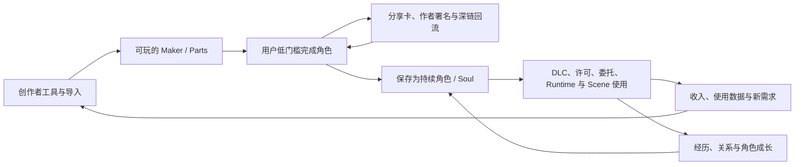

# Soulidity × Animacraft 增长战略与执行策划

**版本：** 0.1 Internal Strategy Draft

**基线日期：** 2026-08-12

**适用周期：** 未来 12 个月，另含 12 个月后的条件式方向

**目标读者：** 创始团队、产品、增长、创作者运营、生态合作、协议与 Runtime 工程

> 本文回答一个核心问题：为什么 Soulidity 与 Animacraft 有机会从“捏一个角色”扩展成较大的角色创作、使用与协作网络，以及现在应该按什么顺序验证它。

本文严格区分四类表述：

- `External Fact`：有直接来源支持的外部事实；
- `Current`：当前代码、主网对象、生产配置或产品路径已存在；
- `Planned / Research`：已进入项目规划或研究，但不能对外说成已上线；
- `Strategy Hypothesis`：本策划建议验证的商业或增长假设，不是已证明结论。

---

## 0. 执行摘要

### 0.1 结论

Soulidity 与 Animacraft 真正有潜力做大的原因，不是把 Picrew、捏咔或设圈交易“搬到链上”，也不是把每个 PNG 包装成 NFT。它把四个已经分别被验证过的需求，连接成一条此前断裂的价值链：

1. **Picrew / 捏咔展示了低门槛组合创作、平台内分享和作者发布能够规模运行**：捏咔进一步展示了 DLC 与二改工具 / 授权可以成为付费 SKU。相关数据均为运营方口径；分享能否为 Soulidity 带来可持续的可归因回流，仍需单独实验。
2. **设圈报道与社区个案显示出围绕角色设定、委托、修改、商用及多人共设的交易语言和实践**：其普遍性、规模与稳定需求没有可靠统计，必须通过访谈和试点独立验证；交易又常依赖自然语言、圈内惯例和人工信任，权利边界并不天然清楚。
3. **NFT 基础设施展示了记录来源、持有与可编程转移 / 结算的技术能力**：官方报告与平台资料同时显示，Token 转移不自动转移知识产权，创作者收益执行依赖具体市场和合约规则，链上交易也可能出现自成交；跨应用携带与持续产品价值仍需在具体产品中验证。
4. **UGC 游戏与创作者平台展示了“工具—内容—分发—收入”可以形成大规模生态**：官方数据同时显示创作者收入分布差距明显；Soulidity 是否能形成同类飞轮、以及长尾保护是否改善供给，仍需独立验证。

这里的“验证”只表示相关平台已经观察到规模使用、付费功能或创作者收入，**不表示这些机制组合到 Soulidity 后仍会自动成立**。尤其是角色二次使用、机器可读许可带来的增量转化、模块化供给意愿和跨 Runtime 留存，仍是本项目必须独立验证的假设。

Soulidity × Animacraft 的结构性机会是：

> **让角色从一次性生成图片，变成由权利清楚的 Parts 持续组成、能够跨 Runtime 使用、积累经历并让多类创作者持续获得收入的角色身份。**

增长公式可以压缩为：

```text
规模化潜力
  = 低门槛创作
  × 可分享传播
  × 模块化供给
  × 机器可读权利
  × 角色连续性
  × 跨场景需求
```

其中任何一项接近零，网络都不会自然成立。链上协议只能降低信任与结算成本，不能替代好看的内容、顺滑的创作体验、真实分发和角色使用场景。

### 0.2 对外定位与对内品类

不建议面对普通用户先讲“链上资产”“DeFi”或“协议”。分层表达如下：

| 对象 | 首屏价值主张 | 用户真正购买的价值 |
| --- | --- | --- |
| 轻量玩家 | **捏一个会继续长大的角色** | 快速表达、保存、分享、持续换装 |
| OC 主 | **让你的角色在不同应用里仍然是同一个角色** | 设定连续性、成长、关系、收藏与可控授权 |
| Maker / Part 作者 | **让作品被反复使用、扩展并持续产生收入** | 工具、分发、许可、DLC、委托、归因和分账 |
| Scene / Runtime 开发者 | **接入有来源、有权限、有连续状态的角色** | 标准接口、准入、内容供给、身份与结果写回 |
| 品牌 / IP | **把一次活动页变成可持续运营的角色互动资产** | 定制 Maker、联名内容、传播归因、长期复访 |

对内可把品类定义为 **Living Character Network / 持久角色网络**。Animacraft 是创作与供给入口，Soulidity 是身份、权利、内容和授权层，Runtime 与 Scene 是持续需求和经历发生层。

### 0.3 当前最重要的判断

`Current`：Animacraft 已实现较完整的 pre-v1 production-candidate Character Maker 编辑、发布、Walrus 内容包、Sui 来源与商业协议基础；Soulidity 已有 Soul、内容、Grant、市场、Collection 和桌面 Runtime 基础。但当前公共可验证 Maker 供给仍处于冷启动，Canonical Soul 现有集成、Commerce v5、退役状态下的 Composable Assets v6、尚未部署的 Physical v7 以及 Expansion Pack v8 的不同生产门仍需分别处理。Scene、Quest、可验证游戏结果和 DeFi 尚不是现有产品能力。

因此未来 12 个月的顺序必须是：

```text
真实 Maker 供给
  → 无摩擦试玩与分享回流
  → 角色保存与二次使用
  → DLC / 许可 / 委托收入
  → Canonical Soul 与 Runtime 连续性
  → 受控 Part 共创
  → Scene / Agent 产生新需求
  → 真实现金流后的托管、奖池与融资
```

不能倒过来先做 Token、公开炒作式二级市场或通用游戏引擎。

---

## 1. 我们继承了哪些已经被验证的商业模型

### 1.1 Picrew：免费体验、组合表达与社交传播

`External Fact`：Picrew 允许作者发布可玩的 image maker，用户即使未注册也可以使用；平台条款强制保留游玩、下载与 SNS 分享这一基础传播范围，同时允许作者设置个人、非商用、商用和修改范围。Picrew 运营方在 2025 年 PicLab 发布中自报年使用者超过 7,400 万、约 10,000 个公开 Maker；这是公司宣传口径，不等同于 MAU、活跃作者或审计数据。Picrew 近年又扩展了去广告 / 保存 / 收藏类 Premium 与面向品牌 IP 的定制 Maker 服务。

可继承的机制：

- 先玩后注册，第一价值时刻发生在账号、钱包和支付之前；
- 每一次成图都是作者和 Maker 的分发载体；
- 大量模板与大量用户之间形成内容发现网络；
- 用户付费不必只来自图片本身，也可来自工具、保存、收藏和 B2B 定制。

不能直接继承的问题：

- “捏出一个形象”不自动获得角色设计、版权、商用或再次创作权；
- 免费分享能做大流量，但未必能让长尾作者获得可持续收入；
- 成图通常仍是一次性结果，角色身份和后续成长不连续。

### 1.2 捏咔：免费游玩、DLC、二改授权与作者分账

`External Fact`：捏咔当前支持原创作者出售收费 DLC 和“个人非商用二改授权”。官方明确该授权是分发授权，不是买断或商用授权；银行卡通道披露的平台费为 15%、支付服务费为 0.35%、作者余额为 84.65%。官方同时说明，整套 Maker 付费游玩、买断和商用仍是未来功能，不能将其写成今天已存在的完整模型。

可继承的机制：

- 基础 Maker 免费，具体扩展内容或高级编辑能力付费；
- “许可 + 工具能力”可以打包成一个清楚的付费 SKU；
- 作者分账与订单记录是供给持续更新的基础；
- 捏咔已在产品与官方说明中使用 DLC、二改授权、买断和商用等术语；这些术语是否被用户准确理解，仍需通过权利理解测试验证。

Soulidity / Animacraft 应进一步解决：

- 把“二改、二创、商用、直播、周边、AI 输入、转授权”等拆成可选择字段；
- 把购买凭证、许可版本、来源和实际可用内容绑定；
- 把基础 Maker、Expansion Pack、独立 Item Product、服务交付和版权转让分成不同商品，避免都叫“买断”。

### 1.3 设圈与约稿：高意愿需求已经存在，但交易基础设施不足

`External Fact`：依《著作权法》第 20 条，美术、摄影作品原件所有权转移不改变著作权归属（原件展览权除外）；该规则不应泛化为数字文件、角色设定或全部权利的统一归属规则。依第 19 条，受委托创作作品的著作权由合同约定；合同未明确约定或未订立合同时，著作权属于受托人，但法律另有特别规定的除外。设圈中可以观察到成设、拍卖、普通购买、买断、二改 / 二传 / 二转、多人共设、委托和周边等交易语言，但这些主要来自社区惯例与个案，不是统一规则或可靠市场规模统计。

这意味着 Soulidity 不能把圈内模糊语言直接产品化，而应把它转换成明确的权利对象：

| 圈内说法 | 产品中必须拆开的字段 |
| --- | --- |
| “买设” | 获得哪一份文件、哪种使用许可、是否可公开、是否可改 |
| “买断” | 版权转让、独占许可、停止再售、源文件、署名、期限与地域分别确认 |
| “二改” | 可修改范围、可否委托第三方、可否公开、是否商用 |
| “二传 / 二转” | 可否再分发、转让许可或转售资产，创作者是否审核 |
| “拆分” | 模板图层拆分、Live2D / 动画绑定服务、多人权益拆售三者分开 |

早期应支持“清楚许可 + 委托服务”，不应开放多人共同产权或默认二转。共同所有会带来改稿、上架、转售、下架和商业授权中的共同决策问题，只有在专门合同和争议流程成熟后再研究。

### 1.4 NFT：借用可验证机制，不借用投机外壳

NFT 生态提供了四个值得保留的机制：

- 可验证的创建者、来源、版本和父子关系；
- 稀缺席位、持有状态和跨应用读取；
- 可编程访问、转让与结算；
- 社区资格、挑战、成就和持续效用。

相关报告和平台规则也揭示了四个必须避免的问题：

- Token 或 NFT 的转移不会自动转移关联图片、角色设定或版权；
- 创作者收益是否可选、如何执行，取决于具体市场、合约标准和当时政策；OpenSea 资料只能证明其平台自身的设置与执行条件，不能外推所有市场；
- 自成交可以伪造价格和流动性；
- 没有持续效用的稀缺，会把增长退化成拉新资金与地板价维护。

因此建议采用 **Web2 可理解、链上可验证** 的产品表达：用户购买的是清楚的使用权、内容访问、角色身份或服务，不承诺升值。链上用于来源、版本、权限和结算，不作为首页叙事。

### 1.5 UGC 游戏：需求场景能放大创作者经济，但收入分布必须治理

Roblox 与 Epic 的官方披露表明，其平台已经形成创作者支付机制，但均属平台自报。Roblox 披露约 20,000 名 DevEx 参与者在截至 2024-06-30 的 12 个月收入中位数为 1,645 美元；该口径不覆盖全部创作者，不能据此估算零收入或零曝光比例。Epic 的 40% eligible net revenue engagement pool 只说明其当时的参与度分配规则，不应类比为 Soulidity 分账比例。

Soulidity 应把以下指标放在与 GMV 同等重要的位置：

- 创作者收入中位数与获得首笔收入的比例；
- Top 10 / Top 100 占播放和收入比例；
- 新作零曝光率与首个有效用户所需时间；
- 作者首发成功率、复更率与流失原因；
- 许可纠纷、下架、退款与侵权响应时间。

结论不是一开始就建“元宇宙”，而是先给角色一个短、可重复、能产生真实需求的使用场景，再逐步开放 Scene 工具。

---

## 2. Part 资产化到底是什么

### 2.1 它不是“每个 PNG 一个 NFT”

Part 资产化的最小定义是：

> **把一个角色组件的内容、来源、兼容性、许可、访问权、装配状态和收益关系分别结构化，使它能够在明确边界内被发现、验证、组合、授权和结算。**

一张 PNG 只是内容文件。可持续运作的 Part / Item 至少还需要：

| 层 | 需要回答的问题 |
| --- | --- |
| 内容 | 文件是什么、哈希和存储位置是什么、哪个版本 |
| 来源 | 谁创建、来自哪个 Maker / Pack、父版本是什么 |
| 兼容 | 可进入哪些 Slot / LayerTrack，依赖、排斥和渲染规则是什么 |
| 权利 | 可个人展示、修改、商用、训练、转让或再许可到什么范围 |
| 访问 | 免费、一次性付费、配额、白名单或活动资格 |
| 装配 | 哪个 Soul 当前使用，Genesis 与 Current Appearance 如何变化 |
| 经济 | 哪个事件需要付款，哪些贡献者以什么比例获得收入 |
| 信任 | Official、Certified 或 Open，由谁验证，能否撤销准入 |

`Current`：Maker v5 文档 / 输出图为 `Maker → Part → Item → Style → PNG`；主网基础 publication 沿用 protocol v4，Commerce & Rights v5 在每个不可变 release 上叠加访问、Complete、收入和转售策略。Composable Assets v6 定义 Maker-local Slot、Official / Certified / Open Item Products、Entitlement、Owned Item、Genesis Appearance 与 Current Appearance。v6 源码与 Mainnet 核心对象已部署，链上配置曾被启用并完成 proof 绑定；当前产品 runtime gate 为 false，19 个业务写入口已由退休不变量阻断，只保留限定恢复 / 兼容路径。不得对用户称为可发布、购买或装备。

技术口径必须进一步细分：v4 / v5 的 Part、Item、Style 仍只是 Maker / Root 内记录，并非独立可转让对象；v6 的 `ItemProductV6` 是产品定义，只有 Owned binding 才产生 `OwnedItemV6`；v7 中真正可持有、托管和装备的最小视觉资产是 `StyleAssetV7`，Part 仍是策略 / Slot 记录；v8 的 `ExpansionPackPassV8` 是整包钱包权利，Style 仍是 Release 表行。因此“Part 资产化”是战略总称，当前协议的准确实现是**组件结构化、Item 产品化、特定 Style 资产化与 Pack 权利化**。

`Activation target`：Expansion Pack v8 代码已部署并完成父 Root finalization，但产品门仍关闭，尚无 v8 Release、Pass、Walrus 或 Seal 生产写入。首个 FREE Pack 的待验证路径是“发布并读回 Pack → claim FREE Pass → 获取公开 Walrus 内容 → Player 本地合并”；FREE 资产不走 Seal 解密。Seal 解密只属于未来单独审阅的 paid Pack 路径。v8 不等于 Canonical Soul Mint，也未开启 Complete 或 Physical Bridge。

### 2.2 为什么这个原子单位会改变商业结构

传统捏人平台的主要商品是“整个 Maker”或“最终图片”；Part 资产化后，供给和需求可以在更小单元相遇：

- 发型作者不必制作完整角色 Maker；
- 动画师可以只提供动作、表情或绑定服务；
- 原 Maker 作者可以控制第三方准入而不复制或篡改原图；
- 用户不必重买或重 Mint 角色，可以持续升级同一个角色的外观和能力；
- Scene 可以声明兼容的角色组件和美术规格；
- 收入可以按明确的购买或使用事件回流真正相关的贡献者。

组合价值可能随 Parts 和 Items 增加而非线性增长，但“有效组合数”不能简单用各 Part 选项相乘：requires / excludes、Last Bastion、颜色绑定、层级和许可证都会压缩实际可用组合。增长指标必须统计**通过规则并被真实使用的有效组合**，不能用理论排列数制造虚荣数字。

### 2.3 资产、许可、服务和所有权必须分开

首年商品模型建议限制在六类：

1. **Base Maker**：免费或一次付费的基础创作系统；
2. **Expansion Pack / DLC**：绑定精确 Maker 版本的内容扩展；
3. **Item Product**：单独发布并通过兼容性验证的第三方组件；
4. **License Upgrade**：个人、商业、直播 / 周边或其他明确权利升级；
5. **Creative Service**：约稿、改稿、拆层、绑定、动画等里程碑服务；
6. **Runtime / Scene Service**：桌面、Agent、游戏、云同步或场景使用服务。

不要把以上商品都包装成“NFT 所有权”。用户对某个链上对象的持有、对文件的访问、法律许可、Maker 管理权和著作权转让是五件不同的事。

---

## 3. 角色、游戏、Agent 与协作创作为什么会发生质变

### 3.1 角色：从成图变成持续状态

角色的长期价值不再只来自“当时捏得好看”，而来自六条可连续的状态：

```text
稳定身份 Soul
  + 来源与版本 Maker / Recipe
  + Genesis / Current Appearance
  + 受保护内容 Soul Doc / Memory / Skills
  + 被接受的经历、关系与能力变化
  + 对 Runtime / Agent 的有限授权
```

同一个角色可以换衣、换 Runtime、进入游戏或被 Agent 使用，但身份和关键来源不需要重新创建。用户投入的设定、委托、回忆和关系会沉淀到同一角色上，留存逻辑由“再来生成一张图”变成“回来继续经营这个角色”。

### 3.2 游戏：从孤立皮肤变成角色需求引擎

Scene 不只是展示 NFT 的房间，而应为角色创造具体需求：

- 某个短篇冒险需要兼容的服装、表情或能力；
- 活动为通过许可的角色生成 Run Receipt；
- Scene 只提交声明过的 Claim，不能任意修改 Soul；
- 经用户、协议或可信验证者接受的 Outcome 才进入长期状态；
- 角色带着结果、关系或纪念物进入下一个 Runtime。

这会把游戏从独立获客成本中心变成 Maker / Part 的复用和分发渠道。但 `Planned`：Scene Maker、Quest、Run Receipt 和 Accepted Outcome 仍需实现，首年只应从一个 5–15 分钟、规则有限的参考 Scene 开始。

### 3.3 Agent：从“出售一个机器人”变成授权同一身份去执行

Soul 是身份与策略锚点，Agent 是 Runtime 中的执行者，两者不应混为同一资产：

- 一个 Soul 可以在桌宠、聊天、工作流和游戏中有多个投影；
- Agent 只取得完成任务所需的 Scope，并可设置到期、撤销和 Ownership Epoch 失效；
- 模型、工具、本地状态和私密记忆不因“持有 Soul”自动公开；
- `Planned`：未来 Runtime 可提交 Receipt 或 Claim，但不能未经接受污染角色长期记忆；当前尚无 Scene Run Receipt、Claim 或 Accepted Outcome 协议；
- 角色转手或 Grant 失效后，旧 Runtime 不应继续读取受保护内容。

增长意义是：用户不需要在每个 Agent 产品里从零重建人格与角色资产；开发者也不必拥有角色本身，只需获得可验证、最小化的运行授权。

### 3.4 协作创作：从整包交付变成模块化生产网络

未来一名角色背后可以有多种专业贡献者：

```text
Character / Maker 作者
  ├─ Part / Item 画师
  ├─ 设定与文本作者
  ├─ 动画、语音与绑定服务者
  ├─ Scene / Quest 作者
  ├─ Runtime / Agent 开发者
  └─ 策展、验证和品牌发行方
```

机器可读的来源与许可证让第三方知道“能否用、怎么用、收入给谁”；兼容性验证让扩展内容不必改写基础 Maker；明确的收益事件避免所有人对每次 Agent 调用无限叠加版税。这才是 Part 资产化真正带来的协作效率。

### 3.5 DeFi：只能建立在已验证现金流之后

DeFi 的正确对象不是“给主观估值的 OC 做地板价”，而是可审计的生产与收入事件：

1. Scene / Part 创作赏金；
2. 委托与商业授权的里程碑托管；
3. 基于已发生 Maker / DLC / Runtime 收入的预付款或应收融资；
4. 在权利、估值、清算和监管成熟后，才研究更复杂的抵押或流动性。

`Research`：当前没有已发行协议 Token，DeFi 和创作者融资也不是现有能力。任何金融扩展都必须在真实留存、真实收入、反女巫、反自成交、风险准备金和法域审查之后。

---

## 4. 产品角色与完整操作逻辑

### 4.1 四层职责

| 层 | 核心职责 | 不应该做什么 |
| --- | --- | --- |
| **Animacraft** | Maker / Part / Item / Style 创作、规则、渲染、发布、兼容与商业授权入口 | 不重复铸造最终角色身份 |
| **Soulidity** | Canonical Soul、来源、内容、Grant、所有权 Epoch、市场与关键结算 | 不承担高频渲染、模型推理和所有游戏过程 |
| **Runtime** | Desktop、Agent、游戏客户端、DApp 中的实际交互与执行 | 不自动取得版权或永久修改 Soul 的权力 |
| **Scene** | 规则、目标、活动、关系、结果与内容需求 | 不用中心化结果冒充“全部上链” |

### 4.2 理想用户旅程

```text
看到朋友分享的角色
  → 无钱包打开对应 Maker
  → 30–90 秒完成第一次组合
  → 导出带作者署名和深链的分享卡
  → 保存为可继续编辑的角色
  → 为喜欢的 DLC / Part 或许可升级付费
  → 在价值已经成立后创建 / 连接 Canonical Soul
  → 在 Desktop、Agent 或参考 Scene 中继续使用
  → 获得被接受的经历、关系和新内容需求
  → 再次分享、购买或邀请其他创作者参与
```

`Product Gap`：当前公开 Template Plaza 可无钱包浏览，但创建、发布和链上路径仍有钱包依赖。增长实验应把钱包后移到“保存受保护权益、购买或创建 Soul”的时刻，不应让钱包成为第一次试玩前置条件。

### 4.3 当前能力与激活状态矩阵

版本说明：产品版本 0.8.x、Core Sui package object version、协议模块 v4 / v5 / v6 / v8，以及独立 Physical v7 companion package 是不同编号轴。Expansion Pack 协议 v8 的稳定 TypeOrigin 来自 Core package version 6，当前 corrective callable 是 Core package version 7；后者不等于尚未部署的 Physical v7。

| 能力 | 当前状态 | 增长含义 |
| --- | --- | --- |
| Maker Studio、Player、规则与渲染 | `Implemented / production candidate` | 可以承载创作者冷启动和试玩验证 |
| Maker v4 主网基础 | `Mainnet, product-gated` | 先完成真实 Maker 端到端证据 |
| Commerce & Rights v5 | `Implemented, production-gated` | 不能提前宣传完整付费闭环 |
| Expansion Pack v8 免费钱包测试 | `activation phase, gate OFF` | 候选 Pack 尚未发布；仅用于未来扩展包发布 / Pass / 本地合并证据，不是 Soul Mint |
| Canonical Soul 集成 | `adapter/code + Mainnet bindings present; product gate OFF` | 缺生产同 PTB / 钱包验收，是角色连续性增长前的关键依赖 |
| Composable Assets v6 | `Mainnet core deployed; product retired/gated` | 19 个业务写入口阻断，只保留限定恢复 / 兼容路径；新业务需新协议决策，不能直接“开白名单” |
| Physical v7 | `source implemented/tested; not Mainnet-deployed/configured; gate OFF` | 不进入首年核心增长承诺 |
| Soul、Content、Grant、Market、Collection | `Mainnet / Implemented` | 可作为后续身份、访问和结算基础 |
| Desktop Runtime | `Pilot` | 适合做第一个“角色二次使用”场景 |
| Scene / Quest / Accepted Outcome | `Planned` | 先做单个参考场景，不宣传通用引擎 |
| DeFi / Token | `Research / No current issuance` | 只设条件门，不列入获客路线 |

---

## 5. 增长飞轮



图中的箭头在完成实验前都是 `Strategy Hypothesis`，不是已证明因果。只有相邻转换的增量指标连续成立，才能把它称为飞轮；否则它只是一个待优化漏斗。核心边分别用分享带来的增量完成、保存对 D30 的增量、Pack 装配对 MRC 的增量、首笔收入对作者 D30 复更的增量来验证。

### 5.1 分享分发飞轮

作者发布 Maker → 用户完成角色 → 导出带作者和 Maker 深链的分享卡 → 朋友直接进入同一 Maker → 新一轮完成与分享。

关键不是水印曝光，而是**回到可玩的精确入口**。每张分享卡至少应携带 Maker ID、作者、版本、合规署名与深链归因；隐私敏感的 Recipe 不应默认公开。

### 5.2 创作者收入飞轮

更好工具 / 更快导入 → 更多高质量 Maker → 更多使用 → DLC、许可和委托收入 → 作者复更 → 更多风格与长尾供给。

增长团队不能只签头部作者。头部负责拉新与审美标杆，长尾负责覆盖身份、文化、体型、题材和小众 Scene 的多样需求。

### 5.3 角色连续性飞轮

完成角色 → 保存 / 创建 Soul → Desktop 或 Scene 使用 → 产生经历和新外观需求 → 用户回到角色 → 更高情感投入和迁移成本。

这一飞轮是 Soulidity 相对传统捏人平台最重要的差异，但必须用“二次使用率”证明，不能用 Mint 数量替代。

### 5.4 模块协作飞轮

稳定 Slot / LayerTrack / Rights 规范 → 第三方 Part 作者容易进入 → 组合覆盖增加 → Scene 和用户需求增加 → 使用与分账增加 → 更多专业作者进入。

该飞轮必须通过白名单验证、兼容测试和收益上限启动。完全开放但没有质量与侵权治理，会迅速产生碎片化和信任崩溃。

### 5.5 B2B 飞轮

品牌 / IP 定制 Maker → 粉丝创造并分享 → 获得可归因传播与复访 → 品牌续费扩展 Pack、活动或 Scene → 反向为 C 端带来新用户和合法 IP 内容。

B2B 是早期重要现金流与内容启动器，但产品要保证品牌 Maker 结束活动后仍有明确的保存期限、许可和用户权益，不能活动结束即失效而伤害信任。

B2B 与自然 C 端必须使用两套 cohort 和 P&L。品牌买量、定制内容与人工运营会抬高完成和复访，MRC、传播与留存必须同时报告“含 B2B”和“剔除 sponsored 流量”；B2B 另设定制工时上限、最低贡献毛利、组件复用率与续费门。

---

## 6. 商业化阶梯

商业化应围绕真实价值逐级增加，不把所有收入押在一次高价发行或二级交易。

| 层级 | SKU | 主要付款人 | 主要收款方 | 上线顺序 |
| --- | --- | --- | --- | --- |
| 免费入口 | 基础 Maker、基础导出、分享 | 无 | 获客成本 | 立即 |
| 用户工具 | 高清 / 动画导出、版本保存、更多收藏、云同步 | OC 用户 | 平台 / Runtime | 0–90 天测试 |
| 内容 | Expansion Pack、Part、动作、表情、背景、语音 | OC 用户 | 内容作者为主 | v5 / v8 证据后 |
| 权利 | 商用、直播、周边、团队席位等许可升级 | 用户 / 小团队 | 权利人为主 | 0–180 天，先人工审核 |
| 服务 | 约稿、改稿、拆层、Rig、动画 | OC 用户 / IP | 服务创作者 | 0–180 天，白名单托管 |
| 关系 | 作者月度支持、更新包、粉丝会 | 粉丝 | 作者为主 | 有稳定复更后 |
| Runtime | Desktop Pro、Agent、私密内容、模型 / 工具调用 | 高留存用户 | Runtime 运营方 | 90–365 天 |
| Scene | 门票、活动、内容内购、品牌赞助 | 用户 / 品牌 | Scene 作者为主 | 180–365 天 |
| B2B | 定制 Maker、白标活动、内容审核与报表 | 品牌 / IP | 平台 + 创作者 | 0–180 天 |

### 6.1 许可结账不应只有一个“买断”按钮

每个 Maker / Pack / Item 建议使用同一套机器可读字段：

- 个人展示、公开发布、二次修改、二次创作；
- 商业内容、广告、直播 / 打赏、周边、游戏 / Runtime 使用；
- 生成式 AI 输入、训练、检索或提示词使用；
- 转售、转让、再分发、再许可；
- 独占性、地域、期限、席位、署名和撤销条件。

首版 checkout 只提供三条清晰路径：

1. **Personal**：个人展示与明确范围内分享；
2. **Creator / Commercial**：列明商业场景、期限、席位和收入边界；
3. **Exclusive / Transfer Inquiry**：进入人工合同，不在一个链上按钮里假装完成版权转让。

每笔交易生成可下载授权凭证，记录资产版本、Rights Manifest 哈希、双方、价款、期限和附加条款。协议权限凭证不应被表述成覆盖所有法域的法律结论。

### 6.2 分账原则

`Current contract design`：Commerce v5 的 Base / Pack / Complete 初级收费候选为 Maker Treasury 90%、Animacraft Protocol 10%；Soulidity 当前固定二级平台费为 2.5%，Maker 与 Soul 来源版税有独立上限。具体开放前仍需以生产配置、主网对象和安全审阅为准。

商业原则：

- 初级内容收入应让作者及明确依赖方获得 85%–90%；
- Referral / Curator 奖励从平台份额中支付，不额外向作者加税；
- 不对每次 Agent 调用、每个 Scene 行为和所有下游交易进行无限版税套娃；
- 用户在签名前看到总价、gas、存储、许可和不可退款边界；
- 收入宣传同时披露中位数、分布与获得收入的作者比例。

### 6.3 单位经济必须先于规模化付费

85%–90% 的作者份额是供给侧原则，不自动等于平台商业可持续。每个付费 SKU 上线前必须计算：

```text
贡献毛利
  = 实收
  - 作者与依赖方分账
  - 支付 / gas / Walrus / Seal 成本
  - 退款、坏账与税费
  - 审核、争议、客服和创作者支持的可归因工时
  - 渠道获客成本
```

分别为 DLC、License、Commission、Runtime 和 B2B 建表，记录客单价、退款率、单 Maker 支持工时、CAC、贡献毛利与回收期。低于预注册门槛时应提价、缩小服务或停止 SKU，不能用 GMV 增长掩盖负贡献毛利。

---

## 7. 北极星指标与增长指标树

### 7.1 唯一北极星：月度二次使用角色数

建议统一北极星为 **Monthly Reused Characters，MRC（月度二次使用角色数）**：

> 在统计月内，一个角色完成首次 `character_complete` 后至少间隔一个自然日，又成功发生 `character_reopen + save`、`pack_equip + render`、达到预注册有效时长的 `runtime_activate`，或一个有效 `accepted_outcome`；按角色去重后的数量。

浏览、领取、购买、钱包连接、Mint、转账、仅打开未保存、未达到时长的 Runtime 会话和机器人调用本身都不计入 MRC。购买属于变现指标，只有实际装配并渲染后才可能构成二次使用。

采用这个指标有三个原因：

- 对传统 Maker，它验证角色不是一次性成图；
- 对 Soulidity，它验证持久身份确实提高留存；
- 对 Runtime、Scene、Agent 和 DLC，它是共同的需求基数。

阶段性实现：

| 阶段 | 代理指标 | 身份口径 |
| --- | --- | --- |
| Canonical Soul 前 | 本地 / 登录账户中的保存角色被二次编辑或使用 | 匿名设备 ID + 账户 ID 去重，不等于 Soul |
| Soul 试点 | Soul 在两天或两个 Runtime 产生合格事件 | Soul ID，剔除内部测试与自成交 |
| Scene 后 | Monthly Meaningfully Changed Souls | 至少一次 Accepted Outcome 或跨场景状态变化 |

### 7.2 指标树

| 维度 | 核心指标 | 不能用什么替代 |
| --- | --- | --- |
| 获客 | 分享深链访问、作者渠道新访客、B2B 活动新访客 | 曝光量 |
| 激活 | Maker 打开→首个选择→有效完成→导出 / 保存 | 钱包连接数 |
| 传播 | 完成→分享率、深链 CTR、深链→完成率、传播系数 | 水印出现次数 |
| 留存 | 角色 D1 / D7 / D30 二次使用、作者 D30 复更 | 累计注册、累计 Mint |
| 供给 | 周活发布作者、首发成功率、Time-to-first-Maker、有效组合使用 | 理论组合数 |
| 收入 | 付费率、ARPPU、DLC / 许可 / 服务收入、退款 | 二级挂牌价 |
| 作者健康 | 收入中位数、首笔收入率、Top 份额、零曝光率、复更率 | 总创作者支付 |
| 权利安全 | Rights 字段覆盖、投诉、下架、争议、处理时长 | “上链即确权”口号 |
| 协议健康 | 发布 / Pass / Treasury 事件、Walrus 可读、RPC / Config 一致 | 独立钱包数等同活跃用户 |

`Current measurement gap`：当前仓库尚无完整产品分析埋点。链上事件 / 对象可以测**实际发生后**的 Pack 创建、Pass、Entitlement、Treasury、holder 和 `paid_atomic`；Walrus receipt 与部署健康要由发布证据和监控系统测量。当前 v8 尚无上述 Pack / Pass / Walrus 生产写入。现状不能可靠回答访客转化、渠道、DAU / MAU、D7 / D30 留存和跨设备恢复；邀请制试点前必须补齐事件字典、匿名身份合并、测试钱包排除和隐私同意。

### 7.3 事件字典最小集

首版只采集能支持决策的事件：

```text
maker_impression
maker_open
first_valid_selection
character_complete
character_export
share_create
share_deeplink_open
character_save
character_reopen
wallet_prompted / wallet_connected
pack_view / pack_claim / pack_equip
license_view / license_checkout / license_complete
creator_draft_start / preflight_pass / publish_complete
runtime_activate / scene_enter / accepted_outcome
```

每个事件携带 `maker_id`、版本、渠道、匿名 / 账户 / Soul 身份层级、测试标记和许可版本；不得采集未获同意的私密 Recipe、Soul Memory 或 Agent 对话内容。

在分析上线前还要冻结：UTC 或业务时区、事件幂等键、角色 ID 生成与合并优先级、匿名→账户→Soul 的 identity stitching、删除 / 撤回同意后的处理、内部流量和机器人排除。D30 只报告已完整观察 30 天的成熟队列；新近队列单独标为未成熟，不能按未留存计零。

---

## 8. 目标用户与首个切入市场

### 8.1 五类用户的任务

| 用户 | 主要任务 | 最大阻碍 | 首个价值时刻 |
| --- | --- | --- | --- |
| 轻量玩家 | 快速做头像 / 角色并分享 | 钱包、学习成本、模板不好看 | 90 秒内完成并导出 |
| OC 主 | 保存角色、扩充设定、持续换装和二创 | 权利不清、资产散落、跨应用重做 | 角色可被再次打开且仍是同一个 |
| Maker / Part 作者 | 低成本发布并获得曝光、收入和委托 | 拆图劳动、冷启动、盗用、无数据 | 第一位非熟人完成并署名分享 |
| Scene / Runtime 作者 | 获得合法、标准化、可持续的角色内容 | 格式碎片、权限不清、没有分发 | 一个角色可安全接入并产生结果 |
| 品牌 / IP | 做可玩的粉丝互动并衡量传播 | 定制成本、审核、活动结束即流失 | 用户生成内容带来可归因回流 |

### 8.2 推荐起步人群

首个楔子不是“所有喜欢角色的人”，而是：

> **已经拥有 OC 或愿意建立长期 OC、会在社交媒体分享、愿意持续换装 / 补设定的用户，以及已经有拆分素材或可快速完成 Maker 的中腰部原创画师。**

原因：这两类用户同时具备表达需求、持续编辑动机、对许可的敏感度和为定制内容付费的可能。纯头像用户能带来流量，但未必能验证角色连续性；纯 Web3 收藏者能形成短期交易，却不能证明角色被持续使用。

### 8.3 三个内容主题试点

为避免供给过散，90 天只选三类审美 / 使用主题，每类配 3–5 位锚点创作者：

1. **OC / TRPG 角色卡**：强调设定、表情、职业服装和故事复用；
2. **桌宠 / Agent 伙伴**：强调透明背景、动作、表情和持续陪伴；
3. **社交头像 / 双人关系**：强调分享、CP / 朋友组合和关系传播。

主题可按现有创作者资源调整，但必须在试点开始前固定，防止“什么都能做”导致每一类库存都不足。

### 8.4 用自下而上模型限定“能做多大”

外部平台总用户量只能证明品类存在，不能推出 Soulidity 的可达市场。试点前要为每个主题建立三种情景：

```text
年度可达收入
  = 可触达并成功首发的创作者数
  × 每位作者带来的有效完成数
  × 角色保存率
  × 成熟队列付费率
  × 年 ARPPU
```

同时估算每位创作者招募与支持工时、自然分享新增完成、D30 MRC 和贡献毛利。把普通捏人平台 + 云保存、约稿平台、Live2D / 桌宠工具、游戏头像系统列为替代方案，访谈用户为什么要迁移、为什么不迁移。90 天容量与实验样本从真实渠道和这张模型反推，而不是从 Picrew 的总规模外推。

以下是典型替代路径，不是对任一单独产品全部功能的审计：

| 替代路径 | 已有优势 | Soulidity 必须证明的增量价值 |
| --- | --- | --- |
| Picrew / 捏咔式 Maker | 创作快、模板多、分享习惯成熟 | 同一角色持续使用、Rights 凭证和多作者收入是否值得迁移 |
| 约稿平台 / 私域交易 | 高定制、直接连接画师 | Maker 使用能否带来更低获客成本，里程碑与来源能否降低纠纷 |
| Live2D / 桌宠工具 | 日常陪伴与动态表现强 | 标准化内容、权限和同一 Soul 是否能减少重复制作与锁定 |
| 游戏内 Avatar | 使用场景清楚、留存强 | 跨应用携带是否带来真实用户价值，而非只增加复杂度 |
| NFT 市场 | 来源、持有和交易可验证 | Rights 与持续效用优先是否能避免投机和版权混淆 |

### 8.5 护城河必须按顺序形成

技术代码本身还不是商业护城河。可持续优势的形成顺序应是：

1. Rights、来源、版本和兼容图降低一次协作成本；
2. 稳定规范让更多 Maker / Item / Runtime 可互操作；
3. 同一角色的持续使用带来用户留存和情感迁移成本；
4. 创作者获得重复收入，形成难以一次性复制的供给网络；
5. 在用户同意和隐私边界内，积累“什么内容在什么角色 / 场景被真正使用”的图谱；
6. B2B、作者社群和 Runtime 共同构成多入口分发。

如果第一、二步没有降低创作与授权成本，协议复杂度就不是护城河；如果第三步没有提高 MRC，Soul 也只是另一种保存格式。

---

## 9. 90 / 180 / 365 天执行路线图

下文数字是**暂定试点容量上限或样本下限，不是市场预测，也不是在基线前冻结的成功阈值**。第 1–2 周先测 open→complete、save、share、D7 与单作者支持工时，再按基线、最小可检测提升、队列成熟时间和团队容量反推各实验样本；随后预注册分母、阈值、置信区间和 `pass / iterate / stop` 规则。任何对外采用数据必须标注口径。

### 9.1 0–30 天：先让真实链路和测量成立

目标：从“协议准备”进入“可观测的邀请试点”。

产品与协议前置：

- 对账 v8 Authority、部署记录与 runtime config；保持其他生产门关闭；
- 完成一个 FREE child Pack 的 Walrus 上传 / 认证、链上创建、manifest 绑定、Style 注册、seal、Authority admission、activate 和逐步 readback；
- 在 Preview 与生产完成真实钱包的领取、刷新恢复、跨钱包负面测试和 Player 本地合并；
- 当前 v8 不宣称 Complete、Soul Mint、Physical 或 paid + Seal；
- 维持父 Root 所需 PAUSED 状态及当前安全不变量。

增长基础设施：

- 完成上述最小事件字典和漏斗看板；
- 建立测试钱包 / 内部流量排除、UTM 与 Maker 深链；
- 设计带作者署名和精确 Maker 深链的分享卡；
- 建立作者申请、权利声明、举报 / 下架和争议联系人；
- 选择 10–15 位锚点创作者，逐一完成素材权利与制作能力审查。

30 天出口条件：

- 一个 FREE Pack 端到端链路有可复查证据；
- 分析系统能回答“从 Maker 打开到完成 / 分享 / 二次使用掉在哪一步”；
- 至少 5 个真实 Maker 可由非团队钱包打开并完成；
- 没有把链上钱包数宣传成用户数。

### 9.2 31–90 天：验证分享回流和角色二次使用

目标：证明 Maker 不只是工具，角色也不只是一次性成图。

供给：

- 完成 10–20 位邀请创作者、20–40 个可用 Maker；
- 三个主题各有足以完成角色的基础内容；
- 为创作者提供导入检查、首发陪跑、数据页和复更建议；
- 只开放 FREE Base / FREE Pack，或对付费采用人工收款与明确许可的小规模实验；生产 paid v8 不在这一阶段默认承诺。

消费与传播：

- Maker 无钱包试玩；在保存受保护权益、领取 Pack 或创建 Soul 时再提示钱包；
- 上线分享卡 A/B：轻署名 vs 署名 + Maker CTA；
- 上线收藏 / 关注 / 更新提醒与“继续这个角色”；
- 用 Desktop Pilot 做第一个**本地保存角色投影**场景。该实验只验证“角色进入桌面后是否增加二次使用”，不验证 Soul 身份、Grant、跨设备或跨 Runtime 连续性；后者必须等待 Canonical Soul 适配后独立实验。

建议 90 天学习门槛：

- 以 500 次有效完成作为初始样本下限；若分享、保存或 D30 分群的统计功效不足，继续积累而不强行下结论；
- 完成→分享率、分享深链 CTR、深链→完成率都有稳定样本；
- 20% MRC、50% 作者首发和 30% 作者 D30 复更仅作为预实验工作假设；第 1–2 周基线后冻结正式阈值，D30 只使用完整成熟队列；
- 零重大权利事故，普通争议有明确 SLA 和复盘。

### 9.3 91–180 天：验证第一批重复收入

目标：让创作者收入来自角色持续使用，而非一次高价发行。

产品：

- 在 v5 / v8 免费链路稳定后，按独立发布门审阅 paid Base / Pack：Seal、密文、USDC、Pass、分账、提现、失败恢复和退款 / 争议说明缺一不可；
- 上线 Personal / Commercial / Exclusive Inquiry 三路径许可 checkout；
- 上线作者主页、委托 CTA、报价、里程碑和白名单托管；
- 测试高级导出、角色版本保存、云同步或 Desktop Pro；
- 完成现有 Canonical Soul 适配器的生产 gate 审阅及同 PTB 钱包证据后，才把“持续角色身份”开放给邀请用户。
- 另立“Canonical Soul + SoulGrant Desktop”实验，测试跨设备恢复、权限理解、撤销与跨 Runtime 身份连续性，不与 90 天本地投影数据混池。

GTM：

- 与 1–3 个原创 IP、TRPG 社群或品牌做定制 Maker 试点；
- 每个试点报告分享回流、角色二次使用、作者获益和许可争议，不只报告生成次数；
- 建立内容策展位：新作、长尾、主题和兼容扩展分开，防止热门榜单吞噬全部流量。

180 天决策门：以下阈值必须在 90 天结束时根据基线预注册，本文只规定决策结构，不虚构绝对数。

- 非投机内容 / 许可 / 工具收入占比达到预注册下限，否则停止扩展二级交易叙事；
- 成熟创作者队列的第二笔购买 / 服务订单率达到预注册下限，并同时报告全体受邀作者分母，避免只观察已收入者；
- 作者收入中位数与首笔收入率在预注册的连续周期改善，否则暂停扩大供给、优先修复发现和转化；
- Canonical Soul 对照实验达到预注册最小提升和置信要求，否则不以 Soul 连续性作为主要增长卖点；
- 如果 paid、Soul 或 B2B 任一链路未通过安全 / 权利门，继续以免费增长验证，不用临时 Token 补贴掩盖问题。

### 9.4 181–365 天：从角色工具扩展为小型生态

目标：证明第三方内容和一个参考 Scene 能共同增加 MRC。

产品采用串行条件门，而不是并行铺开：

1. Canonical Soul 对二次使用产生增量后，基于 v6 已验证的数据模型设计一个新的、经过审阅的可组合伴生协议或等价 Web2 试点；**不重新开启已退休的 v6 业务入口**；
2. 新协议 / 试点在 testnet、安全和产品验收后，才白名单开放兼容 Item Product；每个 Item 经过 Slot / LayerTrack / Rule / Renderer 与 Rights 校验。Item 装配对 MRC 产生增量后，在参考 Scene 与 Agent 任务中**二选一**启动下一验证，避免无法归因；
3. 参考 Scene 路径使用 5–15 分钟、有限输入、公开规则和有限结果 Schema；Agent 路径通过 SoulGrant 获取最小 Scope，并验证用户能理解、撤销；
4. 上一步成立后，才建立面向第三方的接入文档、测试 Maker / Soul、兼容性工具和结果验证示例；
5. v7 Physical 保持独立非核心门，只在独立部署、安全和产品验收后测试少量真正可托管 / 装备的 StyleAsset，不纳入 365 天生态成功的必要条件。

运营：

- 创作者分成、策展、兼容验证和争议审核形成固定周节奏；
- 建立 Walrus 续期提醒、RPC / GraphQL / Seal / 前端配置监控；
- 完成独立 Move 安全审阅、多签 / UpgradeCap 托管、批量发布和灾难恢复；
- 根据实际支持能力逐步从邀请制扩展，不能把产品 v1 或 1,000 活跃创作者当成没有证据的宣传。

365 天成功定义：

- MRC 持续增长，并且增长同时来自复用、内容扩展和至少一个 Runtime / Scene；
- 有健康的非头部供给：新作者能获得曝光、首个用户和首笔收入；
- 用户能说明自己拥有什么、能做什么、哪些权利不包含；
- 创作者有来自 Base 以外的重复收入；
- 关键增长不依赖 Token 价格、公开拍卖或不可持续补贴。

### 9.5 365 天之后：条件式扩展

只有当角色二次使用、创作者收入和参考 Scene 都成立，才推进：

- 多 Scene 的 Accepted Outcome 与跨场景关系；
- 第三方 Runtime / Agent SDK 与认证；
- Scene 创作赏金和里程碑托管；
- 基于可审计历史收入的预付款 / 应收融资研究；
- 协议级策展、争议验证或治理质押。

Token、借贷、AMM、OC 抵押和流动性池不是自然的下一步，必须另立目标、法律意见、风险模型和独立安全审计。

---

## 10. 90 天实验组合

每个实验必须先登记 `eligible cohort`、随机 / 分配单元、基线、主要指标、最小可检测提升（MDE）、最小 N、运行周期、量化护栏、负责人和 `pass / iterate / stop` 规则。下表只给预注册方向；数字必须由第 1–2 周基线和容量计算冻结，不能在看过结果后修改。

| 实验 | 分配单元 / 主要指标 | 预注册决策门与护栏 |
| --- | --- | --- |
| E1 分享卡与深链 | 合格完成访客；增量深链→有效完成 | CTA 版回流完成达到 MDE，且深链→完成不下降；作者归因丢失、署名投诉超过阈值即停 |
| E2 零钱包试玩 | 新访客；Maker open→complete | 完成率达到 MDE，且保存 / 购买身份错误不升；出现权益归属混乱即停 |
| E3 “继续这个角色” | 首次保存角色；成熟队列 MRC、D7 reopen | MRC 达到 MDE；误认本地保存等于 Soul 的可用性错误超过阈值则迭代文案 |
| E4 FREE Base + Pack | 可领取 Pack 的成熟角色；equip + render 后 MRC | Pack 组相对对照达到 MDE；v8 readback、恢复或跨钱包任一硬门失败即停 |
| E5 三档许可 | 有许可意图用户；checkout→complete、争议 / 咨询率 | 转化或客单改善且争议不升；用户权利理解测试低于阈值即简化套餐 |
| E6 委托 CTA | 合格 Maker 完成用户；合格询盘→接受→按时交付 | 成交与贡献毛利通过门；诈骗、未成年人或交付纠纷超过阈值即停 |
| E7 创作者首发陪跑 | 受邀作者；first publish、支持工时、D30 republish | 首发 / 复更达到 MDE 且单 Maker 支持工时在容量内，否则缩小服务 |
| E8a 本地 Desktop 投影 | 已保存本地角色；7 日有效使用、MRC uplift | 验证桌面场景增量，不声称 Soul 连续性；崩溃、隐私投诉超过阈值即停 |
| E8b SoulGrant Desktop | 完成 Canonical Soul / Grant 的邀请用户；跨设备恢复、权限理解、撤销、MRC | 仅在适配证据后启动；权限理解或撤销成功率未达门则不扩展 |
| E9 B2B 定制 Maker | 独立 sponsored cohort；完成、分享回流、30 日复访、贡献毛利、续费 | 与自然 C 端分开报告；定制工时、毛利或用户权益持续性未达门则不续做 |

实验优先级：E1、E2、E3、E7 同时启动；E4 以当前 v8 激活证据为前置；E5、E6 在 Rights 与人工处理流程完成后；E8a 可在本地保存链路稳定后启动，E8b 等待 Canonical Soul / Grant；E9 可由独立商务队列并行寻找，但人力、数据与 P&L 均不得混入自然 C 端基线。

---

## 11. 获客与创作者运营计划

### 11.1 渠道组合

| 渠道 | 内容形式 | 目标 |
| --- | --- | --- |
| 作者自有社交 | Maker 链接、制作过程、用户成图转发 | 高意图首批玩家 |
| 用户分享 | 成图 / 短视频 + 精确深链 | 低成本传播回流 |
| OC / TRPG 社群 | 角色挑战、关系卡、跑团角色包 | 验证持续角色需求 |
| 桌宠 / Agent 社区 | 从成图到桌面投影的演示 | 验证二次使用 |
| 创作者教育 | 拆图规范、Rights、收入数据、案例 | 降低首发时间 |
| 品牌 / IP | 定制 Maker 与活动 Pack | 现金流、合法内容与曝光 |
| 开发者生态 | 参考 Runtime / Scene、SDK、黑客松 | 365 天后的需求侧 |

不建议用买量先放大一个没有稳定完成率和二次使用的漏斗。付费获客只能在每个渠道的分享回流、D30 和毛利可测后启动。

### 11.2 创作者分层服务

- **Anchor Creator**：提供主题标杆、联合发布和用户入口；给予制作支持，不承诺永久首页垄断；
- **Growth Creator**：已有作品和小社群，重点提供导入、数据、DLC 与许可模板；
- **New Creator**：通过模板、检查器、示例文件和首发审核降低成本；
- **Part Specialist**：发型、服装、表情、动作、音频或 Rig 专项作者，在新的可组合协议 / Web2 兼容试点通过后进入；已退休 v6 不作为直接开放入口；
- **Scene / Runtime Builder**：用需求清单反向采购合法 Parts，而不是无条件抓取素材。

创作者数据页至少显示有效打开、完成、导出、分享回流、收藏、Pack 使用、付费、许可和争议；同时解释发现机制的主要权重，允许作者知道为什么没有曝光。

### 11.3 发现机制

首页不采用单一“热门”排序，至少划分：

- 新作探索；
- 编辑精选；
- 主题 / 使用场景；
- 最近更新；
- 与当前角色兼容的 Pack / Item；
- 来自你已关注作者；
- 长尾探索配额。

排序既看完成和复访，也看加载性能、投诉、许可完整度和新作者机会；不能以交易额直接决定曝光，否则会形成投机与头部自强化。

---

## 12. 地域、合规与安全边界

### 12.1 中国大陆与全球产品路径必须分开

`External Fact`：中国人民银行等十部门 2021 年通知将法币与虚拟货币兑换、虚拟货币之间兑换、代币发行融资、相关信息中介和定价等列举的虚拟货币相关业务活动界定为非法金融活动，并明确境外虚拟货币交易所向境内居民提供服务同样属于非法金融活动。鉴于相关产品设计可能落入兑换、交易撮合、定价、代币融资或宣传导流等被禁止 / 严格监管的活动，本策略把 Token 交易、虚拟货币兑换、升值预期和 NFT 二级炒作排除出中国大陆用户路径；这是审慎的产品风险控制，不是对所有 NFT 或公链技术使用的统一法律定性，也不构成法律意见。正式上线必须由目标法域律师复核。

建议双路径：

| 路径 | 用户支付与表达 | 权利 / 技术实现 |
| --- | --- | --- |
| 中国大陆面向产品 | 人民币法币、普通数字内容 / 服务 / 许可，不宣传投资或 Token | Web2 账户 + 可审计 Rights Ledger；是否以及如何使用公链需专项法律评估，用户端不得形成虚拟货币交易闭环 |
| 合规海外路径 | 法币或获允许的链上结算，明确非投资属性 | Sui / Walrus / Seal 来源、权限和结算；按法域做 KYC、税务、制裁和消费者规则 |

全球统一的是 Maker 格式、Rights Manifest、来源、兼容和 Runtime 接口；支付、转让、市场和数据托管按地区适配。不要为了“全球统一”让高风险金融功能污染最先需要验证的角色产品。

90 天试点开始前必须冻结首发市场。每个实验登记 `region / contracting entity / payment rail / custody / tax-KYC / data residency`：中国大陆队列只测试人民币、Web2 账户与 Rights Ledger；USDC / Sui paid 只进入完成专项法律审核的海外队列。两者的转化、收入和用户身份不得混池。

### 12.2 权利治理

上线公共供给前必须具备：

- 上传者身份和原创 / 授权声明；
- 素材来源、AI 使用和同人状态字段；
- 可联系的举报、反通知、下架和争议流程；
- 不同状态下对已购买用户的处理规则；
- 未成年人创作者 / 购买者的监护、支付和委托边界；
- 商业、周边、直播、AI、转让等高风险许可的人工复核；
- Rights Manifest 版本不可被悄悄追溯修改。

链上不可变记录可以证明“当时声明了什么”，不能自动证明声明者确实拥有所有权利。平台仍需审核、争议处理和法律救济。

### 12.3 协议与运营安全

开放扩张前的硬门：

- 独立 Move 安全审阅和关键负面测试；
- UpgradeCap / AdminCap / Treasury 多签和职责分离；
- RPC、GraphQL、Walrus、Seal、前端配置和链 ID 监控；
- 签名前固定精确交易字节、gas、expiration、对象版本与摘要；
- 模糊广播只按相同 digest / bytes 读回，不盲目重签；
- Walrus 53 epochs 不是“永久存储”，须有续期预算和用户提示；
- Web 可以回滚，已发布链上包和已认证存储通常只能暂停或 roll-forward，不能宣传成可删除回滚；
- 反女巫、关联钱包、刷单、自成交和虚假归因检测。

### 12.4 AI 使用边界

每个 Maker / Part 明确以下开关：

- 是否包含生成式 AI 辅助素材及披露方式；
- 是否允许被用作训练、微调、检索、风格参考或提示词输入；
- Agent 是否可读取、修改或公开该内容；
- 哪些派生输出需要署名或再次授权。

默认最小授权。Agent 的技术 Grant 与作品的法律许可必须同时满足，只有其中之一不能构成完整使用权。

---

## 13. 明确不做清单

未来 12 个月不建议：

- 公开炒作式角色拍卖、地板价排行榜或虚构稀缺；
- 把 Mint、钱包数、交易额或理论组合数当成核心增长；
- 默认允许 Part、图片、许可或角色二转；
- 用“买断”掩盖版权转让、独占许可和停止再售的差异；
- 在首个 v8 FREE Pack 完成证据前称其已可钱包测试，或在证据后把它称为 Soul Mint、Complete、Physical；
- 把 v6 / v7 代码存在说成已对用户开放；
- 在真实 Maker 和 Scene 收入前发行 Token 或承诺积分兑换；
- 为异质、低频、主观估值的 OC 强行做 AMM 或专业做市；
- 同时建设通用游戏引擎、元宇宙、DAO、DeFi 和 Agent 市场；
- 只补贴头部作者，或只公布总创作者收入；
- 在没有分析埋点时宣称 DAU、留存、转化或“活跃创作者”；
- 把两年左右的 Walrus 存储期宣传成永久保存。

---

## 14. 团队、节奏与责任划分

### 14.1 最小跨职能小队

| 责任 | 每周产出 |
| --- | --- |
| Product / Growth | 漏斗、实验、用户访谈、路线取舍 |
| Creator Success | 作者招募、素材检查、首发与复更 |
| Rights / Trust | 许可模板、举报、争议、AI / 同人审核 |
| Protocol / Release | gate、readback、监控、安全与主网证据 |
| Runtime / Experience | Desktop / 参考 Scene 的二次使用闭环 |
| Data | 事件字典、身份去重、看板、实验分析 |
| Partnerships | B2B / IP 试点与开发者接入 |

如果团队不足，不应减少 Rights、Release 或 Data，而应缩小主题、作者数和功能范围。

### 14.2 周期节奏

- **每天**：发布 / 存储 / RPC 健康、举报和高风险交易检查；
- **每周**：增长漏斗、创作者首发、用户访谈、实验决策；
- **双周**：Maker / Pack 主题上新与创作者复盘；
- **每月**：MRC、供给、收入分布、Rights 和安全联合复盘；
- **每季度**：只有通过证据门的 Planned 能力才能进入 Current 对外口径。

每个增长评审必须同时回答：用户价值是否增加、创作者分布是否改善、权利与安全风险是否可控、协议承诺是否与生产开关一致。

---

## 15. 立即可执行的 14 天清单

按依赖关系排序：

1. 冻结对外术语：不再笼统说“Part NFT”“上链确权”“v8 已上线”；采用本文状态矩阵。
2. 完成当前 v8 FREE child Pack 的配置对账、Walrus、链上发布、readback、Preview、生产与真实钱包证据。
3. 产出事件字典、数据结构和漏斗看板需求；至少能测 Maker open→complete→share→return→reopen。
4. 设计两版分享卡和精确深链；同时设计隐私与署名规则。
5. 确定三个内容主题、15 位候选创作者和首批 5 个必须上线的 Maker。
6. 发布一页式创作者合作说明：收益、Rights、AI、审核、存储期限、下架和不承诺 Token。
7. 完成 Personal / Commercial / Exclusive Inquiry 的 Rights 字段和授权凭证原型，并交目标市场律师审阅。
8. 为每位试点作者建立首发 checklist、耗时记录和支持成本记录。
9. 定义 MRC、测试账户排除、跨设备身份合并和隐私留存规则。
10. 预约 10 名 OC 用户做“从分享进入→完成→保存→次日继续”的可用性测试。
11. 选择 Desktop Pilot 中最简单的角色二次使用路径，明确 Canonical Soul 前后的差异文案。
12. 建立举报邮箱 / 表单、责任人、严重级别与响应 SLA。
13. 建立 B2B 一页方案：定制 Maker + 分享回流 + 30 日复访报告，而不是只卖生成次数。
14. 14 天末用证据决定 90 天试点是否开放；未通过 v8 / 数据 / 权利任一硬门，则保持内部邀请而不扩流量。

### 15.1 14 天交付物与负责人

| 交付物 | DRI | 验收 |
| --- | --- | --- |
| v8 FREE Pack 证据包 | Protocol / Release | 每一步 readback、真实钱包正负路径、production smoke 通过 |
| 事件字典与实验模板 | Data + Growth | 含 identity stitching、幂等、成熟队列与 pass / iterate / stop |
| 首批 Maker 与作者名单 | Creator Success | 权利声明、支持工时预算、主题覆盖完成 |
| Rights 原型与争议流程 | Rights / Trust | 三档许可、凭证、举报入口、目标法域法律审阅排期 |
| 分享卡与可用性测试 | Product / Design | 两版原型、10 名用户记录、问题优先级 |
| 地域与支付决策 | Founder / Legal / Finance | 首发区域、主体、支付轨道、KYC / 税务 / 数据边界书面冻结 |
| B2B 一页方案与独立 P&L | Partnerships | 定制范围、工时上限、最低毛利、用户权益和 cohort 隔离 |

---

## 16. 关键战略风险与证伪条件

| 假设 | 如何被证伪 | 应对 |
| --- | --- | --- |
| 用户想经营长期角色 | D30 二次使用长期低、访谈只把它当头像工具 | 收缩 Soul 叙事，先把 Maker / B2B 做成独立业务 |
| Part / Pack 会带来复购 | 用户只换新 Maker，不给旧角色扩展 | 优先角色版本、收藏和作者系列，而不是继续拆细资产 |
| 权利清晰能提高成交 | checkout 更长、转化下降且争议无改善 | 保留机器字段，前台用更少、更清楚的套餐表达 |
| 创作者愿意模块化供给 | 拆图和兼容成本高于收入 | 提供工具 / 服务化制作，减少开放类型和规格 |
| Runtime / Scene 提高留存 | 接入用户 MRC 无显著提升 | 停止通用引擎投入，只保留高表现使用场景 |
| 链上能降低协作成本 | 钱包、gas、恢复和合规成本超过收益 | 把链隐藏在后台或仅用于高价值来源 / 结算 |
| B2B 能补贴冷启动 | 品牌只要一次曝光，交付消耗拖垮 C 端 | 产品化模板和价格，限制定制范围，拒绝无复用项目 |

最大的战略风险不是竞品复制，而是**在角色连续性尚未成立时，把大量资源投入协议层的远期组合能力**。每一个技术里程碑都应对应一个用户或创作者指标，否则只能视为基础设施准备，不视为增长。

---

## 17. 证据、假设与来源

### 17.1 项目内事实来源

- [Soulidity 项目总览](./SOULIDITY_PROJECT_OVERVIEW_CN.md)
- [Soulidity 白皮书 v3.0](./SOULIDITY_WHITEPAPER_V3_CN.md)
- [产品与协议规格](./SOULIDITY_PRODUCT_PROTOCOL_SPEC_CN.md)
- [Animacraft × Soulidity 经济模型](./ANIMACRAFT_SOULIDITY_ECONOMIC_MODEL_CN.md)
- [全链上游戏引擎方案 v0.1](./SOULIDITY_GAME_ENGINE_V0_1_CN.md)
- [资料审计与术语迁移](./SOURCE_AUDIT_AND_MIGRATION_CN.md)
- Animacraft 当前源码与状态：`tmp/animacraft-drop-legacy/README.md`、`PRODUCTION_STATUS.md`、`COMPOSABLE_ASSETS_V6.md`、`move/animacraft/sources/`、`move/animacraft_physical_v7/sources/`、`runtime-config.js`
- Soulidity 当前现代源码线：`tmp/soulidity-physical-v7/move/soulidity/sources/`、`web/app/api/agent/`、`web/lib/auth/resolve-agent.ts`

### 17.2 外部直接来源

- Picrew 许可、免费游玩 / 分享和用户权利边界：[Picrew Terms of Use](https://support.picrew.me/en/terms)
- Picrew App 订阅的去广告、保存和收藏上限权益：[Picrew Premium Plan](https://support.picrew.me/en/subscription/about_subscription)
- Picrew B2B 定制 Maker、约 10,000 个公开 Maker、2 个月和 200 万日元起：[PicLab 官方发布](https://tetrachroma.co.jp/news/2025/10/%E6%96%B0%E3%82%B5%E3%83%BC%E3%83%93%E3%82%B9%E3%80%8C%E3%83%94%E3%82%AF%E3%83%A9%E3%83%9C%E3%80%8D%E3%82%B9%E3%82%BF%E3%83%BC%E3%83%88%EF%BC%81/)
- 捏咔 DLC、二改授权、非买断 / 非商用边界与分账：[捏咔作者须知](https://docs.neka.cc/pricing/notice)
- 美术作品原件转移不自动转移版权：[江苏省政府知识问答](https://www.jiangsu.gov.cn/art/2024/9/20/art_90838_6434.html)
- 委托创作的著作权归属规则：[中华人民共和国著作权法（中国人大网）](https://www.npc.gov.cn/c2/c30834/202011/t20201119_308796.html)
- 设圈交易语言与个案（仅作社区惯例观察，不能外推市场规模或统一规则）：[新浪科技转载界面新闻报道](https://finance.sina.com.cn/tech/2021-04-15/doc-ikmyaawa9905735.shtml)
- NFT 与知识产权边界：[USCO / USPTO 联合报告](https://www.copyright.gov/policy/nft-study/Joint-USPTO-USCO-Report-on-NFTs-and-Intellectual-Property.pdf)
- 创作者版税执行的条件与限制：[OpenSea Creator Earnings](https://support.opensea.io/en/articles/8867026-how-do-i-set-creator-earnings-on-opensea)
- NFT 自成交与虚假流动性风险：[Chainalysis NFT Wash Trading](https://www.chainalysis.com/blog/2022-crypto-crime-report-preview-nft-wash-trading-money-laundering/)
- Roblox 创作者规模与收入中位数（官方口径）：[RDC 2024](https://about.roblox.com/newsroom/2024/09/rdc-2024-robloxs-next-frontier)
- Fortnite Engagement Payout：[Epic 官方 FAQ](https://dev.epicgames.com/documentation/fortnite/fortnite-developer-program-faqs-in-fortnite?lang=en-US)
- 中国大陆虚拟货币业务风险边界：[中国人民银行等十部门通知](https://www.pbc.gov.cn/tiaofasi/144941/3581332/4348658/index.html)

### 17.3 尚待验证的关键假设

- Soul 连续性是否显著提高 D30 角色二次使用；
- 用户对 DLC、许可、委托、Runtime 的付费顺序和价格弹性；
- Part 作者是否愿意承担兼容与 Rights 标注成本；
- 链上证据是否真正减少商业合作和争议成本；
- 中国大陆、海外 Web2 用户与 Web3 用户是否需要完全不同的 onboarding；
- 参考 Scene 和 Agent 能否带来增量留存，而不是只增加产品复杂度。

---

## 18. 最终判断

Soulidity × Animacraft 不是因为“结合了热门概念”就会做大。它有机会做大，是因为它可能把一个已经存在的大规模创作入口，接到一个尚未被很好服务的长期需求上：

```text
一次性捏图
  → 有来源和许可的角色组件
  → 可持续编辑的同一角色
  → 跨 Runtime / Scene 的使用与经历
  → 多创作者围绕角色协作和获得收入
```

真正的护城河将是：清楚的权利与来源图、稳定的兼容标准、角色跨场景连续性、长尾创作者收入和累积的使用关系网络，而不是某一条 Move 合约、某一次 Mint 或某个 Token。

接下来最重要的，是在 90 天内证明“真实 Maker → 分享回流 → 角色二次使用 → 创作者复更”能够连续成立；重复购买与创作者重复收入作为 91–180 天的下一道独立决策门。
