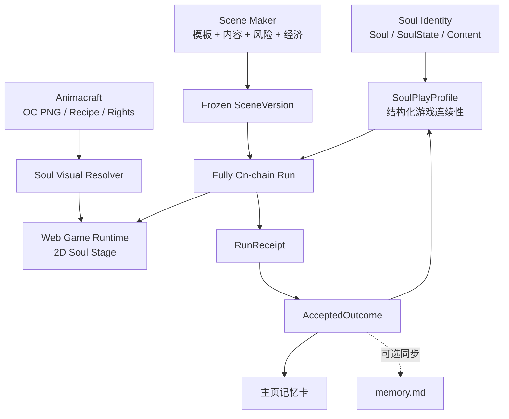
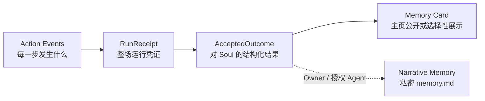

# Soulidity 全链上游戏引擎方案

**产品名：** Soulidity Scene Engine  
**参考游戏：** Soul Expedition  
**版本：** 0.1 Proposal  
**基线日期：** 2026-07-31  
**状态：** `Target / Planned`  
**适用范围：** Soulidity、Animacraft、Scene Maker、Web Game Runtime  

---

## 0. 执行摘要

Soulidity 的游戏方向不应是“给 NFT 加几个小游戏”，也不应先建设一个试图兼容所有游戏类型的通用引擎。

第一阶段应完成一条具体、可信、可重复的纵向闭环：

> 玩家从 Soul 个人主页进入一个全链上 Scene，选择单人或组队远征；所有行动、随机、状态、得失和结算由 Sui Move 执行；客户端使用现有 2D 图片、Persona Sprite 或兜底棋子表现过程；结算生成不可伪造的 Run Receipt 与 Accepted Outcome，并在 Soul 主页形成一段可浏览、可选择同步到私密 Memory 的人生经历。

完整产品由四部分组成：

| 产品 | 作用 |
| --- | --- |
| **Scene Protocol** | 定义 Scene、版本、Run、行动、随机、奖池、结果和分账 |
| **Soul Game Runtime** | 在 Web 中读取链上状态并以 2D 纸剧场形式渲染和重放 |
| **Scene Maker** | 让创作者组合经过审核的玩法模板、地图、事件、美术和经济参数 |
| **Soul Expedition** | 首款官方参考游戏，同时验证单人、组队、得失、记忆和创作者收益 |

第一版只授予满足严格标准的 Scene `Fully On-chain` 标识。服务端、数据库和 AI 可以改善检索、叙事和视觉表现，但不得决定行动是否合法、随机结果、伤害、掉落、胜负或资金结算。

## 1. 产品目标

### 1.1 北极星指标

> 每个月有多少 Soul 因为与其他 Soul 共同经历了一件不可伪造、值得记住、并且存在真实得失的事情，而改变了自己的链上人生。

建议将其产品化为可计算指标：

```text
Monthly Meaningfully Changed Souls
= 当月新增至少一个 Finalized AcceptedOutcome 的独立 Soul
  且该 Outcome 来自不可变 SceneVersion
  且包含共同参与，或包含非零风险/损失

Co-experienced Souls
= 上述 Soul 中，AcceptedOutcome 包含至少另一个 Soul 的数量
```

辅助指标：

- Soul 铸造到首次游玩的中位时间；
- 单人远征到首次组队的转化率；
- 每个 Soul 30 日内进入的独立 Scene 数；
- 共同经历后再次组队的比例；
- Outcome 被主页、其他 Scene 或 Runtime 消费的比例；
- Scene 发布到首次有效游玩、首次收入的时间；
- 收入中来自真实游玩、内容和服务，而非资产转售的比例。

TVL、NFT 数量、交易量和注册数可以观察，但不是产品价值本身。

### 1.2 核心体验原则

1. **同一个 Soul 持续生活**：游戏不重新发行一套角色 NFT。
2. **真实得失**：玩家能够获得资源、装备、关系和荣耀，也会损失携带物、耐久、机会或健康状态。
3. **风险先知情**：进入前明确显示最大可能损失、允许写回的状态和费用。
4. **行为塑造角色**：角色性格与关系来自可验证选择，不只是创建时填写的设定。
5. **一张图片也能玩**：视觉素材完整度影响表现丰富度，不影响基础参与权。
6. **创作者因真实使用获益**：Scene 作者通过有人进入、复玩和消费获得收入。
7. **链是裁判，客户端是舞台**：Move 决定发生了什么，Runtime 决定如何演出来。

## 2. 现有基础与事实边界

### 2.1 当前 Soul 能力

现有 Soulidity 主网协议已经提供：

- `Soul`：名称、描述、`image_url`、Creator、来源类型和来源引用；
- `SoulState`：当前 Owner、Personal Kiosk、`ownership_epoch`、内容根、Grant、Collection、Paid Access 和扩展配置；
- `SoulContent`：类型化内容槽、Walrus Blob、版本、读取模式和操作权限；
- `SoulGrant`：可撤销、可过期、随所有权 Epoch 失效的 Scope 授权；
- `sprite` / `audio` Active Binding；
- 固定价 USDC 市场、Personal Kiosk 和 CollectionRight；
- Web Soul 详情页、内容版本管理、Memory、Skill、Sprite 和授权界面；
- Desktop Persona Sprite Sheet 渲染和部分受保护内容消费。

这些能力足以作为游戏身份、视觉和私密叙事内容的基础，但当前主网包没有 Scene、Quest、Run、Outcome、Reward Pool 或游戏物品协议。

主网当前只注册了 5 个内置 Content Kind，`next_kind=16`，尚无自定义 Kind。UpgradeCap、MarketAdminCap 和 KindAdminCap 也尚未完成公开多签治理。因此新游戏 Package、Registry、暂停权和资金 Cap 必须先定义独立托管与迁移方案，不能宣称游戏引擎已经去中心化治理。

### 2.2 Markdown 的真实语义

现有内容系统不能笼统描述为“所有 MD 都可以一直写入”：

| 内容 | 当前事实 | 游戏用途 |
| --- | --- | --- |
| `soul.md` | 铸造时固定为 `kind=0, name=soul, version=0`，之后不可追加、删除或清理 | 角色不可随意改写的基础身份与边界 |
| `memory/default` | 可以追加版本；当前 Owner/有效 Memory Grant 可软删除，Owner 可清理关联 Blob | 私密叙事记忆、回顾和 Agent 上下文 |
| `skill/<name>` | 可以追加、软删除和清理版本 | 能力说明与 Runtime 配置，不直接等于可信游戏战力 |
| `sprite` / `audio` | 可以版本化并选择 Active Binding | 游戏和桌宠视觉/音频输入 |

因此：

> Markdown 适合承载角色语义和可读叙事，不适合作为高价值游戏状态或奖励证明的唯一真相。

如果游戏只把“击败 Boss”写进 `memory.md`，Owner 或获授权 Agent 也可以自行写入同样文本，其他合约无法区分真实游戏结果与自述。

### 2.3 Animacraft 当前可提供什么

Animacraft 已经具备：

- Maker v5 的 `Part → Item → Style → PNG` 组合模型；
- 全局 Layer Track、坐标、缩放、旋转、混合和颜色规则；
- 同一 Renderer 生成最终 OC PNG；
- Maker、Recipe、版本、许可、Living Content 和 Walrus 包；
- `soul.md`、`memory.md`、`SKILL.md` 的 Soulidity 映射；
- 不生成竞争的成品角色资产，目标是由 Soulidity 铸造唯一 Soul；
- Canonical Soul Mint Authorization 与同一 PTB 铸造的目标 ABI。

截至本基线：

- Animacraft v4 callable package 已在 Mainnet 部署并完成源码验证；
- Protocol Fee 与 Canonical Soul Mint 的生产 Gate 仍关闭；
- Soulidity 正式 Adapter 与市场迁移尚未完成生产验证；
- Mainnet 发现仍没有已验证公开 Maker；
- 工作树中的 Commerce v5、Base/Pack/Complete 和精确 Style Registry 是已通过本地测试的候选实现，但尚不能表述为 Mainnet 生产能力；
- Animacraft 最可靠的游戏视觉输出仍是最终合成 PNG 和可追溯 Recipe，不能假设每个 OC 都有行走、攻击或受伤动画。

### 2.4 可以直接复用与必须新增

| 领域 | 直接复用 | 必须新增 |
| --- | --- | --- |
| 身份 | Soul ID、Owner、ownership epoch、来源 | SoulPlayProfile |
| 内容 | soul.md、Memory、Skill、Sprite、Audio | 游戏视觉 Manifest、可选 Narrative Memory Schema |
| 权限 | Owner 校验、Grant、Seal | Outcome Policy、Run 限权和游戏 Session Policy |
| 视觉 | image_url、Persona Sprite、Animacraft PNG | Soul Visual Resolver、Scene Stage、回放协议 |
| 游戏 | 无 | Scene、Run、Action、Receipt、Outcome、Item、Injury |
| 经济 | USDC、Kiosk、市场基础 | Reward Vault、Scene Treasury、门票与游戏分账 |
| 社交 | Web 社区、Soul Space | Party、Bond、Invite、共同经历 |

## 3. 产品结构



### 3.1 Scene Protocol

建议作为独立 Move Package 建设，而不是把第一款游戏直接塞进现有 Soulidity 核心包：

- 降低对已上线身份、内容和市场协议的升级风险；
- 可以固定具体规则 Package ID；
- 允许不同游戏模板独立审计和发布；
- 只通过现有公开读取函数验证 `SoulState`；
- 游戏失败不能损坏 Soul 的持有和内容系统。

首批模块建议：

```text
scene_registry.move
scene.move
play_profile.move
run.move
expedition.move
reward_vault.move
game_item.move
outcome.move
```

后续模块：

```text
relationship.move
arena.move
guild.move
bounty.move
territory.move
```

### 3.2 Soul Game Runtime

首发 Runtime 直接进入 Soulidity Web，不依赖 Desktop：

```text
/worlds                              全站 Scene 发现
/souls/:id                           Soul 主页
  └─ Explore / 进入世界              Soul 专属兼容 Scene
/play/:sceneId/:version/:runId       Run Room
  └─ 结算、回放和记忆卡
/souls/:id?tab=life                  Soul Life Timeline
```

当前 Soul 详情页主要围绕买卖、Info、Persona Sprite、Skills、Memory 和 Grants。游戏版本上线后，“进入世界”应成为持有人 Hero 的第一主操作，买卖降为次级；非持有人仍可查看经历和兼容 Scene，但不能代表该 Soul 开始 Run。

Desktop 只作为可选入口：

- 提醒发现新事件；
- 显示正在恢复的伤病；
- 接收组队邀请；
- 展示远征结果；
- 在明确授权下协助同步 Narrative Memory。

### 3.3 Scene Maker

Scene Maker 不是第一天就允许上传任意 Move 代码，而是组合经过审核的链上模板。

创作者编辑：

1. Scene 身份、题材和版本；
2. 节点地图和路线；
3. 遭遇、敌人和选项；
4. 数值、掉落和失败条件；
5. 人数、回合与超时；
6. 视觉、音频和文本；
7. Soul 准入与读取需求；
8. Outcome Schema 和最大损失；
9. Reward Vault、门票和分账；
10. 模拟、预检、发布和新版本。

发布输出：

- Walrus `soulidity.scene.v1` Manifest；
- SceneKit：背景、地图、敌人、特效、图标、音频、主题和动作语义；
- 链上 `SceneRoot`；
- 冻结的 `SceneVersion`；
- 已注资的 `RewardVault`；
- Rights Manifest 和依赖快照。

Character Maker 的 Recipe、Part/Item/Style 和 SoulMintAuthorization 不直接复用为 Scene 规则。Scene Maker 可以复用 Animacraft 的版本、Walrus Quilt、发布预检、Cap/Treasury 和恢复思路，但 SceneKit 是独立内容类型。

## 4. “真正全链上”的验收定义

Scene 只有满足以下全部条件，才能显示 `Fully On-chain`：

1. 核心规则由固定 Package ID 的 Move 代码执行；
2. Run、回合、参与者、生命、资源和状态在 Sui 对象中；
3. 玩家有效行动由钱包交易或受限会话授权提交；
4. 随机使用 Sui 原生 `Random`，或对隐藏信息使用公开 Commit-Reveal；
5. 合约决定命中、伤害、掉落、胜负和超时；
6. 门票、抵押、奖励和损失原子结算；
7. SceneVersion 在 Run 创建后不可替换；
8. 后端不能签署一个“玩家已获胜”的权威结果；
9. Indexer 宕机后，第三方可以从链上对象和事件重建状态；
10. 第三方 Runtime 可以根据同一记录重放游戏；
11. 管理员不能重写已 Finalize 的 Receipt；
12. 升级、暂停、奖池和 Treasury Cap 有明确治理边界。

### 4.1 什么不需要逐像素上链

以下内容可以存储在 Walrus，由客户端渲染：

- PNG、Sprite Sheet、背景、特效、字体和音频；
- Scene 文本和本地化；
- 动画映射和 UI 主题；
- 由链上结果生成的分享视频。

链上必须保存 SceneVersion 对这些内容的定位、哈希和许可快照。视觉资源失效时，第三方客户端仍应能用文本、图标和基础棋子重放游戏。

### 4.2 随机安全要求

Sui 原生 `Random` 可以在 Move 中创建 `RandomGenerator` 并生成范围随机值，但合约仍必须防止“根据随机结果故意耗尽 Gas 或对象限制”造成偏置。

规则：

- 使用随机前完成全部输入和余额校验；
- 所有随机分支必须有有界、可结算的执行路径；
- 随机后不得调用由玩家控制且可能选择性 Abort 的任意模块；
- 奖励数量、对象创建数、事件数和动态字段访问数必须有硬上限；
- PvP 隐藏行动使用 Commit-Reveal，并设置未 Reveal 的确定性惩罚；
- 随机分布和掉落表随 SceneVersion 冻结并公开。

## 5. 链上对象模型

### 5.1 Scene 供给对象

| 对象 | 职责 |
| --- | --- |
| `SceneRegistry` | 发现、模板白名单、风险等级、暂停新 Run 和版本索引 |
| `SceneRoot` | 稳定 Scene 身份、Creator、Treasury 和当前推荐版本 |
| `SceneAdminCap` | 发布新版本、暂停入口和管理未来参数；不能改旧版本 |
| `SceneVersion` | 冻结规则 Package、模板版本、内容哈希、准入、风险、Outcome 和分账 |
| `RewardVault<T>` | 预先托管可发放资产，禁止无资金奖励 |
| `SceneTreasury<T>` | 接收门票和公开分账 |

`SceneVersion` 至少固定：

- Scene Root 和版本号；
- Rule Package ID、Template ID 和规则版本；
- Walrus Manifest ID 与内容哈希；
- 支持的 Runtime 和最低视觉等级；
- 人数、回合、时间和重试规则；
- Entry Fee、最大损失和退款规则；
- 允许的装备和资产类型；
- 随机、掉落和反刷参数；
- Outcome Schema 和允许写入的命名空间；
- Creator、素材、协议和奖池分账；
- Rights Manifest、内容警告和可见性。

### 5.2 Soul 连续性对象

#### `SoulPlayProfile`

每个 Soul 在 Scene Engine 中最多一个：

- `soul_id`；
- 创建时与最近使用的 ownership epoch；
- 赛季与模板命名空间状态；
- 完成次数、失败次数和最近 Outcome；
- 当前 Injury / Recovery 状态；
- Outcome 索引根或动态字段；
- 不包含无限增长的向量。

`SoulPlayProfile` 跟随 Soul ID，而不是钱包。每次控制操作都必须读取实时 `SoulState.current_owner` 和 `ownership_epoch`。

如果 Injury、冷却或其他状态会随 Soul 转让继续存在，Soul 市场的挂单和购买确认页必须展示这些状态。未完成市场披露与兼容检查前，不开放会显著降低 Soul 使用能力的永久状态。

第三方 Scene 不得直接增加一个无命名空间的“全局等级”或“全局战力”。状态分为：

```text
official:<template>:<season>:<key>
scene:<scene_id>:<version>:<key>
issuer:<package_id>:<schema>:<key>
```

官方跨 Scene 属性只接受白名单模板产生的有上限贡献；开放 Scene 的成长默认留在自己的命名空间。

#### `GameItem`

游戏物品与 Soul 身份分离：

- Template、版本、来源 Scene；
- Owner 或持有容器；
- 耐久、绑定和可交易策略；
- 可进入哪些 Scene；
- 是否允许在 Run 中丢失；
- 来源 Receipt。

高风险 Run 只能损失玩家明确转入 Run Escrow 的物品，不能从钱包任意拿取资产。

#### `Injury`

第一版只支持有限、可恢复的伤病：

- 类型、强度；
- 来源 Receipt；
- 生效和恢复时间；
- 治疗条件；
- 对指定模板的效果。

永久死亡、Soul 销毁、永久技能删除和不可逆核心身份修改不进入 MVP。

### 5.3 Run 对象

每次远征创建独立共享对象，避免所有玩家竞争一个全局可变对象：

```text
Run
├─ scene_version_id
├─ phase
├─ turn
├─ created_at / deadline
├─ party_size
├─ participants
├─ route / encounter
├─ pending_actions
├─ escrow summary
├─ outcome_policy
└─ finalized flag
```

阶段：

```text
Lobby
→ Locked
→ ChooseRoute
→ SubmitActions
→ ResolveTurn
→ EncounterResult
→ ContinueOrRetreat
→ Finalized / Aborted
```

组队规则：

- 2–4 个 Soul；
- 每个参与者分别由当前 Owner 加入；
- 全员准备后锁定 SceneVersion、Loadout、风险和 ownership epoch；
- 每轮各自提交行动；
- 全员提交后任何人可触发结算；
- 到期未提交者执行公开的默认行动，例如 Guard；
- 恶意掉线不能永久锁住队伍或奖池。

如果 Soul 在 Run 中途发生 ownership epoch 变化：

- 旧 Owner 不能继续代表该 Soul 行动；
- Run 按版本化规则中止该参与者或整场；
- Escrow 返回创建 Run 时记录的资产提供者；
- 不产生会影响新 Owner 的 AcceptedOutcome；
- 可以保留一条“Run 因所有权变化中止”的 Receipt。

第一版不要求修改现有 Soul 市场来锁住 Soul。高风险的跨所有权状态必须等正式 Runtime Lock 与市场适配完成后再开放。

### 5.4 `RunAvatarSnapshot`

Run 锁定时必须冻结该局实际使用的身份与视觉输入：

```text
RunAvatarSnapshot
├─ run_id
├─ soul_id
├─ owner_at_entry
├─ ownership_epoch
├─ visual_mode
├─ image / active sprite reference
├─ animacraft_maker_id?
├─ maker_version_id?
├─ manifest_blob_id?
├─ recipe_hash?
├─ runtime_projection_hash?
├─ visual_use_grant_id?
└─ loadout snapshot
```

它保证 Soul 后续换头像、切换 Sprite、Maker 发布新版本、装备变化或 Soul 转手后，旧 Run 仍能按当时素材、规则和许可重放。

## 6. 可信记忆模型

游戏经历需要四层，而不是直接让 Scene 写一段 Markdown：



### 6.1 `RunReceipt`

Finalize 后冻结：

- Scene、版本和规则 Package；
- Run ID；
- 参与 Soul 与玩家地址；
- 开始、结束和 Finalize 时间；
- 初始 Loadout 和风险承诺；
- 行动摘要或事件 Merkle Root；
- 最终状态；
- 获得和失去；
- 随机方法；
- 结算交易；
- 是否因超时或所有权变化中止。

### 6.2 `AcceptedOutcome`

全链上模板可以在结算时直接 Finalize Outcome，因为规则本身已经完成验证。它包含：

- Soul ID；
- Receipt ID；
- Outcome Schema；
- 命名空间；
- 属性变化；
- Injury；
- 获得/损失的物品；
- 共同参与者；
- 关系贡献；
- 可撤销性；
- 展示策略；
- 简短、结构化的链上叙事码。

玩家在进入 Run 时签署 `OutcomePolicy`，预先同意：

- 哪些命名空间可以更新；
- 最大属性变化；
- 最大可损失资产；
- 可产生哪些 Injury；
- 是否自动形成共同经历；
- 哪些摘要公开。

合约不得产生超出该 Policy 的结果。

链上 Outcome 的存在本身不能保密。展示策略只能控制 Soulidity 默认界面是否突出显示；需要隐私的详情应只保存承诺或哈希，将正文放入 Seal 保护的 Narrative Memory。产品不得把“主页隐藏”描述成“链上删除”。

### 6.3 Narrative Memory

结算后，Runtime 可以根据 Receipt 生成标准 Markdown：

```markdown
---
schema: soulidity.game-memory.v1
receipt_id: "0x..."
scene_id: "0x..."
scene_version: 1
outcome_id: "0x..."
participants:
  - "0xSoulA"
  - "0xSoulB"
---

# 雾庭远征

我们在第三个岔路选择继续深入……
```

流程：

1. 链上先 Finalize Receipt 和 Outcome；
2. 客户端根据链上字段生成可读叙事；
3. Owner 确认，或本地 Agent 在有效 Memory Grant 下处理；
4. 文本加密并存入 Walrus；
5. 通过现有 `memory/default` 追加新版本；
6. Memory 中必须引用 Receipt 和 Outcome ID。

由于 Walrus Blob 必须先准备，Narrative Memory 通常是第二笔交易，不能假装与随机结算在同一笔交易中原子完成。

安全要求：

- Scene 不获得通用 Memory Grant；
- 游戏奖励不依赖 Markdown 内容；
- 删除 Narrative Memory 不删除 Receipt；
- 手工写入相同文字不能伪造 AcceptedOutcome；
- AI 只能把结构化结果改写成故事，不能添加链上未发生的获得、杀戮或关系。

## 7. 2D 视觉运行时

### 7.1 定位

首版统一视觉语言：

> Soul Stage：一本会动的链上冒险绘本 / 纸剧场。

这不是为了掩盖素材不足，而是为了兼容来自不同创作者、不同画风和不同视觉成熟度的 OC。

Scene 承担大部分世界视觉：

- 地图；
- 背景；
- 敌人；
- 道具；
- UI；
- 特效；
- 音频；
- 镜头和氛围。

Soul 主要提供身份视觉，不需要先拥有完整传统游戏动作集。

### 7.2 Soul Visual Resolver

Runtime 按以下顺序选择表现：

1. Scene 专用 `RuntimeProjection`；
2. 兼容的战斗 Sprite / 动作包；
3. 当前 Active `persona-sprite`；
4. Animacraft 最终透明 PNG 或 Soul `image_url`；
5. 头像卡片；
6. 带名称、主色和纹章的默认 Soul 棋子。

| 视觉级别 | 输入 | 表现 |
| --- | --- | --- |
| V0 | image_url / 头像 | 卡片、圆形棋子、状态环 |
| V1 | 透明立绘 | 纸偶、位移、缩放、震动和全图特效 |
| V2 | 多表情 / 多姿势 | 待机、攻击、受伤和胜利切换 |
| V3 | Persona Sprite Sheet | 使用现有动画及 Mood 映射 |
| V4 | Scene 专用 Rig / 动作包 | 完整战斗与互动表现 |

最低 V0 即可进入首发 Scene。

### 7.3 三个首发画面

#### 远征地图

- Scene 节点地图；
- Soul 头像棋子；
- 路线、风险、迷雾、撤退出口；
- Party 状态和当前回合。

#### 遭遇舞台

- 背景和 2.5D 视差；
- 左侧 Soul 卡片/纸偶，右侧敌人；
- 攻击、Guard、Aid、Skill、Retreat；
- 位移、受击闪烁、镜头震动、粒子、数字和音效。

#### 命运结算

- 获得与失去并排展示；
- Injury、关系和性格变化；
- 参与 Soul；
- Receipt 与交易链接；
- 保存/分享记忆卡；
- 可选“同步到私密 Memory”。

### 7.4 链上事件到动画

Move 输出标准动作码和结算字段：

```text
TURN_STARTED
ACTION_STRIKE
ACTION_GUARD
ACTION_AID
HIT
CRITICAL
MISS
INJURY_APPLIED
ITEM_GAINED
ITEM_LOST
RETREAT_SUCCEEDED
RUN_FINALIZED
```

`SceneVisualManifest` 将动作码映射到背景、动画、特效和音频。不同客户端可以使用不同画面，但必须播放同一个已发生结果。

### 7.5 Animacraft 的角色

Animacraft 首版负责：

- 提供有来源和许可的最终 OC PNG；
- 提供 Maker、版本和 Recipe；
- 提供分层素材的原始组合信息；
- 提供可选表情、服装和 Scene Skin 扩展；
- 在许可明确时生成 Scene Projection。

不得假设：

- 所有 Animacraft OC 都有动画；
- Scene 可以任意拆分、改色或生成原作衍生形象；
- 购买 Maker 自动包含所有游戏和商业使用权；
- Scene 门票默认向所有上游无限叠加版税。

`RuntimeProjection` 默认绑定 Soul、Scene、版本和 ownership epoch，不形成第二个可独立交易的角色身份。

游戏使用许可不能复用 SoulMintAuthorization 或 Soul 二级交易版税。正式视觉层需要独立的 `VisualUseGrant`，至少声明：

```text
display
animate
crop
recolor
overlay_equipment
generate_projection
commercial_game
```

Grant 同时绑定 MakerVersion、SceneVersion、有效期和费用策略。没有相应 Scope 时，Runtime 只能在原图卡片容器中展示，不得擅自拆层、重绘或生成衍生皮肤。

## 8. 首款游戏：Soul Expedition

### 8.1 产品定义

Soul Expedition 是 5–15 分钟的全链上节点式 Roguelike：

```text
选择 Soul
→ 创建或加入队伍
→ 选择 Loadout 与风险
→ 进入路线
→ 链上遭遇与随机
→ 战斗 / 交涉 / 救援 / 撤退
→ 战利品或伤病
→ Receipt + AcceptedOutcome
→ Soul Life Timeline
```

同一模板可换皮为：

- 地牢；
- 荒野；
- 遗迹考古；
- 海上航行；
- 灵异调查；
- 星际探索；
- 商队护送。

### 8.2 首发模式

#### Solo

- 一个 Soul；
- 6–8 个节点；
- 每次遭遇 2–4 个可选行动；
- 随时选择继续或撤退；
- 越深入，奖励和风险越高；
- 失败损失本场明确放入 Escrow 的物品或耐久。

#### Party

- 2–4 个 Soul；
- Vanguard、Scout、Mender、Envoy 等赛季角色；
- 每轮分别提交行动；
- Aid、Cover、Rescue 等行为形成可验证关系贡献；
- 队伍共同决定继续或撤退；
- 分配规则在出发前锁定。

### 8.3 属性来源

不得直接把用户上传的 `SKILL.md` 或自述设定当作可信战斗数值，否则任何人都可以写“攻击力 9999”。

第一赛季采用：

- 固定总点数的赛季 Build；
- 官方模板定义的有限职业；
- Run 中托管的 GameItem；
- 官方 Outcome 产生的有上限成长；
- Soul 的 Markdown 只解锁叙事表达，不直接增发战力。

未来可以通过 Verifier、Maker Recipe Proof 或标准化能力凭证映射更多 OC 特征。

### 8.4 得失设计

第一版允许：

**获得**

- Scene 资源；
- 有来源的 GameItem；
- 装备耐久或制作材料；
- Scene 声望；
- 成就；
- 共同经历；
- Bond 贡献；
- 可选择写入的 Narrative Memory。

**失去**

- 本场消耗品；
- 明确托管的战利品；
- 装备耐久；
- 本次继续深入的机会；
- 有期限、可恢复的 Injury；
- Scene 命名空间中的排名或声誉。

第一版禁止：

- Soul NFT 被销毁或夺走；
- 从主钱包任意扣除资产；
- 未披露的永久 Debuff；
- 永久删除 Soul Skill 或 Memory；
- 默认 USDC 死斗或博彩；
- Scene 作者无限增发奖励。

### 8.5 风险等级

| 等级 | 可能损失 | MVP |
| --- | --- | --- |
| Story | 只有机会、次数和记录 | 支持 |
| Venture | 本场消耗品、耐久、Escrow 战利品 | 支持 |
| Wound | 额外产生可恢复 Injury | 支持 |
| Death Oath | 永久能力阶段、稀有资产或生命阶段 | 不支持 |

每个“进入”按钮上方必须显示最坏情况，而不是只展示最高奖励。

## 9. 后续游戏模板

同一组链上原语可以衍生：

| 模板 | 核心机制 | 优先级 |
| --- | --- | --- |
| Expedition | 路线、遭遇、风险、撤退 | P0 |
| Arena | 异步回合、Loadout、排名 | P1 |
| World Boss | 分轮协作、贡献、阶段变化 | P1 |
| Bounty | 预付赏金、公开条件、自动支付 | P1 |
| Caravan | 货物 Escrow、护送、背叛和分账 | P2 |
| Social Bond | 双方选择、关系和共同记忆 | P2 |
| Guild Village | 公共金库、建造和灾难 | P2 |
| Tactical Board | 格子、视野、范围和占领 | P3 |
| PvPvE Extraction | 搜索、遭遇、掠夺和撤离 | P3 |
| Social Deduction | Commit-Reveal、投票和隐藏身份 | P3 |

实时格斗、MMO 高频移动和依赖 AI 主观裁判的玩法不属于首版 Fully On-chain 模板。

## 10. Scene Maker 经济

### 10.1 收入来源

- 免费 Scene 的 Sponsor Reward Pool；
- 固定门票；
- 赛季或次数 Access；
- Scene Skin、动画、音频和剧情 DLC；
- 创作者赏金；
- 品牌或社区活动预算；
- 后续经审计的 Creator Revenue Right。

第一款官方 Expedition 建议免费或由 Sponsor 补贴，不先用高门票测试需求。

### 10.2 分账原则

- 使用 Circle Sui USDC 作为首批付费和奖池资产；
- SUI 主要用于 Gas；
- Scene 费用与现有 Soul 二级市场费分开治理；
- 所有分账在签名前展示基数、顺序、舍入和上限；
- Maker、素材或 Soul Creator 只有在许可证明确触发该收入事件时参与；
- 不默认对每次游玩叠加 Maker、Soul、Collection、Scene 和平台多层版税；
- 游戏视觉使用费使用独立 `VisualUseGrant` 和收入事件，不复用 SoulMintAuthorization 或 `deposit_resale_royalty`；
- 奖励必须来自已注资 Vault 或合约允许的守恒产出；
- 没有真实 Scene 收入前，不发行协议 Token。

### 10.3 创作者保护

- SceneVersion 不可静默修改；
- Creator 收入进入链上 Treasury；
- 新版本不追溯修改旧 Run；
- Scene 下架不夺走玩家已合法获得的物品和 Receipt；
- 素材依赖、Rights Manifest 和分账随版本快照；
- Scene 可暂停新 Run，但不能重写已结束结果。

## 11. 安全与滥用防护

### 11.1 权限

- Scene 不获得 Soul 所有权；
- Scene 不获得通用 `MEMORY`、`SKILLS` 或 `ASSETS` Grant；
- 每个 Run 只读取公开身份和明确允许的字段；
- 私密 Sprite 在客户端本地解密渲染，合约不需要读取图片；
- 所有资产损失限定在 Run Escrow；
- 可选会话授权必须绑定 Scene、Soul、动作集合、期限、Gas 和资产上限。

当前 Seal Session Key 只解决受保护内容解密，不是游戏交易 Session。第一版应把一局控制在 4–6 次有意义的钱包签名；后续新增独立 `SceneSessionCap`：

```text
scene_version
soul_id
ownership_epoch
allowed_actions
max_actions
max_spend
max_stake
expires_at
revoked
```

### 11.2 合约不变量

- 一个 Run 只能 Finalize 一次；
- 一个 Receipt 只能对应一个 Finalized Run；
- Reward Vault 不得负余额或重复支付；
- SceneVersion 在 Run 内不可替换；
- Outcome 不得超出 Entry 时的 OutcomePolicy；
- ownership epoch 改变后旧 Owner 不能行动；
- 超时永远存在确定性退出路径；
- 所有向量、掉落、事件和对象创建数有硬上限；
- 无管理员函数可以改写已 Finalize 结果。

### 11.3 社交与经济

- Party 邀请签名和过期；
- 掉线默认动作和退出惩罚；
- 同钱包、多 Soul、设备和行为层面的反刷；
- Reward Pool 按风险增加频率、身份和挑战限制；
- 排名、可靠性、战斗和社区贡献分开；
- 不用一个 Karma 分数判断人格或信用；
- 高风险、博彩、未成年人和地区限制需独立法律评估。

### 11.4 内容与可用性

- Scene Manifest 记录 Walrus 保存期和续期责任；
- 视觉不可用时仍有基础 Renderer；
- Rights Manifest 明确展示、改编、直播和商业使用；
- AI 生成/修改需披露并取得相应许可；
- 合法投诉可暂停新使用，但不能伪装成抹除链上历史。

## 12. MVP 交付范围

### 12.1 P0：协议垂直切片

- 独立 Scene Engine Move Package；
- SceneRoot / SceneVersion；
- SoulPlayProfile；
- Solo Run 状态机；
- Sui Random；
- RewardVault；
- RunReceipt / AcceptedOutcome；
- 基础 GameItem 和 Injury；
- ownership epoch 中止路径；
- Move 单元与不变量测试。
- monorepo SDK 中新增 Scene 查询、事件和 PTB 构造；在完成版本策略前不承诺为稳定公共 SDK。

### 12.2 P1：Soul Web 入口与完整视觉

- Soul 主页 `Explore` 入口；
- Scene 详情和进入前风险清单；
- V0–V3 Soul Visual Resolver；
- 地图、遭遇、结算三个画面；
- 交易状态与失败恢复；
- Receipt 回放；
- Soul Life Timeline；
- Narrative Memory 手动同步；
- Indexer 重建和链上直读降级。

### 12.3 P2：组队与关系

- Party 创建、邀请和准备；
- 每轮多人行动与超时；
- Aid / Cover / Rescue；
- 共同 Receipt；
- Bond Contribution；
- 战利品分配；
- 组队复玩和主页展示。

### 12.4 P3：Scene Maker Alpha

- Expedition 模板参数编辑；
- 地图、遭遇、敌人、奖励和视觉编辑；
- 风险、Outcome、权限和经济预检；
- 本地模拟器；
- Walrus 发布；
- 链上版本冻结；
- Creator Treasury 和数据面板；
- 第一个非核心团队 Scene。

### 12.5 P4：第二种玩法

优先增加异步 Arena，而不是立刻建设大型世界：

- 复用 SoulPlayProfile、GameItem、Injury、Receipt 和 Visual Resolver；
- 验证远征获得的资源是否能在另一种玩法中产生价值；
- 证明 Outcome 真正可以跨 Scene 使用。

## 13. MVP 完成标准

只有满足以下条件，才算“游戏引擎版本完成”，而不是技术 Demo：

### 玩家

- 持有只有一张 `image_url` 的 Soul 也能完成全流程；
- 从 Soul 主页进入官方 Scene；
- 单人完成一场 5–15 分钟远征；
- 看到每一步链上确认和明确等待状态；
- 真实获得或失去至少一种链上游戏状态/资产；
- 主页出现可验证记忆卡；
- 可从链上 Receipt 重放；
- 可选择把经历同步到私密 Memory。

### 多人

- 2–4 个 Soul 可以创建、加入并完成一场远征；
- 某个玩家掉线后其余人仍可按公开规则结束；
- 共同经历同时指向同一 Receipt；
- 至少一种救援或协作行为影响后续关系。

### 全链上

- 后端关闭后，新客户端仍可读取和继续未结束 Run；
- 任何人都能复算伤害、掉落和结算；
- Indexer 不是胜负真相；
- 没有管理员能够伪造胜利或重复发奖；
- 随机、经济和对象上限通过独立安全审阅。

### 创作者

- 一个 Creator 能使用模板发布新 Expedition Scene；
- 发布后规则和内容版本可核对；
- Reward Vault、门票与分账可审计；
- 第一次有效游玩和收入可在链上确认；
- 旧版本仍可重放。

## 14. 明确不做

第一版不做：

- 通用 3D 引擎；
- 实时 MMO；
- 把每一帧或 PNG 像素放进 Move；
- 用 LLM 判断胜负和掉落；
- 任意第三方 Move 模块即插即用；
- 永久死亡或 Soul 销毁；
- Soul 抵押借贷；
- 协议 Token、挖矿和高杠杆；
- 未经许可把所有 OC 重绘成统一风格；
- 用一套全局 XP 强行统一所有 Scene；
- 让 Scene 直接获得宽泛 Memory Grant。

## 15. 最终产品叙事

Soulidity Scene Engine 的核心不是“链上小游戏平台”，而是数字角色的生活协议：

```text
Animacraft 让 OC 获得身体和来源
Soulidity 让它拥有身份、内容和连续性
Scene Maker 让创作者提供世界和命运
Scene Engine 让选择、风险和结果可信
Soul Runtime 让这些结果成为可见、可重放的人生
```

第一版只需证明一件事：

> 一个只有 2D 图片的真实 Soul，可以从自己的主页进入一场完全由链上规则执行的远征；它可能独自回来，也可能与其他 Soul 建立羁绊；它会带回战利品，也可能留下伤痕；这一切既能被第三方验证，也能成为角色以后继续生活的记忆。

这条闭环成立以后，Arena、悬赏、商队、公会、领地、社交推理和创作者金融才拥有共同且可信的底座。

## 16. 参考事实源

本方案以以下本地实现和规格为基线：

- `clawnews/move/soulidity/sources/soul.move`
- `clawnews/move/soulidity/sources/content.move`
- `clawnews/move/soulidity/sources/kind_registry.move`
- `clawnews/packages/soulidity-sdk/src/persona-sprite.ts`
- `clawnews/desktop/apps/desktop/src/renderer/components/SpriteRenderer.tsx`
- `clawnews/web/app/souls/[id]/page.tsx`
- `animacraft/living-content.js`
- `animacraft/CREATOR_ASSET_SPEC_V5.zh-CN.md`
- `animacraft/SOULIDITY_ADAPTER_HANDOFF.md`
- `animacraft/PRODUCTION_STATUS.md`
- `docs/v3/SOULIDITY_PRODUCT_PROTOCOL_SPEC_CN.md`
- `docs/v3/ANIMACRAFT_SOULIDITY_ECONOMIC_MODEL_CN.md`

外部技术参考：

- [Sui Onchain Randomness](https://docs.sui.io/sui-stack/on-chain-primitives/randomness-onchain)
- [Sui Transactions](https://docs.sui.io/develop/transactions/)
- [Walrus](https://docs.sui.io/sui-stack/walrus/)
- [Seal](https://docs.sui.io/sui-stack/seal/)
