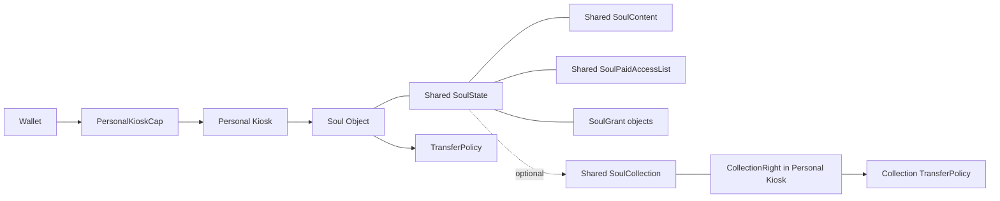

# Soulidity 产品与协议规格

**版本：** 3.0 Draft  
**基线日期：** 2026-07-24  
**用途：** 统一产品、设计、工程、生态集成与文档口径  
**规范范围：** 当前 Soulidity 主网协议 + 当前产品边界 + Maker / Scene 下一阶段概念规格

---

## 1. 如何使用本文

本文包含三种不同确定性的内容：

- **Current**：以当前主网包、Move 源码、部署清单和产品代码为准；
- **Target**：已经确认的产品目标，可进入设计和里程碑拆解；
- **Conceptual**：用于建立共同语言的概念模型，不是最终 Move ABI、数据库 Schema 或兼容承诺。

本文中的“应”“不得”等规范性用语，只在相应状态范围内生效。标为 `Planned` 或 `Research` 的对象不能被外部集成方当作已存在接口。

事实冲突时按以下优先级处理：

1. Sui 主网对象、交易与部署清单；
2. 当前 Move 源码和测试；
3. 当前 Web、Desktop、SDK 的实际调用路径；
4. 已确认的 v3 产品决策；
5. PRD、原型、研究稿和路线图；
6. 旧白皮书、旧融资 Deck 和历史讨论。

## 2. 产品定义

Soulidity 是面向持久数字实体的链上原生创作、身份、体验与经济网络。

核心产品闭环为：

```text
Maker 创建角色 / Scene
  → OC 获得 Soul 身份
  → Soul 在 Runtime 中进入 Scene
  → Quest / Activity 产生可验证结果
  → 结果被选择性写入长期状态
  → 社交展示、组合、授权和交易
  → 收益按规则回流参与者
```

## 3. 状态词典

| 标签 | 判断标准 |
| --- | --- |
| `Mainnet` | 对象或能力可从当前 Sui 主网部署及交易核验 |
| `Implemented` | 当前代码中存在完整路径，不保证生产版本已部署或开放 |
| `Pilot` | 已有受控使用或预览发行 |
| `Planned` | 已进入目标架构或产品路线 |
| `Research` | 仍需验证可行性、价值或风险 |
| `Governance Pending` | 依赖参数、Cap、审核或公开治理决策 |
| `No current issuance` | 当前不存在已发行的对应协议资产，不代表未来发行承诺 |
| `Legacy` | 不再作为当前产品或协议依据 |

## 4. 术语表

| 术语 | 规范定义 | 不等于 |
| --- | --- | --- |
| **OC** | 具有可辨识创作身份的原创角色，可处于链下或早期形态 | 必然是 NFT 或 AI Agent |
| **Soul** | 在 Soulidity 协议中的持久身份与持有对象 | 协议代币、法律人格 |
| **Soul Object** | 位于 Personal Kiosk 中的 Sui `Soul` 对象 | 全部内容文件 |
| **SoulState** | 与 Soul 关联的共享状态对象 | 可自由转让的独立资产 |
| **SoulContent** | 类型化内容槽、版本和 Walrus Blob 绑定 | 明文内容数据库 |
| **SoulGrant** | 持有人发出的可撤销、可过期、分 Scope 权限对象 | 完整 IP 许可证 |
| **Paid Access** | 对特定内容 Kind 的付费访问条目 | Soul 所有权、不可撤销永久许可 |
| **SoulCollection** | 共享的 Soul 集合与成员关系 | 集合中所有 Soul 的持有权 |
| **CollectionRight** | Collection 的额外经济权利对象；是否可交易由创建配置决定 | 股份、基金份额 |
| **Creator** | 创建 OC、素材、Maker、Scene 或其他内容的人或组织 | 必然是当前 Holder |
| **Holder** | 当前协议认定的 Soul 或权利对象持有者 | 必然拥有全部著作权 |
| **Maker** | 生成或组合角色、素材或体验的规则与工具 | Creator 本人 |
| **Runtime** | 角色实际交互、渲染、推理或执行任务的环境 | Soul 身份本身 |
| **Scene** | 可发布、可版本化、可进入的体验单元 | 必然是完全链上游戏 |
| **Quest** | Scene 内有条件、步骤和结果的目标 | 任意后台任务记录 |
| **Activity** | 面向第三方活动系统的通用任务接口 | 仅游戏副本 |
| **Run Receipt** | 某次运行发生及其上下文的可验证凭证 | 自动被接受的长期成长 |
| **Outcome** | 运行产生并经规则验证的结果 | 无命名空间的全局属性 |
| **OCL** | 实体在指定版本和 Runtime 中的能力成熟度 | 稀有度、价格或艺术价值 |
| **Rights Manifest** | 机器可读的权利、许可证和使用边界描述 | 法院判决或自动版权转让 |
| **Sui / SUI** | Sui 是网络；SUI 是 Gas 与资产单位 | 同一个产品概念 |

## 5. 当前主网基线

### 5.1 部署标识

| 项目 | 当前值 |
| --- | --- |
| Soulidity Package | `0x6680f74155dd9f1c2ae0109556e459b1259f80b7597679292a70572887cfb1c0` |
| Publish Transaction | `BuBAX27guhWwvUM5y9PGUnMi77C3ttSdRG95p1eGhxmS` |
| MarketConfig | `0xe6214eaba8afa4c9191a602b78bfc0658ce1e188625f986dc6768d40f4d7dbb5` |
| KioskRegistry | `0x8063dbb7cc35b136355a329a7d54ae3258ee8b30473d86a925d3390f7b9a32e4` |
| KindRegistry | `0x27f249c5fe0ff056f4d5bc1473e10621966e646faf29de89200d9b612e6b9880` |
| Soul TransferPolicy | `0xaf28f957b4f30bfd73c00bff61cc3cb8d54be25ca1a0f03aa8aad15e06e476c4` |
| CollectionRight TransferPolicy | `0xaeee89fa0d39d43f7cbd402ec13a618a06222ff40792e8edc6c627cadfc0def0` |
| Payment Coin | Circle Sui Mainnet USDC：`0xdba34672e30cb065b1f93e3ab55318768fd6fef66c15942c9f7cb846e2f900e7::usdc::USDC` |
| Market 状态快照 | `paused=false`；`platform_fee_bps=250` |

唯一维护入口是：

- `clawnews/packages/soulidity-sdk/src/deployment-manifest.json`
- `clawnews/move/soulidity/sources/`

### 5.2 当前模块

主网包包含七个模块：

| 模块 | 当前职责 |
| --- | --- |
| `soul` | Soul、SoulState、来源、所有者、Epoch、配置与关联 |
| `grant` | Scope 授权、替换、撤销、过期、容量与所有权失效 |
| `kind_registry` | 内容 Kind、操作、读取模式、Scope 与 Active Binding 能力 |
| `content` | 类型化内容槽、版本、删除、清理、Active Binding 与 Seal 审批 |
| `paid_access` | 按 Kind 配置价格、期限和买方访问条目 |
| `collection` | SoulCollection、成员关系、额外版税与 CollectionRight |
| `market` | Kiosk、创建、导入、Personal Join、挂单、购买、结算和付费访问 |

Scene、Quest、OCL、Rights Manifest、Reward Pool 和 Maker Adapter 当前不在该主网包中。

### 5.3 治理状态

`Governance Pending`

当前 manifest 中记录了 UpgradeCap、MarketAdminCap、KindAdminCap 和 TransferPolicy Cap。基线核验时这些关键 Cap 尚未迁入公开多签治理。

在治理迁移前：

- 对外不得声称协议已经完成去中心化治理；
- 所有参数和升级变更应保留交易记录与变更说明；
- 高风险新能力不应仅依赖单个 EOA 操作；
- 主网升级前必须更新本文、部署清单和兼容性说明。

## 6. 当前对象模型

### 6.1 对象关系



### 6.2 `Soul`

当前字段语义：

- `creator`：铸造时的创作者地址；
- `name`、`description`、`image_url`：基础展示信息；
- `provenance_kind`：Native、Imported 或 Personal Join；
- `origin_ref`：可选来源引用；
- `version`：对象协议版本。

这些基础字段在当前协议中没有通用编辑入口。可更新内容必须进入 SoulContent 或受控 SoulState 配置。

当前 `Soul` 没有逐对象 Bound / Free 或不可转让开关。它被锁入 Personal Kiosk，并可通过满足 TransferPolicy 的 Soulidity 市场路径交易。未来若引入不可转让或条件转让对象，必须新增明确协议与迁移方案。

### 6.3 `SoulState`

当前核心状态：

- 关联 `soul_id`；
- 原始 Creator 与创作者版税；
- 当前 Owner 与当前 Personal Kiosk；
- `ownership_epoch`；
- Grant 容量与活跃授权索引；
- SoulContent、SoulCollection、PaidAccessList 的可选对象 ID；
- 是否正在挂单；
- 扩展状态配置。

SoulState 是共享对象，不作为可独立交易资产。所有应用必须核对 `SoulState.soul_id` 与目标 Soul，不能只相信前端或数据库关联。

### 6.4 所有权 Epoch

每次受支持的 Soul 市场转移会轮换所有者并增加所有权 Epoch。以下对象或配置会检查 Epoch：

- SoulGrant；
- Paid Access 条目；
- Paid Access Kind 配置。

旧 Epoch 的权限必须被客户端视为无效，即使旧对象或数据库记录仍然存在。

## 7. 当前内容协议

### 7.1 内容 Kind 矩阵

| ID | Kind | 规范名称 | 操作 | 可读模式 | Grant Scope | Active Binding | 下载策略 |
| ---: | --- | --- | --- | --- | --- | --- | --- |
| 0 | `soul_doc` | `soul` | 铸造时创建，之后不可追加/删除/清理 | Owner、Grant | `SEAL` | 否 | 不要求资源下载策略 |
| 1 | `memory` | `default` | Append、Delete、Purge | Owner、Grant | `MEMORY` | 否 | 不要求资源下载策略 |
| 2 | `skill` | 自定义名称 | Append、Delete、Purge | Owner、Grant | `SKILLS` | 否 | 不要求资源下载策略 |
| 3 | `sprite` | 自定义名称 | Append、Delete、Purge、Active Bind | Owner、Grant、Paid、Public | `ASSETS` | 是 | Public / Owner Only / Allowlist |
| 4 | `audio` | 自定义名称 | Append、Delete、Purge、Active Bind | Owner、Grant、Paid、Public | `ASSETS` | 是 | Public / Owner Only / Allowlist |

Kind ID 5—15 保留，自定义 Kind 从 16 开始。Kind Descriptor 在创建后不可被任意改写；内容槽在追加时快照操作、读取和 Scope 语义，避免 Registry 后续状态改变而追溯性修改旧槽。

### 7.2 铸造时内容不变量

当前 mint wrapper 要求：

- 恰好一个 `kind=0, name=soul` 的 SOUL_DOC；
- 至少一个 `kind=1, name=default` 的 MEMORY；
- 每个初始条目满足对应 Kind 的操作和读取模式；
- Active Binding 只能用于声明支持该能力的 Kind；
- Blob 与 SoulContent 在同一 mint 流程中绑定。

产品界面可以把空白初始 Memory 表现为可选输入，但交易构造器仍必须生成满足协议的不变量内容。

### 7.3 Slot 与版本

一个内容版本至少包含：

- Kind、名称和版本索引；
- Walrus Blob Object ID；
- 创建时间；
- 删除与清理状态；
- `read_mode_mask`；
- `grant_scope_mask`；
- `op_mask`；
- 下载策略；
- `seal_encrypted` 标记。

`Delete` 是逻辑删除；`Purge` 回收关联 Blob 对象并将版本标记为已清理。产品不得把两者都翻译成“从所有地方永久删除”，因为链上事件、缓存、备份和第三方副本仍可能存在。

### 7.4 Public 不等于链上明文

当前内容槽保持 Seal 加密。`READ_PUBLIC` 表示任何满足公共策略的调用者可以获得批准并解密，不表示内容原文直接存储在 Move 对象中。

公开资源 UI 必须仍校验：

- 内容哈希；
- Walrus Blob 与链上 Slot 的关联；
- Public 下载策略；
- 被选择的版本是否未删除、未清理。

### 7.5 Canonical Persona Sprite

`Mainnet / Implemented`

桌面消费约定使用：

- Kind：`sprite`；
- Active Binding 名称：`persona-sprite`；
- 配置形态：`sprite.config.v1`；
- 本地解析输出：`persona-sprite.png` 与 `persona-sprite-config.json`。

主网已经存在 Active `persona-sprite` 与 Grant 等链上对象，证明链上绑定和授权对象已经建立；结合 Desktop 代码与测试，可确认消费链路具备实现基础，但这不构成生产 E2E、公开二进制完整能力或广泛采用的证明，也不代表 Animacraft 已接入该链路。

## 8. 当前访问控制

### 8.1 读取模式

| 模式 | 通过条件 | 生命周期 |
| --- | --- | --- |
| Owner | 请求地址等于 SoulState 当前所有者 | 随所有权变化 |
| Grant | SoulGrant 有效、Scope 覆盖、未过期、Epoch 匹配 | 可撤销、可过期、所有权变化失效 |
| Paid | 买方有相应 Kind 条目、Scope 覆盖、未过期、Epoch 匹配 | 可由当前所有者撤销；所有权变化失效 |
| Public | Slot 允许 `READ_PUBLIC` 且下载策略匹配 | 仍经 Seal 公共审批与完整性校验 |

Slot 必须保留 Owner 读取模式。一个应用不能因为内容被标为 Public，就跳过内容状态、哈希和策略核验。

### 8.2 SoulGrant 规格

当前 Scope：

| Bit | Scope | 用途 |
| ---: | --- | --- |
| 1 | `SEAL` | 核心受保护内容 |
| 2 | `MEMORY` | Memory |
| 4 | `SKILLS` | Skill |
| 8 | `ASSETS` | Sprite、Audio 等资源 |

规则：

- 默认 Grant 容量为 1；
- Owner 可以调高或调低到不小于当前活跃数的容量；
- 协议硬上限为 10,000；
- 同一 grantee 新 Grant 替代其旧 Grant；
- 支持到期、全量撤销和部分 Scope 撤销；
- 所有权 Epoch 变化使旧 Grant 失效；
- SDK 的批量 PTB 限制不等于协议总容量。

产品不得把“上限 10,000”展示为某个 Soul 已经拥有 10,000 个 Agent，也不得继续把“永远只能授权一个 Agent”写成协议事实。

### 8.3 Paid Access 规格

Owner 可为允许 `READ_PAID` 的 Kind 配置：

- 原子单位价格；
- 与该 Kind 默认 Scope 一致的 Scope；
- 可选时长；
- 当前所有权 Epoch 快照。

买方购买后得到按地址、按 Kind 记录的访问条目。当前规则：

- Owner 不能购买自己的访问；
- 条目可以到期；
- Owner 可以撤销；
- 删除 Kind 配置不会自动撤销此前条目；
- 所有权轮换会使配置和旧条目失效；
- 协议没有退款流程。

购买确认页必须展示访问 Kind、时长、撤销能力、退款缺失和所有权转移影响。

## 9. 当前创建与交易流程

### 9.1 Personal Kiosk 初始化

1. 用户创建或使用 Personal Kiosk；
2. `KioskRegistry` 记录 Owner、Kiosk ID 与 KioskCap ID；
3. 后续创建、挂单和购买必须使用匹配的注册 Kiosk；
4. 更换主 Kiosk 需要走 rebind 流程，并保证旧 Kiosk 满足协议条件。

### 9.2 Native Mint

1. 用户准备基础元数据、Creator 版税和初始内容；
2. 加密内容并注册 Walrus Blob；
3. 构造符合初始内容不变量的 mint PTB；
4. 创建 Soul、SoulState、SoulContent 和 PaidAccessList；
5. Soul 锁入用户 Personal Kiosk；
6. 共享关联状态并发出事件。

### 9.3 Imported Mint

与 Native Mint 的对象结果相同，但 `provenance_kind=Imported`，并记录可选 `origin_ref`。

当前 `origin_ref` 是来源声明，不是链上证明。外部导入 UI 必须区分：

- 未验证声明；
- 钱包签名来源；
- Maker Adapter 验证；
- 第三方 Verifier 验证。

### 9.4 Personal Join

Personal Join 将一个调用者提供的外部 Sui 对象作为来源加入记录，并防止同一个来源对象被重复 Join。它不自动改变外部对象的所有权规则，也不把外部对象和 Soul 变成不可分离的同一资产。

### 9.5 Soul 挂单与购买

1. Seller 使用注册 Personal Kiosk 挂出固定价；
2. Listing 快照 Seller、Soul、State、价格、Creator 版税和可选 Collection；
3. Buyer 使用注册 Personal Kiosk，支付精确报价；
4. 协议拆分平台费、Creator 版税、可选 Collection 版税和 Seller 所得；
5. Soul 进入 Buyer Kiosk；
6. 所有权 Epoch 轮换，旧 Grant 与 Paid Access 失效；
7. Listing 关闭并发出购买事件。

当前 TransferPolicy 要求 Kiosk Lock、Personal Kiosk 与 Soulidity Market Witness，不能绕过为普通地址直接转移。

### 9.6 CollectionRight

1. Creator 创建 SoulCollection；
2. 对应 CollectionRight 进入 Personal Kiosk，并记录是否允许交易；
3. 成员 Soul 可按协议条件加入 Collection；
4. 只有 `tradeable=true` 的 CollectionRight 才能固定价挂单和购买；
5. 成员 Soul 交易时可按 Collection 参数向当前 Right Holder 支付额外版税。

CollectionRight UI 必须显示它不是成员资产所有权，不得用“买下一整个 Collection”作为含混文案。

## 10. 当前产品边界

### 10.1 Web

`Implemented`

代码覆盖创建、导入、市场、Collection、My Souls、Paid Access、社区、资源和 Agent API。链上权利以 Sui 状态为准；搜索、Feed、评论、排行、关注和部分认证依赖应用数据库。

产品必须在链上数据和应用镜像不一致时：

- 标注数据来源与最后同步时间；
- 以链上对象决定所有权、授权和支付；
- 不用数据库统计替代链上部署事实；
- 提供重新同步或直接查看对象的路径。

### 10.2 Desktop

`Pilot`

可确认的能力：

- Electron 浮动 Persona 与 Sprite Sheet 渲染；
- CLI 会话与权限状态桥；
- Claude Code、Codex、OpenCode 的进程或日志适配；
- Soul 资源库、公共 Sprite 下载；
- Owner / Allowlist 场景下的 Agent Grant、Seal 解密和本地缓存；
- Persona 激活、设备与账号绑定；
- 本地 Agent 钱包与系统安全存储；
- 任务执行、托盘、Deep Link 和更新代码。

公开发行边界：

- 生产下载页提供 macOS Apple Silicon v0.0.5 预览包；
- 当前发行未签名；
- Windows、Linux、完整语音、完整对话式 Agent 和自主长期记忆不能写成已完成。

### 10.3 SDK

`Implemented`

当前 TypeScript SDK 是 monorepo 内部包，包含部署常量、对象读取、PTB 构造、内容和 Persona Sprite 适配等。对外发布稳定 SDK 前必须补齐：

- 语义化版本与迁移策略；
- 公共包名和发布渠道；
- API 稳定性分级；
- 端到端示例；
- 主网、测试网和本地配置隔离；
- 安全与签名指南；
- 兼容性测试矩阵。

## 11. Animacraft 集成规格

### 11.1 当前事实

Animacraft v3 主网包：

`0x9678afa6b008ddd0637b7723e30beac1c2a1d096b39c76b103f1a1841dc1ffea`

`Mainnet / Pilot`

Animacraft 当前提供 Character Maker、Player Editor、规则化部件组合、本地草稿、Walrus Manifest 和 Sui Maker 管理基础。

Soulidity 工作区内存在 `animacraft.oc-package.v1` 的免费 Maker 导入代码，但：

- UI 来源入口被禁用；
- 当前生产 `/import` 尚未部署该逻辑；
- Maker ID 只进行了格式检查；
- recipe hash / origin ref 没有被链上证明；
- v3 / v4 Maker Schema 没有适配证据；
- 付费授权和同一 PTB 授权消费没有激活。

因此规范状态是：**代码适配存在，生产集成未激活。**

### 11.2 目标不变量

正式 Adapter 必须满足：

1. 最终只铸造一个 Soul，不产生竞争的角色所有权对象；
2. Maker 来源由对象、版本、内容哈希和签名共同验证；
3. 用户在签名前看到 Maker 使用费、平台费、Creator 分账和许可证；
4. 授权消费、支付和 Soul 铸造尽量在同一 PTB 原子完成；
5. 同一个授权或配方不能被重复消费；
6. Walrus 输出包与 SoulContent 的哈希一致；
7. Rights Manifest 随成品记录；
8. Adapter 失败不能留下已付款但未铸造的中间状态；
9. Maker 升级不能追溯修改既有 Soul 的来源和许可；
10. 免费、付费、商业和非商业 Maker 使用模式明确分离。

### 11.3 经济参数状态

Animacraft v4 候选设计中的初级分账、二级 Maker 版税和费率上限仍是 `Governance Pending`。它们不是当前 Soulidity 全局经济参数，不能写进公开产品价格承诺。

### 11.4 分层角色与换装 Maker

`Research / Planned`

未来可新增 Layered Avatar & Outfit Maker，使用户在 Mint OC 时同时提交最终合成图和可验证的 `LayerManifest`。Manifest 候选字段包括：

- Maker、版本、Recipe 与 Rights Manifest 引用；
- 图层资源哈希、顺序、锚点、画布尺寸和混合规则；
- 身份层、装备插槽、皮肤变体与可见性条件；
- 每个素材的 Creator、许可证、依赖和兼容范围；
- 默认 Loadout 与 Runtime 渲染要求。

Mint 后的换装应通过独立的 `AppearanceProjection` 或 `Loadout` 更新，而不是修改 Soul 的不可变身份和来源。协议设计需满足：

1. 一个 Soul 保持同一身份，不因换装重复 Mint；
2. 图层、装备和皮肤的持有权或使用许可在应用更新前可验证；
3. 皮肤只代表视觉变体，除非游戏规则另行明确，不自动改变装备数值；
4. Soul 转移、装备转移、许可到期或撤销时，当前 Loadout 有确定的降级规则；
5. 不兼容图层不能静默组合，渲染结果应可按版本复现；
6. 外观更新保留历史与内容哈希，但隐私和存储策略需避免无限膨胀；
7. Maker、素材、装备与平台费用受统一叠加上限约束。

该能力不属于当前 Native Mint 或 Imported Mint；对象模型、授权消费、渲染规范和产品交互完成独立评审前，不得在 UI 中表示为已支持。

## 12. OCL 产品规格

`Research / Planned`

### 12.1 记录结构

一个 OCL 认证结果至少包含：

- Soul / Entity ID；
- Entity Version；
- Runtime 与 Environment ID；
- Claimed Level；
- Verified Level；
- `I-M-X-A-U-R` 六维指纹；
- 测试套件版本；
- 证据 Manifest 哈希；
- Verifier；
- 验证时间与有效期；
- 撤销或降级状态。

### 12.2 等级使用规则

- OCL 是能力门槛，不是平均分；
- 高等级不得自动获得更高市场排序；
- Scene 可以把 OCL 作为准入条件，但必须说明必要性；
- Runtime、模型、工具或权限改变后需要复验；
- 验证失败或关键能力移除后允许降级；
- OCL-4 / OCL-5 必须包含权限、预算、审计、停止和接管证据。

## 13. Scene 协议概念规格

`Planned / Conceptual`

本节定义产品对象，不承诺最终 Move Struct 名称。

### 13.1 `SceneDefinition`

| 字段组 | 最小内容 |
| --- | --- |
| Identity | Scene ID、Creator、名称、描述、标签 |
| Version | Version ID、父版本、发布时间、兼容范围 |
| Content | Walrus Manifest、内容哈希、依赖列表 |
| Runtime | 支持客户端、执行模式、最小版本 |
| Entry | Soul / OC 要求、OCL、Collection、持仓、门票、地区或年龄 |
| Permissions | 读取 Kind、请求 Grant Scope、允许写回的 Outcome Schema |
| Rules | 人数、时间、失败、重试、随机性和作弊策略 |
| Verification | 结果验证者、签名、证明、重放或挑战方式 |
| Economy | 入场费、退款、奖励池、分账和费用上限 |
| Rights | Rights Manifest、内容警告、隐私与衍生使用 |
| Lifecycle | Draft、Published、Paused、Deprecated、Archived |

### 13.2 `QuestDefinition`

最小字段：

- Quest ID 与所属 Scene Version；
- 目标和步骤；
- 前置条件；
- 时间窗、尝试次数和并发限制；
- 成功、失败和部分完成条件；
- 输入 Schema；
- Outcome Schema；
- 奖励规则；
- 验证方法；
- 可重复性与防刷策略。

### 13.3 `RunReceipt`

最小字段：

- Receipt ID；
- Scene / Quest / Version；
- 参与 Soul 和可选 Player 地址；
- Runtime / Server / Verifier；
- 开始与结束时间；
- 输入承诺或种子；
- Outcome 摘要；
- 证据或回放哈希；
- 签名集合；
- 状态：Submitted、Verified、Challenged、Finalized、Rejected。

Receipt 证明一次运行，不自动修改 Soul。

### 13.4 `OutcomeClaim`

Outcome 必须使用命名空间，例如：

```text
scene:<scene_id>:achievement:<key>
scene:<scene_id>:stat:<key>
issuer:<verifier_id>:credential:<key>
```

每项 Claim 至少包含 Schema、值、发行者、证据、时间、可见性和是否可撤销。禁止任何 Scene 直接写入未命名的“全局等级”“全局战力”或核心身份字段。

### 13.5 `AcceptedOutcome`

长期结果只有在满足以下任一路径后被接受：

- 完全链上规则直接结算；
- Holder 明确接受；
- 预授权规则允许指定 Scene 写入指定命名空间；
- 经过挑战期并最终化；
- 由满足阈值的 Verifier 集合确认。

Holder 必须可以隐藏非必要公开结果；删除或隐藏不能伪装成抹除链上历史。

### 13.6 `RewardPool`

概念字段：

- Sponsor 与支付资产；
- 总预算、每次上限和截止时间；
- 合格 Quest / Activity；
- 验证条件；
- 每地址、每 Soul、每设备或每身份限制；
- 未使用资金返还；
- 暂停和争议处理；
- 分账顺序与费率；
- 防 Sybil 和反作弊要求。

首版 Reward Pool 应只支持少量白名单资产和固定规则，避免直接引入任意 DeFi 组合。

### 13.7 `ActivityAdapter`

外部项目接入时声明：

- 外部系统 ID 与网络；
- Activity Schema；
- 身份映射；
- 请求的 Soul 字段与权限；
- 完成证明；
- 回调或结果消费方式；
- 奖励来源；
- 失败、重复提交和跨链最终性处理。

Adapter 不得以复制 Soul 为默认方案；远端表示必须能解析回身份根。

## 14. Scene 执行模式要求

### 14.1 Fully On-chain

必须：

- 把核心规则和状态变更放在 Move；
- 固定或公开升级路径；
- 使用可验证随机性；
- 对 Gas、对象拥塞和并发限制做压力测试；
- 不依赖隐藏服务器决定奖励。

### 14.2 Verifiable Hybrid

必须：

- 固定 Scene 与规则版本；
- 声明 Server / Verifier；
- 对高价值结果提供签名、回放、证明或挑战机制；
- 区分未最终化与最终化结果；
- 提供超时、服务不可用和争议处理；
- 奖励规模与验证强度匹配。

### 14.3 On-chain Anchored

必须：

- 链上校验身份、准入、费用和奖励；
- 声明哪些运行数据仅在客户端或数据库中；
- 不把本地体验事件包装成链上共识事实；
- 对隐私、缓存和内容导出提供说明；
- 高价值写回升级到更强验证模式。

## 15. 社交产品规格

### 15.1 当前与目标分离

- 当前：Web 帖子、频道、评论、投票、关注、排行、成就、Space；
- 目标：Soul 可进入的广场、组队、公会、Creator Space、共同任务和可玩的活动；
- 链上：身份、准入、可验证成就、奖励和部分关系证明；
- 应用层：实时聊天、Feed 排序、推荐、Moderation 和高频互动。

### 15.2 关系模型

关系记录应区分：

- 用户关注；
- Soul 与 Soul 的共同经历；
- 队伍或公会成员关系；
- Creator 与作品来源；
- Verifier 与认证；
- 交易、授权和服务关系。

不得用单一可交易分数合并所有关系。敏感关系默认私有或选择性披露。

### 15.3 治理要求

- 社区规则和内容政策公开；
- 举报、申诉和证据流程可访问；
- 对机器生成、广告、赞助和官方活动做标记；
- 奖励排行有 Sybil 与刷量防护；
- 数据库处罚与链上资产冻结严格分开；
- 除非存在协议级安全原因，应用封禁不能被描述为销毁用户链上所有权。

## 16. 经济与费用规格

### 16.1 当前费用

- 支付资产：Circle Sui Mainnet USDC；
- 平台费：当前 MarketConfig 为 250 bps；
- Soul 交易：Seller 收入、平台费、Creator 版税和可选 Collection 额外版税；
- CollectionRight 交易：Seller 收入与平台费；
- Paid Access：购买款扣除平台费后支付给当前 Soul Holder，平台费支付给 MarketConfig 的 fee recipient。

当前 Move 合约会拒绝使适用平台费、Creator 版税和 Collection 版税合计超过 100% 的路径；当前 SDK 构造器还分别把 Creator 与 Collection 版税输入限制在 2,500 bps。产品必须区分合约硬约束与 SDK 输入约束，不能把 SDK 限制误写成永不变化的协议常量。

前端报价必须来自当前链上配置与 Listing，不得硬编码历史费率。

### 16.2 未来分账不变量

任何 Maker / Scene 分账实现必须：

- 明确计费基数；
- 先计算总额，再按公开顺序拆分；
- 使用确定性舍入；
- 设总费率上限；
- 避免同一角色重复收取同类版税；
- 在签名前显示最坏情况总费用；
- 处理收款地址失效和零金额；
- 记录版本与交易事件；
- 明确退款是否按原分账反向处理。

### 16.3 协议代币

当前状态：`No current issuance`。

工程、产品和融资材料不得引用旧 Deck 的代币分配作为当前配置。任何未来代币能力都必须使用独立决策记录和独立文档。

## 17. SDK 与集成要求

### 17.1 读取 API

公共 SDK 目标接口应覆盖：

- `resolveSoul(soulId)`；
- `resolveSoulState(stateId | soulId)`；
- `resolveContent(kind, name, version)`；
- `resolveActiveBinding(kind)`；
- `checkOwner(address)`；
- `checkGrant(address, scope)`；
- `checkPaidAccess(address, kind)`；
- `resolveCollection(collectionId)`；
- `quoteMarketPurchase(listingId)`；
- `resolveScene(sceneId, version)`；
- `checkSceneEligibility(scene, soul, address)`；
- `verifyRunReceipt(receipt)`。

这些名称是概念接口，不是当前 SDK 兼容承诺。

### 17.2 写入与签名

- 默认由用户钱包签名高价值操作；
- Runtime 的设备钱包只获得明确授权的能力；
- 构造器必须显示网络、Package、对象、支付资产、总费用和 Scope；
- 不允许用一段不可读 bytes 隐藏许可证或授权；
- PTB 失败必须可诊断，不留下应用层“看似成功”状态；
- 重试操作使用幂等键或链上唯一标识；
- 所有外部输入在构造交易前做类型和网络校验。

### 17.3 版本兼容

- Scene、Rights、OCL、Maker 与 Receipt Schema 独立版本化；
- Runtime 声明支持范围；
- 破坏性升级提供迁移或并存期；
- Deprecated 不追溯修改历史证明；
- Registry 变化必须可由事件和快照重建。

## 18. 非功能要求

### 18.1 安全

- Move 合约单元测试与场景测试覆盖所有资金、Epoch 和授权边界；
- 主网前独立审计；
- Cap 多签与恢复流程演练；
- Wallet、Device Wallet 与服务密钥分离；
- 密钥 sidecar 加密、备份和恢复；
- 第三方 Scene 沙箱、依赖锁定和签名；
- Reward Pool 防重放、防重复领取和限额。

### 18.2 可用性

- Walrus Blob 到期前预警与续期；
- RPC、Indexer 和数据库状态分别监控；
- Seal Key Server 故障有明确错误和恢复路径；
- 用户可导出可导出的角色内容和 Manifest；
- 生产入口显示支持网络与版本；
- 关键应用提供降级读取模式。

### 18.3 隐私

- Memory 默认非公开；
- Scene 权限按字段和 Kind 最小化；
- 关系与成就选择性展示；
- 本地缓存有清理入口；
- 明确链上、Walrus、数据库和本地设备的数据保留差异；
- 不把删除 UI 文案写成无法保证的全网擦除。

### 18.4 可观测性

- 记录链上交易、对象版本、事件和失败原因；
- 内容上传记录 Blob、哈希、期限和续期状态；
- Runtime 记录授权请求和工具调用回执；
- Scene 记录版本、Run Receipt、验证和争议状态；
- 指标排除 smoke test、内部账号和失败交易。

## 19. 首个跨场景 MVP

### 19.1 范围

最小产品只需要：

- 一个真实 Soul；
- 一个 Scene Maker 模板；
- 一个 5—15 分钟单人小副本；
- 一个可验证完成条件；
- 一个 USDC 或无价值测试奖励；
- 一个 Scene 作者分账；
- 一个可被 Desktop 或 Soul Space 展示的结果。

不在首版范围：

- 通用 3D 引擎；
- 开放世界；
- 任意脚本执行；
- 跨链资产桥；
- DAO 治理；
- 抵押借贷；
- 协议代币；
- 高价值 PvP 奖池。

### 19.2 验收流程

1. Creator 使用模板发布带版本和哈希的 Scene；
2. Scene 声明准入、所需 Soul 字段和最小 Grant；
3. Holder 在进入前看到费用、权限和结果写回范围；
4. Runtime 校验当前 Soul Owner 与 Scene Version；
5. 玩家完成副本；
6. Runtime 或 Verifier 生成签名 Run Receipt；
7. 协议或服务校验重复提交、版本和完成条件；
8. 奖励与分账按固定规则结算；
9. Outcome 写入 Scene 命名空间或由 Holder 接受；
10. Desktop 或 Soul Space 读取并展示结果；
11. Soul 转移后，旧 Runtime Grant 失效；
12. Scene 暂停、Blob 不可用和验证失败都有明确错误路径。

### 19.3 验收指标

- 端到端成功率 ≥ 95%；
- 结果重复领取率为 0；
- 费用报价与实际支付差异为 0；
- 未授权写回为 0；
- 每项完成结果可追溯到 Scene Version 与 Receipt；
- Creator 分账可由链上交易核对；
- 至少一个结果被第二个 Runtime 消费；
- Walrus、Seal 或 RPC 故障时不会出现“已扣款但无可恢复结果”。

具体阈值在 Pilot 后可调整，但安全不变量不能用增长指标替代。

## 20. 状态矩阵

| 领域 | 当前状态 | 下一决策点 |
| --- | --- | --- |
| Soul / Kiosk / State | `Mainnet` | Cap 多签与升级治理 |
| Content / KindRegistry | `Mainnet` | 自定义 Kind 审核与公开文档 |
| Walrus / Seal | `Implemented` | 自动续期、sidecar 备份与恢复 |
| Grant | `Mainnet` | 多 Runtime UX 与容量治理 |
| Paid Access | `Mainnet` | 退款、披露与消费者保护 |
| Market | `Mainnet` | 是否扩展支付、订单类型和费用模型 |
| CollectionRight | `Mainnet` | Rights 文案与收入披露 |
| Web | `Implemented` | 生产部署与链上/DB 状态标注 |
| Desktop | `Pilot` | 签名发行、跨平台与产品范围 |
| Animacraft | `Mainnet / Pilot` | 独立主网包；Adapter、来源证明与原子结算待完成 |
| OCL | `Research / Planned` | 认证 Schema、Verifier 与复验 |
| Rights Manifest | `Planned` | 法律模板与机器可读字段 |
| Scene / Quest / Receipt | `Planned` | MVP Schema、执行模式和审计边界 |
| Social World | `Planned` | 实时 Runtime、关系与治理 |
| Reward Pool | `Research / Planned` | 反作弊、退款与资产白名单 |
| DeFi / Financing | `Research` | 真实现金流与法律审查 |
| Protocol Token | `No current issuance` | 如有需要，另行治理与披露 |

## 21. 变更控制

以下事件必须更新本文：

- 新 Soulidity 主网 Package 或对象迁移；
- MarketConfig 费率、收款地址或支付资产改变；
- KindRegistry 新增、废弃或读取语义改变；
- Grant、Paid Access 或 TransferPolicy 行为升级；
- Animacraft Adapter 生产激活；
- Desktop 新平台正式发行；
- Scene / OCL / Rights 合约首次部署；
- Reward Pool 或任何融资功能进入 Pilot；
- Cap 迁入多签或治理结构改变。

每次更新同时维护 [资料审计与术语迁移](./SOURCE_AUDIT_AND_MIGRATION_CN.md)，并在 [v3 文档入口](./README.md) 标注基线日期。
