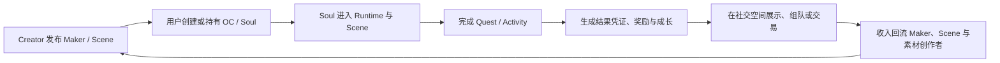

# Soulidity 项目总览

> 更新提示（2026-09-06）：最新产品分类、四款游戏与 SoulDesk 品牌名称见 [生态与产品总览](../SOULIDITY_ECOSYSTEM_CN.md)。以下保留 7 月愿景与规格背景；部署状态不应脱离来源日期引用。

**副标题：** 让数字角色拥有可持续生活的开放网络  
**版本：** 3.0 Draft  
**日期：** 2026-07-24  
**核心主张：** Create Once. Live Across Worlds.

---

## 1. Soulidity 是什么

Soulidity 是面向原创角色（OC）、AI Agent 和其他持久数字实体的链上原生创作、身份、体验与经济网络。

它解决的不只是“如何发行一个 NFT”，而是一个数字角色如何在不同产品与世界中持续存在：

- 它是谁；
- 谁持有、授权或使用它；
- 它包含哪些内容、记忆、技能和形象；
- 它可以进入哪些桌宠、游戏、社交空间或 DApp；
- 它在这些场景里完成了什么；
- 结果、奖励、关系和成长如何延续；
- 创作者、持有人、场景作者和生态伙伴如何获得收入。

Soulidity 的目标是让角色从一份静态设定或单一应用中的 Agent，成长为可验证、可携带、可授权、可互动并可持续扩展的数字实体。

> 当前 Character Maker 负责创造角色；下一阶段的 Scene Maker 将创造世界与玩法。Soul 负责承载身份与连续性，协议负责确权、授权、证明与结算。

## 2. 为什么现在的数字角色仍然是割裂的

今天的 OC、AI Agent、游戏角色和链上资产分别生活在不同系统中：

- OC 的设定、图片与交易条款通常散落在平台、网盘和聊天记录；
- AI Agent 的人格、技能与记忆被锁在某个运行框架；
- 游戏角色的成长只能留在单一游戏数据库；
- NFT 能证明某个对象被持有，却通常不能表达角色的内容、能力和运行权限；
- 创作者制作角色，开发者制作游戏，活动方发布任务，但三者之间缺少通用接口；
- 社交区域往往只有展示和聊天，没有围绕角色共同发生的行动；
- 版税、奖励、活动预算和创作者收入依赖平台后台或人工结算。

结果是：角色可以被创建，却很难真正“生活”；资产可以被持有，却很难被持续使用；内容可以被消费，却很难跨场景积累价值。

## 3. 核心模型

Soulidity 用五个彼此分离、可以组合的概念描述数字实体：

| 概念 | 回答的问题 | 定位 |
| --- | --- | --- |
| **OC** | 角色的创作身份与文化表达是什么？ | 可以从草稿、设定、立绘或人格包开始，不要求一开始就在链上 |
| **Soul** | 它是谁、由谁持有、内容与权利如何锚定？ | Sui 上的持久身份、资产和权限容器 |
| **OCL** | 它当前能做什么，证据是什么？ | OCL-0 至 OCL-5 的能力成熟度，不是价值等级 |
| **Runtime** | 它在哪里实际运行、交互或执行任务？ | 桌宠、Agent 实例、游戏客户端、NPC、DApp 等 |
| **Scene** | 它进入了什么世界或玩法？ | RPG、副本、小游戏、社交空间、活动或 DApp 体验 |

这五层不会被混成一种资产。持有 Soul 不自动意味着拥有全部著作权；一个高价值 OC 也不必成为高自主 Agent；同一个 Soul 可以在多个 Runtime 中运行；一个 Scene 可以服务许多 Soul。

## 4. 产品组成

### 4.1 Soulidity Protocol & App

当前 Soulidity 的核心协议和应用负责：

- Soul 的原生创建、外部导入与 Personal Join；
- Sui Personal Kiosk 中的资产持有和转让；
- `soul.md`、Memory、Skill、Sprite、Audio 和自定义内容类型；
- Walrus 内容存储与 Seal 条件访问；
- 可撤销、可过期、分 Scope 的 SoulGrant；
- 按内容类型配置的 Paid Access；
- Soul 与 `tradeable=true` CollectionRight 的固定价 USDC 市场；
- Soul Collection、版税权利和成员绑定；
- Web 社区、Soul Space、关注、帖子、评论、排行和资源页；
- Agent API 与内部 TypeScript SDK。

### 4.2 Animacraft

Animacraft 是生态中的第一个 Character Maker：

- 创作者发布由 Parts、Items、Layers、Colors 与规则组成的 Maker；
- 用户通过 Maker 组合并渲染自己的 OC；
- Maker 内容与成品包进入 Walrus；
- Maker 的来源、规则、管理权和收入对象进入 Sui；
- 目标流程中，最终完成的角色只在 Soulidity 中铸造成一个 Soul，不创建重复角色资产。

Animacraft 与 Soulidity 是独立产品和独立 Sui 包。Character Maker 与主网协议基础已经存在；Soulidity 工作区内有免费 Maker v1 handoff 的代码适配，但 UI 入口被禁用，当前生产 `/import` 尚未部署该逻辑。“同一交易内验证 Maker 授权、完成付费并铸造唯一 Soul”的正式适配器仍待激活。

### 4.3 SoulDesk

SoulDesk（原 Soulidity Desktop / Anima Desktop）是第一个参考 Runtime。它已经将角色形象和 Agent 工作状态带到桌面：

- 悬浮桌宠与 Sprite 动画；
- Claude Code、Codex 等 CLI 状态感知；
- 本地 Agent 钱包与设备绑定；
- Persona、资源库、缓存和部分 Seal 解密；
- 文件任务和 Agent 工作流反馈。

桌宠证明 Soul 不应只停留在市场页面。接下来的游戏和社交场景将延续同一思路：角色在真实使用中形成关系、记忆和价值。

### 4.4 Infinite Flow Engine 与游戏产品线

Infinite Flow Engine 是面向 Sui 的可组合全链游戏引擎，已有场景版本、单人 Run、随机事件、结算和结果凭证的 P0 实现。它通过合约框架与 SDK 降低游戏开发难度，当前范围及生产发布门槛见最新生态总览。

Soul Expedition、Soul Paper Theater、Infinite Stellar 与 Soul Habitat 统一归入游戏产品线，分别提供短局冒险、纸舞台策略、多人赛季世界和异步养成体验。Soul Habitat 尚在规划；其他游戏已有不同程度实现。各游戏保留独立规则，不要求全部依赖 Infinite Flow Engine。

### 4.5 Maker & Scene Network

下一阶段将 Maker 从“创建角色”扩展到“创建可游玩的内容”：

- **Character Maker**：外观、设定、人格、技能和初始内容；
- **Layered Avatar & Outfit Maker（未来规划）**：Mint 时保留可验证图层与插槽，使玩家在不重铸 Soul 的情况下自主更换服装、装备和皮肤；
- **Scene Maker**：地图、房间、NPC、对话、任务、战斗、解谜和奖励；
- **Game Templates**：轻 RPG、回合战斗、放置、派对小游戏、社交互动等模板；
- **Activity Builder**：链上活动、准入条件、证明方式、奖励池和合作方回调。

早期目标不是一次性做出通用游戏引擎，而是提供少量稳定模板，使创作者能够不写合约或只写少量代码就发布可玩的独立副本。

## 5. 最小完整循环



这条循环比单纯“发行更多 NFT”更重要。Soulidity 的长期网络效应来自同一个 Soul 被反复使用，以及创作者持续获得可衡量的回报。

## 6. 场景与游戏方向

一个 Scene 可以是：

- 5 分钟完成的链上小游戏；
- 使用 Soul 属性和记忆触发分支的叙事副本；
- 多人协作或对抗的轻 RPG；
- 桌宠中的周期性事件；
- 只允许特定 Soul、Collection、OCL 或持仓进入的房间；
- 品牌、DAO、社区或其他链上项目发布的活动；
- 读取 Soul 技能并产生可审计结果的 DApp；
- 社交广场中的演出、展览、共同建设或社区决策。

为避免伪造“全链上”承诺，Scene 将支持三种执行模式：

| 模式 | 适合内容 | 链上边界 |
| --- | --- | --- |
| **Fully On-chain** | 简单规则、回合制小游戏、链上谜题 | 规则、状态与结果主要在 Sui 执行 |
| **Verifiable Hybrid** | RPG、副本、较复杂多人玩法 | 客户端或服务执行，高价值状态与结果通过证明、签名或挑战机制结算 |
| **On-chain Anchored** | 高表现力客户端、桌宠、叙事与社交体验 | Sui 管理身份、准入、资产和奖励，Walrus 保存内容，运行过程不逐帧上链 |

Soulidity 的标准不是强迫所有计算上链，而是让关键权利、规则、输入、结果和价值流能够被验证。

## 7. 社交区域为什么必须“有事可做”

社区不应只是 Feed、聊天室和角色展柜。新版社交层围绕共同动作组织：

- 携带 Soul 进入公开广场或持仓门控空间；
- 邀请、组队、匹配和共同完成副本；
- 公会、兴趣小组和创作者社区；
- Maker 作品展览、试玩和现场发布；
- 角色之间可见但受隐私控制的关系与共同经历；
- 社区任务、合作建设和剧情投票；
- 由活动方资助的竞赛、赏金与链上奖励；
- 成就、凭证和创作贡献的展示。

社交层的核心指标不是发帖量，而是有多少 Soul 与其他人共同完成了有意义的行动。

## 8. 市场与经济

Soulidity 市场最终承载的对象不只是一类 NFT：

| 交易对象 | 用户获得什么 |
| --- | --- |
| Soul | 特定链上数字实体的持有权及协议定义的使用能力 |
| CollectionRight | 某个 Collection 的额外版税权利，不等于成员 Soul 所有权 |
| Maker / Scene | 使用、管理或商业化某个创作系统或体验的权利 |
| 素材与玩法模块 | 可组合的视觉、音频、任务、地图、规则与逻辑组件 |
| Paid Access | 特定内容类型的有期限或无期限访问条目；当前协议中可由所有者撤销且不自动退款 |
| 服务与活动 | 委托创作、角色运营、任务、门票、通行证和品牌活动 |

经济循环以真实使用为起点：

```text
创作投入
  → Maker / Scene 使用费
  → Soul 与内容消费
  → 游戏和活动收入
  → 自动分账与创作者收益
  → 更多内容供给
```

当前协议使用 Circle Sui USDC 进行固定价结算，主网 MarketConfig 的默认平台费为 2.5%。Maker 的初级与二级收入模型仍需在正式适配器、治理和安全审阅完成后激活。

## 9. DeFi 与融资的正确位置

DeFi 应服务内容经济，而不是先制造金融复杂度。建议的推进顺序是：

1. 先验证 Maker、Scene、游戏和活动产生真实收入；
2. 再建立奖池、赏金、里程碑托管和自动分账；
3. 随后探索基于已发生收入的创作者融资和收入权；
4. 最后才评估抵押、流动性和更复杂的资产金融化。

潜在方向包括：

- Scene 创作赏金与里程碑托管；
- 社区或合作方资助的 Quest Reward Pool；
- Maker / Scene 收入分成凭证；
- 创作者预售和可交付成果融资；
- 以历史现金流为依据的融资工具；
- 跨协议激励和链上活动预算。

项目当前没有已发行的 Soulidity 协议代币。旧融资 Deck 中的代币分配和轮次数字属于历史方案；任何代币、TGE 或 DAO 设计都必须经过新的治理、法律、用途与安全评估，并形成独立文件。

## 10. 技术栈

| 层 | 技术 | 职责 |
| --- | --- | --- |
| 权利与结算 | **Sui** | Soul、Kiosk、Collection、Grant、内容索引、市场、规则、结果和奖励 |
| 内容与资产 | **Walrus** | 图片、音频、角色包、Maker、Scene、剧情和其他大体积数据 |
| 条件解密 | **Seal** | 根据链上所有权、Grant、Paid Access 或公开策略释放密钥 |
| 交易编排 | **Soulidity SDK** | 构造 PTB、读取对象、解析事件、组织内容与市场操作 |
| 应用服务 | **Web / API / Indexer / DB** | 检索、镜像、社区、身份、上传、密钥 sidecar 和开发者接口 |
| Runtime | **Desktop / Game / DApp / Agent** | 实际交互、玩法、推理、渲染与任务执行 |

链是权利与结算的真相层，但完整产品仍依赖客户端、索引服务、Walrus 保存期限、Seal Key Server、密钥 sidecar 和治理 Cap。新版文档会明确这些信任与可用性边界。

## 11. 当前状态快照

| 能力 | 状态 | 当前边界 |
| --- | --- | --- |
| Soulidity Sui 协议 | `Mainnet` | 主网包与关键 Registry/Config 已部署；当前治理 Cap 尚未迁入多签 |
| Soul 创建、内容、Grant、市场、Collection | `Mainnet` | 以当前 Move 包与 Circle Sui USDC 为准 |
| Web 市场与社区 | `Implemented` | 权利和结算以链上为准；社区、索引和认证依赖数据库 |
| Agent API / 内部 SDK | `Implemented` | SDK 目前是 monorepo 内部包，不是稳定公开 npm 产品 |
| SoulDesk 桌面端 | `Pilot` | macOS Apple Silicon 有未签名预览发行；跨平台和完整 Agent 体验仍在建设 |
| Animacraft Character Maker | `Mainnet / Pilot` | 主网发布基础已存在；正式集成开关仍关闭，版本以当前部署清单为准 |
| Layered Avatar & Outfit Maker | `Research / Planned` | 分层 Mint、换装、装备皮肤与外观投影尚未实现 |
| Infinite Flow Engine 与游戏 | `Implemented / Pilot / Planned` | 引擎 P0 与部分游戏已有实现，具体范围见最新生态总览；可视化 Scene Maker 尚在规划 |
| 可游玩社交世界 | `Planned` | 当前是 Web 社区，不是多人游戏世界 |
| DeFi、创作者融资 | `Research` | 先等待真实内容收入和风险模型 |
| 协议代币 | `No current issuance` | 无已发行协议代币；旧 Tokenomics 不代表当前决策 |

## 12. 路线图

### 阶段 A：把现有基础设施变成可信基线

- 治理 Cap 与 UpgradeCap 多签托管；
- Walrus 续期、Seal sidecar 备份和恢复机制；
- Animacraft → Soulidity 正式适配器；
- 权利清单、许可证和来源验证；
- 公共 SDK 与示例应用边界。

### 阶段 B：证明一个 Soul 能跨场景使用

- 发布 2 至 3 个官方参考副本；
- Soul 准入、属性读取、任务结果与奖励回写；
- 桌宠与小游戏共享同一 Soul 身份；
- 建立 Scene、Quest、Run Receipt 的最小标准。

### 阶段 C：让第三方能够制作场景

- Scene Maker Alpha；
- 地图、NPC、对话、任务、战斗和小游戏模板；
- Scene 发布、版本、依赖、准入和收益设置；
- Creator Dashboard 与内容审核。

### 阶段 D：让社交空间成为内容分发入口

- 角色空间、组队、公会和共同任务；
- Maker 展示、试玩与活动广场；
- 关系、成就和声誉的证据模型；
- Sybil、防刷、申诉和内容治理。

### 阶段 E：开放生态与经济网络

- 第三方游戏、DApp 和 Agent Framework SDK；
- 链上活动、任务和奖励池；
- 分层角色与换装 Maker 试点，包括图层 Manifest、装备插槽、皮肤许可和外观投影；
- 场景、模块、素材、服务和许可市场；
- 基于真实收入的创作者融资与 DeFi 试验。

## 13. 最重要的近期目标

下一阶段不应同时追求“通用游戏引擎、元宇宙、DeFi 和 DAO”。最有价值的验证是一个短而完整的闭环：

> 用户携带一个真实 Soul 进入一个 Maker 创建的小副本，完成任务后获得链上可验证结果；该结果能在桌宠或社交空间中显示，场景作者能收到可核对的收入。

一旦这条路径跑通，RPG、小游戏、DApp、社交活动、品牌合作和外部链上任务就可以在同一基础上持续扩展。

---

完整愿景与设计见 [Soulidity 白皮书 v3.0](./SOULIDITY_WHITEPAPER_V3_CN.md)，实现边界见 [产品与协议规格](./SOULIDITY_PRODUCT_PROTOCOL_SPEC_CN.md)。
