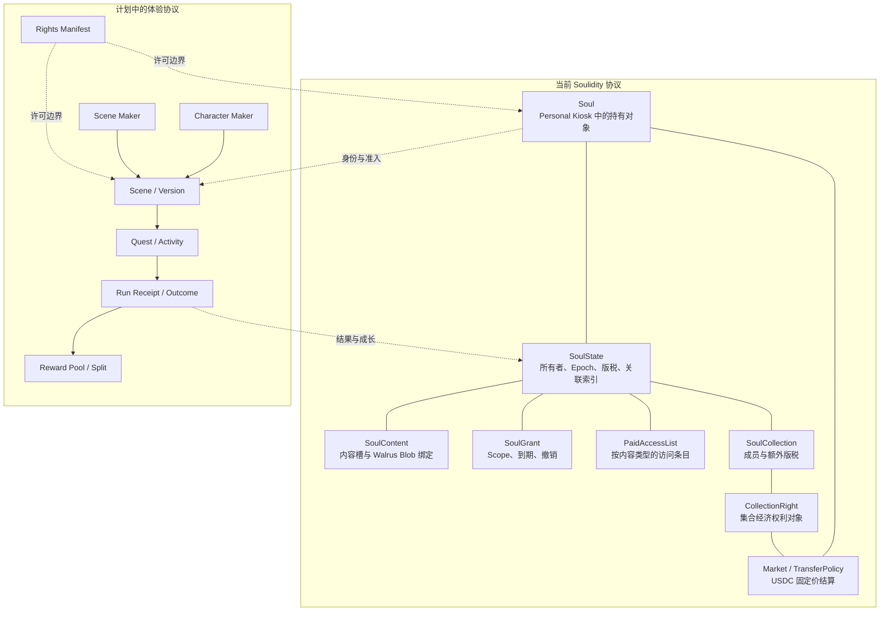
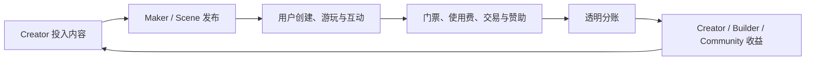

# Soulidity 白皮书 v3.0

**副标题：** 面向持久数字实体的链上原生创作、身份、体验与经济网络  
**核心主张：** Create Once. Live Across Worlds.  
**文档版本：** 3.0 Draft  
**基线日期：** 2026-07-24  
**网络基线：** Sui Mainnet  
**语言：** 简体中文

---

## 阅读说明

本文同时描述 Soulidity 已经部署的协议、已经实现或试运行的产品，以及下一阶段的 Maker、Scene、游戏、社交与经济网络。为避免把愿景误写成事实，本文使用以下状态标签：

- `Mainnet`：对应协议包或关键对象已记录在 Sui 主网部署清单中；
- `Implemented`：代码与实际产品路径存在，但不代表已经全面开放；
- `Pilot`：可用于受控试验或早期用户；
- `Planned`：方向与边界已进入路线图，尚不是可依赖的生产能力；
- `Research`：需求、机制、安全或监管假设仍需验证；
- `Governance Pending`：能力或方案存在，但关键参数、Cap 托管或公开承诺仍待治理；
- `No current issuance`：当前不存在已发行的对应协议资产，不代表未来发行承诺；
- `Legacy`：历史方案，不再代表当前实现。

本文不是代币发行、证券销售、收益承诺或法律权利意见。链上持有、协议权限、著作权、商标权、人格权和商业许可是不同概念；具体权利应以创作者发布的许可证、Rights Manifest 和适用法律为准。

## 1. 执行摘要

Soulidity 的出发点很简单：数字角色不应只是某个平台中的一张图、一个 NFT 或一段只能在单个应用中运行的提示词。

一个真正持久的数字角色，需要同时回答五类问题：

1. **身份**：它是谁，来自哪里，如何跨版本保持为同一个实体；
2. **权利**：谁持有、使用、修改、授权或交易它；
3. **内容**：它有哪些设定、记忆、技能、形象、音频和扩展资源；
4. **运行**：它在哪里交互、工作、陪伴或自主执行任务；
5. **经历**：它进入过哪些世界、完成过什么任务、获得了什么结果与关系。

Soulidity 将这些问题拆成可以组合的协议与产品层：

- **Soul** 在 Sui 上承载持久身份、持有关系、内容索引和权限状态；
- **Walrus** 承载角色包、图像、音频、Maker、Scene 和其他大体积内容；
- **Seal** 根据链上所有权、Grant 或 Paid Access 控制条件解密；
- **Character Maker** 已有主网基础，用于生产角色与素材；**Scene Maker** 仍属规划，将用于生产可游玩的 Scene；
- **Runtime** 让同一个 Soul 在桌宠、Agent、游戏、DApp 或社交空间中运行；
- **Scene / Quest / Activity** 让角色产生可验证结果、奖励、关系与成长；
- **市场与社区** 负责发现、组合、授权、交易、协作和收入回流。

Soulidity 已拥有 Sui 主网协议、Soul 内容与授权模型、固定价 USDC 市场、CollectionRight、Web 应用、社区能力、桌面桌宠 Pilot，以及 Animacraft Character Maker 的主网基础。下一阶段的重点不是再造一个孤立游戏，而是建立一条可重复的内容闭环：

```text
Maker 创建角色或场景
  → 用户创建或持有 OC / Soul
  → Soul 进入桌宠、RPG、小游戏、社交空间或 DApp
  → 完成 Quest / Activity
  → 产生可验证结果、奖励、关系与成长
  → 在社区展示、组队、授权或交易
  → 收益回流 Maker、Scene 和素材创作者
  → 新内容持续产生
```

## 2. 愿景：从“拥有角色”到“角色生活”

互联网已经让角色能够被发布，生成式 AI 让角色能够对话，区块链让数字对象能够被持有。但这三种能力仍然彼此割裂。

Soulidity 希望建立的不是单个 OC 平台、单个 Agent 框架或单个链游，而是持久数字实体的底层服务设施：

> 任何原创角色都可以从一个创意开始，获得结构化内容和可验证身份，在清晰授权下进入不同 Runtime 与 Scene，持续积累经历、关系和经济活动，同时让创作者保留来源、规则与收入。

这意味着同一个 Soul 可以：

- 在 Web 中被创建、导入、展示和交易；
- 在 Desktop 中成为可感知 Agent 状态的桌宠；
- 在轻 RPG 中作为玩家角色或 NPC；
- 在小游戏中使用自己的形象、技能或持仓进入；
- 在社交广场里组队、展览、参与活动；
- 在第三方 DApp 中作为身份、访问资格或服务主体；
- 在获得明确授权后执行有限工具与工作流；
- 在不同场景间保留被选择的状态、成就和关系。

“生活”并不意味着所有数据无限公开，也不意味着所有行为自动上链。它意味着身份具有连续性、关键权利可验证、授权可撤销、结果可核对、内容可携带，并且每个 Runtime 都明确自己的信任边界。

## 3. 当前问题

### 3.1 身份被平台切碎

同一个 OC 在绘画平台、聊天机器人、游戏和链上市场中通常拥有不同账号、格式和资产。角色来源、版本和持有人关系无法被机器稳定解析。

### 3.2 内容与 Runtime 绑定

人格、技能、记忆、Sprite 和语音通常由某个应用私有保存。用户一旦更换产品，角色就失去连续性。

### 3.3 所有权、许可与运行权限混在一起

持有一个数字资产不自动等于拥有著作权，也不代表某个 Agent 可以读取记忆、调用工具或转售内容。缺少细粒度权限时，用户只能在“全部开放”和“完全封闭”之间选择。

### 3.4 创作者与场景开发者难以共享价值

角色创作者、素材作者、Maker 作者、游戏作者、活动组织者和持有人可能共同产生价值，但多数平台只支持单一收款方或依赖后台人工结算。

### 3.5 社交空间缺少共同动作

只有 Feed、聊天和展示柜的社区，很难形成长期关系。角色需要一起完成任务、探索世界、参加活动、创造内容，社交才会围绕共同经历生长。

### 3.6 “全链上”经常被错误理解

高表现力游戏、AI 推理、实时社交和大文件不适合把每一步都写入链上。真正重要的是明确哪些权利、规则、状态和价值流必须上链，哪些计算可以在链下执行，以及结果如何被验证。

## 4. 六项设计原则

### 4.1 身份、能力、运行与场景分离

Soul 不是 Runtime，OCL 不是价格等级，Scene 也不是 Soul 的一部分。分离后，同一个身份才能安全进入多个环境。

### 4.2 持有人控制授权

应用和 Agent 只应获得完成任务所需的最小权限。当前 SoulGrant 可限定目标 Soul、受权地址、Scope 和时间，并通过所有权 Epoch 失效；Runtime、应用、域名或环境绑定属于后续扩展。

### 4.3 关键路径可验证

当前协议以链上对象、哈希和策略锚定所有权、内容索引、授权与市场结算。未来 Scene 协议还应把准入和高价值结果通过链上对象、签名、证明或挑战机制锚定。不是所有计算上链，而是关键事实可验证。

### 4.4 可组合性必须由显式许可开启

Maker、Scene、素材和 Soul 具备形成可组合生态的技术目标，但当前不得推定存在组合、改编、训练或商业使用许可。只有 Rights Manifest、许可证或权利方签名明确允许后，应用才能按其来源、版本、访问与商业化规则进行组合。

### 4.5 经济建立在使用之上

协议优先验证“用户是否反复使用 Soul、创作者是否获得真实收入”，再扩展奖池、融资和 DeFi。金融化不能替代产品价值。

### 4.6 能力越高，治理要求越高

能够调用工具、支付资产或持续自主运行的实体，必须同时具有预算限制、风险分级、确认、审计、暂停和人工接管。

## 5. 核心模型

### 5.1 五层数字实体模型

| 层 | 核心问题 | 典型对象 |
| --- | --- | --- |
| **OC** | 它作为一个创作角色是什么？ | 名称、设定、视觉、人格、Lore、来源 |
| **Soul** | 它是谁，由谁持有，内容和权利如何锚定？ | Sui Soul、SoulState、SoulContent、Rights |
| **OCL** | 它在指定版本和环境中已被证明能做什么？ | 等级、六维能力指纹、证据与有效期 |
| **Runtime** | 它在哪里实际交互或执行？ | Desktop、Agent、游戏客户端、NPC、DApp |
| **Scene** | 它进入了什么规则、世界或活动？ | RPG、副本、小游戏、社交空间、Quest |

OC 可以先于 Soul 存在；Soul 可以没有 AI Runtime；同一个 Soul 可以对应多个 Runtime；Scene 可以接受未上链 OC 的试玩。当前 Soul 能携带链上可验证权利，并将作为未来跨场景状态的身份锚点；跨场景状态标准本身尚未实现。

### 5.2 当前对象图与计划扩展



虚线部分是跨协议关系或计划接口，不代表当前主网包已经包含 Scene、Quest 或 Run Receipt 合约。

## 6. 参与者

| 参与者 | 主要行为 | 主要价值 |
| --- | --- | --- |
| **Creator** | 创造 OC、素材、Maker、Scene、剧情、规则或服务 | 来源、收入、传播与长期角色价值 |
| **Holder** | 持有 Soul 或 CollectionRight，管理授权与使用 | 可验证持有、使用、在规则允许时交易并保持关系连续性 |
| **Player / User** | 进入 Runtime、游玩、互动、创作和完成任务 | 体验、奖励、成长、社交与贡献 |
| **Scene Builder** | 使用模板或 SDK 构建 RPG、小游戏、空间和活动 | 分发、门票、使用费、分账与用户关系 |
| **Runtime Operator** | 运行 Desktop、Agent、游戏服务器或 DApp | 获得受控访问并提供持续服务 |
| **Verifier** | 验证 OCL、任务结果、来源或安全属性 | 认证费、信誉与生态服务收入 |
| **Sponsor** | 资助 Quest、活动、奖池或创作者里程碑 | 用户触达、社区目标与可核对交付 |
| **Protocol Governance** | 管理升级、参数、Registry 和紧急响应 | 协议安全、兼容性和公共规则 |

同一个地址或组织可以同时扮演多个角色，但协议应尽量避免由一个角色单方面控制所有关键事实。

## 7. Soul 协议：当前基础

### 7.1 Soul 与 SoulState

`Mainnet`

当前 Soulidity 以两个关联对象区分资产本体和持续状态：

- **Soul**：可持有、可交易的 Sui 对象，记录版本、创作者、名称、描述、图片、来源类型与可选来源引用；
- **SoulState**：共享状态对象，记录当前所有者、所在 Kiosk、所有权 Epoch、创作者版税、内容对象、Collection、Paid Access 和可扩展配置。

Soul 被放入用户的 Sui Personal Kiosk。市场转移完成后，SoulState 更新所有者与所有权 Epoch，使旧授权和旧访问条目不能在新所有权周期中继续被当作有效权限。

当前基础元数据在铸造后不可直接编辑；可演进内容通过 SoulContent 的类型化槽位管理，而不是修改 Soul 本体。

当前主网模型没有逐 Soul 的 Bound / Free 或“禁止转让”配置；Soul 通过 Personal Kiosk 与 TransferPolicy 在受支持的市场路径中交易。不可转让或条件转让 Soul 仍属于后续研究，不能被当作当前能力。

### 7.2 创建与来源

`Mainnet`

当前协议支持三类来源：

- **Native**：直接在 Soulidity 创建；
- **Imported**：从外部 OC、角色包或资产导入；
- **Personal Join**：用户将个人角色接入 Soulidity。

链上 `provenance_kind` 与 `origin_ref` 可以记录声明来源，但“存在来源字符串”不等于“来源已被第三方验证”。未来 Maker 适配器和来源验证器需要提供签名、交易关系或可验证 Manifest。

### 7.3 SoulContent

`Mainnet`

当前内置内容类型如下：

| 内容类型 | 当前更新语义 | 典型用途 |
| --- | --- | --- |
| `SOUL_DOC` | 铸造后不可变 | 核心角色说明、初始人格或根 Manifest |
| `MEMORY` | 可追加，也支持删除与清理 | 经历、上下文、可治理记忆 |
| `SKILL` | 可创建、更新、删除 | 能力描述、工具或工作流清单 |
| `SPRITE` | 可创建、更新、删除，并设置 Active | 桌宠、游戏与社交形象 |
| `AUDIO` | 可创建、更新、删除，并设置 Active | 语音、音乐、效果音 |
| 自定义 Kind | 由 KindRegistry 扩展 | Scene、凭证、模型或生态特定内容 |

内容的链上记录包含类型、访问模式、Walrus Blob 关联和完整性信息。真正的大文件不写入 Move 对象，而是写入 Walrus；浏览器侧使用 AES-GCM-256 加密受保护内容，内容哈希用于完整性核验，解密密钥由 Seal 策略控制。

Walrus 注册存在保存期限，当前默认流程并不等于永久存储；生产系统必须提供续期、迁移、备份和不可恢复风险提示。Seal Key Server 与应用保存的密钥 sidecar 也是可用性依赖。

### 7.4 SoulGrant

`Mainnet`

SoulGrant 允许持有人向某个地址授予有限权限。当前 Scope 包括：

- `SEAL`：满足受保护内容的 Seal 访问条件；
- `MEMORY`：访问或操作被允许的记忆能力；
- `SKILLS`：使用被允许的技能内容；
- `ASSETS`：使用被允许的资源。

Grant 可以设置到期时间、整体撤销或撤销部分 Scope。默认容量为 1，但当前合约允许持有人调整容量，上限为 10,000；同一被授权地址的新 Grant 会替代其旧 Grant。Soul 所有权 Epoch 变化会使旧授权失效。

Grant 是协议权限，不是法律意义上的完整许可证，也不应被客户端解释为超出 Scope 的授权。

### 7.5 Paid Access

`Mainnet`

Paid Access 将“拥有 Soul”和“访问某类内容”分开。当前访问条目按内容类型配置，可以有期限或不设置时间到期。

需要明确的产品边界：

- 当前所有者可以撤销访问；
- 协议不自动执行退款；
- Soul 转移后旧所有权周期中的访问会失效；
- “Lifetime”仅表示没有时间到期，不表示不可撤销或法律上的永久许可。

因此所有购买界面必须展示撤销、退款、转移和内容可用性规则。

### 7.6 Collection 与 CollectionRight

`Mainnet`

SoulCollection 是共享集合对象，可绑定成员 Soul 并设置额外版税。每个 Collection 对应一个 SoulCollectionRight；只有创建配置中的 `tradeable=true` 时，该 Right 才能固定价挂单和购买。

CollectionRight 表示协议定义的集合经济权利：

- 不等于持有集合中的每个 Soul；
- 不等于公司股份、基金份额或对创作者全部收入的权利；
- 不自动授予成员内容的著作权、修改权或商业使用权；
- 实际收入取决于成员交易、参数和协议规则。

### 7.7 市场与结算

`Mainnet`

当前市场支持 Soul，以及被配置为可交易的 CollectionRight 的固定价挂单和购买，使用 Circle Sui Mainnet USDC 结算。买方支付挂单价以及协议规定的平台、创作者和可选 Collection 费用；默认平台费为 250 bps，即 2.5%。

当前并不是通用 AMM、拍卖、借贷或多币种支付市场。任何新增支付资产、竞价、复杂版税或跨链结算都应单独设计和审计。

### 7.8 Rights Manifest

`Planned`

下一版内容标准需要加入机器可读的 Rights Manifest，用来明确：

- 链上持有者获得哪些展示、运行、训练、改编、商业使用或转授权能力；
- 哪些权利由创作者保留；
- 许可证适用的地区、时间、用途与收入阈值；
- 是否允许进入第三方 Scene、生成衍生内容或用于模型训练；
- 许可证版本、正文哈希、签署方和争议处理入口。

Rights Manifest 不能取代法律合同，但可以减少应用对“持有即拥有全部权利”的错误推断。

## 8. OCL：从角色档案到可治理数字实体

`Research / Planned`

Soul 回答“它是谁、由谁持有”，OCL 回答“它在特定版本和环境中已经被证明能做什么”。

### 8.1 六维能力指纹

| 维度 | 核心问题 |
| --- | --- |
| 身份连续性 `I` | 能否跨版本、平台和时间被认作同一个实体？ |
| 内容与记忆连续性 `M` | 设定、状态与经历能否持续积累并追溯？ |
| 交互性 `X` | 能否根据用户与情境保持角色边界地回应？ |
| 行动能力 `A` | 能否在授权下调用工具或改变外部状态？ |
| 自主性 `U` | 能否在有限目标、预算和时间内规划与持续运行？ |
| 权利可验证性 `R` | 持有、使用、修改、授权与转让能否机器验证？ |

公开结果应同时包含 OCL 等级与能力指纹，例如 `OCL-3 / I4-M3-X3-A2-U1-R4`。

### 8.2 六个等级

| 等级 | 名称 | 能力边界 |
| --- | --- | --- |
| `OCL-0` | Concept | 有可辨识创作意图，尚未形成稳定角色包 |
| `OCL-1` | Defined | 有结构化设定、来源和稳定版本 |
| `OCL-2` | Persistent | 有可验证身份、版本、来源和机器可读权利 |
| `OCL-3` | Interactive | 可持续交互，并有记忆与隐私策略 |
| `OCL-4` | Operational | 可在细粒度授权下调用工具并给出执行回执 |
| `OCL-5` | Autonomous | 可在强治理边界内持续规划、行动与复盘 |

OCL 不评价画工、文化价值、稀有度、粉丝数或价格。等级必须绑定“实体 + 版本 + Runtime 环境”，并区分创作者声明等级与基于证据的验证等级。环境或关键能力改变后应重新验证。

OCL-5 也不表示意识、人格、法律主体资格或通用智能。

## 9. Maker 网络

### 9.1 Character Maker

`Mainnet / Pilot`

Animacraft 是生态中的第一个 Character Maker。Creator Studio 允许作者组合 Parts、Items、LayerBindings、颜色和规则，发布可供玩家编辑的角色生成器；Player Editor 允许用户在规则内创建自己的 OC。

Maker 的规则和内容包进入 Walrus，Maker 管理对象与资金对象进入 Sui。最终角色应只在 Soulidity 铸造成一个 Soul，避免 Animacraft 与 Soulidity 各自创建重复的“角色所有权对象”。

当前边界是：

- Animacraft v3 主网包已发布并完成源码验证；
- Character Maker 与本地草稿流程存在；
- Soulidity 工作区内已有 `animacraft.oc-package.v1` 免费 Maker handoff 代码，但 UI 入口被禁用，生产 `/import` 尚未激活；
- 当前来源字段尚未形成可依赖的 Maker 链上证明；
- 正式的付费 Maker、可验证来源、二级版税和单一 PTB 铸造适配器尚未生产激活。

### 9.2 Layered Avatar & Outfit Maker

`Research / Planned`

Layered Avatar & Outfit Maker（分层角色与换装 Maker）将把 Character Maker 的一次性合成结果扩展为可持续换装的角色外观系统。用户 Mint OC 时，除保存最终合成展示图外，还可选择保存经过验证的图层 Manifest、插槽、遮挡顺序、兼容规则和素材来源，使玩家之后能够自主更换服装、装备及其不同皮肤，而不需要重复 Mint 一个新的 Soul。

候选模型包括：

- **身份层**：脸型、身体、角色设定等稳定部分，与 Soul 核心身份绑定；
- **装备插槽**：头部、上装、下装、武器、配饰、特效等可替换位置；
- **外观皮肤**：装备的视觉变体，不默认改变装备权利或游戏数值；
- **Layer Manifest**：记录图层资源、顺序、锚点、尺寸、版本、兼容 Maker 和内容哈希；
- **Loadout / Appearance Projection**：记录当前穿戴组合，允许在明确授权下更新，并可由不同 Runtime 渲染。

该方向必须区分“拥有 Soul”“拥有或获准使用某件装备”“获准展示某个皮肤”三类权利。换装不得改写 Soul 的不可变来源，素材也不得因被组合进外观而自动转移版权。首版实现前还需解决图层标准、跨 Maker 兼容、内容审核、授权撤销边界、渲染一致性、缓存与费用叠加，因此不属于当前 Mint 流程承诺。

### 9.3 Scene Maker

`Planned`

Scene Maker 将把创作能力从“做一个角色”扩展为“做一个角色可以进入的世界”。首版应聚焦少量可预测模板：

- 轻 RPG 与分支叙事；
- 回合制或卡牌战斗；
- 放置与周期事件；
- 解谜、收集和计时挑战；
- 派对小游戏；
- 展览、演出和社交互动；
- 门控活动、社区任务和品牌合作。

Scene Maker 的基础模块包括：

- 地图、房间与传送关系；
- NPC、对话和剧情条件；
- Quest、步骤、失败和完成条件；
- 战斗、数值、技能映射和掉落；
- Soul / Collection / OCL / 持仓准入；
- 结果证明、奖励池和自动分账；
- Scene 版本、依赖、许可证和内容审核；
- 模板、素材、逻辑模块与第三方组件市场。

首版目标不是构建一个覆盖所有类型的通用游戏引擎，而是让非合约开发者能够发布 5—20 分钟可玩的独立副本。

### 9.4 Maker 的可组合性

Maker 生态需要区分四类资产：

1. **编辑器与规则**：如何生成内容；
2. **素材与模块**：可以被哪些 Maker 或 Scene 使用；
3. **输出作品**：用户最终创建的 OC、Sprite、地图或剧情；
4. **运行许可与收入权**：谁可以发布、商业化、更新或收取分成。

来源、许可证、依赖和费用必须随版本保留。购买 Maker 不应被默认解释为买下所有使用者生成的 Soul；使用某素材也不应自动转移素材版权。

## 10. Scene、Quest 与 Activity

`Planned`

### 10.1 Scene

Scene 是可发布、可版本化、可进入的体验单元。它至少需要声明：

- 创建者、版本、内容 Manifest 和依赖；
- 支持的 Runtime 与执行模式；
- 准入条件、人数、时间与费用；
- 读取哪些 Soul 字段和内容类型；
- 允许写回哪些结果；
- 结果验证者和争议流程；
- 收款、分账、奖励与退款规则；
- 权利、年龄、地区、隐私和内容警告。

### 10.2 Quest

Quest 是 Scene 内可被接受和完成的目标。它可以包含多个步骤、时间窗口、前置条件和完成策略。Quest 本身不应任意获得 Soul 写权限，而是通过预先声明的结果 Schema 提交有限输出。

### 10.3 Activity

Activity 是更通用的活动接口，可用于第三方链上项目、DAO、品牌、Agent 框架或线下活动。它关注：

- 谁可以参加；
- 需要提交什么证据；
- 谁判断完成；
- 奖励从哪里来；
- 结果可以被哪些应用消费。

### 10.4 Run Receipt、Outcome 与成长

每次重要运行可以产生 Run Receipt，记录 Scene、版本、参与 Soul、时间、输入承诺、结果摘要、验证方法和签名。只有被协议或应用接受的 Outcome 才能进入长期状态。

为避免任何 Scene 污染角色身份，结果分三层：

- **Receipt**：某次运行确实发生的凭证；
- **Claim**：Scene 对结果的声明；
- **Accepted State**：持有人或规则允许写入 Soul 的长期状态。

成长不应是一个由任意游戏无限增加的全局数值。更稳妥的模型是场景命名空间、可验证成就、能力证据和选择性汇总。

## 11. 三种执行模式

Soulidity 不要求所有 Scene 使用同一种技术模式。

| 模式 | 适合内容 | 信任与验证方式 |
| --- | --- | --- |
| **Fully On-chain** | 简单规则、回合制小游戏、谜题、链上抽取 | 规则、主要状态和结果由 Move 执行 |
| **Verifiable Hybrid** | 轻 RPG、多人副本、较复杂数值玩法 | 客户端或服务运行，高价值结果通过签名、证明、重放、挑战或多方验证结算 |
| **On-chain Anchored** | 高表现力客户端、桌宠、叙事、实时社交 | Sui 负责身份、准入、资产和奖励；运行过程不逐帧上链 |

每个 Scene 必须公开自己的执行模式、可信方、可重放程度、作弊风险和争议流程。不能用“链上入口”包装一个完全不可审计的后台结果。

## 12. 社交世界

### 12.1 当前社区

`Implemented`

Soulidity Web 已包含帖子、频道、评论、投票、关注、排行、成就和空间等社区能力。这些功能主要依赖应用数据库、认证和索引服务，并不是链上多人游戏世界。

### 12.2 下一阶段：围绕共同动作组织社交

`Planned`

社交空间将从内容 Feed 扩展为 Scene 的发现与进入层：

- 携带 Soul 进入公开广场或门控空间；
- 展示 Maker、Scene、角色形象和可验证成就；
- 邀请、组队、匹配和共同完成 Quest；
- 创建公会、兴趣组和 Creator Space；
- 参加演出、发布会、试玩、竞赛和合作建设；
- 形成受隐私控制的关系、共同经历和贡献记录；
- 让社区直接资助任务、赏金和内容里程碑。

社交声誉不应只有一个可以刷高的总分。建议把内容贡献、任务可靠性、创作来源、验证记录、社区治理和交易行为分开表达，并提供 Sybil 防护、申诉、封禁和数据删除机制。

### 12.3 社交北极星

比发帖量更重要的指标是：

- 有多少 Soul 与其他 Soul 共同完成过活动；
- 多少关系跨越两个以上 Scene；
- 多少用户从社区发现内容并实际进入 Scene；
- 创作者发布后多久获得第一次有效游玩和第一次收入；
- 有多少结果被其他 Runtime 再次使用。

## 13. 市场与创作者经济

### 13.1 可交易与可付费的对象

Soulidity 的长期市场不是单一 NFT 列表，而是多个权利市场的组合：

| 对象 | 交易或付费的实际内容 |
| --- | --- |
| Soul | 链上持有对象及协议定义的使用能力 |
| CollectionRight | 集合的额外经济权利 |
| Maker / Scene | 使用、管理、发布或商业化某个创作系统的权利 |
| 素材 / 模块 | 视觉、音频、剧情、地图、任务、规则与代码组件的许可证 |
| Paid Access | 特定内容类型的访问条目 |
| Quest / Activity | 门票、报名、奖励资格或赞助 |
| Runtime / Agent 服务 | 按时间、任务、调用或成果提供的服务 |
| 创作与运营服务 | 委托、陪跑、角色运营、验证、审核和托管 |

这些对象的所有权、访问权、许可证和收益权必须在界面与合约中分开，不能统一包装成模糊的“买下资产”。

### 13.2 收入回流

一个 Scene 可以根据公开规则，把收入分给：

- Scene 作者；
- Character Maker 作者；
- 被使用的素材和模块作者；
- Soul 原始创作者；
- CollectionRight 持有人；
- 活动验证者或 Runtime 运营者；
- 协议或社区金库；
- 奖励池。

任何分账都必须给出顺序、基数、上限、舍入方法和失败处理。总费率必须有硬上限，避免费用叠加使交易不可用。

### 13.3 真实经济循环



网络价值应首先来自重复使用、内容供给和可核对收入，而不是只依赖资产价格上涨。

## 14. DeFi 与创作者融资

`Research`

DeFi 可以为内容生产提供更好的资金工具，但必须晚于真实需求和现金流。

建议的渐进顺序：

1. **奖励池与赏金**：Sponsor 存入预算，满足验证条件后自动支付；
2. **里程碑托管**：Creator 按可核对交付分阶段领取资金；
3. **预售与门票**：明确交付、退款、延期和失败条款；
4. **收入分成凭证**：只针对定义清晰、可审计的特定收入流；
5. **现金流融资**：依据历史收入而非主观稀有度评估；
6. **抵押与流动性实验**：只有在价格发现、清算和权利边界成熟后评估。

主要风险包括版权瑕疵、收入波动、流动性不足、预言机操纵、清算伤害、证券或集体投资属性、未成年人消费和跨地区监管差异。

Soulidity 当前没有已发行的协议代币。旧融资 Deck 中的估值、融资轮次、代币分配、TGE 与效用设计均为 `Legacy`，不构成当前路线图或公开承诺。未来若需要协议代币，应另行发布独立的治理、法律、效用、安全与分配文件。

## 15. 开放生态与外部接入

`Planned`

Soulidity 的扩展性来自公开接口，而不是要求所有体验由核心团队开发。

### 15.1 接入层

未来 SDK 应支持：

- 解析 Soul、SoulState、SoulContent 和 Collection；
- 校验所有权、Grant、Paid Access、OCL 和 Rights Manifest；
- 请求用户批准最小 Scope；
- 获取 Walrus 内容并通过 Seal 解密；
- 注册 Scene、Quest、Activity 和结果 Schema；
- 构造准入、结算、奖励和分账 PTB；
- 提交 Run Receipt 或读取可验证 Outcome；
- 监听所有权、授权、内容和市场事件；
- 在不托管用户主钱包的前提下运行应用。

### 15.2 外部框架

潜在接入对象包括：

- Sui 与其他链上项目的活动系统；
- Agent Framework、CLI Agent 与自动化平台；
- 游戏引擎、Web 游戏与独立开发者工具；
- DAO、社区和品牌任务系统；
- 创作者平台、OC 社区和既有 NFT 集合；
- 身份、声誉、证明与隐私协议。

跨链集成的首要目标是证明和接入，而不是复制一份不可同步的 Soul。任何桥接或远端表示都必须声明哪个对象是身份根、如何处理双花、撤销、升级和最终性。

## 16. 技术架构与信任边界

### 16.1 分层架构

| 层 | 主要组件 | 真相与责任 |
| --- | --- | --- |
| 身份与权利 | Sui Move、Kiosk、TransferPolicy | Soul 持有、Collection、Grant、访问索引和结算 |
| 内容与完整性 | Walrus、哈希、Manifest | 大文件保存、内容寻址与版本证据 |
| 条件访问 | Seal、Key Server、密钥 sidecar | 根据链上条件释放受保护内容密钥 |
| 编排与读取 | TypeScript SDK、Indexer、RPC | PTB 构造、事件读取、对象解析和缓存 |
| 应用服务 | Web、API、数据库、认证 | 搜索、社区、展示、上传、镜像和运营 |
| Runtime | Desktop、游戏、Agent、DApp | 渲染、推理、实时交互、工具调用与玩法 |
| 规划中的扩展协议 | Scene、Quest、Receipt、Reward | 未来承载准入、结果、奖励和跨场景状态 |

### 16.2 当前不能省略的信任假设

- **升级与管理 Cap**：当前关键 Cap 尚未全部迁入公开多签或成熟治理；
- **RPC 与 Indexer**：界面读取可能延迟、漏索引或依赖服务可用性；
- **Walrus 保存期限**：内容需要续期，过期并不由 Soul 对象自动修复；
- **Seal 与 sidecar**：密钥服务和应用保存的数据影响解密可用性；
- **Runtime**：AI 推理、实时游戏和桌宠运行依赖客户端或运营方；
- **社区数据库**：帖子、排行和部分声誉不是链上共识状态；
- **验证者**：混合 Scene 的结果质量取决于签名者、证明或挑战机制；
- **法律与内容审核**：链上记录不能自动判断著作权、侵权或不当内容。

### 16.3 “链上原生”的定义

Soulidity 使用“链上原生、端到端可验证”，而不是把所有计算都称为全链上：

- 身份、所有权、权限和结算以 Sui 为准；
- 内容与规则包由 Walrus 和哈希锚定；
- 条件访问由 Seal 与链上策略共同决定；
- 高频运行可在链下进行；
- 高价值结果必须有公开验证方法；
- 应用服务可以改善体验，但不能无提示地改变链上权利。

## 17. 安全、隐私与治理

### 17.1 合约与资金安全

- 核心对象、Registry、Cap 与升级路径需要独立审计；
- 高价值资金操作应使用多签、时间锁、限额和紧急暂停；
- 新 Scene 模块不得默认获得 Soul 或主钱包的无限权限；
- 所有分账、手续费和退款规则应在签名前可读；
- 第三方模块应有版本固定、依赖扫描和撤销机制。

### 17.2 Agent 与 Runtime 安全

- 工具权限按最小 Scope 分配；
- 资产操作、外部发送、删除和高风险工具必须二次确认；
- Runtime 应提供预算、频率、域名和文件范围限制；
- 关键调用产生可审计回执；
- 持有人能够暂停、撤销和接管；
- OCL 自主性升级必须同时升级治理能力。

### 17.3 隐私

- Memory 不应默认公开；
- 用户应知道哪些内容在链上、Walrus、应用数据库或本地设备；
- 删除本地记录不等于删除链上事件或已复制的 Walrus 内容；
- Scene 只读取完成体验所需的字段；
- 成就和关系应支持选择性展示；
- 涉及未成年人、位置、健康或财务数据的应用需要额外保护。

### 17.4 知识产权与人格权

- 创作者必须声明来源和许可；
- 导入资产应区分“用户声明”与“已验证来源”；
- Maker 输出、用户编辑和 AI 生成部分需要明确权利链；
- 相似角色、声音克隆、真人形象和商标使用需要投诉与下架流程；
- 协议不能用不可变性阻止合法争议处置；
- 链上转移不自动转移所有法律权利。

### 17.5 游戏公平与社交治理

- Scene 必须公开随机性、服务器权限和反作弊方法；
- 奖励规模越高，验证与争议机制越强；
- 对刷号、女巫攻击、机器人和串谋设置成本与检测；
- 社区治理需要申诉、证据保留、分级处罚和透明规则；
- 不把单一 Karma 分数当作人格、信用或风险判断。

## 18. 当前状态

截至基线日期，项目状态如下：

| 能力 | 状态 | 可依赖边界 |
| --- | --- | --- |
| Soulidity Move 协议 | `Mainnet` | 包、Registry、MarketConfig、Kiosk 与 TransferPolicy 有部署记录 |
| Soul / SoulState | `Mainnet` | 原生、导入、Personal Join，Kiosk 持有与所有权 Epoch |
| Content / Walrus / Seal | `Mainnet / Implemented` | 类型化内容、Blob 绑定和条件访问；续期与密钥服务仍是依赖 |
| SoulGrant / Paid Access | `Mainnet` | Scope、到期、撤销和所有权失效；Paid Access 无协议退款 |
| Market / CollectionRight | `Mainnet` | Circle Sui USDC 固定价市场；Right 需配置为可交易 |
| Soulidity Web | `Implemented` | 创建、导入、市场、Collection、社区、资源与 API |
| Soulidity Desktop | `Pilot` | macOS arm64 早期版本；桌宠、CLI 状态桥和部分内容能力 |
| Soulidity SDK | `Implemented` | 当前主要作为 monorepo 内部包使用，尚非稳定公共 SDK |
| Animacraft v3 | `Mainnet / Pilot` | 独立 Character Maker 主网包；正式 Soulidity 适配器未激活 |
| Layered Avatar & Outfit Maker | `Research / Planned` | 图层 Manifest、装备插槽、皮肤许可和可更新外观投影尚未实现 |
| Scene / Quest / Receipt | `Planned` | 尚无可承诺的主网标准 |
| 可游玩社交世界 | `Planned` | 当前社区是 Web 产品，不是多人游戏 Runtime |
| OCL 验证 | `Research / Planned` | 分类学已形成，认证工具和 Registry 尚未上线 |
| DeFi / 创作者融资 | `Research` | 没有生产产品或收益承诺 |
| 协议代币 | `No current issuance` | 旧 Tokenomics 已归为历史方案 |
| 协议治理 | `Governance Pending` | 关键 Cap 的多签与公开治理仍需完成 |

主网部署标识、对象 ID 和核验路径统一记录在 [产品与协议规格](./SOULIDITY_PRODUCT_PROTOCOL_SPEC_CN.md) 中。

## 19. 路线图

### 阶段 A：可信基础

- 将 UpgradeCap 与管理 Cap 迁移到多签或明确治理；
- 完成 Walrus 续期、Seal sidecar 备份、恢复和故障演练；
- 发布 Rights Manifest 最小规范；
- 完成 Animacraft → Soulidity 可验证来源与唯一铸造适配器；
- 整理公共 SDK、示例、版本策略和安全指南。

**完成标准：** 一个由 Animacraft 生成的角色能够在用户明确签名下形成唯一 Soul，来源、费用、许可和内容都可核对。

### 阶段 B：跨场景最小闭环

- 定义 Scene、Quest、Run Receipt 与 Outcome 最小 Schema；
- 发布 2—3 个官方参考副本；
- 让 Desktop 与小游戏读取同一个 Soul；
- 把一个可验证结果展示在 Soul Space 或桌宠中；
- 让 Scene 作者收到可核对收入。

**完成标准：** 从进入副本到结果、展示和分账的整条路径可重复演示。

### 阶段 C：Scene Maker Alpha

- 发布地图、NPC、对话、任务和轻量战斗模板；
- 支持 Scene 版本、依赖、许可、准入和奖励配置；
- 提供 Creator Dashboard、测试沙箱和发布审核；
- 建立素材、模块与模板的组合规则。

**完成标准：** 非核心团队 Creator 可以不写 Move 合约发布一个安全的小副本。

### 阶段 D：可玩的社交层

- 上线组队、公会、Creator Space 和活动广场；
- 将 Scene 试玩嵌入发现流；
- 建立关系、共同经历和贡献证据；
- 上线反刷、申诉、内容审核和隐私控制。

**完成标准：** 社交发现能够稳定转化为共同游玩，且关系跨多个 Scene 延续。

### 阶段 E：开放生态

- 开放 Scene / Activity SDK 和验证器接口；
- 接入第三方游戏、DApp、Agent Framework 与链上活动；
- 研究并试点 Layered Avatar & Outfit Maker、图层 Manifest、装备插槽、皮肤许可与可更新外观投影；
- 支持 Sponsor Reward Pool、赏金和里程碑托管；
- 建立兼容性测试、版本治理和生态 Registry。

**完成标准：** 第三方可以独立发布、结算并维护一个 Soul 可进入的体验。

### 阶段 F：基于真实收入的金融实验

- 研究特定 Scene 或 Maker 的收入分成凭证；
- 试验基于历史收入的创作者融资；
- 在法律、安全和流动性允许时评估抵押或二级市场；
- 任何代币方案单独治理与披露。

**进入条件：** 已有稳定真实用户、可审计收入、退款与争议数据，且不存在用融资掩盖产品需求不足的情况。

## 20. 衡量指标与可证伪假设

### 20.1 北极星指标

> 每月完成至少一次可验证跨场景活动的活跃 Soul 数。

该指标同时要求有真实 Soul、真实 Runtime、真实 Scene 和可验证结果，比注册用户或铸造量更接近网络价值。

### 20.2 核心指标

- Soul 从创建到第一次 Runtime 使用的中位时间；
- 每个活跃 Soul 使用的 Runtime / Scene 数；
- Scene 首次发布到第一次有效游玩的时间；
- Creator 获得第一次收入和重复收入的比例；
- Scene 完成率、复玩率、组队率和跨场景留存；
- 被授权 Runtime 数、Grant 撤销率和安全事件率；
- Walrus 续期成功率与受保护内容恢复成功率；
- Outcome 被其他 Runtime 消费的比例；
- 退款、争议、作弊和内容投诉处理时间；
- 收入中来自真实使用而非资产转售的比例。

### 20.3 关键假设

- 用户愿意让同一个 Soul 跨多个体验持续存在；
- 可验证身份与来源能提高 OC 的长期使用，而不只提高交易意愿；
- 小型 Maker 模板比一次开发大型链游更能形成内容供给；
- 围绕共同任务的社交比单纯 Feed 更能产生关系留存；
- 细粒度可撤销授权会提高用户使用 Agent 与外部 DApp 的意愿；
- Creator 更重视可持续使用收入，而不是一次性发行；
- 只有在真实现金流出现后，DeFi 才能改善而不是扭曲内容生态。

每个假设都应通过产品数据、访谈和安全事件持续验证；如果假设不成立，应调整模型，而不是用叙事替代证据。

## 21. 主要风险

| 风险 | 可能影响 | 缓解方向 |
| --- | --- | --- |
| Cap 与升级集中 | 单点控制、升级或参数风险 | 多签、时间锁、公开变更记录、紧急流程 |
| Walrus 保存过期 | 内容不可用 | 续期服务、多副本、到期监控和导出 |
| Seal / sidecar 故障 | 合法用户无法解密 | 备份、恢复演练、密钥轮换和故障披露 |
| 来源与 IP 虚假声明 | 侵权和信任损失 | 签名来源、Rights Manifest、投诉和验证者 |
| 混合游戏作弊 | 奖励被窃取 | 重放、签名、挑战、风险分级和押金 |
| 社交 Sybil 与刷量 | 声誉和奖励失真 | 成本、行为分析、证明、申诉和人工治理 |
| Runtime 越权 | 数据或资产损失 | 最小 Scope、确认、限额、撤销和审计 |
| 经济费用叠加 | 用户无法承担使用成本 | 总费率上限、费用预览和参数治理 |
| 低流动性金融化 | 操纵、清算和监管风险 | 延后 DeFi、现金流基础、额度与法律审查 |
| 标准过早复杂化 | 开发者难以接入 | 先做最小闭环、模板优先、版本兼容测试 |

## 22. 结论

Soulidity 的核心不是把每个角色包装成一种新资产，而是让数字角色真正获得连续性。

Character Maker 解决“角色如何被创造”，Soul 解决“它是谁以及谁能做什么”，Runtime 解决“它如何运行”，Scene 解决“它在哪里生活”，Quest 与 Activity 解决“它完成了什么”，市场和社区则让内容、关系与收入形成循环。

现阶段最重要的产品证明是：

> 用户携带一个真实 Soul 进入一个 Maker 创建的小副本，完成任务后得到链上可验证结果；这个结果能够在另一个 Runtime 或社交空间继续存在，参与创作和运营的人能够按公开规则获得收入。

当这条路径稳定后，桌宠、RPG、小游戏、社交世界、Agent、DApp、链上活动、创作者融资和外部生态，才会成为同一套基础设施上可以不断生长的不同形态。

---

## 附录 A：主网基线

截至 2026-07-24：

- Soulidity Mainnet Package：`0x6680f74155dd9f1c2ae0109556e459b1259f80b7597679292a70572887cfb1c0`
- Soulidity Publish Transaction：`BuBAX27guhWwvUM5y9PGUnMi77C3ttSdRG95p1eGhxmS`
- 支付资产：Circle Sui Mainnet USDC
- Animacraft v3 Mainnet Package：`0x9678afa6b008ddd0637b7723e30beac1c2a1d096b39c76b103f1a1841dc1ffea`

对象 ID、源码路径和验证说明见 [产品与协议规格](./SOULIDITY_PRODUCT_PROTOCOL_SPEC_CN.md)；历史资料冲突与迁移决策见 [资料审计与术语迁移](./SOURCE_AUDIT_AND_MIGRATION_CN.md)。

## 附录 B：公开表述速查

| 不建议使用 | 推荐使用 |
| --- | --- |
| 所有东西都完全上链 | 关键身份、权利、状态和结算上链，运行过程按模式验证 |
| 永久存储 | 有期限的 Walrus 存储，并提供续期与迁移 |
| 永久不可撤销访问 | 无时间到期但当前所有者可撤销的 Paid Access |
| 买了 Soul 就拥有全部 IP | 持有链上对象，具体法律权利以 Rights Manifest 和许可证为准 |
| Collection 就是基金或股份 | CollectionRight 是协议定义的集合额外经济权利 |
| Maker 已与 Soulidity 完全集成 | Character Maker 主网基础已存在，正式适配器仍待激活 |
| 社交世界已经上线 | Web 社区已实现，可游玩社交世界属于规划 |
| Soulidity 已有 Tokenomics | 当前没有已发行协议代币，旧 Tokenomics 属历史方案 |
| OCL 越高越值钱 | OCL 只描述能力成熟度，不评价价格或文化价值 |
